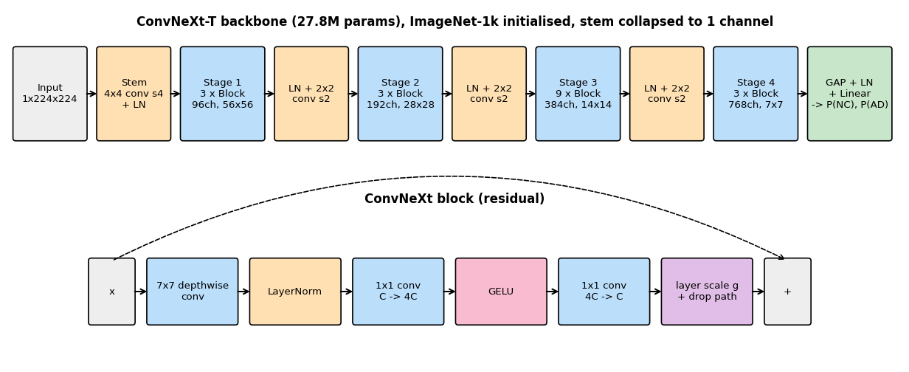
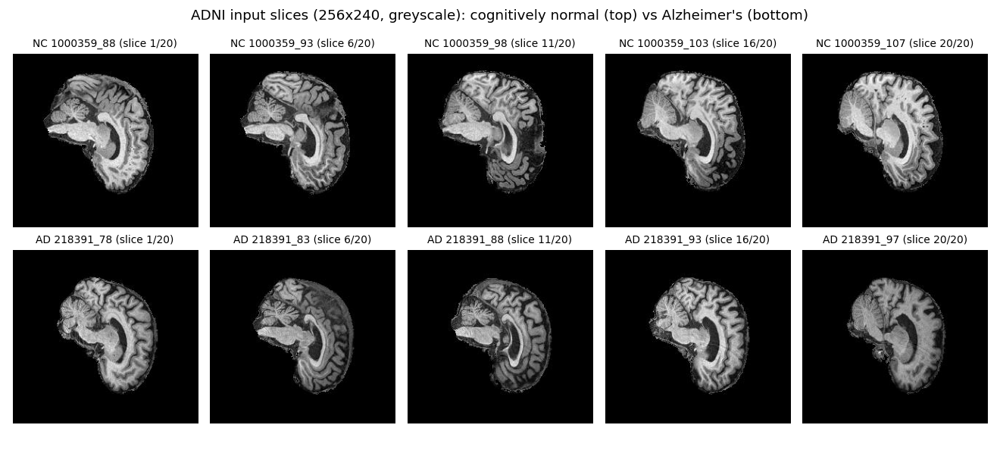
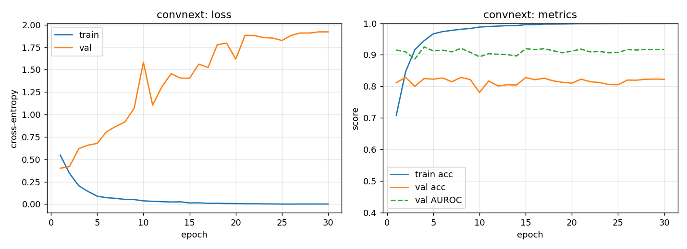
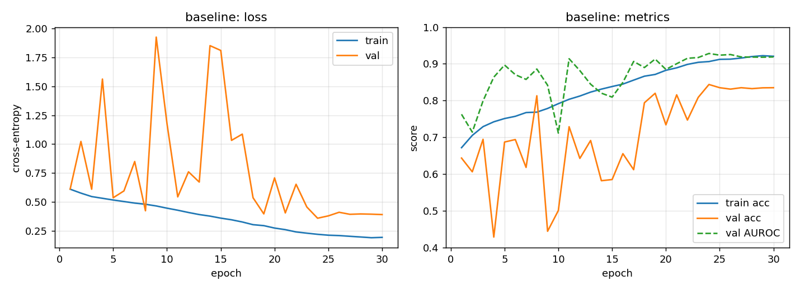
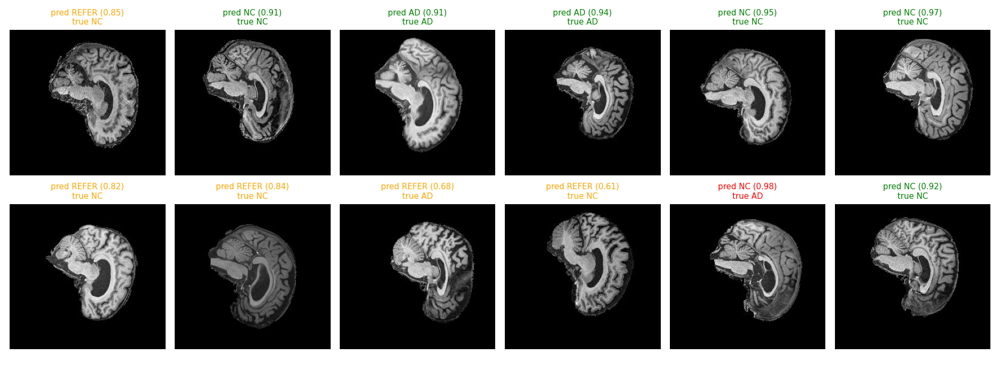
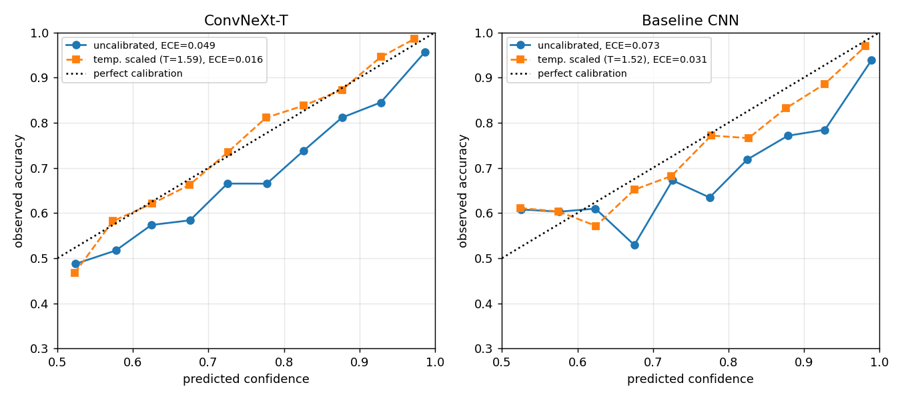
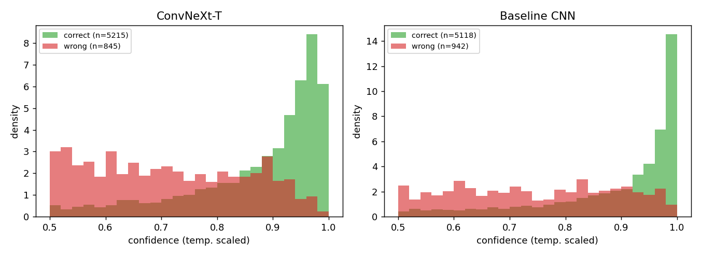
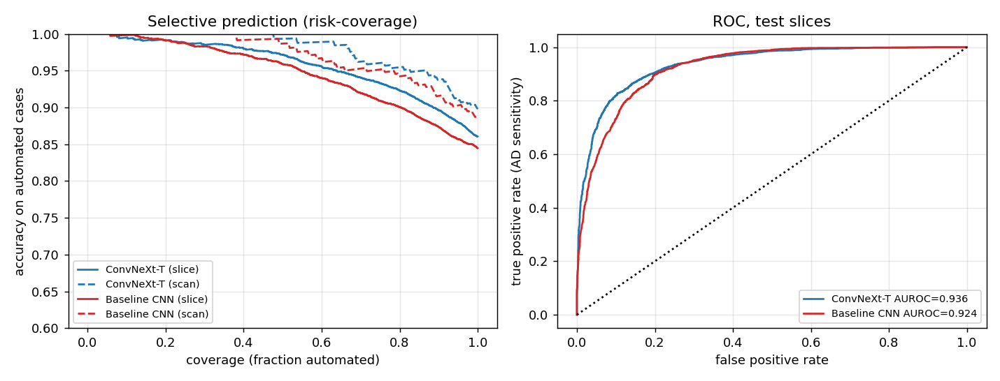
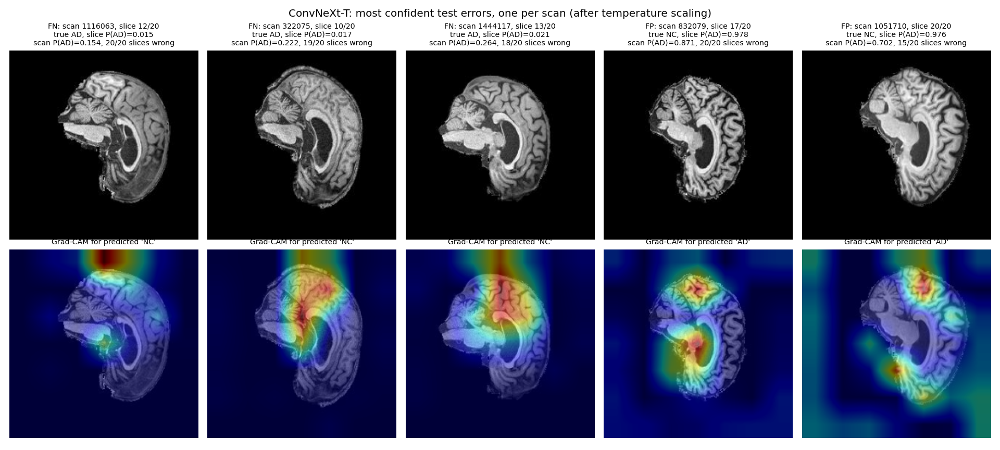
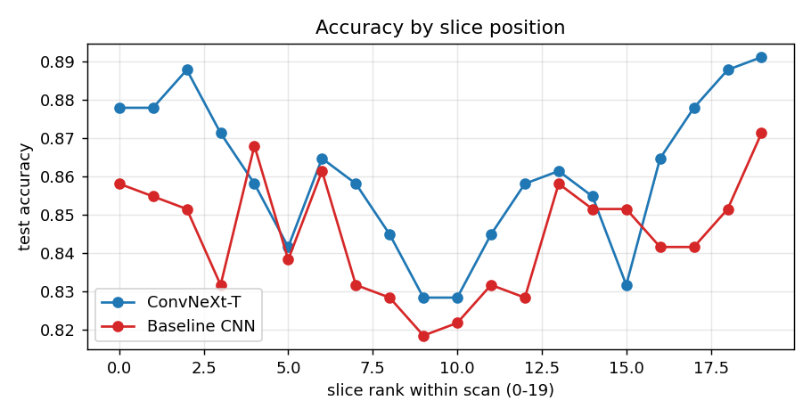

# ConvNeXt for Alzheimer's Disease Classification on ADNI Brain MRI

**Task 2.1 (Classification, Hard difficulty).** Classify T1-weighted ADNI brain MRI slices as Alzheimer's disease (**AD**) or cognitively normal (**NC**) with a ConvNeXt, reach at least 0.80 test accuracy, and investigate the *confidence and ambiguity dilemma*: does the model know when it is wrong, and can a reject rule safely route uncertain scans to a human?

**Result.** On a patient-disjoint test split (136 unseen patients), fine-tuned ConvNeXt-T reaches **0.891 slice / 0.924 scan / 0.897 patient accuracy** (AUROC 0.958). A 1.2 M-parameter baseline CNN reaches 0.857 / 0.911 / 0.860. ConvNeXt is more accurate but also *more overconfident* (temperature 5.6 vs 2.8), so its confidence is only usable after recalibration and a validation-chosen referral threshold. Requiring both models to agree before automating a scan gives **97.9% accuracy on 78% of scans**. Two findings shaped the pipeline: the official ADNI train/test folders share 216 patients, and a model evaluated that way mostly learns to recognise patients (§3.1); and a horizontal-flip augmentation that is anatomically wrong for sagittal slices cost ConvNeXt 5 points of patient accuracy (§5.4).

---

## Contents
1. [Problem and algorithm](#1-problem-and-algorithm)
2. [Feasibility review](#2-feasibility-review)
3. [Data, pre-processing and splits](#3-data-pre-processing-and-splits)
4. [Training](#4-training)
5. [Results](#5-results)
6. [Open dilemma: confidence, calibration and referral](#6-open-dilemma-confidence-calibration-and-referral)
7. [Failure case autopsy](#7-failure-case-autopsy)
8. [Recommendation to the project manager](#8-recommendation-to-the-project-manager)
9. [Usage and reproducibility](#9-usage-and-reproducibility)
10. [References](#10-references)

---

## 1. Problem and algorithm

**Problem.** Alzheimer's disease causes progressive, irreversible neurodegeneration: the hippocampus and cortex atrophy and the ventricles enlarge. Structural MRI shows these changes, but they overlap with normal ageing and with natural differences in head shape. An automated AD vs NC classifier could pre-screen scans for a radiologist. In screening, though, a confident wrong answer is the dangerous failure. A missed AD case (a false negative) that the system reports as "certain" never reaches a human, so the classifier also needs to say when it is unsure.

**Algorithm.** ConvNeXt [1] is a pure convolutional network modernised step by step from ResNet-50 towards the design of Vision Transformers:

* a **patchify stem** (non-overlapping 4×4 convolution with stride 4) instead of a 7×7 convolution and max-pool;
* a **4-stage hierarchy** (3-3-9-3 blocks for ConvNeXt-T) with separate LayerNorm + 2×2 stride-2 down-sampling layers between stages;
* **inverted-bottleneck blocks**: a large-kernel **7×7 depthwise convolution** for spatial mixing, followed by a LayerNorm and an MLP of two 1×1 convolutions (C → 4C → C) with GELU for channel mixing. This mirrors a Transformer block, where the depthwise convolution plays the role of self-attention;
* fewer activations and normalisation layers, **LayerNorm** instead of BatchNorm, **layer scale** (a learnable per-channel scale initialised to 1e-6) and **stochastic depth** for regularisation.

The model is implemented from scratch in [`modules.py`](modules.py). It is initialised from torchvision's ImageNet-1k ConvNeXt-T weights, which are remapped onto this implementation; the mapping reproduces torchvision's features exactly (max abs. difference 0.0, checked by `python modules.py`). The RGB stem filters are summed into one channel so the network takes single-channel MRI slices directly. A global-average-pooled 768-d feature goes through LayerNorm and a 2-way linear head.



**Baseline.** To find out what ConvNeXt's architecture and pretraining actually buy, it is compared with a plain **VGG-style CNN** (`BaselineCNN` in `modules.py`): four stages of two 3×3 conv-BN-ReLU layers with max-pooling (32-64-128-256 channels), global average pooling, dropout and a linear head. It has 1.2M parameters and is trained from scratch. Both models use the same data, splits, augmentation and evaluation code.

---

## 2. Feasibility review

*The one-page review presented at the midpoint check-off, reproduced as submitted. The changes made after it are listed at the end of this section.*

### 2.1 User need, scope and acceptance criteria

This prototype will classify ADNI structural brain MRI scans as Alzheimer's disease (AD) or cognitively normal (CN), supporting specialist review. The investigation is whether ConvNeXt produces more reliable confidence estimates than a simple CNN, or remains overconfident on incorrect predictions. It is a research prototype, not a diagnostic system.

Acceptance criteria:
1. target ≥0.80 patient-level test accuracy;
2. report per-class precision/recall, macro-F1 and AUROC for both models;
3. assess calibration and report error rate versus retained-case coverage under a validation-selected rejection threshold;
4. analyse five representative failures; and
5. record parameters, peak VRAM and per-patient inference latency, targeting <16 GB peak VRAM.

### 2.2 Model choice, data and experimental design

I propose a 2D ConvNeXt-Tiny architecture and a small CNN baseline using the course ADNI data at `/home/groups/comp3710/ADNI`. ConvNeXt applies convolution, residual learning, normalisation and hierarchical feature extraction. Both models will use identical patient splits, preprocessing and evaluation. Implementation and any pretrained-weight use will follow course requirements and be documented.

The supplied metadata contains three numeric labels without a diagnostic codebook, 0 being CN, 1 MDI, and 2 being AD. Subject IDs can be extracted consistently from the scan paths. I will initially select one eligible scan per subject using a fixed rule: after confirming the chosen image variant and applying predefined image-quality checks, retain the scan with the lowest numeric metadata image ID. This is a reproducible tie-breaker, not a claim that the scan is the earliest visit. All variants and slices from a subject will stay in one split, with patient separation established before slice extraction. I will average selected-slice probabilities within that single scan to produce one patient prediction.

Training-only augmentation and consistently defined anatomical slice selection will limit shortcuts. Validation data will select hyperparameters, temperature scaling and the reject threshold; the test set will remain untouched until final evaluation. Reliability diagrams and Brier scores will supplement classification metrics.

### 2.3 Preliminary feasibility evidence and next experiment

An initial audit of `meta_data_with_label.json` found 2,189 scan records covering 942 subjects; 567 subjects have multiple records. Codes 0, 1 and 2 have 810, 625 and 754 records respectively (459, 262 and 221 subjects). All records contain raw, masked and c1-c5 image paths and a label; subject IDs agree across the paths, and no subject has conflicting codes in this file. However, the diagnostic code mapping, image availability, spatial dimensions and quality remain unverified. Counts describe the complete metadata, not the final AD/CN cohort.

On 19 October 2026, a local torchvision ConvNeXt-Tiny benchmark using synthetic 224 × 224 three-channel inputs, batch size 8, FP16 mixed precision and AdamW completed 10 warm-up and 30 measured steps on an RTX 5070 Laptop GPU. Peak allocated/reserved VRAM was 0.949/1.015 GB, and mean measured step time was 0.0874 seconds, with all 30 measured optimiser updates completing. This supports local memory feasibility for the tested configuration; it excludes data loading and does not establish ADNI accuracy or Rangpur performance. The <16 GB target is a planning constraint, not a repository-specified minimum.

### 2.4 Risks, budget, fallback and recommendation

Risks include patient leakage, small cohorts, class imbalance, scanner-related shortcuts and misleading confidence. I will inspect five false-positive/false-negative or confidently wrong cases and document uncertainty in the results. A provisional 12 GPU-hour budget on GPU Lab's A10G or Rangpur will cover pilots and model comparisons, with checkpoints and time reserved for evaluation. This is a budget, not a runtime estimate.

If GPU memory is insufficient, I will reduce batch size and use gradient accumulation to retain a larger effective batch size. If training time exceeds the budget, I will reduce the shared slice count for both models while retaining patient separation. With fixed-size batches, reducing the total slice count mainly reduces training time rather than peak GPU memory. The final recommendation will weigh accuracy, calibration, coverage and compute cost, specifying which cases require specialist review; model confidence alone will not establish clinical safety.

*Reference:* [1] Liu et al. (2022), *A ConvNet for the 2020s*, CVPR. https://github.com/facebookresearch/ConvNeXt

### 2.5 Changes since the feasibility review

| Planned | Implemented | Reason |
|---|---|---|
| One scan per patient (lowest image ID) | **All scans** of each patient, kept in the same split, with patient- and class-balanced sampling | The provided AD_NC slice folders contain 1,526 scans from 680 patients. Using all of them gives ~2.2× more training data while keeping the patient-separation guarantee; balanced sampling stops patients with many visits from dominating (see §3). |
| Patient split built from the metadata | Same, but the official `train/` / `test/` folders were **pooled and re-split** by patient | The audit found that the official folders share 216 patients (§3.1). |
| Average slices of the single selected scan | Slice-, scan- and patient-level metrics are all reported; patient level averages every slice of every scan of that patient | Matches acceptance criterion 1 while keeping finer-grained results. |
| Slice selection | The 20 slices already supplied for each scan are used as given | The pre-processed release fixes the slices per scan; slice numbers are not aligned across scans, so no further anatomical selection was possible. |
| FP16 mixed precision | bf16 autocast | Same speed on the RTX 5070, with no loss scaling needed. |
| "Training-only augmentation" (unspecified) | Rotation, scale, shift and intensity jitter; **no flip** | A horizontal flip was used at first, but on sagittal slices it swaps anterior and posterior. The ablation in §5.4 measured its cost. |

---

## 3. Data, pre-processing and splits

**Dataset.** The pre-processed ADNI release used in COMP3710 (`AD_NC/{train,test}/{AD,NC}/<scan>_<slice>.jpeg`): 1,526 T1 MRI scans, each supplied as 20 consecutive **sagittal** slices (256×240, greyscale; a side view of one hemisphere). The number in each file name is the ADNI **image (scan) ID**, not a patient ID. `meta_data_with_label.json` maps every scan to its patient (e.g. `068_S_0473`). The 1,526 scans come from **680 patients**: 221 AD patients with 743 scans (≈3.4 visits each) and 459 NC patients with 783 scans (≈1.7 each). No patient has scans under both labels. Slice numbers are not aligned across scans (each scan's 20 slices start at a different index), so position analyses use the slice's *rank* within its scan.



### 3.1 Leakage audit: why the official split was not used

The first full ConvNeXt run used the official `test/` folder as the test set and split `train/` into train/validation by file-name ID. It reached 0.97 validation accuracy but only **0.748** test accuracy. Mapping scans to patients explained the gap:

* the validation split was really a *scan*-level split, so other visits of the same patients sat in both train and validation;
* the official `train/` and `test/` folders **share 216 patients** (5,560 of the 9,000 test slices).

Breaking that test result down by whether the patient had been seen during training shows what the model had learned:

| Official test patients | Patients | Slices | Accuracy | AD recall | NC recall |
|---|---|---|---|---|---|
| also in training (other visits) | 216 | 5,560 | 0.973 | 0.958 | 0.983 |
| **never seen** | 115 | 3,440 | **0.385** | **0.141** | 0.933 |

The network had largely learned to **recognise individual brains**, not Alzheimer's. AD patients appear many times in training (≈3.4 scans each), so "familiar anatomy" became a proxy for AD. On new AD patients it predicted NC 86% of the time, which is the most dangerous failure for a screening tool, and the leaky validation set would have hidden it. Everything below uses the patient-disjoint split instead.

### 3.2 Patient-disjoint splits ([`dataset.py`](dataset.py))

Both official folders are pooled, and **patients** (not scans or slices) are shuffled per class with a fixed seed and assigned 70 / 10 / 20 % to train / validation / test. Every slice of every scan of a patient lands in exactly one split. `python dataset.py` asserts that the three patient sets are disjoint.

| Split | Patients | Scans | Slices | AD slice fraction |
|---|---|---|---|---|
| Train | 476 | 1,068 | 21,360 | 0.478 |
| Validation | 68 | 155 | 3,100 | 0.581 |
| Test | 136 | 303 | 6,060 | 0.469 |

* The 20 % test share leaves 136 unseen patients (44 AD, 92 NC). That is enough for usable patient-level estimates while keeping most patients for training.
* Validation is used for model selection (best epoch), for fitting the calibration temperature and for choosing the referral threshold. The test split is never used to pick anything.
* **Balanced sampling.** Each training epoch draws 21,360 slices *with replacement*, with each slice weighted by 1 / (slices of its patient × patients in its class). Every patient, and both classes, then contribute equally, which removes the "many visits ⇒ AD" shortcut found above.

### 3.3 Pre-processing and augmentation

* All slices are decoded once into a cached `uint8` array (`cache/`, git-ignored), so training has no per-epoch disk I/O.
* Intensities are scaled to [0, 1] and standardised with the mean/std of the *training* patients (0.116 / 0.226). The statistics are stored in the checkpoint and reused at inference.
* Slices are resized to 224×224 (bilinear) to match ConvNeXt's pretraining resolution.
* **Augmentation** (training only, applied per sample on the GPU with `affine_grid` / `grid_sample`): rotation ±10°, scale 0.9–1.1, translation ±6%, and brightness/contrast jitter of ±10%. These reflect plausible variation in head position and scanner intensity without changing anatomy. **No horizontal flip:** the slices are sagittal, so a flip would swap anterior and posterior, which never occurs in a real scan. An earlier version used one, and its cost is measured in §5.4 (`--hflip 0.5` reproduces it).

---

## 4. Training

[`train.py`](train.py) trains either model with identical data handling:

| Setting | ConvNeXt-T | Baseline CNN |
|---|---|---|
| Initialisation | ImageNet-1k (torchvision), stem → 1 channel | random (PyTorch default Kaiming-uniform) |
| Optimiser | AdamW, lr 1e-4, weight decay 0.05 | AdamW, lr 1e-3, weight decay 1e-4 |
| Schedule | 1 epoch linear warm-up, cosine decay to 0 | same |
| Epochs / batch | 30 / 64 | 30 / 64 |
| Regularisation | stochastic depth 0.2, augmentation (no flip) | dropout 0.3, BatchNorm, augmentation (no flip) |
| Loss | cross-entropy (no label smoothing, so calibration is measured on the raw objective) | same |
| Precision | bf16 autocast, channels-last, grad-clip 1.0 | same |
| Model selection | best validation accuracy | same |
| Best epoch / training time | 16 / 27.8 min | 30 / 13.8 min |

Weight decay is not applied to norms, biases or layer-scale parameters. Each run writes per-epoch losses and metrics to `results/<tag>_history.json` and plots them to `results/<tag>_curves.png`.

---

## 5. Results

All numbers are on the **patient-disjoint test split** (136 patients the models never saw: 303 scans, 6,060 slices), using the checkpoint with the best validation accuracy and **no horizontal flip** (§5.4 explains why). Each configuration is a single training run (seed 42). Scan- and patient-level results average the temperature-scaled slice probabilities (§6.1).

### 5.1 Training curves

| ConvNeXt-T (best epoch 16) | Baseline CNN (best epoch 30) |
|---|---|
|  |  |

* **ConvNeXt** is already at 0.825 validation accuracy after one epoch and never leaves a narrow 0.825–0.861 band. Training accuracy goes to 1.000, and validation loss rises 4.5× (0.36 → 1.64). The pretrained network adapts within a few epochs; after that it memorises the training patients and grows **more confident without getting more accurate**. The "best" epoch (16) wins by a 1–2 point spike within that band, so the checkpoint choice is partly luck.
* **The baseline** learns slowly from scratch, and its validation accuracy swings between 0.52 and 0.84 in the high-learning-rate phase. It stabilises as the cosine schedule decays and is still improving at epoch 30, so it would probably benefit from a longer schedule.

### 5.2 Classification performance

**Slice level (6,060 slices).**

| Model | Accuracy | Macro-F1 | AUROC | AD sensitivity | NC specificity |
|---|---|---|---|---|---|
| **ConvNeXt-T** | **0.891** | **0.891** | **0.958** | **0.887** | **0.895** |
| Baseline CNN | 0.857 | 0.857 | 0.936 | 0.875 | 0.841 |

| Model | Class | Precision | Recall | F1 |
|---|---|---|---|---|
| ConvNeXt-T | NC | 0.900 | 0.895 | 0.898 |
| ConvNeXt-T | AD | 0.882 | 0.887 | 0.885 |
| Baseline CNN | NC | 0.884 | 0.841 | 0.862 |
| Baseline CNN | AD | 0.829 | 0.875 | 0.852 |

**Scan and patient level.**

| Model | Scan acc. (303) | Scan AUROC | Scan sens. / spec. | Patient acc. (136) | Patient AUROC | Patient sens. / spec. |
|---|---|---|---|---|---|---|
| **ConvNeXt-T** | **0.924** | **0.978** | 0.923 / **0.926** | **0.897** | **0.957** | 0.864 / **0.913** |
| Baseline CNN | 0.911 | 0.977 | **0.958** / 0.870 | 0.860 | 0.953 | **0.886** / 0.848 |

Scan confusion matrices `[[TN, FP], [FN, TP]]`: ConvNeXt `[[149, 12], [11, 131]]`, baseline `[[140, 21], [6, 136]]`. Averaging the *uncalibrated* probabilities gives ConvNeXt 0.931 scan / 0.912 patient accuracy, as `train.py` prints. The calibrated pipeline is reported here because that is what the referral rule uses.

**Acceptance criterion 1 (≥ 0.80 patient-level test accuracy) is met:** ConvNeXt reaches 0.897, and 0.891 / 0.924 at slice / scan level. ConvNeXt beats the baseline by 3.4 points at slice level, 1.3 at scan level and 3.7 at patient level, with higher AUROC throughout. The models lean in different directions: the baseline catches slightly more AD scans (sensitivity 0.958 vs 0.923) but raises almost twice as many false alarms (21 vs 12 NC scans flagged).

**Example usage and output.** Running `predict.py` on the test split prints the metrics and the effect of the referral rule (this is the slice-level threshold stored by `evaluate.py`):

```text
$ python predict.py
Loaded convnext from epoch 16 (val acc 0.8606); T=5.609, refer below confidence 0.889

Test slices: 6060
  accuracy     0.8914
  macro_f1     0.8910
  auroc        0.9579
  sensitivity  0.8873
  specificity  0.8950
  ece          0.0454
  NC: precision 0.9001 recall 0.8950 F1 0.8975
  AD: precision 0.8817 recall 0.8873 F1 0.8845
  confusion [[TN, FP], [FN, TP]] = [[2882, 338], [320, 2520]]
Scan-level accuracy (mean of 20 slices): 0.9241 over 303 scans
Reject option @ 0.889: automated 74.1% of slices with accuracy 0.9608; referred 1569
Saved visualisation to results/predict_examples.png
```

Individual slices can be classified too. Here, two confident slices are automated, and two borderline ones are referred to a human:

```text
$ python predict.py --images .../AD/240954_90.jpeg .../NC/1001329_110.jpeg .../NC/1020325_105.jpeg .../AD/250168_103.jpeg
        240954_90.jpeg: P(AD)=0.936 -> AD (confidence 0.936)
      1001329_110.jpeg: P(AD)=0.080 -> NC (confidence 0.920)
      1020325_105.jpeg: P(AD)=0.663 -> REFER (confidence 0.663)
       250168_103.jpeg: P(AD)=0.744 -> REFER (confidence 0.744)
```

The saved visualisation (green = correct, red = wrong, orange = referred):



### 5.3 Computational cost

Measured on an RTX 5070 Laptop GPU (8 GB) with bf16 autocast. Latency is the median of 50 timed forward passes after warm-up. "Per scan" is one batch of the scan's 20 slices.

| | ConvNeXt-T | Baseline CNN | Ratio |
|---|---|---|---|
| Parameters | 27.82 M | 1.17 M | 24× |
| Training time (30 epochs) | 27.8 min | 13.8 min | 2.0× |
| Time to selected epoch | ≈ 15 min (epoch 16) | 13.8 min (epoch 30) | 1.1× |
| Peak training VRAM (batch 64) | 4.26 GB | 2.02 GB | 2.1× |
| Inference latency, 1 slice | 4.8 ms | 0.9 ms | 5.3× |
| Inference latency, per scan (20 slices) | 14.4 ms | 8.2 ms | 1.8× |
| Throughput (batch 64) | 1,310 slices/s | 2,242 slices/s | 0.58× |
| Peak inference VRAM (1 / 20 / 64 slices) | 177 / 256 / 587 MB | 17 / 251 / 789 MB | — |

Both models are far inside the feasibility review's < 16 GB budget, and both read a full scan in well under 20 ms. The baseline is *not* cheaper in memory at large batch sizes: its first stage runs 3×3 convolutions at full 224×224 resolution, while ConvNeXt's 4×4 stride-4 stem downsamples immediately. The practical costs of ConvNeXt are a 24× larger model, which needs the ImageNet download, 2× slower throughput and 2× the training memory. None of these matter for a screening workload measured in scans per day.

### 5.4 Ablation: the horizontal-flip augmentation

The first version of the pipeline flipped slices horizontally with p = 0.5, assuming axial slices where left-right symmetry makes a flip harmless. The slices are in fact **sagittal** (side view of one hemisphere, Fig. §3), so a horizontal flip swaps **anterior and posterior**: the cerebellum and frontal lobe trade places, producing brains that never occur in a real scan. Both models were retrained with the flip removed, changing nothing else (`--hflip 0` vs `--hflip 0.5`):

| | ConvNeXt-T, flip → **no flip** | Baseline CNN, flip → **no flip** |
|---|---|---|
| Best validation accuracy (epoch) | 0.829 (2) → **0.861** (16) | 0.844 (24) → 0.838 (30) |
| Test accuracy, slice | 0.861 → **0.891** | 0.845 → **0.857** |
| Test accuracy, scan | 0.898 → **0.924** | 0.888 → **0.911** |
| Test accuracy, patient | 0.846 → **0.897** | 0.846 → **0.860** |
| Test AUROC, slice | 0.936 → **0.958** | 0.924 → **0.936** |
| Fitted temperature *T* | 1.59 → 5.61 | 1.52 → 2.78 |
| ECE after temperature scaling | **0.016** → 0.045 | 0.031 → **0.016** |
| Wrong slices with confidence > 0.9 | **91** → 140 | 175 → **110** |

* **Removing the anatomically impossible flip improves both models on every accuracy measure.** It improves ConvNeXt much more (+5.1 points at patient level, beyond the ≈ ±3-point sampling noise of a 136-patient test set). With the flip, the two models were *tied* at patient level (0.846). Without it, ConvNeXt leads clearly.
* The flip was removed on anatomical grounds, not by picking the better test score. ConvNeXt's validation accuracy agreed (+3.2 points); the baseline's did not change meaningfully (−0.6).
* **The improvement came with a calibration cost for ConvNeXt.** Its best validation epoch moved from 2 to 16, and the longer it trains, the more overconfident it becomes (§5.1), so its temperature jumped from 1.6 to 5.6. §6 looks at what this means for referral. The earlier flip-trained results are kept in `results/flip/summary.json` and `results/*_flip_*`.

---

## 6. Open dilemma: confidence, calibration and referral

The question is whether the model's confidence can be trusted to decide which cases are safe to automate.

### 6.1 Are the models overconfident?



| | ConvNeXt-T | Baseline CNN |
|---|---|---|
| ECE, raw (15 bins) | 0.099 | 0.093 |
| ECE after temperature scaling | 0.045 | **0.016** |
| Fitted temperature *T* (validation) | 5.61 | 2.78 |
| Brier score raw → scaled | 0.102 → **0.082** | 0.115 → 0.101 |
| NLL raw → scaled | 0.883 → **0.281** | 0.490 → 0.325 |
| Mean confidence when correct / wrong | 0.902 / 0.778 | 0.881 / 0.713 |
| Wrong slices with confidence > 0.9 | 140 | **110** |
| **Confidence AUROC** (correct vs wrong), slice / scan | **0.845** / 0.884 | 0.820 / **0.892** |

* **Both models are badly overconfident out of the box, and ConvNeXt is the worse of the two.** Its raw NLL (0.883) is almost twice the baseline's. It needs a temperature of 5.6 (the baseline 2.8), i.e. its logits are more than five times too large. In the raw reliability curve, ConvNeXt slices predicted with ~0.88 confidence are right only ~50% of the time.
* **Temperature scaling fixes the baseline almost perfectly, but not ConvNeXt.** One scalar fitted on validation brings the baseline to ECE 0.016, sitting on the diagonal. ConvNeXt improves to 0.045 but stays overconfident between 0.65 and 0.9 confidence: a single temperature can rescale its confidences but cannot fix the *shape* of its miscalibration. Its scaled confidences also bunch into a narrow band (none above ≈ 0.96, see histogram), with many errors sitting just below the correct cases.
* **Confidence still carries real information about errors.** The *confidence AUROC* is the probability that a random correct prediction is more confident than a random wrong one (0.5 = useless). It is 0.82–0.89 for both models: neither is "stubbornly overconfident" in the sense of being *equally* sure of right and wrong answers. ConvNeXt ranks slice errors slightly better; the baseline ranks scan errors slightly better.
* **Why ConvNeXt ends up worse calibrated:** checkpoints are selected by validation *accuracy*. ConvNeXt's accuracy is flat while its loss rises 4.5× (§5.1), so selecting epoch 16 instead of epoch 2 bought +3 points of accuracy at the price of a much more overconfident network. The flip-trained ConvNeXt, selected at epoch 2, needed only T = 1.6 and reached ECE 0.016 (§5.4).



### 6.2 Selective prediction: automate the confident, refer the rest



The risk-coverage curves sort cases by confidence and plot the accuracy of the automated fraction. At slice level, ConvNeXt's curve lies above the baseline's at every coverage. At scan level (dashed) the two are close, with ConvNeXt ahead above ≈ 80% coverage.

**Referral rule chosen on validation, tested once on test.** On validation, find the *lowest* confidence threshold whose automated cases reach 95% accuracy, then apply it unchanged to the test split:

| Level | Model | Threshold | Test coverage | Test accuracy on automated | Referred | Missed AD not referred | False alarms not referred |
|---|---|---|---|---|---|---|---|
| Slice | ConvNeXt-T | 0.889 | 74.1% | **0.961** ✓ | 1,569 slices | 79 slices | — |
| Slice | Baseline | 0.877 | 58.7% | **0.960** ✓ | 2,505 slices | 65 slices | — |
| Scan | ConvNeXt-T | 0.744 | 82.2% | **0.960** ✓ | 54 scans | 6 | 4 |
| Scan | Baseline | 0.615 | 89.1% | 0.948 ✗ | 33 scans | 4 | 10 |

* **At slice level both thresholds transfer**, but ConvNeXt automates **74% of slices vs 59%** for the same accuracy. That is its clearest operational advantage.
* **At scan level ConvNeXt's threshold holds (0.960); the baseline's falls just short (0.948).** The baseline automates more scans, but 10 of its 14 unreferred errors are false alarms.
* Both models let a handful of AD scans through unreferred (6 and 4 of 142). Neither confidence threshold alone is safe enough to remove the human from AD screening.

### 6.3 Do the two models fail on the same scans?

Only partly. ConvNeXt gets 23 scans wrong and the baseline 27. **The baseline is right on 10 of ConvNeXt's 23 errors, and ConvNeXt is right on 14 of the baseline's 27.** Averaging their probabilities does not help (0.921 scan accuracy vs 0.924 for ConvNeXt alone), but treating *disagreement* as a reason to refer does:

| Scan-level rule (thresholds from validation) | Automated | Accuracy on automated | Missed AD not referred | False alarms not referred |
|---|---|---|---|---|
| ConvNeXt alone | 82.2% | 0.960 | 6 | 4 |
| Baseline alone | 89.1% | 0.948 | 4 | 10 |
| **Both models agree *and* both clear their threshold** | **77.6%** | **0.979** | **2** | **3** |

The agreement rule halves the number of unreferred errors compared with ConvNeXt alone (5 vs 10) and cuts unreferred missed AD scans from 6 to 2, for 4.6 points less coverage and +8 ms per scan to run the baseline. The five scans it still gets wrong are cases where *both* networks are confidently wrong. Three of them are analysed in §7.

---

## 7. Failure case autopsy

The five most confident ConvNeXt errors, after temperature scaling and at most one slice per scan, with Grad-CAM [3] maps from the last stage:



| # | Scan (patient, date) | Truth | Slice P(AD) | Scan P(AD) | Slices wrong | Baseline scan P(AD) | Diagnosis |
|---|---|---|---|---|---|---|---|
| 1 | 247513 (099_S_4124, 2011-07) | AD | 0.051 | 0.24 | 17/20 | **0.53** | ConvNeXt confidently calls NC despite a visibly enlarged ventricle. Attention is on superior parietal cortex and the temporal pole rather than the ventricle or medial temporal lobe. The baseline narrowly gets it right, so the agreement rule refers it. |
| 2 | 1116063 (153_S_6665, 2019-01) | AD | 0.055 | 0.16 | 19/20 | 0.35 | Missed by **every** model trained in this project, including the flip-trained ConvNeXt (0.15). Relatively preserved anatomy; part of the attention falls *above the brain*, in the black background. Both models agree and are confident, so the agreement rule **automates this miss**. |
| 3 | 316747 (036_S_4820, 2012-07) | AD | 0.062 | 0.35 | 14/20 | **0.71** | The patient's **earliest** of five test scans. ConvNeXt's P(AD) rises across later visits: 0.75 (2012-10), 0.80 and 0.53 (2013-02), 0.93 (2013-09). This is consistent with atrophy that was still mild at the first visit, while the AD label is assigned per patient. Attention on cerebellum/brainstem, regions not associated with AD. The baseline disagrees, so it is referred. |
| 4 | 1075136 (002_S_4225, 2018-11) | NC | 0.948 | 0.79 | 18/20 | 0.76 | Cognitively normal brain with enlarged ventricles and widened sulci (age-related atrophy). All models agree on AD, including the flip-trained ConvNeXt (0.77): the anatomy itself is ambiguous. **Automated false alarm.** |
| 5 | 1149150 (029_S_4290, 2019-04) | NC | 0.947 | 0.91 | 20/20 | 0.63 | Same patient's scan 17 days later (1133905) also gets 0.81 from ConvNeXt, so the error is consistent and patient-driven. The baseline gives 0.63 and 0.43 to the two near-identical scans, i.e. it is unsure, not consistent. Attention on superior parietal cortex, with a streak above the brain. **Automated false alarm** (baseline 0.63 just clears its 0.615 threshold). |

**Failure modes.**
1. **Errors are scan-wide, not slice noise.** Every autopsied scan is wrong on 14–20 of its 20 slices, so averaging slices cannot rescue them. The mistakes come from the patient's anatomy, not from one bad slice.
2. **Early or mild AD → confident NC (cases 1–3).** These are the dangerous misses. Case 3 suggests that some are *label* problems as much as model problems: ADNI labels are per patient, so an early visit of an AD patient may not yet show AD-level atrophy.
3. **Atrophic but cognitively normal brains → AD (cases 4–5).** Ventricular enlargement and sulcal widening also happen in normal ageing. A structural-MRI-only model cannot separate them without age or clinical information, and all models make the same call.
4. **Attention on irrelevant regions (cases 2, 3, 5).** Background above the brain and the cerebellum appear in the Grad-CAM maps. This is a sign of shortcut features. Cropping to the brain mask (the metadata lists `masked` images) is the natural next experiment.
5. **ConvNeXt is more confident in its errors than the baseline** on four of the five cases (1, 2, 3, 5), consistent with its higher temperature (§6.1). That is exactly why the cheaper model is useful as a second opinion.

Accuracy by position within the scan is fairly flat (ConvNeXt 0.86–0.92 across the 20 slice ranks; baseline 0.82–0.89, dipping at ranks 8–11), so no slice position is systematically unusable:



---

## 8. Recommendation to the project manager

**Deploy ConvNeXt as a scan-level triage assistant behind a calibration and referral layer, with the baseline CNN as a second opinion. Do not deploy either network's raw confidence.**

1. **Decide per scan, not per slice** (average the 20 slices): +3.3 points for ConvNeXt, +5.4 for the baseline. A scan is also the unit a radiologist reads.
2. **Always recalibrate.** ConvNeXt's raw probabilities are more than 5× too extreme (T = 5.6), and the temperature must be refitted on validation every time the model is retrained. Even after scaling it is overconfident at mid-range confidence, so **use the empirical, validation-chosen threshold** rather than trusting the probability values themselves.
3. **Operating point for maximum safety: the agreement rule.** Automate a scan only if ConvNeXt and the baseline agree *and* both clear their validation thresholds (0.744 and 0.615 after temperature scaling); refer everything else. On 136 unseen patients this automated **77.6% of scans at 97.9% accuracy**, with 2 missed AD scans and 3 false alarms reaching no human, out of 303 scans.
4. **Operating point if only one model can run: ConvNeXt with its 0.744 scan threshold** (82.2% automated at 96.0%). It is the only single model whose scan threshold held on unseen patients.
5. **Does ConvNeXt justify its cost?**
   * **On accuracy, yes:** +3.4 points slice, +3.7 points patient and higher AUROC than a 1.2 M-parameter CNN. At slice level it can automate 74% vs 59% of slices at the same 96% accuracy. The extra cost (≈ 6 ms per scan, 2 GB more training VRAM) is negligible.
   * **On trustworthy confidence, no on its own:** it is *worse* calibrated than the baseline after scaling (ECE 0.045 vs 0.016) and makes more high-confidence errors (140 vs 110 slices above 0.9).
   * **The added complexity pays off only inside the calibration + referral layer, and works best paired with the cheap model.**
6. **Change how checkpoints are selected.** Choosing the epoch by validation accuracy alone silently picked a strongly overconfident model (epoch 16 vs 2, T 5.6 vs 1.6). Selecting by validation NLL or ECE, or stopping within the first few epochs, should trade a little accuracy for much better confidence. This is the next experiment.
7. **What still needs a specialist:** early-visit or mild-atrophy AD (cases 1–3), older cognitively normal patients with marked atrophy (cases 4–5), and **every scan where the two models disagree**. Even with the agreement rule, scans on which both networks are confidently wrong (such as case 2) are not caught, so a human audit sample of automated "NC" scans is advisable.

**Limitations.**
* **Single run per configuration, no seed variance.**
* **Small test set:** 136 test patients, so about ±3 points of patient accuracy is sampling noise.
* **Limited inputs:** 2D slices only, and no age or clinical covariates.
* **Labels are per patient** and assumed constant across visits (case 3 suggests this adds label noise).
* **Noisy model selection:** best-epoch selection relies on 68 validation patients, and ConvNeXt's validation accuracy varies only 0.825–0.861 across epochs.
* **Results depend on the split.** The leakage audit (§3.1) shows how strongly reported accuracy depends on it, so results on the official ADNI split are not comparable to these.

---

## 9. Usage and reproducibility

### Dependencies

Tested with the following versions (Windows 11, NVIDIA RTX 5070 Laptop GPU 8 GB, CUDA 12.8):

| Package | Version |
|---|---|
| Python | 3.13.7 |
| torch | 2.9.0+cu128 |
| torchvision | 0.24.0+cu128 (for ImageNet weights only) |
| numpy | 2.2.6 |
| scikit-learn | 1.7.2 (metrics) |
| matplotlib | 3.10.7 |
| Pillow | 11.3.0 |

```bash
pip install torch==2.9.0 torchvision==0.24.0 --index-url https://download.pytorch.org/whl/cu128
```

```bash
pip install numpy==2.2.6 scikit-learn==1.7.2 matplotlib==3.10.7 pillow==11.3.0
```

### Files

| File | Purpose |
|---|---|
| [`dataset.py`](dataset.py) | loading/caching, patient-level split, balanced sampling, normalisation, GPU augmentation |
| [`modules.py`](modules.py) | ConvNeXt (from scratch) + ImageNet weight mapping, baseline CNN |
| [`train.py`](train.py) | training, validation, test evaluation, checkpointing, curves |
| [`predict.py`](predict.py) | example inference with the saved model + referral rule + visualisation |
| [`evaluate.py`](evaluate.py) | dilemma analysis: calibration, risk-coverage, profiling, Grad-CAM failure autopsy |
| [`utils.py`](utils.py) | metrics, ECE/Brier, temperature scaling, thresholds, scan/patient aggregation |

### Running

Set the data location (defaults to `D:\ADNI\AD_NC`; on Rangpur use `/home/groups/comp3710/ADNI/AD_NC`):

```bash
export ADNI_ROOT=/home/groups/comp3710/ADNI/AD_NC
```

```bash
python train.py --arch convnext --epochs 30
```

```bash
python train.py --arch baseline --epochs 30 --lr 1e-3 --weight-decay 1e-4
```

```bash
python evaluate.py
```

```bash
python predict.py
```

`predict.py` defaults to `checkpoints/convnext_best.pt` (use `--ckpt checkpoints/baseline_best.pt` for the baseline) and can also classify individual slices:

```bash
python predict.py --images /path/to/AD_NC/train/AD/240954_90.jpeg /path/to/AD_NC/train/NC/1020325_105.jpeg
```

To reproduce the flip ablation (§5.4), train with the flip enabled under separate tags and evaluate them into their own folder:

```bash
python train.py --arch convnext --epochs 30 --hflip 0.5 --tag convnext_flip
```

```bash
python train.py --arch baseline --epochs 30 --lr 1e-3 --weight-decay 1e-4 --hflip 0.5 --tag baseline_flip
```

```bash
python evaluate.py --tags convnext_flip baseline_flip --out-dir results/flip
```

**Reproducibility.** Seeds are fixed (`--seed 42`) for Python, NumPy and PyTorch. The patient split depends only on the seed and `meta_data_with_label.json`, and `predict.py` rebuilds it from the parameters stored in the checkpoint. cuDNN autotuning and bf16 arithmetic make runs non-bit-exact. Each configuration was trained once, so run-to-run variance has not been measured. Note that ConvNeXt's validation accuracy varies only between 0.825 and 0.861 across epochs, so a different seed may select a different epoch. Checkpoints and cached arrays are git-ignored. Only code, metrics (`results/*.json`) and figures are committed.

---

## 10. References

1. Z. Liu, H. Mao, C.-Y. Wu, C. Feichtenhofer, T. Darrell, S. Xie. *A ConvNet for the 2020s.* CVPR 2022. https://arxiv.org/abs/2201.03545
2. C. Guo, G. Pleiss, Y. Sun, K. Q. Weinberger. *On Calibration of Modern Neural Networks.* ICML 2017. (temperature scaling, ECE)
3. R. R. Selvaraju et al. *Grad-CAM: Visual Explanations from Deep Networks via Gradient-based Localization.* ICCV 2017.
4. Y. Geifman, R. El-Yaniv. *Selective Classification for Deep Neural Networks.* NeurIPS 2017. (risk-coverage)
5. Alzheimer's Disease Neuroimaging Initiative (ADNI). https://adni.loni.usc.edu
6. torchvision ConvNeXt implementation and ImageNet-1k weights (used only as a weight source; architecture re-implemented). https://pytorch.org/vision/stable/models/convnext.html
