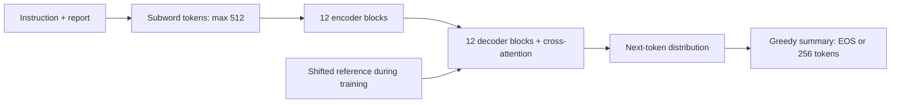
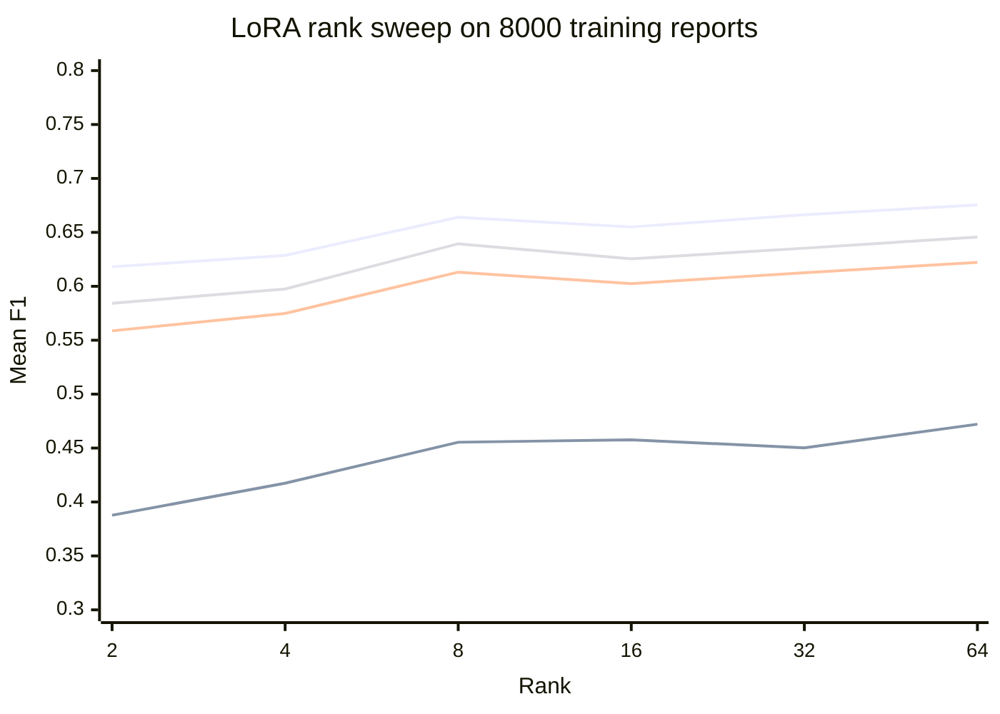
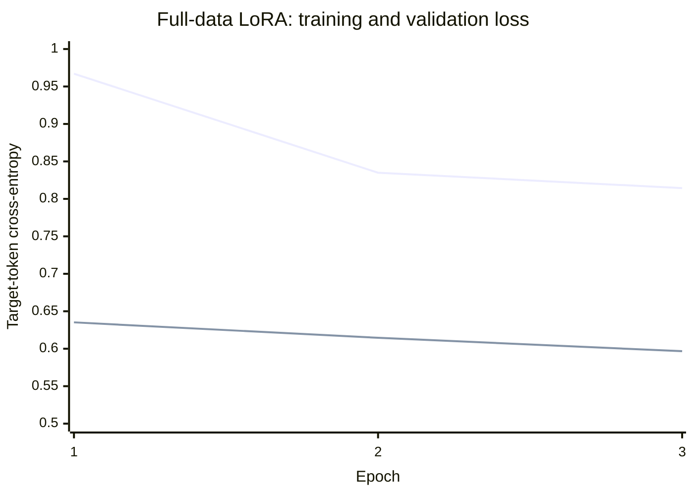

FLAN-T5 Radiology Summarisation
===============================

- Author: Phan Anh Minh Le · COMP3710/COMP7710, UQ · Section 2.6 (Hard).
- Scope: text-only radiology-to-lay-summary generation using google/flan-t5-base.

Introduction
------------

- Compare zero-shot inference, low-rank adaptation (LoRA), and full fine-tuning on BioLaySumm
  LaymanRRG.
- Test whether improved ROUGE also preserves findings, negation, uncertainty, anatomical location,
  and primary conclusions.
- Target sixth-grade English through prompting; reading level and patient comprehension remain
  unmeasured.
- Full-data adaptations use 108,197 filtered reports. Full tuning achieves the highest observed
  matched ROUGE; source-based reviews still expose unsupported assertions and omissions.
- Results support a clinician-reviewed research prototype. Images are not inputs; clinical safety is
  unestablished.

Working principles
------------------

| Component                         | Configuration                                                     |
| --------------------------------- | ----------------------------------------------------------------- |
| Backbone                          | T5ForConditionalGeneration; 247,577,856 base parameters           |
| Encoder / decoder                 | 12 bidirectional / 12 causal blocks with cross-attention          |
| Hidden width / heads / head width | 768 / 12 / 64                                                     |
| Feed-forward                      | Gated GELU, intermediate width 2,048                              |
| Vocabulary                        | 32,128 model rows; 32,100 tokenizer entries                       |
| Embeddings / output head          | Shared encoder/decoder input embeddings; untied output projection |
| Input / output budget             | 512 prompted input tokens / 256 new tokens                        |
| PAD / EOS / decoder start         | 0 / 1 / 0                                                         |



- T5 → FLAN: pretrained text-to-text Transformer, subsequently instruction-tuned; this project
  adapts released weights rather than pretraining a model.
- Teacher forcing: minimise mean negative log likelihood over non-padding reference tokens. Shift
  decoder inputs right; replace padded labels with -100; preserve source attention masks. Prompt
  tokens do not enter target loss.
- Inference: model.eval(), torch.inference_mode(), do_sample=False, num_beams=1; FP32 generation.
  Evaluation disables dropout but does not itself change requires_grad.
- LoRA: freeze the base; learn ΔW=(alpha/r)BA on 72 attention q,v matrices, each 768 × 768. Adapter
  count is 72 × r × (768+768) = 110,592 × r.
- Rank 64: 7,077,888 updated parameters; 254,655,744 resident parameters including the base. Full
  tuning updates all 247,577,856 backbone parameters.
- Memory: FP32 base weights occupy approximately 0.922 GiB before activations, caches, gradients,
  and optimiser states. Smaller adapters do not guarantee lower peak VRAM.
- Fidelity: attention and masked cross-entropy impose no hard constraint on source entailment,
  conclusion retention, or uncertainty.

One-page feasibility review
---------------------------

- Consultation: author confirmed tutor check-off completion on 22 October 2026. This retrospective
  review does not reproduce the consultation document; its date and feedback are unrecorded.
- User: clinician/radiology-service reviewer preparing patient explanations. Preserve source meaning
  and recommendations without adding diagnoses or advice.
- Course concepts: attention, transfer learning, teacher forcing, masked cross-entropy,
  regularisation, parameter efficiency, and held-out evaluation.

Proposed acceptance criteria and evidence:

1. No training overlap under held-out image keys or stripped lowercase report text
   Evidence / status: 42,257 rows removed; patient independence remains unverified.

2. Finite masked loss, correct trainable counts, frozen LoRA base, checkpoint reload
   Evidence / status: Historical checks passed; consolidated CPU self-test checks filtering, masks,
   updates, and reload.

3. Both adaptations improve all four ROUGE metrics on matched validation examples
   Evidence / status: Met on 150 reused examples; independent generalisation untested.

4. Successful full-data job within 3 hours and 22 GiB allocated GPU memory
   Evidence / status: Historical successful runs satisfy these proposed budgets; exploratory work
   and reserved memory differ.

5. No unsupported pathology, polarity reversal, or missing primary conclusion in five cases
   Evidence / status: Not met: LoRA case 4012 and both tuned models' case 4506 fail.

- Compute feasibility: initial 20-report CPU smoke test reached ROUGE-Lsum .1391 and 47.26 tokens/s;
  later GPU runs completed both adaptations and the rank sweep.
- Risks: missing patient IDs, reused validation data, imperfect references, truncation, anatomical
  substitutions, and altered certainty.
- Next experiment: reuse checkpoints; freeze a new review set; test conclusion preservation and
  claim/negation alignment under blinded clinical review.
- Fallback: clinician-reviewed drafts with the original report accessible. Proposed thresholds are
  prototype checks, not clinical standards; page length depends on export formatting.

Data preprocessing and leakage prevention
-----------------------------------------

| Published split | Reports | References | Role                                      |
| --------------- | ------: | ---------- | ----------------------------------------- |
| Training        | 150,454 | Available  | Filter before adaptation                  |
| Validation      |  10,000 | Available  | Loss and reference-based comparison       |
| Test            |  10,537 | All blank  | Inference coverage and qualitative review |

- Dataset: [BioLaySumm
  LaymanRRG](https://huggingface.co/datasets/BioLaySumm/BioLaySumm2025-LaymanRRG-opensource-track),
  revision 6783ab38f9de28c4372799346f51d3927ae7eb9a.
- Fields: source, images_path, radiology_report, layman_report; source collections include
  BIMCV-COVID19, OpenI, and PadChest. Only report text enters the model.
- Filtering: preserve held-out splits; remove any training row matching held-out (source,
  images_path) or report.strip().lower(). Retain 108,197 training rows.
- Before filtering: train/validation share 138 unique image keys and 2,164 (source, normalised
  report) keys; train/test share three normalised report pairs. These are different-key counts, not
  removed-row counts.
- Limits: no fuzzy matching or punctuation removal; generic repeated reports may belong to different
  people. Patient separation and upstream pretraining contamination are unverified. Test labels are
  not used for filtering.
- Tokenisation: right-truncate prompted input to 512 tokens and targets to 256; dynamically pad
  training batches; mask target padding with -100. Entirely blank test targets produce no labels;
  mixed blank/nonblank supervised targets are rejected.
- Prompt:

```text
Rewrite this radiology report in plain English for a patient at a sixth-grade reading level. Preserve all findings, negations, and uncertainty. Do not add diagnoses or advice. Explain medical terms simply.
Radiology report: {report.strip()}
Plain English summary:
```

Reproduce the experiment
------------------------

Environment and downloads
-------------------------

- Run from this directory; preserve an existing vendor GPU PyTorch build.
- Historical GPU environment: Python 3.12.12, PyTorch 2.12.0+rocm10.0.0, HIP 7.15.26333,
  Transformers 4.51.3, Datasets 4.4.1, PEFT 0.15.2.
- Other versions: SentencePiece 0.2.2, rouge-score 0.1.2, PyArrow 26.0.0, huggingface-hub 0.36.2;
  later Matplotlib inspection: 3.10.8. Exact historical AMD wheels/drivers are not archived.
- Fresh CPU environment; GPU execution requires its vendor PyTorch build instead of the CPU wheel:

```powershell
python -m venv .venv
.\.venv\Scripts\Activate.ps1
python -m pip install torch==2.4.1 --index-url https://download.pytorch.org/whl/cpu
python -m pip install transformers==4.51.3 datasets==4.4.1 peft==0.15.2 sentencepiece==0.2.2 rouge-score==0.1.2 pyarrow==26.0.0 huggingface-hub==0.36.2 matplotlib==3.10.8 nltk==3.10.3
python modules.py --download
python dataset.py --download
```

- Model revision: 7bcac572ce56db69c1ea7c8af255c5d7c9672fc2. Download commands pin model/data
  revisions; a fresh clone must train adaptations before tuned inference.

Train, reload, compare
----------------------

```powershell
# Baseline and pilot.
python predict.py --report "No significant radiological findings in the chest."
python predict.py --limit 150 --seed 42 --output-dir outputs/baseline150
python train.py --dry-run
python train.py --output-dir outputs/lora_pilot

# Six ranks on 8,000 reports; then full-data LoRA and full tuning.
python train.py --preset sweep --output-dir outputs/lora_sweep
python train.py --preset full --output-dir outputs/lora_full
python train.py --full --preset full --output-dir outputs/full_tuning

# Synthetic CPU checks, no downloads.
python train.py --self-test

# Reload current-run outputs and compare identical validation samples.
python predict.py --adapter outputs/lora_full/rank64/adapter --limit 150 --output-dir outputs/lora_eval150
python predict.py --checkpoint outputs/full_tuning/full/checkpoint --limit 150 --output-dir outputs/full_eval150
python predict.py --compare outputs/baseline150 outputs/lora_eval150 outputs/full_eval150 --output-dir outputs/comparison
```

| Preset | Training / validation reports | LoRA ranks          | Epochs / batch |
| ------ | ----------------------------- | ------------------- | -------------- |
| pilot  | 128 / 20                      | 8                   | 1 / 4          |
| sweep  | 8,000 / 150                   | 2, 4, 8, 16, 32, 64 | 3 / 16         |
| full   | All eligible / 150            | 64                  | 3 / 16         |

- --full selects full tuning; --preset full alone selects LoRA. Override ranks, limits, LR,
  optimiser, epochs, batch size, evaluation interval, seed, or threads explicitly. Training limits
  of zero select whole splits.
- predict.py omitting --limit scores all 10,000 validation reports; it is not the historical
  batch-16 whole-test runner.
- Evaluation writes metrics.json, predictions.json, and five safety_cases.json entries. Comparison
  verifies exact example tuples, revision, seed, limits, decoding, and ROUGE convention.
- Training saves weights/tokenizer, metadata, split indices, and loss_curve.png; nested training
  metadata preserves generation timers. Use new output directories.
- Refactor boundary: current unified training validates each epoch and optionally every N updates;
  generation follows training. Timers include optimisation/validation loss; Muon and intermediate
  generation/checkpoints were removed. Supported CPU/GPU backends run the loop; BF16 is conditional
  on support.
- Reproducibility limit: historical full-data numbers were not rerun after consolidation. Seeds fix
  sampling, not necessarily GPU bit patterns or historical schedules.

Actual output example:

- Source: "No significant radiological findings in the chest."
- Both historical final tuned models: "There are no important issues seen in the chest x-ray."
- Baseline: "This radiology report is for a sixth-grade reading level."

These are saved predictions, not edited ideal answers; the audit flags the tuned models' unsupported
modality detail.

Quantitative results and failure analysis
-----------------------------------------

Matched validation comparison
-----------------------------

- Identical 150 seed-42 reports, references, prompts, and generation settings; no sampled inputs
  truncated. Reused for selection, so these are development validation scores.
- Mean per-report ROUGE F1 on 0–1; stemming and punctuation-based sentence newlines for ROUGE-Lsum.
- Historical full-data settings: three epochs, batch 16, 20,289 updates, BF16 forwards/loss, FP32
  weights/generation, gradient clipping 1.0, constant LR, no accumulation/distributed training.

| Method         | Updated parameters | ROUGE-1 | ROUGE-2 | ROUGE-L | ROUGE-Lsum |
| -------------- | -----------------: | ------: | ------: | ------: | ---------: |
| Zero-shot      |                  0 |   .1391 |   .0365 |   .1245 |      .1294 |
| Full-data LoRA |          7,077,888 |   .7178 |   .5118 |   .6624 |      .6863 |
| Full tuning    |        247,577,856 |   .7547 |   .5779 |   .7138 |      .7333 |

```mermaid
xychart-beta
    title "Matched validation: baseline, LoRA, full tuning"
    x-axis ["ROUGE-1", "ROUGE-2", "ROUGE-L", "ROUGE-Lsum"]
    y-axis "Mean F1" 0 --> 1
    bar [0.1391, 0.0365, 0.1245, 0.1294]
    bar [0.7178, 0.5118, 0.6624, 0.6863]
    bar [0.7547, 0.5779, 0.7138, 0.7333]
```



Series order: zero-shot baseline, full-data rank-64 LoRA, full tuning. These are overlap
measurements, not clinical safety scores.

- LoRA: r=64, alpha 128, dropout .05, AdamW LR .001, zero decay, no checkpointing, three loss
  checks.
- Full: fused AdamW LR .0001, decay .01 on multidimensional tensors, gradient checkpointing, 41 loss
  checks.
- Interpretation: full tuning gains .0471 ROUGE-Lsum over LoRA; LoRA updates approximately 35 times
  fewer parameters. Single seed, reused examples, and different optimisers/schedules limit
  attribution.

LoRA rank performance
---------------------


| Rank | Updated parameters | ROUGE-1 | ROUGE-2 | ROUGE-L | ROUGE-Lsum |
| ---: | -----------------: | ------: | ------: | ------: | ---------: |
|    2 |            221,184 |   .6181 |   .3877 |   .5587 |      .5842 |
|    4 |            442,368 |   .6286 |   .4174 |   .5748 |      .5975 |
|    8 |            884,736 |   .6640 |   .4554 |   .6131 |      .6394 |
|   16 |          1,769,472 |   .6550 |   .4577 |   .6025 |      .6255 |
|   32 |          3,538,944 |   .6664 |   .4502 |   .6126 |      .6353 |
|   64 |          7,077,888 |   .6754 |   .4721 |   .6222 |      .6457 |



Line order: ROUGE-1, ROUGE-2, ROUGE-L, ROUGE-Lsum. Numeric values are also available in the table
above.

- Same 8,000 training / 150 validation examples; three epochs, batch 16, 1,500 updates, LR .001,
  alpha/rank 2, dropout .05, seed 42.
- Rank 64 performs best; rank 8 is only .0063 lower in ROUGE-Lsum with eight times fewer updated
  parameters. Gains are non-monotonic.
- This is an 8,000-report study; rank 8 has not been evaluated against rank 64 on the full training
  population.

Learning curves and resources
-----------------------------



Line order: training epoch mean, validation. Full-tuning checks use a different update schedule and
are summarised below.

- LoRA train/validation cross-entropy: .9671/.6352, .8349/.6146, .8144/.5967 across epochs 1–3.
- Full-tuning validation loss: .7854 at update 500 → .4404 at update 20,289. Its validation schedule
  differs from the LoRA epoch schedule.
- All figures are embedded Mermaid diagrams/charts using historical saved metrics, not new training
  runs. No external image file is required; use a Mermaid-capable renderer when exporting the
  report.

| Method         |                        Training timer | Peak allocated GiB | Batch-1 generation tokens/s | Mean generation s/report |
| -------------- | ------------------------------------: | -----------------: | --------------------------: | -----------------------: |
| Baseline       |                                     0 |                N/A |                       95.38 |                     .222 |
| Full-data LoRA | 4,300.57 s, including loss validation |             18.924 |                       83.16 |                     .580 |
| Full tuning    | 5,032.06 s, excluding validation/save |              5.339 |                       98.97 |            .484, derived |

- Hardware: approximately 24 GiB RX 7900 XTX. Checkpointing/allocation lifetimes differ; these are
  implementation measurements, not a controlled efficiency ablation.
- Full trajectory including validation/save: 5,135.89 s; LoRA's broader job including
  setup/baseline/tokenisation/generation: 4,481.09 s. Failed exploratory attempts are excluded.
- Full-tuning historical metadata overwrote generation_seconds; its generation mean is derived from
  7187 / 98.971563 / 150. Current code avoids that overwrite.
- Failure analysis: ROUGE can miss polarity inversion, wrong anatomy, certainty changes, and omitted
  short conclusions. Lower teacher-forced loss does not guarantee faithful free-running summaries.

Internal test comparison
------------------------

- Labelled comparison uses validation, not an independent internal test set. All published test
  references are blank; test ROUGE is unavailable.
- All three configurations have the same five developmental test outputs. Only full tuning has the
  recorded 10,537-report whole-test inference run; no whole-test LoRA accuracy or throughput
  comparison is claimed.

| Full-model benchmark                   |         Entire test split | Separate batch-1 sample |
| -------------------------------------- | ------------------------: | ----------------------: |
| Reports / batch size                   |               10,537 / 16 |                  64 / 1 |
| Generation tokens/s                    |                    512.28 |                   99.97 |
| End-to-end time                        |                1,424.80 s |                 39.73 s |
| Peak allocated GiB                     |                     1.894 |                   1.042 |
| Mean / median / p95 generation latency | Not a batch-1 measurement |   .619 / .530 / 1.126 s |

- Whole-test coverage: each row exactly once; 64 clipped inputs, 229 capped outputs without EOS,
  zero empty predictions.
- Generation timing excludes loading, warmup, tokenisation, and decoding. End-to-end includes
  tokenisation, decoding, and output writes; excludes loading/warmup and the separate latency
  benchmark.
- Independent comparison still requires frozen unseen labelled examples, patient grouping where
  available, equal selection budgets, clinical adjudication, and uncertainty intervals.

Stronger independently tuned 2D baseline
----------------------------------------

- Applicability: this is text generation. No image encoder, image preprocessing, image labels, or
  measured 2D baseline is implemented; images_path is an overlap key.
- Strongest measured comparator: full tuning of the same text backbone, using its own LR/optimiser
  configuration. Shared validation selection prevents calling it independently evaluated.
- A separate image-baseline requirement remains unmet; it needs a defined image task and common
  endpoint, actual images/labels, patient-separated splits, and independent tuning.
- A stronger independent text comparator would tune on separate development data under an equal
  search budget, then score frozen configurations on new labelled examples. That experiment remains
  outstanding.

Mandatory clinical safety audit: five test cases
------------------------------------------------

- Identity limit: five distinct rows/source texts are available; patient IDs are absent. Five
  distinct patients cannot be verified.
- Seed-42 zero-based indices: 409, 1824, 4012, 4506, 10476. All 15 source fields across model
  outputs were checked against test Parquet; references are blank.
- Prompt lengths: 147/65/117/332/124 tokens; none clipped. Cases were reused during development and
  await independent clinical adjudication.

Case 409: marked dorsal osteoporosis, right lower rib callus, honeycombing/probable fibrosis,
possible left density change

- Zero-shot: Fibrosis phrase; drops uncertainty and other findings.
- Full-data LoRA: Recovers coverage; weakens bone severity/healing detail.
- Full tuning: Better bone thinning/healing wording; retains probability.

Case 1824: no significant chest findings

- Zero-shot: Copies reading-level instruction.
- Full-data LoRA: Preserves negative; adds unstated “x-ray” modality.
- Full tuning: Same saved output and modality addition.

Case 4012: bilateral interstitial pattern, possibly poor inspiration; repeat/referral; failed
contact

- Zero-shot: Copies instruction; omits finding/action.
- Full-data LoRA: Adds “fluid or inflammation”; turns poor inspiration definite; omits failed
  contact.
- Full tuning: Preserves uncertainty/contact/repeat study; loses vascular/interstitial detail.

Case 4506: multi-organ CT, positive calcified node, no current evidence of residual/recurrent tumour

- Zero-shot: Negates present node; adds gastric negative; omits tumour conclusion.
- Full-data LoRA: Recovers findings but substitutes vascular anatomy and omits tumour conclusion.
- Full tuning: Better detail; anatomy/scoped negatives remain imperfect; omits tumour conclusion.

Case 10476: right opacities/hilar thickening, left band, no pleural fluid

- Zero-shot: Copies task; omits findings.
- Full-data LoRA: Preserves laterality/negation; vague hilar location and band explanation.
- Full tuning: Preserves main findings; also drops vascular component.

- Date ambiguity: both tuned outputs convert case 409's 6 10 2009 to June 10 without locale
  evidence.
- Unsupported explanation: case 4012's “fluid or inflammation” is absent from the source. Repeating
  the source's imaging recommendation is supported; adding pathology is not.
- Output cap: both tuned CT outputs reach 256 tokens without EOS despite the complete 332-token
  input. General stability survives; the separate tumour conclusion does not. Increasing the cap is
  an untested intervention.
- Accessibility: simpler words can still be vague or anatomically wrong. No comprehension result,
  acute-emergency coverage claim, population error rate, or clinical superiority follows from these
  five cases.
- Next controls, untested: flag clipped/capped generation; align findings, anatomy, laterality,
  polarity, certainty, dates, conclusions, and actions; detect instruction copying/repetition;
  measure checker false alarms and reviewer workload.

Engineering recommendation
--------------------------

Prefer the full-tuned model as the next research candidate because it has the highest matched
validation scores and avoids the specific unsupported pathology in LoRA case 4012. This does not
establish clinical superiority: both final models omit the CT tumour conclusion, so autonomous
patient-facing release is unsupported. LoRA remains attractive for adapter storage and fewer updated
parameters; lower VRAM was not demonstrated in the uncheckpointed LoRA loop. Keep outputs as
clinician-reviewed drafts, preserve the source report, and prioritise a fresh blinded
clinical/comprehension evaluation with conclusion-coverage checks before further performance claims.

Codemap
-------

| File / directory         | Role                                                                                          |
| ------------------------ | --------------------------------------------------------------------------------------------- |
| [modules.py](modules.py) | Pinned model download/loading, LoRA/full setup, parameter counts.                             |
| [dataset.py](dataset.py) | Pinned data download, validation, overlap filtering, prompt, sampling, tokenisation.          |
| [train.py](train.py)     | Unified training loop, rank/preset CLI, checkpoints, runtime loss plots, synthetic self-test. |
| [predict.py](predict.py) | Inference, validation ROUGE, five test-case exports, saved-run comparison.                    |
| [README.md](README.md)   | Protocol, commands, historical results, feasibility, failure review, attribution.             |
| data/, models/, outputs/ | Git-ignored datasets, weights, predictions, logs, and runtime artifacts.                      |

Only the five linked source/report files are needed for submission. Dependencies, setup, historical
results, the feasibility review, figures, and the clinical audit are included here; old helper
scripts and documentation drafts have been removed. Generated images and original experiment
artifacts remain local under ignored outputs.

Artificial Intelligence Usage Disclosure
----------------------------------------

- OpenAI Codex assisted with coding and debugging. It also helped format, simplify and helped create this README.
- I set the project's overall direction, chose which model and architecture to use, and decided which
  parameters and experiments to try. I implemented the chosen model architecture and determined the
  implementation details, using AI assistance for coding and debugging. All final design and
  implementation decisions were mine.
- I reviewed and tested the AI-assisted code and remain responsible for the submitted implementation,
  experimental results, and report claims.

References
----------

- Raffel et al. (2020), [T5: Exploring the Limits of Transfer Learning with a Unified Text-to-Text
  Transformer](https://www.jmlr.org/papers/v21/20-074.html).
- Chung et al. (2022), [Scaling Instruction-Finetuned Language
  Models](https://arxiv.org/abs/2210.11416); [FLAN-T5-base model
  card](https://huggingface.co/google/flan-t5-base).
- Hu et al. (2021/2022), [LoRA: Low-Rank Adaptation of Large Language
  Models](https://arxiv.org/abs/2106.09685).
- Lin (2004), [ROUGE](https://aclanthology.org/W04-1013/); [Google rouge-score
  implementation](https://github.com/google-research/google-research/tree/master/rouge).
- Zhang et al. (2020), [Optimizing the Factual Correctness of a
  Summary](https://aclanthology.org/2020.acl-main.458/); Delbrouck et al. (2022), [Semantic Rewards
  for Radiology Report Generation](https://aclanthology.org/2022.findings-emnlp.319/). Motivation
  only; their factuality systems were not implemented.
- [BioLaySumm LaymanRRG
  dataset](https://huggingface.co/datasets/BioLaySumm/BioLaySumm2025-LaymanRRG-opensource-track),
  revision given above.
- [Transformers 4.51.3
  T5](https://github.com/huggingface/transformers/blob/v4.51.3/src/transformers/models/t5/modeling_t5.py),
  [PEFT 0.15.2](https://github.com/huggingface/peft/tree/v0.15.2), [PyTorch](https://pytorch.org/).
  Library model, adapter, collation, loss, and optimiser implementations are attributed to their
  authors.
- COMP3710/COMP7710 assessment draft, Sections 2.6, 3, 4.1, 5.3, 6.1; [course
  repository](https://github.com/shakes76/PatternAnalysis-2026), target branch topic-recognition.
