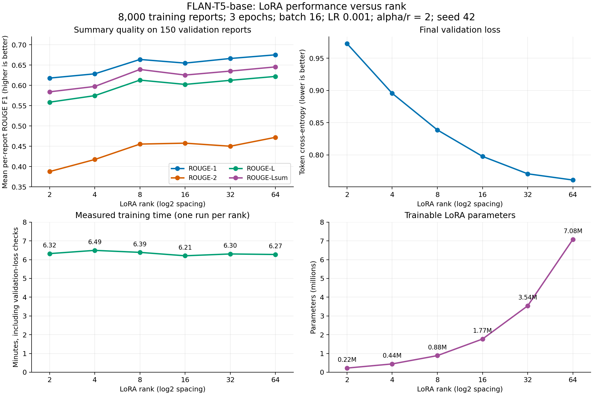

# Radiology Report Summarisation with FLAN-T5

**Author:** Phan Anh Minh Le  
**Course:** COMP3710 / COMP7710

## Status

A zero-shot FLAN-T5-base baseline, supervised LoRA experiments, and full fine-tuning
are implemented. Full-data training and the six-rank LoRA sweep are complete.
Consult the author before further edits or commits.
Use the existing Python environment. Model weights, data, and outputs are ignored by Git.

## Files and usage

- `dataset.py`: local splits, overlap filtering, prompts, and tokenisation.
- `modules.py`: baseline, LoRA, and full-tuning loading and parameter counts.
- `train.py`: LoRA/full-tuning experiments, checkpoint saving, and loss curves.
- `predict.py`: inference, evaluation, and matched comparisons.

Run these commands from `recognition/FLAN_T5_PhanAnhMinhLe/`:

```powershell
python predict.py --report "No pleural effusion or pneumothorax."
python predict.py --limit 20 --output-dir outputs/baseline_smoke
python predict.py
```

Use the existing AMD-enabled environment: PyTorch 2.12.0+rocm10.0.0,
HIP 7.15.26333, Python 3.12.12, and Transformers 4.51.3.
`requirements.txt` records the older CPU baseline runtime; reinstalling its pinned
PyTorch would replace the GPU build. No separate environment was created.

The last command evaluates all 10,000 validation reports; it can take substantially
longer on CPU. `--limit` selects a reproducible random sample, with seed 42 by default.
The evaluator writes `metrics.json`, `predictions.json`, and `safety_cases.json`.
Safety cases require qualitative review; the program does not assign clinical safety scores.

For LoRA, install `peft==0.15.2` and use the existing Matplotlib installation:

```powershell
python -m pip install peft==0.15.2
python train.py --train-limit 128 --eval-limit 20 --epochs 1 --batch-size 4 --output-dir outputs/lora_pilot
python predict.py --adapter outputs/lora_pilot/rank8_fast/adapter --limit 750 --output-dir outputs/lora_eval750/rank8_fast
```

```python
from dataset import get_tokenized_splits
from modules import load_baseline

tokenizer, model = load_baseline()
splits = get_tokenized_splits(tokenizer)
splits.save_to_disk("outputs/tokenized_splits")
```

The current local model is preferred; otherwise `load_baseline` downloads
`google/flan-t5-base`. `count_params(model)` returns total, trainable, and non-trainable
parameter counts, plus the names of layers containing trainable parameters.
Evaluation mode disables dropout; `torch.inference_mode()` disables gradient tracking.
Neither changes `requires_grad`, and this baseline performs no parameter updates.

## Data and preprocessing

Dataset: `BioLaySumm/BioLaySumm2025-LaymanRRG-opensource-track`, revision
`6783ab38f9de28c4372799346f51d3927ae7eb9a`, stored under `data/`.
The source text is `radiology_report`; the target is `layman_report`.

| Published split | Rows | Reference summaries |
| --- | ---: | --- |
| train | 150,454 | Available |
| validation | 10,000 | Available |
| test | 10,537 | All blank |

The published splits are preserved. Train and validation tokens have `labels`;
blank test targets are omitted, so test tokens are for inference only. Inputs are
truncated and padded to 512 tokens; targets to 256. Target padding becomes -100
so it contributes nothing to the loss. Attention masks preserve input padding.
Supervised training uses dynamic batch padding with the same target mask and length limits.

**Split audit:** train/validation share 138 unique `(source, images_path)` identifiers.
They also share 2,164 distinct normalised source/report pairs; train/test share 3,
and validation/test share 1. Repeated text alone need not identify the same patient,
but overlapping image identifiers need investigation. No patient ID column is supplied.
The loader warns about shared image identifiers. Supervised training removes rows matching
held-out image IDs or normalised report text: 42,257 removed, 108,197 eligible.
Held-out splits stay fixed; patient-level separation remains unverified.
The untuned baseline has not learned from this training split.

## Baseline protocol and smoke results

Model revision: `7bcac572ce56db69c1ea7c8af255c5d7c9672fc2`.
The prompt requests sixth-grade plain English while preserving findings, negations,
and uncertainty. Decoding is greedy, with a maximum of 256 new tokens.

The initial run evaluated **20 randomly selected validation reports**, seed 42.
These are smoke-test measurements, not full validation results.

| Measurement | Value |
| --- | ---: |
| ROUGE-1 F1 | 0.1522 |
| ROUGE-2 F1 | 0.0440 |
| ROUGE-L F1 | 0.1359 |
| ROUGE-Lsum F1 | 0.1391 |
| Total parameters | 247,577,856 |
| Trainable parameters (`requires_grad`) | 247,577,856 |
| Non-trainable parameters | 0 |
| Training time | 0 seconds; zero-shot |
| Training GPU resources | None |
| Peak GPU VRAM | Not applicable; CPU run |
| Generation throughput | 47.26 tokens/second |
| Timed generation | 9.16 seconds, 433 output tokens |
| Truncated sample inputs | 0 |

Throughput measures batch-size-one `generate` calls after warmup, excluding
prompt tokenisation, decoding, scoring, model loading, and safety cases. Token counts
exclude decoder-start, padding, and EOS tokens. On CUDA, the evaluator synchronises
before timing and reports peak allocated VRAM including resident model weights.
ROUGE uses the mean per-report F1 on a 0-1 scale with stemming. ROUGE-Lsum uses
sentence newlines from punctuation splitting, a simple convention with limitations
for abbreviations. Keep this convention fixed for later comparisons.

Hardware: CPU, Intel64 Family 6 Model 198, four PyTorch threads.
Python 3.12.12, PyTorch 2.4.1+cpu, Transformers 4.51.3; other direct versions are
in `requirements.txt`. Transformers was changed from 5.8.0 because model loading
failed with the installed PyTorch build. The shared environment's `pip check` also
reports an unrelated existing pandas-ta/NumPy version mismatch.

## LoRA results: 750 validation reports

All four models were evaluated on the same 750 randomly selected validation reports
(seed 42), with identical prompts, greedy decoding, and 512/256 input/output limits.
Five inputs were truncated. Each adapter trained on the same 128 filtered reports
for one epoch, batch size 4, CPU. Only query/value LoRA weights were updated;
target padding was masked with -100. Dropout was 0.05 and alpha/rank was 2.

| Model | Rank / alpha | Learning rate | ROUGE-1 | ROUGE-2 | ROUGE-L | ROUGE-Lsum |
| --- | --- | ---: | ---: | ---: | ---: | ---: |
| Baseline | - | - | .1351 | .0399 | .1176 | .1251 |
| LoRA | 8 / 16 | .0003 | .3179 | .1135 | .2767 | .2902 |
| LoRA | 16 / 32 | .0003 | .3748 | .1533 | .3296 | .3477 |
| LoRA | 8 / 16 | .001 | **.4862** | **.2396** | **.4212** | **.4529** |

Rank 8/16 adapters have 884,736/1,769,472 trainable parameters; the 247,577,856
base parameters remain frozen. Training took about 44-46 seconds per pilot;
GPU VRAM was not measured because execution used CPU. The higher learning rate
scored best, but these are single-seed pilots, not full-validation results.
The same five test cases still exposed hallucinations, negation errors, and repetition;
the best-scoring adapter invented blood in a CT report. Higher ROUGE does not establish
clinical safety. Results are stored locally under `outputs/lora_eval750/`.

## Full fine-tuning: all eligible training reports

All **108,197** filtered training reports were used for three epochs (20,289 updates),
with fused AdamW, learning rate 1e-4, batch size 16, seed 42, BF16 autocast and
gradient checkpointing on an AMD Radeon RX 7900 XTX. All 247,577,856 parameters
were trainable. Validation loss was checked every 500 steps; generation ran only
at the final checkpoint. Batch 8 stalled; its failed attempt is excluded below.

| ROUGE-1 | ROUGE-2 | ROUGE-L | ROUGE-Lsum |
| ---: | ---: | ---: | ---: |
| .7547 | .5779 | .7138 | .7333 |

These scores use **150 validation reports**, excluded from training but reused for
model comparisons. They are not independent test scores. Training took **1h 23m 52s**;
the successful trajectory, including evaluation and checkpoint saving, took
**1h 25m 36s**. Peak allocated training VRAM was **5.34 GiB**. Data preparation,
baseline evaluation and the failed batch-8 attempt are excluded from this time.

```powershell
python train.py --full --train-limit 0 --eval-limit 150 --batch-size 16 --learning-rate 1e-4 --epochs 3 --optimizer adamw_torch_fused --eval-every 500 --generation-every 0 --output-dir outputs/full_all_batch16_fused
```

The checkpoint is local at
`outputs/full_all_batch16_fused/adamw_torch_fused_lr0.0001/epoch_3/`.
FP32 reload checks reproduced saved predictions. A reviewed CT summary still omitted
the tumour conclusion when output hit the 256-token limit; clinical review is pending.

Inference covered all **10,537 test reports**, with FP32 greedy generation, batch 16,
and 512/256 input/output limits: **23m 45s** end-to-end, **512.28 generation tokens/s**,
and **1.89 GiB** peak allocated VRAM. There were 64 truncated inputs, 229 outputs
reaching the token limit without EOS, and no empty predictions. Test ROUGE is unavailable
because all reference summaries are blank. A separate 64-report, batch-1 benchmark
measured **99.97 tokens/s** and **0.619 s** mean generation latency. Generation timing
excludes warmup, tokenisation and decoding; end-to-end timing includes tokenisation,
decoding and output writes, but excludes loading, warmup and the separate benchmark.

## LoRA rank sweep: 8,000 training reports

Six fresh adapters used the same 8,000 filtered training reports and 150 validation
reports, three epochs (1,500 updates), batch 16, AdamW at LR .001, alpha/rank 2,
dropout .05, query/value targets, and seed 42. Training and validation loss used
BF16 autocast; weights and final greedy generation remained FP32.

| Rank | Trainable parameters | ROUGE-1 | ROUGE-2 | ROUGE-L | ROUGE-Lsum |
| ---: | ---: | ---: | ---: | ---: | ---: |
| 2 | 221,184 | .6181 | .3877 | .5587 | .5842 |
| 4 | 442,368 | .6286 | .4174 | .5748 | .5975 |
| 8 | 884,736 | .6640 | .4554 | .6131 | .6394 |
| 16 | 1,769,472 | .6550 | .4577 | .6025 | .6255 |
| 32 | 3,538,944 | .6664 | .4502 | .6126 | .6353 |
| 64 | 7,077,888 | **.6754** | **.4721** | **.6222** | **.6457** |

Rank 64 had the highest observed ROUGE; rank 8 was only .0063 lower on ROUGE-Lsum
with 8x fewer trainable parameters. Improvements were not monotonic. These are
single-seed results on a reused validation sample, without significance estimates.
Training plus validation-loss checks took 6.21-6.49 minutes per rank; the complete
sweep took 50.48 minutes. Unlike full tuning, this LoRA loop has no gradient
checkpointing, so training memory/time are not directly comparable between loops.
All six saved adapters passed configuration, parameter-count and exact-prediction
reload checks. Runtime overrides selected ranks and BF16 forwards; the default LoRA
CLI still runs the earlier pilot hypotheses.



Exact aggregate metrics and settings are tracked in
[`results/experiment_summary.json`](results/experiment_summary.json).
Weights, raw reports, predictions and detailed logs remain local under `outputs/`.

## Rank 64 versus full fine-tuning: all eligible training reports

A fresh rank-64 adapter used all **108,197** filtered training reports for three
epochs (20,289 updates). Settings match the rank sweep: alpha 128, dropout .05,
query/value targets, AdamW LR .001, batch 16, seed 42, BF16 forwards and FP32 weights
and generation. Only 7,077,888 adapter parameters were updated; the base stayed frozen.

Both full-data models below used the same 150 validation reports, prompt, references,
and greedy 512/256 input/output limits. This sample was excluded from training but
reused for model selection; these are single-seed validation results, not test scores.

| Method | Trainable parameters | ROUGE-1 | ROUGE-2 | ROUGE-L | ROUGE-Lsum |
| --- | ---: | ---: | ---: | ---: | ---: |
| LoRA rank 64 | 7,077,888 | .7178 | .5118 | .6624 | .6863 |
| Full fine-tuning | 247,577,856 | **.7547** | **.5779** | **.7138** | **.7333** |

LoRA gained .0406 ROUGE-Lsum over its 8,000-report pilot. Full tuning remained
.0471 higher on the full-data comparison; LoRA trained about 35x fewer parameters.
LoRA training plus three validation-loss checks took **1h 11m 41s**; the job including
setup, baseline evaluation, tokenisation, saving and generation took **1h 14m 41s**.
Peak allocated training VRAM was **18.92 GiB**; batch-1 generation reached
**83.16 tokens/s**. Final validation loss was .5967.

Full tuning used LR .0001, fused AdamW, gradient checkpointing and 41 loss checks;
LoRA used ordinary AdamW, no gradient checkpointing and three loss checks. Full-tuning
training time excludes validation; the LoRA timer includes validation loss. Time and
memory differences therefore reflect implementation and hyperparameter differences too.

All filtered indices and 20,289 logged updates were verified. FP32 adapter reload
reproduced all five saved qualitative test predictions exactly. These cases still
show unsupported fluid/inflammation wording, altered certainty, and a CT tumour
conclusion omitted at the 256-token output limit. Human clinical review remains pending.
Only those five test cases were generated for this adapter; the earlier full-test
inference run used the full-fine-tuned model. Test references remain blank.

The adapter is local at `outputs/lora_rank64_all/rank64/adapter/`; detailed reports,
matched outputs and verification are under `outputs/lora_rank64_all/`. Aggregate
metrics and comparison settings are included in `results/experiment_summary.json`.
The four Python source files are unchanged.

## Preliminary baseline clinical safety analysis

Five test cases were randomly selected using seed 42. Test references are absent;
this review compares the generated summary directly with its source report.
This is a preliminary Codex-assisted textual audit for the author to verify.

| Test index | Failure observed | Faithfulness, omissions, and readability |
| --- | --- | --- |
| 409 | Output: "A radiographic report of a pulmonary fibrosis." | Omits osteoporosis, rib callus, honeycombing, and increased left-lung density. Drops the source's "probable" qualification. Pulmonary fibrosis remains unexplained jargon. |
| 1824 | Output repeats the requested reading level | Omits the entire finding that the chest has no significant radiological abnormalities. Fluent words provide no useful explanation. |
| 4012 | Output repeats the rewriting instruction | Omits the interstitial pattern, possible poor inspiration, and the source's recommendation to repeat imaging. Fails the requested transformation. |
| 4506 | Output falsely denies a calcified lymph node | The source explicitly describes a calcified left-iliac lymph node; the output says none are present. It also invents a negative statement about gastric fatty content, omits the conclusion about no evidence of residual/recurrent tumour, and retains dense CT terminology. |
| 10476 | Output repeats the report task | Omits right-lung opacities, right hilar thickening, the left-lung band, and absence of pleural effusion. The output is short but not a summary. |

These samples expose omissions, contradictions, uncertainty changes, and instruction
copying. They do not establish a failure rate or whether an omitted finding is acute.
ROUGE measures lexical overlap and can miss clinically meaningful changes in negation.
The current baseline is unsuitable for patient-facing use. Next investigations should
compare adaptation methods on agreed leakage-controlled splits, verify entities and
negations, check retention of important findings, and route uncertain outputs to human
review. A specialist must validate any clinical guardrail.

## Feasibility review

Full tutor consultation review remains to be written. Initial feasibility evidence:
local inference works, padding/masking checks pass, and a seq2seq forward pass produces
a finite loss. Native AMD GPU execution subsequently completed full-data training and
the LoRA rank sweep. Split overlap, output truncation and factual errors remain priorities.

## Artificial Intelligence Usage Disclosure

OpenAI Codex assisted with repository setup, dataset/model downloads, implementing
and checking the baseline and LoRA training, dependency compatibility fixes, and preliminary error
analysis. Checks included actual split sizes, missing test references, identifier
and report overlaps, target padding masks, a finite model loss, and a 20-report
inference evaluation. LoRA checks verified masked cross-entropy, unchanged base weights,
adapter updates, checkpoint reloads, and matched evaluations up to 750 reports.
Codex also assisted with full-data GPU training, inference on all 10,537 test reports,
the controlled six-rank LoRA sweep, resource measurements, result plots and documentation.
The author must review the code and audit conclusions. No full-validation metrics are claimed.

## References

- Supplied COMP3710 assessment draft, Sections 2.6 and 4.1.
- [Course repository](https://github.com/shakes76/PatternAnalysis-2026).
- [FLAN-T5 model card](https://huggingface.co/google/flan-t5-base).
- [Local dataset source](https://huggingface.co/datasets/BioLaySumm/BioLaySumm2025-LaymanRRG-opensource-track).
- [T5 documentation](https://huggingface.co/docs/transformers/model_doc/t5).
- [Google ROUGE implementation](https://github.com/google-research/google-research/tree/master/rouge).
