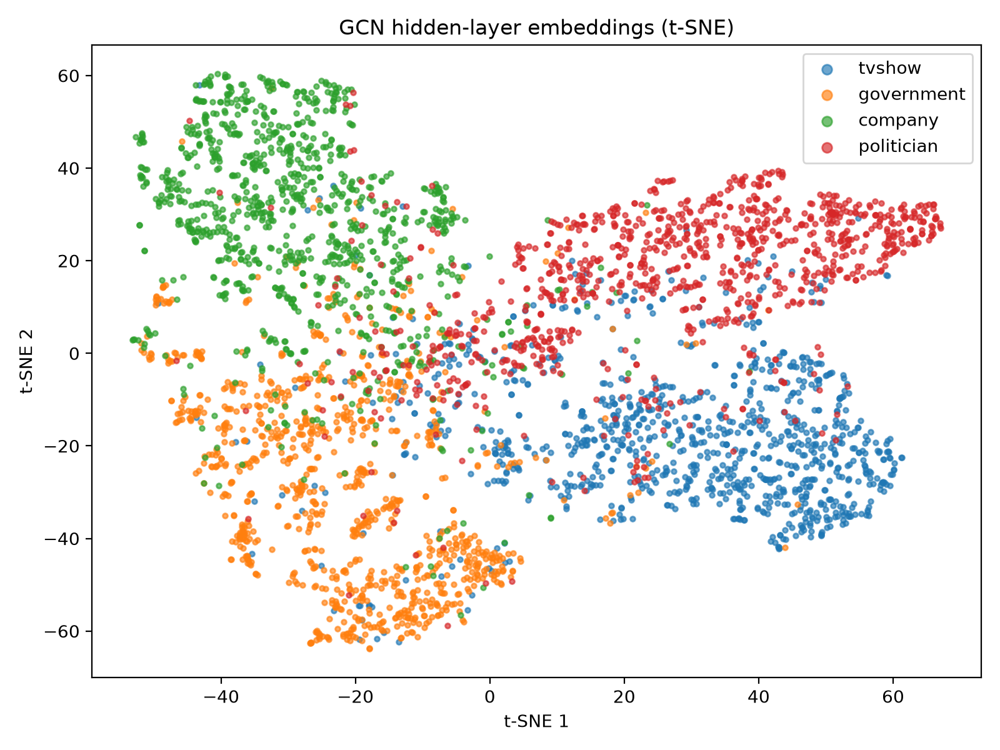
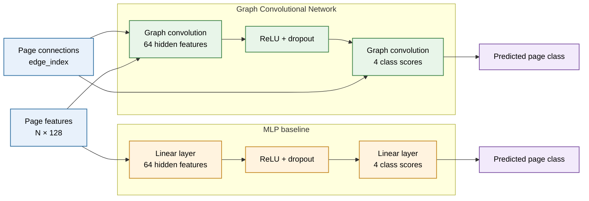
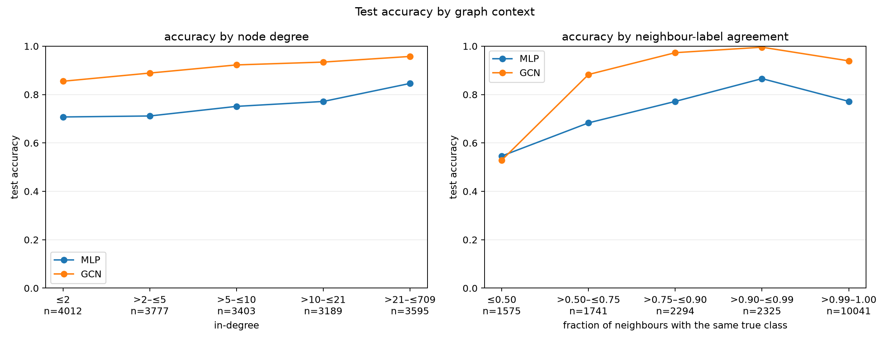

# Classifying Facebook Pages with a Graph Convolutional Network

**Author:** Tia Waturuocha (48041331)

## Table of Contents
- [Project Overview](#project-overview)
- [Model Architecture](#model-architecture)
- [Data Preparation](#data-preparation)
- [Training and Reproducibility](#training-and-reproducibility)
- [Results and Analysis](#results-and-analysis)
- [Feasibility Review](#feasibility-review)
- [Open Research Dilemma](#open-research-dilemma)
- [Limitations](#limitations)
- [Artificial Intelligence Usage Disclosure](#artificial-intelligence-usage-disclosure)
- [References](#references)

## Project Overview

This project classifies official Facebook Pages into four categories: television shows, government organisations, companies, and politicians. The Facebook Page-Page dataset contains 22,470 pages, represented by 128-dimensional feature vectors derived from page descriptions. An edge connects pages that mutually like one another [\[1\]](https://github.com/gayanku/facebook_page-page_dataset). The task is semi-supervised node classification: the models learn from labels on the training pages and predict categories for the remaining pages. I compare a two-layer Graph Convolutional Network (GCN), which uses page features and graph connections, with a Multi-Layer Perceptron (MLP) baseline, which uses the same page features but ignores connections.

The GCN transforms each page's features and aggregates normalised information from its neighbours, including the page itself through self-loops [\[2\]](https://arxiv.org/abs/1609.02907). Its final layer produces scores for the four categories. The MLP applies linear layers to each page independently, providing a baseline for measuring the value of graph information. Both models receive the full graph and page features, but training loss is calculated only from training labels.

*Figure 1. t-SNE projection of 1,000 sampled pages from each category, coloured by their true category. This is a qualitative visualisation; the plotted distances are not a measure of model accuracy.*

## Model Architecture

*Figure 2. Overview of the GCN and MLP architectures. The GCN uses page connections during graph convolution, while the MLP uses page features only.*

### Graph Convolutional Network
[Describe the GCN layers, feature transformation, normalised neighbour aggregation, self-loops, activation, dropout, and output classes. Explain that the layer is implemented in PyTorch.]

### MLP Baseline
[Describe the baseline architecture and clarify that it uses node features but not graph edges.]

## Data Preparation

### Dataset
[Summarise the dataset, its source, number of nodes, feature dimension, number of classes, and graph edges. Cite the source in References.]

### Pre-processing
[Describe how the data is loaded and any changes made before training, including removal of existing self-loops because the GCN adds self-loops itself.]

### Train, Validation, and Test Splits
[State the stratified split proportions and random seed. Explain that validation is used for model selection and test labels are held out from training and tuning. Describe the transductive setting: features and graph structure are available for all nodes, while training loss uses only training labels.]

## Training and Reproducibility

### Dependencies
[List the Python version and required package versions, or explain how to install the pinned dependencies in `requirements.txt`.]

### Running the Project
[Give commands to train the GCN and MLP, generate predictions, run the analysis scripts, and create the visualisations. Explain where the dataset must be placed and how to obtain it.]

### Reproducibility
[Record the split seed, training seeds, selected model settings, checkpoint naming, and any hardware-dependent considerations. Explain how to reproduce the reported results.]

## Results and Analysis

### Quantitative Benchmarking
[Compare the GCN and MLP on the same split. Report accuracy, macro-F1, per-class precision and recall, AUROC, and any other required metrics. Summarise the five-seed results and include relevant training or confidence plots.]

### Embedding Visualisation
[Interpret Figure 1's visible class groupings and overlaps. State that 1,000 nodes were sampled per class and that t-SNE is qualitative, not a performance metric.]

### Performance by Graph Context

[Describe how accuracy changes across node-degree and neighbour-agreement groups. Make clear that neighbour-label agreement uses true labels retrospectively and is not an input available to the models at inference time.]

## Feasibility Review

[Insert the one-page feasibility review required by Section 3. Discuss the problem's suitability, available data and resources, likely risks, and whether the proposed approach is practical.]

## Open Research Dilemma

### Resource Profile

Inference was measured on the NVIDIA Tesla T4 GPU using the full graph, with 5 warm-up runs and 30 timed runs. Memory is PyTorch peak allocated CUDA memory.

| Model | Parameters | Mean inference latency | Peak CUDA memory |
|-------|-----------:|-----------------------:|-----------------:|
| MLP   | 8,516      | 0.317 ms               | 35.58 MB         |
| GCN   | 8,516      | 4.162 ms               | 222.05 MB        |

[Interpret the resource trade-off and explain the hardware and measurement method.]

### Qualitative Error Autopsies

[Analyse 3–5 representative test-set failures. For each, report the true class, predicted class, confidence, node degree, and neighbour context. Diagnose plausible triggers without claiming causation. Include high-confidence errors and state that test-set inspection is retrospective, not a basis for tuning.]

| Node | True class | Model prediction | Confidence | Degree | Neighbour context | Diagnosis |
|------|------------|------------------|-----------:|-------:|-------------------|-----------|
| [node] | [class] | [class] | [value] | [degree] | [summary] | [reasoned interpretation] |

### Engineering Recommendation and Trade-offs

[Recommend which model should be used for the stated task and explain why. Balance predictive performance against latency, memory, complexity, and the value of graph information. State when the alternative model might be preferable.]

## Limitations

[Discuss limitations such as dataset scope, class imbalance, the chosen split, hardware-specific measurements, uncertainty across seeds, and the qualitative limits of t-SNE and retrospective neighbour analysis.]

## Artificial Intelligence Usage Disclosure

[Disclose any AI tools used and what they contributed, such as explanations, debugging, code suggestions, or report editing. State what you personally reviewed, tested, and verified, following Section 6.]

## References

1. [Facebook Page-Page Dataset Repository](https://github.com/gayanku/facebook_page-page_dataset)
2. Kipf, T. N., & Welling, M. (2017). [*Semi-Supervised Classification with Graph Convolutional Networks*](https://arxiv.org/abs/1609.02907). International Conference on Learning Representations (ICLR).
