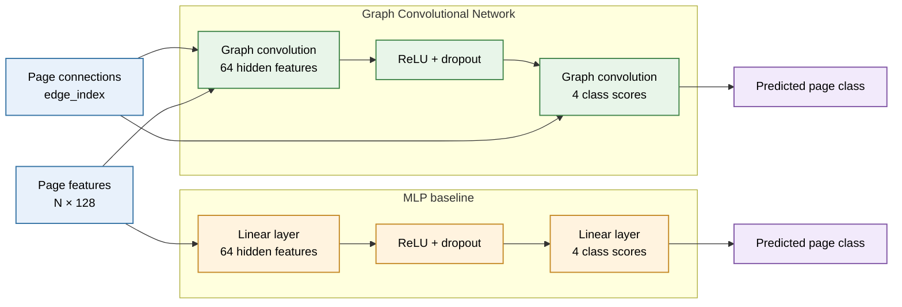
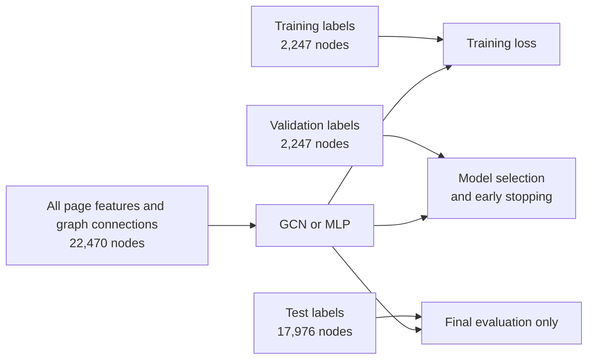

# Classifying Facebook Pages with a Graph Convolutional Network

**Author:** Tia Waturuocha (48041331)

## Table of Contents
- [Project Overview](#project-overview)
- [Model Architecture](#model-architecture)
- [Data Preparation](#data-preparation)
- [Training and Reproducibility](#training-and-reproducibility)
- [Results and Analysis](#results-and-analysis)
- [Feasibility Review](#feasibility-review)
- [Open Research Dilemma](#open-research-dilemma)
- [Limitations](#limitations)
- [Artificial Intelligence Usage Disclosure](#artificial-intelligence-usage-disclosure)
- [References](#references)

## Project Overview

This project classifies official Facebook Pages into four categories: television shows, government organisations, companies, and politicians. The Facebook Page-Page dataset contains 22,470 pages, represented by 128-dimensional feature vectors derived from page descriptions. An edge connects pages that mutually like one another [\[1\]](https://github.com/gayanku/facebook_page-page_dataset). The task is semi-supervised node classification: the models learn from labels on the training pages and predict categories for the remaining pages. I compare a two-layer Graph Convolutional Network (GCN), which uses page features and graph connections, with a Multi-Layer Perceptron (MLP) baseline, which uses the same page features but ignores connections.

The GCN transforms each page's features and aggregates normalised information from its neighbours, including the page itself through self-loops [\[2\]](https://arxiv.org/abs/1609.02907). Its final layer produces scores for the four categories. The MLP applies fully connected linear layers to each page independently [\[3\]](https://docs.pytorch.org/docs/2.15/generated/torch.nn.Linear.html), providing a baseline for measuring the value of graph information. Unlike the GCN, it does not use graph connections. Both models receive the full graph and page features, but training loss is calculated only from training labels.

*Figure 1. t-SNE projection of 1,000 sampled pages from each category, coloured by their true category. This is a qualitative visualisation; the plotted distances are not a measure of model accuracy.*

## Model Architecture

*Figure 2. Overview of the GCN and MLP architectures. The GCN uses page connections during graph convolution, while the MLP uses page features only.*

### Model Selection and Design Rationale

I selected a GCN as the main model because the task is node classification on a graph: in addition to page-description features, pages are connected by mutual likes. The GCN lets the experiment test whether using these connections improves classification compared with a feature-only model. I therefore implemented an MLP as the baseline. The MLP has a similar two-layer pattern but does not use graph edges, making the comparison useful for assessing the contribution of graph information.

### Graph Convolutional Network

The main model is a two-layer Graph Convolutional Network (GCN), based on the graph-convolution approach of Kipf and Welling [\[2\]](https://arxiv.org/abs/1609.02907). Its dimensions are 128 input features, 64 hidden features, and four output scores - one for each page category. Each graph-convolution layer transforms node features and aggregates symmetrically normalised information from connected pages. Self-loops are added so each page's own features also contribute. ReLU and dropout are applied after the hidden layer; the final layer returns class logits. The graph-convolution operation is implemented directly with PyTorch in `modules.py`, rather than using a pre-built graph-convolution layer.

### MLP Baseline

The baseline is a two-layer Multi-Layer Perceptron (MLP) with 128 input features, 64 hidden units, and four output scores. It applies a fully connected linear layer to each page's features, followed by ReLU and dropout, then a second linear layer to produce class logits [\[3\]](https://docs.pytorch.org/docs/2.15/generated/torch.nn.Linear.html). It does not use graph edges.

### Configuration Experiments

I compared hidden sizes of 32, 64, and 128, and also tested selected dropout and learning-rate values. I chose configurations using validation macro-F1, rather than test performance. The 64-hidden-unit GCN with dropout 0.5 and the 64-hidden-unit MLP with dropout 0.3 were carried forward to the five-seed evaluation. The experiments and validation results are recorded in [`results/tuning.csv`](results/tuning.csv).

## Data Preparation

### Dataset

The Facebook Page-Page dataset represents verified Facebook pages as nodes and mutual likes between pages as edges [\[1\]](https://github.com/gayanku/facebook_page-page_dataset). It contains 22,470 nodes, each with a 128-dimensional feature vector derived from its page description, and four page categories: `tvshow`, `government`, `company`, and `politician`. The source data contains 342,004 directed edge entries. After removing self-loops, the graph used in this project contains 341,646 directed edge entries. Because page likes are mutual, connections are represented in both directions.

| Dataset property | Value |
|---|---:|
| Pages (nodes) | 22,470 |
| Features per page | 128 |
| Classes | 4 |
| Directed edge entries after preprocessing | 341,646 |

### Pre-processing

`dataset.py` loads the dataset's feature matrix, edge list, and labels into a PyTorch Geometric `Data` object. Features are converted to `float32` and labels and edge indices to integer tensors. The raw graph contains 358 self-loop entries; these are removed during loading because each GCN layer adds one self-loop per node during message passing. No additional feature scaling or dimensionality reduction is applied by this project.

### Train, Validation, and Test Splits

The nodes are split once using stratified sampling with random seed 42. The split assigns 10% of nodes to training, 10% to validation, and 80% to testing, preserving the class proportions as closely as possible in each subset.

| Split     | Proportion | Nodes | Use |
|-----------|-----------:|------:|-----|
| Training  | 10%        | 2,247 | Calculate training loss and update model weights |
| Validation| 10%        | 2,247 | Select configurations and determine the early-stopping checkpoint |
| Test      | 80%        | 17,976 | Final evaluation after model selection |

This is a transductive node-classification setting: the models receive the features and graph structure for all pages, but the training loss is calculated only from training labels [\[4\]](https://apxml.com/courses/introduction-to-graph-neural-networks/chapter-4-training-gnn-models/graph-data-splitting-transductive-inductive). Validation labels guide model selection and early stopping. Test labels are reserved for final evaluation and retrospective error analysis, not for training or configuration selection.

*Figure 3. Transductive evaluation: the graph and page features are available to the models for all nodes, while labels have separate training, validation, and test roles.*

## Training and Reproducibility

### Dependencies
[List the Python version and required package versions, or explain how to install the pinned dependencies in `requirements.txt`.]

### Running the Project
[Give commands to train the GCN and MLP, generate predictions, run the analysis scripts, and create the visualisations. Explain where the dataset must be placed and how to obtain it.]

### Reproducibility
[Record the split seed, training seeds, selected model settings, checkpoint naming, and any hardware-dependent considerations. Explain how to reproduce the reported results.]

## Results and Analysis

### Quantitative Benchmarking
[Compare the GCN and MLP on the same split. Report accuracy, macro-F1, per-class precision and recall, AUROC, and any other required metrics. Summarise the five-seed results and include relevant training or confidence plots.]

### Embedding Visualisation
[Interpret Figure 1's visible class groupings and overlaps. State that 1,000 nodes were sampled per class and that t-SNE is qualitative, not a performance metric.]

### Performance by Graph Context

[Describe how accuracy changes across node-degree and neighbour-agreement groups. Make clear that neighbour-label agreement uses true labels retrospectively and is not an input available to the models at inference time.]

## Feasibility Review

[Insert the one-page feasibility review required by Section 3. Discuss the problem's suitability, available data and resources, likely risks, and whether the proposed approach is practical.]

## Open Research Dilemma

### Resource Profile

Inference was measured on the NVIDIA Tesla T4 GPU using the full graph, with 5 warm-up runs and 30 timed runs. Memory is PyTorch peak allocated CUDA memory.

| Model | Parameters | Mean inference latency | Peak CUDA memory |
|-------|-----------:|-----------------------:|-----------------:|
| MLP   | 8,516      | 0.317 ms               | 35.58 MB         |
| GCN   | 8,516      | 4.162 ms               | 222.05 MB        |

[Interpret the resource trade-off and explain the hardware and measurement method.]

### Qualitative Error Autopsies

[Analyse 3–5 representative test-set failures. For each, report the true class, predicted class, confidence, node degree, and neighbour context. Diagnose plausible triggers without claiming causation. Include high-confidence errors and state that test-set inspection is retrospective, not a basis for tuning.]

| Node | True class | Model prediction | Confidence | Degree | Neighbour context | Diagnosis |
|------|------------|------------------|-----------:|-------:|-------------------|-----------|
| [node] | [class] | [class] | [value] | [degree] | [summary] | [reasoned interpretation] |

### Engineering Recommendation and Trade-offs

[Recommend which model should be used for the stated task and explain why. Balance predictive performance against latency, memory, complexity, and the value of graph information. State when the alternative model might be preferable.]

## Limitations

[Discuss limitations such as dataset scope, class imbalance, the chosen split, hardware-specific measurements, uncertainty across seeds, and the qualitative limits of t-SNE and retrospective neighbour analysis.]

## Artificial Intelligence Usage Disclosure

[Disclose any AI tools used and what they contributed, such as explanations, debugging, code suggestions, or report editing. State what you personally reviewed, tested, and verified, following Section 6.]

## References

1. [Facebook Page-Page Dataset Repository](https://github.com/gayanku/facebook_page-page_dataset)
2. Kipf, T. N., & Welling, M. (2017). [*Semi-Supervised Classification with Graph Convolutional Networks*](https://arxiv.org/abs/1609.02907). International Conference on Learning Representations (ICLR).
3. PyTorch. [*torch.nn.Linear*](https://docs.pytorch.org/docs/2.15/generated/torch.nn.Linear.html). PyTorch 2.15 documentation.
4. ApX Machine Learning. [*Graph Data Splitting: Transductive vs. Inductive*](https://apxml.com/courses/introduction-to-graph-neural-networks/chapter-4-training-gnn-models/graph-data-splitting-transductive-inductive). *Introduction to Graph Neural Networks*, Chapter 4.
