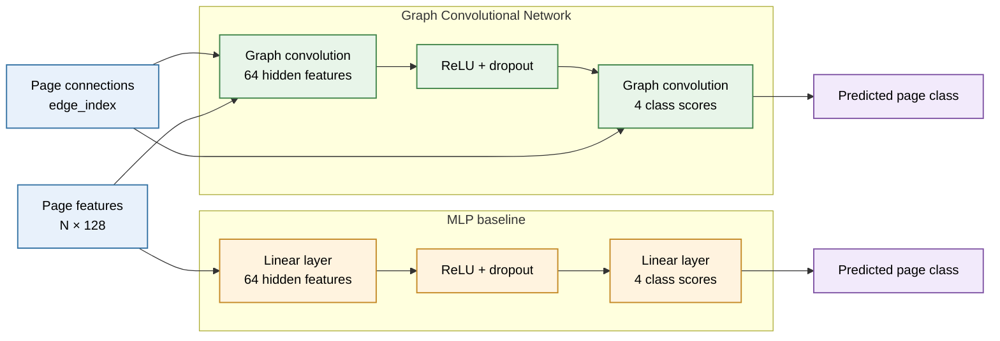
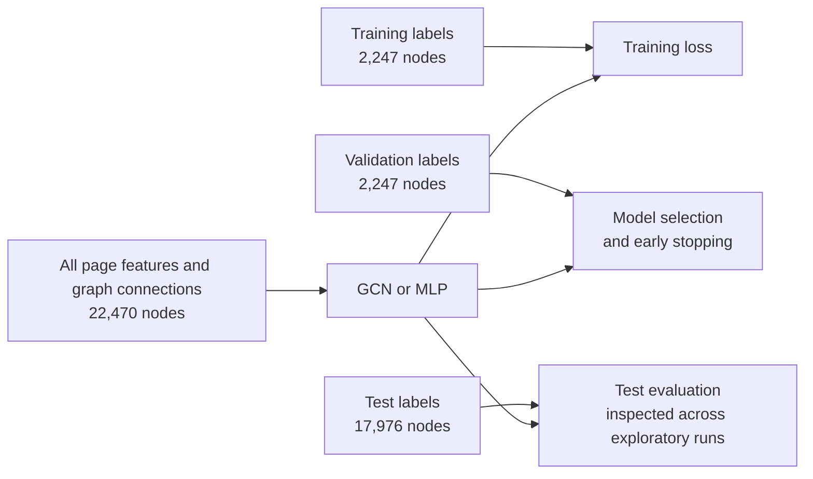

# Classifying Facebook Pages with a Graph Convolutional Network

**Author:** Tia Waturuocha (48041331)

## Table of Contents
- [Project Overview](#project-overview)
- [Model Architecture](#model-architecture)
- [Data Preparation](#data-preparation)
- [Training and Reproducibility](#training-and-reproducibility)
- [Results and Analysis](#results-and-analysis)
- [Feasibility Review](#feasibility-review)
- [Open Research Dilemma](#open-research-dilemma)
- [Limitations](#limitations)
- [Artificial Intelligence Usage Disclosure](#artificial-intelligence-usage-disclosure)
- [References](#references)

## Project Overview

This project sorts official Facebook Pages into four categories: tvshow, government, company and politician. The data is the Facebook Page-Page dataset [\[1\]](#ref-1). It has 22,470 pages, each described by 128 features taken from its page description, and an edge joins two pages that like each other. The task is semi-supervised node classification: the models learn from the labels of a small set of training pages and predict the categories of the rest. 

I compare two models. The baseline is a Multi-Layer Perceptron (MLP) that classifies each page from its own features and ignores the links [\[3\]](#ref-3). The main model is a two-layer Graph Convolutional Network (GCN) that also mixes in information from a page's neighbours [\[2\]](#ref-2). Both models receive the full graph and page features, but training loss is calculated only from training labels.


*Figure 1. t-SNE of 1,000 sampled pages from each category, coloured by true category. This is a visual aid only, the distances are not a measure of accuracy.*

## Model Architecture


*Figure 2. Overview of the GCN and MLP architectures. The GCN uses page connections in each graph convolution. The MLP uses page features only.*

### Model Selection and Design Rationale

I selected a GCN as the main model because the task is node classification on a graph: in addition to page-description features, pages are connected by mutual likes. The GCN lets the experiment test whether using these connections improves classification compared with a feature-only model. Thus, MLP was selected as the baseline, as it has a similar two-layer pattern but without graph edges.

### Graph Convolutional Network

The main model is a two-layer Graph Convolutional Network (GCN), based on the graph-convolution approach of Kipf and Welling [\[2\]](#ref-2). The sizes are 128 input features, 64 hidden features and 4 output scores, one per category. Each layer transforms a page's features and then averages them with its neighbours' features, weighted by degree. Each page also counts itself through a self-loop. ReLU and dropout are applied after the hidden layer; dropout is a regularisation technique that randomly omits activations during training [\[6\]](#ref-6). A ReLU and dropout follow the hidden layer, and the last layer returns logits (raw scores). I wrote the graph convolution directly in PyTorch in modules.py using edge lists, instead of using a prebuilt layer.

### MLP Baseline

The baseline is a two-layer Multi-Layer Perceptron (MLP) with 128 input features, 64 hidden units, and four output scores. It applies a linear layer to each page's features, followed by ReLU and dropout, then a second linear layer to produce class logits [\[3\]](#ref-3). Dropout is used as a regulariser [\[6\]](#ref-6). It does not use graph edges.

### Configuration Experiments

I compared hidden sizes of 32, 64, and 128, and also tested selected dropout and learning-rate values. Validation macro-F1 guided selection of settings and the checkpoint. The 64-hidden-unit GCN with dropout 0.5 and the 64-hidden-unit MLP with dropout 0.3 were carried forward to the five-seed evaluation. The experiments and results are recorded in [`results/tuning.csv`](results/tuning.csv).

## Data Preparation

### Dataset

The dataset represents verified Facebook pages as nodes and mutual likes between pages as edges [\[1\]](#ref-1). It contains 22,470 nodes, each with a 128 features per node, and four classes (categories): `tvshow`, `government`, `company`, and `politician`. The source data contains 342,004 directed edge entries. After removing self-loops, the graph used in this project contains 341,646 directed edge entries. Page likes are mutual, so every connection is stored in both directions.

| Dataset property | Value |
|---|---:|
| Pages (nodes) | 22,470 |
| Features per page | 128 |
| Classes | 4 |
| Directed edge entries after preprocessing | 341,646 |

*Table 1. Summary of the Facebook Page-Page dataset used in this project after self-loop removal.*

### Pre-processing

`dataset.py` loads the dataset's feature matrix, edge list, and labels into a PyTorch Geometric `Data` object. The raw file has 358 self-loop entries. I remove them because each GCN layer adds exactly one self-loop per node, and keeping them would count those nodes' own features twice. I found this by checking the data before training. I do no other scaling or dimensionality reduction.

**Preprocessing summary:** the graph has 342,004 directed edge entries before preprocessing; 358 self-loop entries are removed, leaving 341,646 directed edge entries and 0 isolated nodes.

### Train, Validation, and Test Splits

The nodes are split once using stratified sampling with random seed 42. The split assigns 10% of nodes to training, 10% to validation, and 80% to testing, preserving the class proportions as closely as possible in each subset [\[5\]](#ref-5).

| Split     | Proportion | Nodes | Use |
|-----------|-----------:|------:|-----|
| Training  | 10%        | 2,247 | Calculate training loss and update model weights |
| Validation| 10%        | 2,247 | Select configurations and determine the early-stopping checkpoint |
| Test      | 80%        | 17,976 | Final evaluation after model selection |

*Table 2. Stratified node split sizes and the role of each split.*

This is a transductive node-classification setting: the models receive the features and links for all pages, but only training labels are used to calculate loss [\[4\]](#ref-4). Validation labels are used for model selection and early stopping. I went chose a high number of labelled nodes per class so that the smallest class (politician, about 330 training nodes) still has enough examples.



*Figure 3. Transductive evaluation. All page features and links are available to the models. Labels have separate training, validation and test roles.*

## Training and Reproducibility

### Dependencies

The project uses Python, PyTorch, PyTorch Geometric, NumPy, scikit-learn and Matplotlib, with versions pinned in [`requirements.txt`](requirements.txt). I ran it locally on Python 3.11 and on the UQ GPU Lab on Python 3.10. PyTorch installs differently for CPU, Apple MPS and CUDA, so install the right build for your machine first if needed.

I used the Conda environment named `comp3710` locally. Activate it before running the project:

```bash
conda activate comp3710
```

The UQ GPU Lab provides its own Conda environment at `/conda`. In either environment, install the project dependencies from this directory if they are not already available:

```bash
python -m pip install --upgrade pip
python -m pip install -r requirements.txt
```

The dataset file is not included in Git. Obtain `facebook.npz` from the [Facebook Page-Page dataset repository](https://github.com/gayanku/facebook_page-page_dataset) and place it at `data/FacebookPagePage/raw/facebook.npz`. The `data/` directory is ignored by Git.

### Running the Project

Run these commands from `recognition/GCN_s4804133`, where the Python scripts are located.

To train one GCN and one MLP run with the selected settings:

```bash
python train.py --model gcn --seed 42 --tag five-seed --hidden 64 --dropout 0.5 --epochs 600 --patience 100
python train.py --model mlp --seed 42 --tag five-seed --hidden 64 --dropout 0.3 --epochs 300 --patience 50
```

The five-seed experiment used training seeds 42 to 46, so repeat both commands for each seed. Training saves checkpoints in `outputs/`, learning curves in `figures/`, and appends run metrics to `results/tuning.csv`.

To make predictions from the seed-42 checkpoints and run the analyses:

```bash
python predict.py --checkpoint outputs/gcn_seed42_five-seed.pt
python predict.py --checkpoint outputs/mlp_seed42_five-seed.pt
python analyse.py --tag five-seed
python analyse_graph_context.py
python plot_embeddings.py
```

`predict.py` prints test metrics, saves per-node predictions and probabilities under `outputs/`, and creates a test confidence, reliability, and risk-coverage plot under `figures/`. `analyse.py` reports detailed classification and confidence metrics, updates the confidence plot with the validation-selected threshold, and saves precision-recall plots. `analyse_graph_context.py` compares accuracy by graph context and saves a CSV and plot. `plot_embeddings.py` creates the GCN t-SNE plot. 

### Reproducibility

The stratified node split uses seed 42 and is fixed across model runs. Training uses seeds 42–46. The selected configurations are a two-layer GCN with 64 hidden units, dropout 0.5, a 600-epoch limit, and patience 100; and a two-layer MLP with 64 hidden units, dropout 0.3, a 300-epoch limit, and patience 50. Dropout is applied during training as regularisation [\[6\]](#ref-6). Both models use learning rate 0.01 and weight decay 0.0005, and training is full-batch with the loss on training nodes only. Epoch limits are maximums, and early stopping ends a run when validation macro-F1 has not improved for patience epochs [\[7\]](#ref-7). Other training settings are recorded with each checkpoint and in `results/tuning.csv`.

Training keeps the checkpoint with the best validation macro-F1 and then evaluates on the test split. Runtime and measured memory depend on the device. The resource profile was measured on the UQ GPU Lab `g4dn.xlarge` virtual GPU, recorded as a Tesla T4; local training and inference can use CUDA, Apple MPS, or CPU where supported.

## Results and Analysis

### Quantitative Benchmarking

Both models use the same seed-42 split. Only the training randomness changes across seeds. Please also read the note on the test set in Limitations.

Over five training seeds (42 to 46) the GCN scored a much higher test macro-F1 than the MLP:

| Model | Test macro-F1, mean ± standard deviation | Test accuracy, mean ± standard deviation |
|---|---:|---:|
| MLP | 0.7356 ± 0.0026 | 0.7558 ± 0.0019 |
| GCN | 0.9043 ± 0.0018 | 0.9096 ± 0.0016 |

*Table 3. Five training seeds on the fixed seed-42 split (sample standard deviation).*

The tables below use the seed-42 checkpoint. AUROC and PR-AUC are one-vs-rest per class.macro values are unweighted means across the four classes.

| Model | Class | Precision | Recall | F1 | AUROC (OvR) | PR-AUC |
|---|---|---:|---:|---:|---:|---:|
| MLP | tvshow | 0.8077 | 0.7947 | 0.8012 | 0.9388 | 0.8868 |
| MLP | government | 0.7319 | 0.8205 | 0.7737 | 0.9299 | 0.8598 |
| MLP | company | 0.7632 | 0.7529 | 0.7580 | 0.9356 | 0.8587 |
| MLP | politician | 0.6829 | 0.5494 | 0.6089 | 0.8967 | 0.6993 |
| GCN | tvshow | 0.9203 | 0.8972 | 0.9086 | 0.9807 | 0.9637 |
| GCN | government | 0.8931 | 0.9430 | 0.9174 | 0.9834 | 0.9617 |
| GCN | company | 0.9380 | 0.9179 | 0.9278 | 0.9893 | 0.9733 |
| GCN | politician | 0.8746 | 0.8489 | 0.8616 | 0.9794 | 0.9249 |

*Table 4. Per-class test metrics, seed 42.*

| Model | Test accuracy | Macro-F1 | Macro AUROC (OvR) | Macro PR-AUC |
|---|---:|---:|---:|---:|
| MLP (seed 42) | 0.7556 | 0.7354 | 0.9252 | 0.8261 |
| GCN (seed 42) | 0.9094 | 0.9038 | 0.9832 | 0.9559 |

*Table 5. Overall test metrics, seed 42.*

The GCN outperformed the MLP on all four classes in the seed-42 classification table. The biggest gap is for `politician`, where GCN recall is 0.8489 versus 0.5494 for the MLP. The five-seed results show that the overall macro-F1 advantage is consistent across the tested training seeds.

The plots below show the seed-42 training curves for both models. The confidence plots include confidence histograms, reliability diagrams, and risk-coverage curves. Precision-recall plots show one-vs-rest curves for each class; PR-AUC is reported in the metric tables above.

| MLP training curves | GCN training curves |
|---|---|
|  |  |

*Figure 4. Seed-42 training loss and validation macro-F1 curves for the MLP (left) and GCN (right).*

| MLP confidence analysis | GCN confidence analysis |
|---|---|
|  |  |

*Figure 5. Confidence histograms (correct vs incorrect), reliability diagrams, and risk-coverage curves for the MLP (left) and GCN (right) seed-42.*

| MLP precision-recall curves | GCN precision-recall curves |
|---|---|
|  |  |

*Figure 6. Seed-42 one-vs-rest precision-recall curves for the MLP (left) and GCN (right); per-class PR-AUC values are included in the legends.*

On the seed-42 test set, expected calibration error (ECE, 15 equal-width bins) was 0.0399 for MLP and 0.0197 for GCN. Confidence error-detection AUROC was 0.8121 for MLP and 0.8513 for GCN. Thus, the GCN is better calibrated, and its confidence ranks wrong predictions as uncertain more reliably. Error-detection AUROC measures how well low confidence picks out the incorrect predictions.

#### Confidence-based reject option

Because this model assists human reviewers, I chose 95% validation accuracy as a target. The model should answer when it is confident and pass uncertain pages to a person. Selective classification frames this as a risk–coverage trade-off [\[8\]](#ref-8); I picked the lowest confidence cutoff that met the target on validation, then applied it unchanged to the test set. [\[5\]](#ref-5). The MLP retained 42.85% of test nodes at 95.00% accuracy (threshold 0.9345); the GCN retained 89.64% at 94.86% (threshold 0.6674). Evidently, at nearly the same accuracy, the GCN handles about twice as many pages automatically. I did not evaluate a separate rule for low-degree nodes.

### Embedding Visualisation

Figure 1 shows class-dominated regions in the t-SNE projection: `company` points are concentrated mainly in the upper-left, `politician` in the upper-right, `tvshow` in the lower-right, and `government` largely in the lower-left. The classes overlap, especially near the centre, so the embedding does not cleanly separate every page. The plot is coloured by true class, so it cannot show where low-agreement nodes sit relative to the clusters.

### Performance by Graph Context


*Figure 7. Seed-42 test accuracy by node-degree (left) and neighbour-label-agreement bands (right).*

The GCN has higher test accuracy than the MLP in every degree band. Accuracy rises with degree for both models: from 0.7074 (MLP) and 0.8549 (GCN) for degree ≤2, to 0.8459 and 0.9574 respectively for degree >21. This pattern is consistent with the GCN making use of neighbour information, although this by itself does not prove that degree causes the improvement.

| Test-node group | Nodes | MLP accuracy | GCN accuracy |
|---|---:|---:|---:|
| Degree ≤2 | 4,012 | 0.7074 | 0.8549 |
| Degree >2–≤5 | 3,777 | 0.7114 | 0.8888 |
| Degree >5–≤10 | 3,403 | 0.7511 | 0.9224 |
| Degree >10–≤21 | 3,189 | 0.7714 | 0.9341 |
| Degree >21–≤709 | 3,595 | 0.8459 | 0.9574 |

*Table 6. Seed-42 test accuracy by node-degree.*

Accuracy also generally rises with neighbour-label agreement. In the lowest-agreement band (≤0.50), the GCN is slightly below the MLP (0.5289 versus 0.5460); in the remaining bands, it is higher, reaching 0.9957 for agreement >0.90–≤0.99.

| Fraction of neighbours with the same true class | Nodes | MLP accuracy | GCN accuracy |
|---|---:|---:|---:|
| ≤0.50 | 1,575 | 0.5460 | 0.5289 |
| >0.50–≤0.75 | 1,741 | 0.6829 | 0.8828 |
| >0.75–≤0.90 | 2,294 | 0.7716 | 0.9730 |
| >0.90–≤0.99 | 2,325 | 0.8658 | 0.9957 |
| >0.99–1.00 | 10,041 | 0.7718 | 0.9391 |

*Table 7. Seed-42 test accuracy by neighbour-label agreement. This uses true labels, so it is a diagnostic and not something a model can use at inference time.*

Among test predictions, mean degree was 16.53 for correct MLP predictions and 10.86 for incorrect MLP predictions; mean neighbour-label agreement was 0.903 and 0.825 respectively. For the GCN, the corresponding means were degree 15.73 and 9.33, and agreement 0.910 and 0.623. Neighbour-label agreement is calculated from true labels, so a model can’t use it at inference time. This suggests that GCN errors can occur when neighbourhood context disagrees with a node's true class.

## Feasibility Review

### 1. User Need, Scope and Acceptance Criteria

The prototype helps a human reviewer sort Facebook Pages into `tvshow`, `government`, `company`, or `politician` and refers uncertain predictions for review. The 95% accuracy target is illustrative, not an operational requirement.

Acceptance criteria:

- **Data integrity:** The 10/10/80 train, validation and test masks are disjoint, complete, stratified and reproducible with seed 42. The model inputs are only features and edges, and the loss uses training labels only. The graph is symmetric with no isolated nodes, and 358 self-loops are removed.
- **Model comparison:** Compare macro-F1 and per-class metrics over five training seeds. GCN mean test macro-F1 was 0.9043 ± 0.0018 against 0.7356 ± 0.0026 for the MLP. I did not run a significance test.
- **Confidence:** Report ECE and error-detection AUROC. For seed 42 the GCN scored 0.0197 and 0.8513.
- **Reject option:** Choose the 95% threshold on validation, then report test accuracy and coverage. The GCN reached 94.86% at 89.64% coverage, and the MLP 95.00% at 42.85%.
- **Resources:** Report full-graph inference time and peak memory. The GCN took 4.162 ms and 222.05 MB on the UQ GPU Lab virtual GPU.

### 2. Model Choice

The dataset has 22,470 nodes, 128 features, four classes, and 341,646 directed edges after self-loop removal. The selected band is **Multi-layer GNN [Normal Difficulty]**: a two-layer GCN implemented from scratch, compared with a feature-only MLP. Symmetric normalisation follows Kipf and Welling [\[2\]](#ref-2). Let $H^{(0)}=X$:

$$
Z^{(l+1)}=\tilde D^{-1/2}\tilde A\tilde D^{-1/2}H^{(l)}W^{(l)}+b^{(l)},\quad
\tilde A=A+I,\quad \tilde D_{ii}=\sum_j\tilde A_{ij},\quad l=0,1.
$$

The hidden state is $H^{(1)}=\text{ReLU}(Z^{(1)})$ with training dropout; $Z^{(2)}$ gives class logits. Self-loops retain each node’s features and symmetric normalisation adjusts for degree. The model uses two layers.

### 3. Preliminary Feasibility Evidence

The audit found no isolated nodes; class proportions range from 14.8% `politician` to 30.6% `government`. I chose to use an edge-list representation as opposed to a dense float32 adjacency matrix of about 2.02 GB. GCN outperformed MLP on this split, but test metrics were inspected during exploratory runs, so results are not an untouched generalisation estimate.

### 4. Risks, Budget and Fallback

Risks include class imbalance, confident errors, and neighbours with conflicting labels; neighbour-label analysis is retrospective, not an inference input. Review capacity and the relative cost of an error versus an abstention are unknown. Mean training times were 2.94 s (MLP) and 28.96 s (GCN), but the device was not recorded. Next steps are to test a new split and repeat the resource measurements on verified hardware. If the graph data or the GCN's resource cost is a problem, the fallback is the feature-only MLP. Evaluating genuinely new pages remains future work.

## Open Research Dilemma

The task asks whether the GCN's confidence can be trusted for automated triage, and whether its extra cost is worth it over a simple baseline.

### Resource Profile

Inference was measured on the UQ GPU Lab `g4dn.xlarge` virtual GPU using the full graph, with 5 warm-up runs and 30 timed runs. The instance was recorded as a Nvidia Tesla T4. Memory is PyTorch peak allocated CUDA memory. Training time is the mean training-loop duration across the five runs recorded in `results/tuning.csv`. The log does not record the training device, so those times cannot be compared directly with the inference numbers.

| Model | Parameters | Mean training time | Mean inference latency | Peak CUDA memory |
|-------|-----------:|-------------------:|-----------------------:|-----------------:|
| MLP   | 8,516      | 2.94 s             | 0.317 ms               | 35.58 MB         |
| GCN   | 8,516      | 28.96 s            | 4.162 ms               | 222.05 MB        |

*Table 8. Parameter counts and resource use.*

Both models have the same number of trainable parameters, but the GCN costs more to run because it aggregates features across graph edges. Its mean inference latency was about 13 times the MLP's (4.162 ms versus 0.317 ms), and peak allocated CUDA memory was about 6.2 times higher (222.05 MB versus 35.58 MB). Its logged mean training time was about 9.8 times higher, though the training device was not recorded, so this is a comparison of these runs rather than a controlled hardware benchmark. These figures describe this dataset, implementation, and virtual-GPU environment, not expected performance on every deployment system.

### Qualitative Error Autopsies

The following five GCN test-set errors were selected because they demonstrate confident mistakes in neighbourhoods dominated by another class. Each prediction had confidence 1.000. Neighbour context is not information used to select or tune these cases. These test-set examples are diagnostic only and were not used as a basis for tuning.

| Node | True class | GCN prediction | Confidence | Degree | Neighbours' true classes | Plausible interpretation |
|------|------------|---------------|-----------:|-------:|--------------------------|--------------------------|
| 11332 | tvshow | government | 1.000 | 328 | 289 government, 21 tvshow, 9 politician, 9 company | The large neighbourhood is overwhelmingly government-labelled, consistent with the incorrect prediction despite the node's tvshow label. |
| 9254 | tvshow | politician | 1.000 | 16 | 15 politician, 1 tvshow | Nearly all neighbours are politician-labelled, which may help explain the confident class mismatch. |
| 11612 | government | company | 1.000 | 19 | 18 company, 1 government | The local neighbourhood strongly favours company over the node's government label. |
| 9077 | government | tvshow | 1.000 | 20 | 17 tvshow, 3 government | Most neighbours are tvshow-labelled, matching the mistaken prediction rather than the true class. |
| 20083 | tvshow | politician | 1.000 | 69 | 56 politician, 11 tvshow, 1 government, 1 company | The neighbourhood is dominated by politician-labelled nodes, although the node is tvshow. |

*Table 9. Five high-confidence GCN test errors and their neighbour-label context.*

In every case most neighbours belong to the class the GCN predicted, not the node's true class. These examples suggest a possible difficulty for neighbourhood aggregation when neighbouring labels conflict with the target node's class. However, they do not establish the cause of an error. 

### Engineering Recommendation and Trade-offs

For this task, I recommend the GCN when the mutual-like graph is available and the goal is to maximise classification accuracy. On the seed-42 test split, it achieved macro-F1 of 0.9038 and accuracy of 0.9094, compared with 0.7354 and 0.7556 for the MLP. The five-seed mean macro-F1 also favoured the GCN (0.9043 versus 0.7356). This performance improvement comes with greater inference latency and memory use, with the same parameter count.

The MLP is the more practical choice when graph edges are unavailable, expensive to maintain, or when lower latency and memory use matter more than the accuracy gain. A confidence-based reject option can reduce errors when abstaining is acceptable. With thresholds chosen on validation, the GCN retained 89.64% of test nodes at 94.86% accuracy, while the MLP retained 42.85% at 95.00%. The GCN therefore covered substantially more nodes at nearly the same accuracy, but did not reach 95% accuracy on test. Since test metrics were inspected during exploratory runs, these comparisons are evidence from this experiment, not an unbiased final estimate of future performance.

## Limitations

This evaluation uses one Facebook Page-Page dataset and one fixed stratified split, so it does not show how the models would perform on other datasets, later data, or alternative splits. The five training seeds vary training randomness but do not capture split-to-split variation. Class counts are also uneven: `politician` is the smallest class (14.8% of nodes), while `government` is the largest (30.6%), so per-class metrics are important alongside overall accuracy.

Test metrics were inspected during exploratory configuration runs. Although the final configurations were selected using validation macro-F1, the reported test results are still not a clean hold-out estimate, and I did not choose any further settings from them. The graph-context analysis and error autopsies also use neighbours' true labels, which are not available at inference time. They show association, not cause.

The t-SNE plot is a qualitative projection of a balanced sample, not a performance measure, and its visible clusters may depend on the projection and sampling. Resource measurements are specific to full-graph inference in the recorded UQ GPU Lab virtual-GPU environment; Results may differ on other hardware, graph sizes, or deployment settings.

## Artificial Intelligence Usage Disclosure

**Tool used.** GitHub Copilot with GPT-6 Luna.

**How it assisted.** I used Copilot to organise and edit this README, format its tables and figure captions, and draft the Mermaid model-architecture diagram. It helped me clarify explanations of course concepts such as GCN, MLP and splitting, as well as confidence calibration. During implementation, it generated suggestions for loading the graph and preparing data splits in `dataset.py`. It was also used for implementing boiler-plate code for the MLP and GCN layers in `modules.py`. It also helped with boiler-plate prediction and analysis code for various for classification metrics, precision-recall plots and risk-coverage plots. Further assistance includes comments, docstrings, argument parsing, plotting and debugging. 

**How I verified the work.** I reviewed suggestions against the task requirements, my understanding of the course material, and the implementation in the relevant files. All suggestions were adapted and refined based on my needs, and where AI was used for debugging outputs, I manually verified all outputs used in this project. 

I am responsible for the final code, experiments, interpretation and report. I reviewed and edited all AI-assisted material before including it.

## References

1. <a id="ref-1"></a>[Facebook Page-Page Dataset Repository](https://github.com/gayanku/facebook_page-page_dataset)
2. <a id="ref-2"></a>Kipf, T. N., & Welling, M. (2017). [*Semi-Supervised Classification with Graph Convolutional Networks*](https://arxiv.org/abs/1609.02907). International Conference on Learning Representations (ICLR).
3. <a id="ref-3"></a>PyTorch. [*torch.nn.Linear*](https://docs.pytorch.org/docs/2.15/generated/torch.nn.Linear.html). PyTorch 2.15 documentation.
4. <a id="ref-4"></a>ApX Machine Learning. [*Graph Data Splitting: Transductive vs. Inductive*](https://apxml.com/courses/introduction-to-graph-neural-networks/chapter-4-training-gnn-models/graph-data-splitting-transductive-inductive). *Introduction to Graph Neural Networks*, Chapter 4.
5. <a id="ref-5"></a>ApX Machine Learning. [*Data Splitting*](https://apxml.com/courses/introduction-to-neural-networks/chapter-2-data-preparation-neural-networks/data-splitting). *Introduction to Neural Networks*, Chapter 2.
6. <a id="ref-6"></a>ApX Machine Learning. [*Regularization: L1, L2, and Dropout*](https://apxml.com/courses/deep-learning-fundamentals-keras/chapter-6-improving-model-performance-workflow/regularization-l1-l2-dropout). *Deep Learning Fundamentals with Keras*, Chapter 6.
7. <a id="ref-7"></a>ApX Machine Learning. [*Batches and Epochs*](https://apxml.com/courses/deep-learning-fundamentals-keras/chapter-3-training-deep-neural-networks/batches-epochs). *Deep Learning Fundamentals with Keras*, Chapter 3.
8. <a id="ref-8"></a>Geifman, Y., & El-Yaniv, R. (2017). [*Selective Classification for Deep Neural Networks*](https://arxiv.org/abs/1705.08500). NeurIPS.
