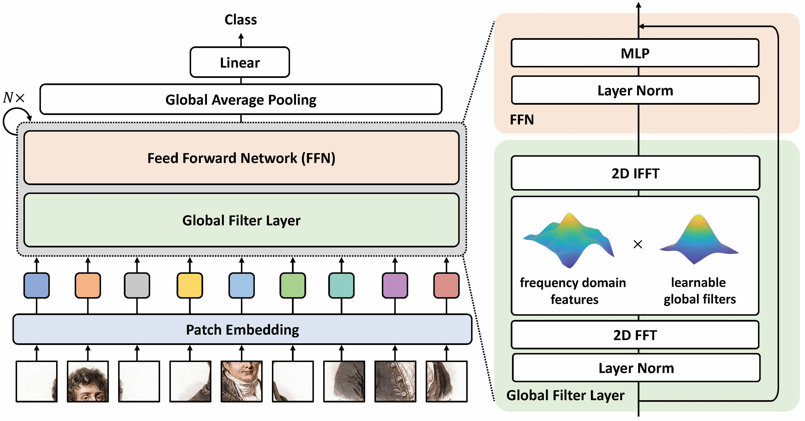
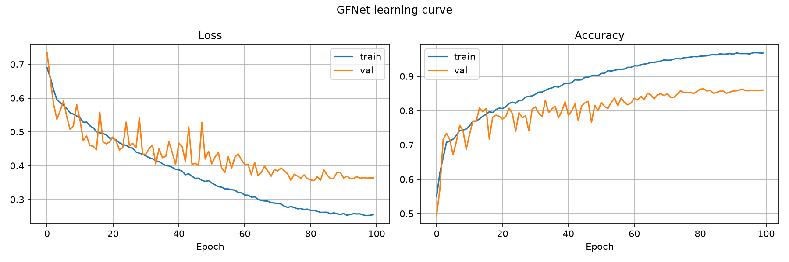
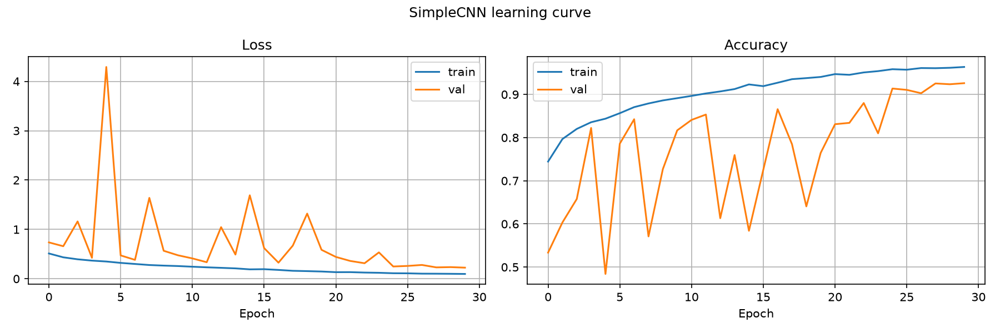

# GFNet for Alzheimer's Disease Classification (ADNI, AD vs NC)
**Author:** Ryan Huang\
**Student ID:** 47189553

## Overview
This pull request trains a Global Filter Network (GFNet-Ti) to classify brain MRI slices from the ADNI dataset as either Alzheimer's disease (AD) or normal control (NC) [1].

### GFNet
GFNet is similar to a Vision Transformer (ViT), but replaces each self-attention layer with a global filter layer [1]. The global filter layer applies a 2D FFT to the patch tokens, multiplies the result element-wise by a learnable filter, and applies the inverse FFT. This allow O(N log N) time, compared with O(N^2) for self-attention, where N is the number of tokens. 




## Results

### GFNet

- Test Accuracy: 80.7% patient
- Training Accuracy: 95.6% (5-fold CV)
- Validation Accuracy: 82.5% (5-fold CV)
- NC Sensitivity: 81.7% slice, 88.1% patient
- AD Sensitivity: 67.7% slice, 73.1% patient

### SimpleCNN 
4 blocks of (Conv → BatchNorm → ReLU) × 2 + max-pool


- Test Accuracy: 74.9% patient
- Training Accuracy: 99.7%
- Validation Accuracy: 96.8%
- NC Sensitivity: 96.7% slice, 97.4% patient
- AD Sensitivity: 52.2% slice, 52.0% patient

SimpleCNN seems to be suffering from data leakage and overfitting. Compared to GFNet, both the training and validation accuracies for SimpleCNN are above 95%, but its test accuracy drops to 75%, whereas GFNet reach 80.7% test accuracy.


## Feasibility Review
- Dataset split: 5-fold patient-level CV on train 1076 patients and test 450 patients
- Architecture: GFNet-Ti, (patch 16, dim 256, depth 12)
- Optimizer: AdamW, lr 5 × 10^-4, weight decay 0.05, batch 64
- Scheduler: Cosine annealing to 1 × 10^-6
- Loss: Cross-entropy, label smoothing 0.1
- Activation Function: GELU
- Training completed: 100 epochs × 5 folds

## Files
- `dataset.py`: loads the ADNI slices, makes patient-level train/val splits and 5-fold CV, and applies transforms and augmentation.
- `modules.py`: the GFNet-Ti model and a SimpleCNN baseline.
- `train.py`: trains GFNet with stop when train platue, and saves checkpoints and json.
- `predict.py`: evaluates a checkpoint on the test set , and saves example predictions, learning curves.
- `tools/count_ids.py`: counts unique patients in each AD_NC folder.
- `tools/image_info.py`: shows the image sizes in each AD_NC folder.
- `tools/setup.ps1`:  setup on a Windows lab computer. 
- `tools/setup_wsl.sh`: the same setup for a Cloud GPU using WSL.

## Usage
```bash
python train.py --cv              # 5-fold CV 
python train.py                   # one train/val split 
python train.py --model simplecnn # SimpleCNN baseline
```
Set the dataset path with `--root path/to/AD_NC` (or `DEFAULT_ROOT` in `dataset.py`).


## Hardware 
- Labs computer (RTX2080) 
- GPU Lab (A100) 
- local Mac M series GPU (M1 Max)

## Environment
- Conda env `torch`, Python 3.11
- Mac (MPS): PyTorch 2.2.2, torchvision 0.17.2, NumPy 1.26.4, Matplotlib 3.11.1, Pillow 12.3.0
- Lab / GPU lab (CUDA): PyTorch + torchvision CUDA 12.6 build (`cu126`)

## Artificial Intelligence Usage Disclosure
Gemini
- help choose ddta augmentation parameters and what type of augmentation i can use 
- help make code commenting 
- help format the output of the training loop
- help extract my constant for easy to follow
- help create a script for fast setup env
- help debug in import the data

## References
[1] Y. Rao, W. Zhao, Z. Zhu, J. Lu, and J. Zhou, "Global filter networks for image classification," in *Advances in Neural Information Processing Systems*, vol. 34, pp. 980–993, 2021. https://arxiv.org/abs/2107.00645. Code: https://github.com/raoyongming/GFNet