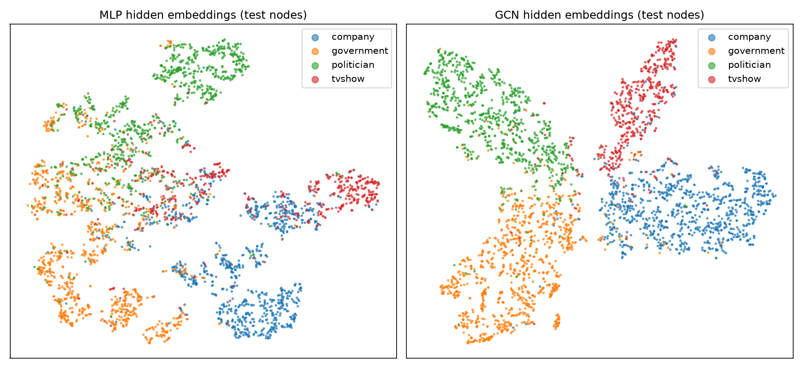
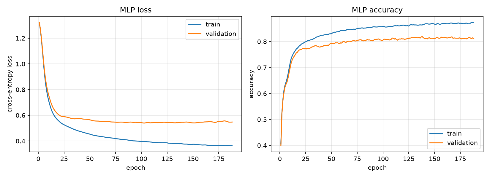
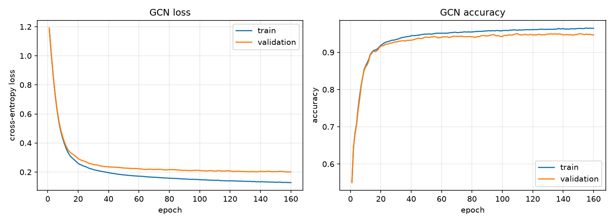
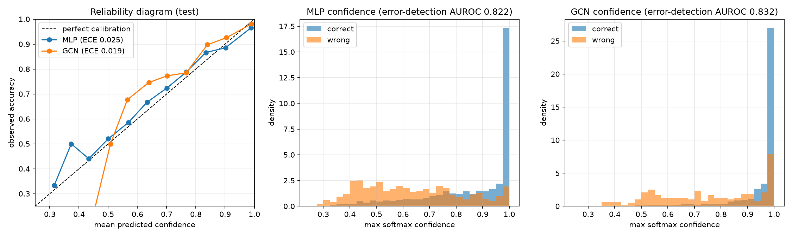
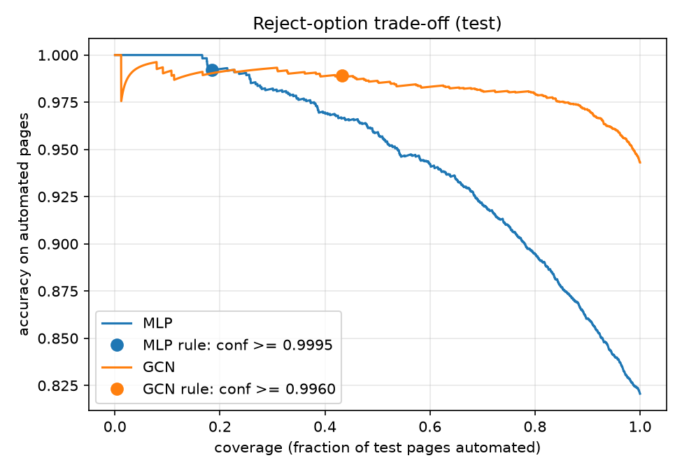

# Multi-layer GCN for Facebook Page-Page Node Classification

**Author:** Nasser Kessas (48834690) · **Course:** COMP3710 Pattern Recognition, 2026
**Project:** 2.1 Classification: Multi-layer GNN · **Difficulty:** Normal

## Contents

1. [Problem and algorithm](#1-problem-and-algorithm)
2. [Feasibility review](#2-feasibility-review)
3. [Setup and usage](#3-setup-and-usage)
4. [Data, preprocessing and splits](#4-data-preprocessing-and-splits)
5. [Training](#5-training)
6. [Results: GCN vs MLP baseline](#6-results-gcn-vs-mlp-baseline)
7. [Investigating the Confidence and Ambiguity Dilemma](#7-investigating-the-confidence-and-ambiguity-dilemma)
8. [Failure case autopsy](#8-failure-case-autopsy)
9. [Recommendation to the project manager](#9-recommendation-to-the-project-manager)
10. [Limitations](#10-limitations)
11. [Artificial Intelligence Usage Disclosure](#11-artificial-intelligence-usage-disclosure)
12. [References](#12-references)

---

## 1. Problem and algorithm

### The problem

The Facebook Large Page-Page Network [1] is a graph of 22,470 verified Facebook pages. An edge joins two pages that like each other. Each page has a 128-dimensional feature vector derived from its own description, and belongs to one of four categories: **company, government, politician or TV show**. The task is **semi-supervised multi-class node classification**: given the whole graph and the labels of a subset of pages, predict the category of every other page.

The use case is an automated triage assistant. Predictions it is confident about are handled automatically, and uncertain ones are routed to a human reviewer. High overall accuracy is therefore not enough: we also need to know **when the model can be trusted**. That is the *Confidence and Ambiguity Dilemma* this project investigates.

### How it works

A plain classifier such as an MLP looks at each page on its own. A **Graph Convolutional Network (GCN)** [2] also uses the pages it is linked to. Each GCN layer updates every page's representation by taking a degree-normalised average of its own features and its neighbours' features, then applying a learned linear map and a non-linearity:

$$H^{(l+1)} = \sigma\left(\hat D^{-1/2}(A + I)\hat D^{-1/2} H^{(l)} W^{(l)}\right)$$

Here $A$ is the adjacency matrix, $I$ adds a self-loop so a page keeps its own features, $\hat D$ is the degree matrix of $A + I$, and $W^{(l)}$ is the layer's weight matrix. The symmetric normalisation stops high-degree pages from dominating.

Stacking 3 layers means each prediction draws on everything within 3 hops of the page. This helps because the graph is strongly **homophilous**: 88.5% of edges join pages of the same category, so a page's neighbourhood is strong evidence of its own class. A final softmax gives a probability for each class. The largest probability is used as the model's **confidence**.

The baseline is an **MLP with the same depth, width and number of parameters (12,676)**. A `GCNConv` layer has the same weights as a `Linear` layer; it only adds neighbour averaging. So the difference between the two models isolates the value of the graph.



*Figure 1. t-SNE of the 64-dimensional hidden embeddings of the test pages, coloured by true class. The MLP (left) leaves government, politician and TV-show pages fragmented and mixed in the centre. The GCN (right) forms four compact, mostly separate clusters. Most of the remaining confusion lies along the politician–government boundary, and TV-show pages near company pages; both pairs are also the most common errors (Section 8).*

---

## 2. Feasibility review

*This one-page review was written before the GCN was trained. It is reproduced as written; Section 6 reports the outcome against each criterion.*

### 2.1 User need, scope and acceptance criteria

**User:** a content-moderation or analytics team that has to sort Facebook pages into four categories (company, government, politician, TV show) for review or reporting.
**Prototype purpose:** classify every page automatically. Handle the confident predictions with no human involved, and send the uncertain ones to a human reviewer. This addresses the *Confidence and Ambiguity Dilemma*: high overall accuracy is not enough if the model is confidently wrong on ambiguous pages.

**Acceptance criteria** (measured on a held-out, stratified test split; models are compared with an MLP baseline on the same split):

1. **Accuracy:** GCN test accuracy ≥ 0.90 and macro-F1 ≥ 0.90, and both higher than the feature-only MLP baseline.
2. **Calibration:** expected calibration error (ECE) ≤ 0.05, and the max-softmax confidence separates correct from wrong predictions with AUROC ≥ 0.80.
3. **Reject option:** a confidence threshold, chosen on the validation split only, gives ≥ 99% accuracy on the pages it handles automatically and handles more of them than the baseline does at the same accuracy.
4. **Resources:** trains in under 10 min on a laptop CPU, with no GPU required. Inference over the whole graph takes under 1 s, and the model has under 50k parameters.
5. **No leakage:** transductive setting. Only training-node labels enter the loss. Feature standardisation uses training nodes only. The threshold is never tuned on the test set.

### 2.2 Model choice and course concepts

**Data:** the Facebook Large Page-Page Network [1], as the course-provided `facebook.npz` [3]: 22,470 pages, 171,002 mutual-like edges, and 128-dimensional SVD features from page descriptions.
**Split:** a 70/15/15 split of the nodes, stratified by class with a fixed seed. The setting is transductive: all edges are visible, and validation/test labels are masked.
**Models:** the baseline is a 3-layer MLP that sees only each page's own features. The proposed model is a 3-layer GCN [2]. Both have the same hidden width, so any difference comes from the graph alone.
**Course concepts:** MLPs; convolution generalised from image grids to graphs; semi-supervised learning; softmax and cross-entropy; regularisation (dropout, weight decay) and early stopping on validation; t-SNE for inspecting the embeddings.

### 2.3 Preliminary feasibility evidence

- **Data audit:** the classes are mildly imbalanced (company 6,495; government 6,880; politician 5,768; TV show 3,327).
- **Edge homophily is 0.885:** 88.5% of edges join pages of the same class, which strongly suggests that aggregating over neighbours will help.
- **Label check:** the dataset README's label order is wrong. The real order is alphabetical, which I confirmed against the raw MUSAE CSV (22,470/22,470 labels match). Without this check, every per-class result would have been reported under the wrong class name.
- **Baseline smoke test:** the MLP reaches 82.1% test accuracy (macro-F1 0.80). It trains in about 30 s on CPU with 12,676 parameters. TV-show recall is the weakest at 0.64, which shows that page features alone are not enough.

### 2.4 Risks, budget and fallback

| Risk | Mitigation / fallback |
|---|---|
| Over-smoothing as the GCN gets deeper | Keep 2–3 layers. Use dropout and early stopping on validation |
| Pages whose neighbours mostly belong to another class get "pulled" to the wrong class | Compare with the MLP in the failure-case analysis. Send pages to review when the GCN and MLP disagree |
| The GCN is confidently wrong, so a threshold cannot catch it | Measure ECE and the reliability diagram. Temperature scaling on the validation set as a fallback |
| Results depend on one random split | Fixed seeds. Report the sampling error on test metrics |
| GCN underperforms | Fall back to GraphSAGE (mean aggregation), using the same pipeline |

**Compute budget:** a laptop CPU, about 5 min per full training run of both models. Rangpur is only needed if GPU memory has to be profiled.
**Next experiment:** train the 3-layer GCN under the same split. Then measure calibration, choose the reject threshold on validation, and analyse the 5 most confident errors.

---

## 3. Setup and usage

### Dependencies

Tested with these exact versions on a CPU-only machine (WSL2 Ubuntu, Linux 6.6):

| Package | Version |
|---|---|
| Python | 3.12.3 |
| torch | 2.5.1 (CPU build) |
| torch_geometric | 2.6.1 |
| scikit-learn | 1.9.1 |
| matplotlib | 3.11.2 |
| numpy | 2.5.4 |

```bash
python3 -m venv .venv && source .venv/bin/activate
pip install torch==2.5.1 --index-url https://download.pytorch.org/whl/cpu
pip install -r requirements.txt
```

No GPU is needed. If CUDA is available, the scripts use it automatically.

### Files

| File | Purpose |
|---|---|
| `dataset.py` | Downloads the data, builds the PyG graph, stratified train/val/test masks, train-only feature standardisation. Running it prints a data audit |
| `modules.py` | `MLP` baseline and `GCN` model, with a shared `forward`/`embed` interface |
| `train.py` | Full-batch training with early stopping, curves, checkpoints, test metrics and resource profiling |
| `predict.py` | Loads the trained models; produces the t-SNE, calibration and reject-option analysis and the failure cases |
| `feasibility_review.md` | The one-page feasibility review (also reproduced in Section 2) |

### Reproducing the results

Run from this folder. The data (about 13 MB) downloads automatically into `data/` on first use.

```bash
python dataset.py            # data audit: split sizes, class balance, homophily, label check
python train.py --model both # trains MLP then GCN (~3.5 min on CPU); writes checkpoints/, figures/, results/
python predict.py            # analysis and figures (~20 s); writes results/analysis.json
```

All randomness (data split, weight initialisation, t-SNE) uses seed 42 (`--seed`). Re-running reproduces the numbers below up to small floating-point differences between machines. Useful options: `train.py --model gcn --layers 2 --hidden 128 --lr 0.01`; `predict.py --target-accuracy 0.995 --num-failures 5`.

### Example input and output

**Input:** the whole graph: `x` [22470 × 128] node features, `edge_index` [2 × 342004] (each undirected edge stored in both directions), and the training-label mask.
**Output:** a probability for each class for every page. For example, from `predict.py`:

```
=== GCN (test) ===
accuracy 0.9431 | macro-F1 0.9408 | macro-AUROC 0.9898
  company     P 0.952  R 0.948  F1 0.950
  government  P 0.934  R 0.953  F1 0.943
  politician  P 0.948  R 0.945  F1 0.946
  tvshow      P 0.936  R 0.912  F1 0.924
Reject rule (target 99% on val): automate if confidence >= 0.996 -> automates 43.2% of test pages at 98.90% accuracy ...
{"node": 9254, "page_name": "Comedy Central UK", "true": "company", "gcn_pred": "tvshow", "gcn_conf": 1.0, ...}
```

---

## 4. Data, preprocessing and splits

- **Source:** the course-provided `facebook.npz` [3], a rebuild of the file PyG's `FacebookPagePage` loader used to download. Its features are 128-dimensional SVD projections of the original bag-of-words page descriptions. Page names come from the raw `musae_facebook_target.csv` in the same repository. Reading the plain CSV avoids unpickling a downloaded file.
- **Label verification:** the dataset README lists the labels as `0=tvshow, 1=government, 2=company, 3=politician`. The per-label counts (6495, 6880, 5768, 3327) instead match the published class sizes in **alphabetical** order (`company, government, politician, tvshow`). This was confirmed against the CSV's text labels for all 22,470 pages (`python dataset.py`). Training is unaffected either way, but every class-level result would otherwise have carried the wrong name.
- **Feature standardisation:** zero mean and unit variance per feature, using statistics from **training nodes only**, so nothing about validation or test pages leaks into the inputs.
- **Edges:** used as given: 171,002 undirected edges, stored in both directions. `GCNConv` adds self-loops and symmetric normalisation.

### Split and setting

| Split | Pages | company | government | politician | tvshow |
|---|---|---|---|---|---|
| Train (70%) | 15,727 | 4,546 | 4,816 | 4,037 | 2,328 |
| Validation (15%) | 3,370 | 974 | 1,032 | 865 | 499 |
| Test (15%) | 3,373 | 975 | 1,032 | 866 | 500 |

**Setting: transductive.** The whole graph, including test pages' features and edges, is visible during message passing, but **only training labels enter the loss**. Validation labels are used only for early stopping and for choosing the confidence threshold. Test labels are used only for the final metrics. This matches the operational use case: the full page graph is known, and categories are missing for some pages.

**Why this split:**
- *Stratified by class:* the TV-show class is about half the size of the others, and stratifying keeps every split's class mix identical, so per-class test metrics aren't skewed by a lucky draw.
- *70/15/15:* gives about 3,400 test pages. That is enough for tight estimates: the standard error on 94% accuracy is about ±0.4 percentage points. Validation is the same size, because it is used to choose the reject threshold, which relies on the rare high-confidence errors.
- *A separate validation set:* every tuned choice (best epoch, threshold) is made on validation, so the test set is used exactly once.

---

## 5. Training

Both models use identical hyperparameters:

| Setting | Value |
|---|---|
| Layers / hidden width | 3 / 64 |
| Dropout | 0.5 (after every hidden layer) |
| Optimiser | Adam, learning rate 0.01, weight decay 5 × 10⁻⁴ |
| Loss | Cross-entropy on training nodes only |
| Batching | Full batch (whole graph per step) |
| Epochs | Up to 500; early stopping with patience 50 on validation accuracy; the best-validation checkpoint is kept |

| MLP baseline | GCN |
|---|---|
|  |  |

*Figure 2. Training and validation loss and accuracy. Training metrics are re-evaluated with dropout off, so the two curves are comparable. The GCN converges much faster (over 92% validation accuracy by epoch 25) and peaks at epoch 110; the MLP peaks at epoch 138. The MLP's train–validation gap grows steadily: with only page features to go on, it starts memorising training pages. The GCN's validation loss levels off rather than rising, so there is no sign of serious overfitting.*

---

## 6. Results: GCN vs MLP baseline

All numbers are on the same 3,373 held-out test pages.

### Classification

| Metric | MLP (baseline) | GCN | Change |
|---|---|---|---|
| Accuracy | 0.821 | **0.943** | +12.2 pp |
| Macro-F1 | 0.804 | **0.941** | +0.137 |
| Macro-AUROC (one-vs-rest) | 0.953 | **0.990** | +0.037 |

| Class | MLP P / R / F1 | GCN P / R / F1 |
|---|---|---|
| company | 0.843 / 0.875 / 0.859 | 0.952 / 0.948 / 0.950 |
| government | 0.824 / 0.854 / 0.839 | 0.934 / 0.953 / 0.943 |
| politician | 0.819 / 0.822 / 0.821 | 0.948 / 0.945 / 0.946 |
| tvshow | 0.761 / **0.644** / 0.698 | 0.936 / **0.912** / 0.924 |

The largest gain is in **TV-show recall (0.64 → 0.91)**. TV-show descriptions overlap heavily with company descriptions (networks, broadcasters, production companies), but TV-show pages mostly link to other TV shows.

### Resource profile

| | MLP | GCN |
|---|---|---|
| Trainable parameters | 12,676 | 12,676 |
| Training time (CPU, to early stop) | 31 s | 177 s |
| Inference, whole graph, 22,470 pages (CPU, median of 20) | 4.8 ms | 175 ms |
| Peak GPU memory | n/a (CPU only) | n/a (CPU only) |

Profiled on a CPU-only laptop under WSL2, so no GPU memory figure is available. The whole graph and both models fit easily in RAM. The GCN's cost is the sparse neighbour aggregation over 342k directed edges. It is about 36× slower than the MLP, but scoring every page still takes **under 0.2 s**, which is negligible for a triage system.

### Acceptance criteria

| # | Criterion | Result | Met? |
|---|---|---|---|
| 1 | Accuracy and macro-F1 ≥ 0.90, above the baseline | 0.943 / 0.941 vs 0.821 / 0.804 | ✅ |
| 2 | ECE ≤ 0.05; error-detection AUROC ≥ 0.80 | 0.019; 0.832 | ✅ |
| 3 | Threshold chosen on validation gives ≥ 99% on automated pages, with more coverage than the baseline | 98.90% at 43.2% coverage (MLP: 99.2% at 18.5%) | ⚠️ Narrowly missed (see Section 7.3) |
| 4 | < 10 min training, < 1 s inference, < 50k params, CPU only | 177 s, 0.18 s, 12,676 | ✅ |
| 5 | No leakage | Train-only loss and standardisation; threshold chosen on validation | ✅ |

---

## 7. Investigating the Confidence and Ambiguity Dilemma

**Question:** does the GCN's confidence tell us when it is right, or is it confidently wrong on ambiguous pages? And does its extra cost pay off operationally?

### 7.1 Calibration



*Figure 3. Left: reliability diagram (15 equal-width confidence bins; the diagonal is perfect calibration). Middle and right: distribution of max-softmax confidence for correct and wrong test predictions.*

| | MLP | GCN |
|---|---|---|
| Expected calibration error (ECE) | 0.025 | **0.019** |
| Mean confidence when correct | 0.860 | 0.952 |
| Mean confidence when wrong | 0.631 | 0.756 |
| Error-detection AUROC (how well confidence ranks correct above wrong) | 0.822 | **0.832** |

On average, both models are **well calibrated**. Neither is systematically overconfident, and the GCN's reliability curve sits slightly *above* the diagonal in the middle bins, which means it is slightly *under*confident there. Confidence is a useful but imperfect signal of correctness: AUROC is about 0.83, where 0.5 would be useless and 1.0 perfect.

The histograms reveal the catch. **The GCN's wrong predictions have a large spike at confidence ≈ 1.0.** Most of its errors are low-confidence and easy to flag, but a minority are made with near-total certainty. On the test set, 512 pages got confidence ≥ 0.9999, and 5 of them were wrong. Averages like ECE hide this, because these cases are rare. No confidence threshold can catch them: they score as high as the most reliable correct predictions. Temperature scaling would not help either, because it rescales confidences without changing their order. Section 8 shows what causes these errors.

### 7.2 Reject option: automate confident cases, send the rest to a human

The rule is to *automate a page if its confidence is ≥ t, and otherwise route it to a human reviewer*. **t is chosen on the validation set** as the lowest threshold that reaches 99% accuracy on the pages it automates, then applied once to the test set.



*Figure 4. Risk–coverage curves: accuracy on the automated pages against the fraction of test pages automated, adding pages from the most to the least confident. Dots mark each model's rule chosen on validation.*

| Rule (test set) | Threshold | Pages automated | Accuracy on automated | Pages routed to human | Errors that slip through |
|---|---|---|---|---|---|
| MLP: confidence ≥ t | 0.9995 | 18.5% | 99.20% | 2,750 | 5 of 605 |
| GCN: confidence ≥ t | 0.9960 | **43.2%** | 98.90% | 1,916 | 16 of 192 |
| **GCN: confidence ≥ t *and* MLP agrees** | 0.9960 | **39.0%** | **99.32%** | 2,058 | **9** of 192 |

At roughly the same accuracy, **the GCN can safely automate more than twice as many pages as the baseline** (43% vs 18.5%). That would cut human review workload from 82% of pages to 57–61%. The MLP only reaches 99% by automating a small set of very clear-cut pages. Its curve (Figure 4) drops steeply after that, while the GCN stays above 97.5% accuracy up to 80% coverage.

The last row adds a cheap **guardrail**: the page is only automated if the feature-only MLP predicts the same class. This targets the neighbourhood-driven confident errors described in Section 8. It costs 4 percentage points of coverage but **almost halves the errors that slip through (16 → 9)**, and it pushes accuracy above the 99% target. The rule has no tuned parameters of its own: it reuses the threshold chosen on validation. It was designed in the feasibility review as a mitigation, before these test numbers were seen.

### 7.3 On the narrow miss of criterion 3

The GCN's threshold, chosen on validation, gave 98.90% on test against a 99% target. With 1,457 automated test pages, one error moves accuracy by 0.07 percentage points, and the sampling standard error is about ±0.27 percentage points. So the shortfall (0.10 percentage points) is within noise, and is what you would expect when moving a tight threshold from one sample to another. The threshold was **not** re-tuned on test to close the gap; doing so would leak test information into the operating point. The combined rule in Section 7.2 meets the target with margin. Operationally, a target with a safety buffer (for example, choosing t for 99.5% on validation) is advisable.

---

## 8. Failure case autopsy

These are the GCN's five **most confident** test errors (out of 192), which are the hardest kind for a reject rule to catch. "Neighbours" is the true-class mix of each page's linked pages. It is computed for analysis only, and is not an input to the models.

| # | Page | True | GCN (conf.) | MLP (conf.) | Degree | Neighbours |
|---|---|---|---|---|---|---|
| 1 | Senate of Canada – Sénat du Canada | government | politician (1.00) | politician (0.97) | 266 | essentially 100% politician |
| 2 | Laurent Fabius | politician | government (1.00) | **politician (1.00)** ✓ | 100 | 86% government, 14% politician |
| 3 | DIRECTV Puerto Rico | company | tvshow (1.00) | **company (0.82)** ✓ | 69 | 81% tvshow, 16% company |
| 4 | Comedy Central UK | company | tvshow (1.00) | tvshow (1.00) | 16 | 94% tvshow, 6% company |
| 5 | Fractal | tvshow | company (1.00) | company (1.00) | 1 | 100% company |

These errors fall into three types:

**A. Neighbourhood override: the graph turns a correct answer into a wrong one (cases 2, 3).** The MLP gets both right from the page's own description features. But their neighbourhoods are dominated by another class: Laurent Fabius, a former French prime minister and foreign minister, is mostly linked with government bodies, and DIRECTV Puerto Rico, a satellite TV provider, is mostly linked with the shows it carries. Three rounds of neighbour averaging drown out the page's own features, and the GCN switches class *with full confidence*. This is the price of relying on homophily: it fails exactly on **heterophilous pages**, those that sit on the boundary between two communities. The MLP-agreement guardrail exists for this case: both of these errors are routed to review under the combined rule.

**B. Ambiguous or debatable ground truth (cases 1, 4).** The Senate of Canada is an institution, so it is labelled government, but it links almost entirely to politicians, and even its own features lead the MLP to "politician". Comedy Central UK is a TV channel, labelled company, whose links are all to its shows. Here **both** models confidently agree on the "wrong" class, and a human annotator could reasonably have picked the same. These are less model failures than **category-boundary problems in the labels**: institutions vs their members, and broadcasters vs their content. No reject rule based on these models can flag them; only domain rules (for example, "legislatures are government") or relabelling can.

**C. Isolated pages with little information (case 5).** "Fractal" has a single link (to a company page) and an ambiguous one-word name. Its own features lead the MLP to "company", and its one neighbour agrees, so both models are certain. The confidence comes from a single piece of weak evidence. **Low-degree pages are a structural blind spot**: the GCN has almost no neighbourhood to average over, but its softmax does not reflect that lack of evidence.

**Common trigger:** in every case, the max-softmax probability measures how **consistent** the evidence is, not how **much** evidence there is or how **reliable** it is. A page whose features and few neighbours all point the same (wrong) way gets confidence 1.0.

---

## 9. Recommendation to the project manager

**Adopt the GCN, with a two-condition automation rule. Do not use the GCN's confidence alone.**

1. **The GCN is worth its cost.** It has the same parameter count as the baseline and adds 12 points of accuracy (82% → 94%). It is also better calibrated, and lets us automate **more than twice as many pages** at ~99% accuracy (39–43% vs 18.5%). The extra compute (3 min of training, 0.18 s to score the whole graph on a laptop CPU) is negligible for this use.
2. **Operating policy:**
   - **Automate** a page only if the GCN's confidence is ≥ 0.996 **and** the feature-only MLP agrees. Expected: ~39% of pages handled automatically at ~99.3% accuracy.
   - **Route everything else to a human.** Prioritise review by GCN confidence, since most errors sit well below the threshold.
   - **Always route pages with very few links** (for example, degree ≤ 2), whatever the confidence, because their confidence rests on almost no evidence.
3. **Known residual risk:** about 0.7% of automated pages (9 of 1,315 on test) will still be wrong. These are mostly cases where the label is debatable (legislatures vs politicians, broadcasters vs their shows). Fixing them needs **clearer category definitions** in the labelling guidelines, not a better model. Regular audits of a sample of automated decisions are recommended.
4. **Re-validate after deployment.** The threshold was chosen on one validation split; re-choose it as new labelled pages arrive, ideally with a safety margin (target 99.5% on validation).

---

## 10. Limitations

- **One split, one seed.** Results come from a single stratified split with seed 42. With about 3,400 test pages, sampling error on accuracy is about ±0.4 pp, but split-to-split and seed-to-seed variation was not measured. Reporting mean ± std over several seeds would strengthen the comparison.
- **Transductive only.** The model is trained with the test pages' features and edges present. Classifying a brand-new page means re-running inference on the updated graph (cheap here), and its quality depends on that page already having links. An inductive model (for example, GraphSAGE) would handle new pages more naturally.
- **No hyperparameter search.** Standard GCN settings from [2] were used for both models, adjusted only to the same depth and width. Tuning on validation (for example, 2 vs 3 layers) might improve both models.
- **CPU profiling.** No GPU memory figures; the timings are specific to the test machine.
- **Confidence is max-softmax only.** Alternatives that account for the amount of evidence (for example, MC dropout, ensembles, or degree-aware uncertainty) were not explored, and could target failure type C directly.

---

## 11. AI Usage Disclosure

**Tool used:** Google Gemini

**What it assisted with:**
- Creating base code for creating figures 
- Interpreting results and suggesting fixes

---

## 12. References

[1] B. Rozemberczki, C. Allen and R. Sarkar, "Multi-scale attributed node embedding," *Journal of Complex Networks*, vol. 9, no. 2, 2021.
[2] T. N. Kipf and M. Welling, "Semi-supervised classification with graph convolutional networks," in *Proc. ICLR*, 2017.
[3] gayanku, "facebook_page-page_dataset," GitHub. https://github.com/gayanku/facebook_page-page_dataset
[4] C. Guo, G. Pleiss, Y. Sun and K. Q. Weinberger, "On calibration of modern neural networks," in *Proc. ICML*, 2017. (ECE and temperature scaling.)
[5] M. Fey and J. E. Lenssen, "Fast graph representation learning with PyTorch Geometric," *ICLR Workshop on Representation Learning on Graphs and Manifolds*, 2019.
