# 3D Improved UNet Image Segmentation - Prostate Case Study

COMP3710 Pattern Recognition and Analysis · s4910970 · Hard difficulty

This project compares a Baseline 3D U-Net with a residual, deep-supervised Improved 3D U-Net for six-class pelvic MRI segmentation: Background, Body, Bones, Bladder, Rectum and Prostate. The dataset is CSIRO's [Labelled weekly MR images of the male pelvis](https://data.csiro.au/collection/csiro%3A51392), referred to as **HipMRI** in this project. The intended use is research on contour drafting with human review, not autonomous treatment planning.

**Main result.** Under the matched historical held-out protocol, Baseline reached patient-mean prostate Dice **0.811548** and Improved reached **0.813587**, a difference of only **+0.002038**. Improved also reduced the worst patient's score by **0.062061**. A separately frozen Context-v2 B candidate was subsequently evaluated once on the same five held-out patients in Rangpur job `699109`; it reached **0.795699**, which is **0.015849 below Baseline**. The evidence therefore supports retaining Baseline as the conservative reference; neither added-complexity candidate establishes a reliable benefit.

## Dataset

1. Open the official [CSIRO collection page](https://data.csiro.au/collection/csiro%3A51392) or its persistent DOI [10.25919/45T8-P065](https://doi.org/10.25919/45T8-P065).
2. Review the collection's licence and data-use conditions before downloading. The repository does not redistribute the MRI files.
3. Extract the download beneath `data/HipMRI_Study_open` so the two full-volume directories appear exactly as follows:

```text
HipMRI_3D_UNet_s4910970/
└── data/
    └── HipMRI_Study_open/
        ├── semantic_MRs/
        │   ├── B006_Week0_LFOV.nii.gz
        │   └── ...
        ├── semantic_labels_only/
        │   ├── B006_Week0_SEMANTIC.nii.gz
        │   └── ...
        └── data_use_agreement.txt
```

The code recursively discovers `.nii` and `.nii.gz` files in those two directories. An MRI ending in `_LFOV` is paired with the mask ending in `_SEMANTIC` through their shared case key. Do not rename medical files. The CSIRO collection's `BriefDataDescription.txt` identifies label `5` as Prostate.

The frozen manifest used in the reported experiment contains 211 scans from 38 patients. Weekly scans are correlated, so splitting individual scans would allow patient-specific anatomy to appear in both training and evaluation. Patient separation reduces that leakage risk, although five test patients still provide limited coverage. Seed 42 assigns 27/6/5 patients and 146/46/19 scans to train/validation/test, with every weekly scan from one patient kept in one partition. Its SHA-256 is:

```text
5457a611c5611f944a26d214a1f325b803dded66f70df5fda3fd009642751a07
```

## 3D Improved UNet

The submission compares two models. `BaselineUNet3D` uses ordinary double-convolution blocks. `ImprovedUNet3D` adds residual projections and two training-only auxiliary heads. Both use channels 16/32/64/128, three downsampling stages and encoder skip connections. Improved inference uses final logits only. Its architecture identifier is `improved_v1`.

MRI intensities are z-score normalized. Images are resized with trilinear interpolation and masks with nearest-neighbour interpolation. Training uses 96×96×96 crops with a 0.5 probability of choosing a prostate-containing crop. Validation and test use deterministic full resized volumes. Raw logits enter cross entropy; softmax is applied within soft Dice.

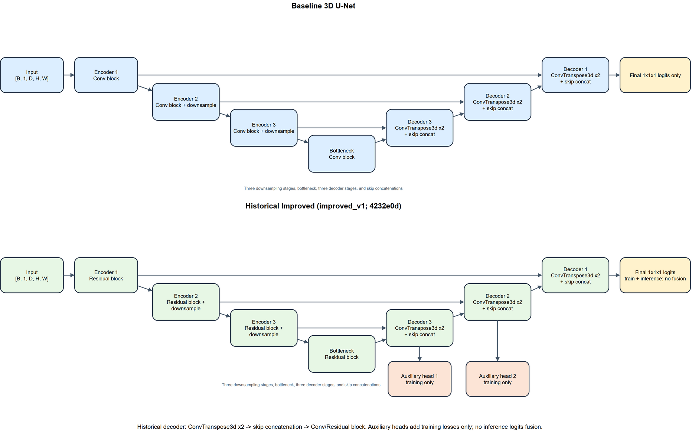

### UNet Comparison

The implementation is a compact residual, deep-supervised adaptation of 3D U-Net, rather than an exact reproduction of the complete Isensee training system. Input tensors have shape `[B,1,D,H,W]`, final logits `[B,6,D,H,W]`, and targets `[B,D,H,W]`. Integer targets enter cross entropy; soft Dice constructs one-hot targets inside the objective.

| Component            | Baseline                                               | Improved                                                   |
| -------------------- | ------------------------------------------------------ | ---------------------------------------------------------- |
| Feature block        | Two 3D convolutions, instance normalization, LeakyReLU | Same block with an identity or projected residual shortcut |
| Downsampling         | Max pooling                                            | Max pooling                                                |
| Decoder upsampling   | Transposed 3D convolution                              | Transposed 3D convolution                                  |
| Deep supervision     | None                                                   | Two decoder auxiliary heads during training                |
| Inference output     | Final head logits                                      | Final head logits                                          |
| Internal architecture identifier | `baseline_v1` | `improved_v1` |

### Modules

The implementation in [modules.py](modules.py) separates feature extraction, reconstruction and supervision:

- **Convolution block (`ConvBlock3D`).** Two padded 3×3×3 convolutions each use instance normalization and LeakyReLU. This block is shared by the plain model and the residual block's main branch.
- **Residual block (`ResidualBlock3D`).** The main branch is added to an identity shortcut, or a 1×1×1 projection when channel counts differ, followed by LeakyReLU.

### Aggregation and Context Pathway

- **Encoder and bottleneck (`_UNet3D`).** Three encoder stages retain skip features at 16, 32 and 64 channels. Max pooling halves each spatial dimension before the next stage; the bottleneck uses 128 channels.

The aggregation pathway progressively reduces spatial resolution while increasing feature channels. Skip features preserve the higher-resolution encoder information required by the decoder. For a 96³ training crop, encoder resolutions are 96³, 48³ and 24³, followed by a 12³ bottleneck.

### Localisation Pathway

- **Decoder and final head (`_UNet3D`).** Transposed convolutions double spatial dimensions. Each result is concatenated with the corresponding encoder feature and refined by a decoder block. A 1×1×1 head produces six-class logits at input resolution.
- **Auxiliary heads (`ImprovedUNet3D`).** Two 1×1×1 heads supervise intermediate decoder features during training. They are omitted from the evaluation output; Improved does not sum their logits into the final prediction.

The decoder reconstructs resolutions of 24³, 48³ and 96³. Argmax over the six final logits gives the predicted integer class at each voxel. These model components depend on PyTorch and do not use NumPy.

### Architecture Identifiers and Evidence

`baseline_v1` and `improved_v1` are **project-defined architecture identifiers**, not additional model names and not names assigned by the course specification, CSIRO or either paper. The report presents only Baseline and Improved; these identifiers ensure that saved experiments reconstruct the correct implementation.

| Identifier | Definition in this submission | Evidence and loading behaviour |
| ---------- | ----------------------------- | ------------------------------ |
| `baseline_v1` | Plain `BaselineUNet3D`, without residual blocks or auxiliary heads | [train.py](train.py), `model_configuration()`, writes this identifier for new Baseline runs; [modules.py](modules.py), `build_model()`, accepts it or an absent historical field. The Baseline class itself does not declare an `architecture_version` attribute. |
| `improved_v1` | `ImprovedUNet3D`, with residual blocks and training-only deep supervision | Declared on the class in [modules.py](modules.py). `build_model()` routes this identifier, the former compatibility identifier, or an absent version in an earlier Improved config to that class. |

The primary experiment used code revision `4232e0d91d8aa6cf8c1de38883b213c07cc62d10` (Baseline job `683675`, Improved job `683676`). At that revision, `ImprovedUNet3D` had no version identifier. The maintained class preserves its parameterized layers and forward computation; current input-size validation additionally rejects dimensions below 16. Thus `improved_v1` is the maintained name for that architecture, not a claim that the original run stored that string or a third model name.

In the original project checkout, the historical definition can be inspected with:

```bash
git show 4232e0d91d8aa6cf8c1de38883b213c07cc62d10:src/modules.py
```

That command needs the original Git history and is not a prerequisite for running an exported course folder. The local evidence index is `docs/results_summary.json` in the original project root; it records the two jobs, source artifact paths, hashes, selected epochs and patient scores. Prediction uses `build_model()` and `load_state_dict(..., strict=True)` in [predict.py](predict.py). Version routing and strict loading guard architecture compatibility; the identifier alone does not establish a result's provenance.

The training objective is weighted cross entropy plus weighted soft Dice. In the main experiment, prostate has weight 4 in both terms and the remaining classes have weight 1. Each Improved auxiliary head adds 0.25 times the same objective, with nearest-neighbour downsampled labels. The later Context-v2 model introduces Dropout3D, interpolation-convolution upsampling and inference-time logit fusion; these features must not be attributed to the historical model's test results.

## Usage

### Dependencies

Run all commands from the directory containing this README, including after moving it into a course fork. Python 3.11 was used for implementation verification. A CUDA GPU is required for the declared full training configuration; CPU is suitable for tests and command inspection.

```bash
python -m venv .venv
source .venv/bin/activate  # Linux/macOS; Windows PowerShell: .venv\Scripts\Activate.ps1
python -m pip install --upgrade pip
python -m pip install torch==2.11.0 numpy==2.4.2 nibabel==5.4.2 matplotlib==3.10.8
```

The dependency versions below were import-verified on 26 October 2026 in the local verification record; this README edit did not repeat that environment audit. For the verified CUDA build, install PyTorch using `python -m pip install torch==2.11.0+cu128 --index-url https://download.pytorch.org/whl/cu128`. Historical formal runs used PyTorch `2.13.0+cu130`, CUDA `13.0` and an A100-PCIE-40GB. The verification environment is not a complete reconstruction of that historical runtime; bitwise reproduction is not claimed.

| Dependency | Verified version (26 October 2026)     | Purpose                            |
| ---------- | -------------------------------------- | ---------------------------------- |
| PyTorch    | `2.11.0+cu128`                       | Models, optimization and inference |
| NumPy      | `2.4.2`                              | NIfTI arrays and visualisation     |
| nibabel    | `5.4.2`                              | NIfTI loading and spatial metadata |
| matplotlib | `3.10.8`                             | Curves and failure panels          |
No W&B account is required.

### Data Audit and Patient Separation

Generate the manifest from the downloaded data:

```bash
python audit.py data/HipMRI_Study_open --output artifacts/dataset_manifest.json --seed 42
```

The audit checks image-mask pairing and spatial metadata before recording patients and cases. For the same dataset release and directory contents, compare the generated manifest's SHA-256 with the reported value above. A mismatch requires inspection before claiming exact reproduction of the historical split. Use the same generated manifest for both model arms.

### Training

The command below reproduces the declared Baseline configuration through the maintained interface:

```bash
python train.py \
  --manifest artifacts/dataset_manifest.json \
  --data-root data/HipMRI_Study_open \
  --output-dir artifacts/reproduced_baseline \
  --model baseline \
  --epochs 20 \
  --batch-size 1 \
  --learning-rate 0.001 \
  --base-channels 16 \
  --target-shape 128 128 128 \
  --train-patch-shape 96 96 96 \
  --foreground-patch-probability 0.5 \
  --seed 42 \
  --device cuda \
  --prostate-label 5 \
  --prostate-label-source "CSIRO DOI 10.25919/45T8-P065, BriefDataDescription.txt: 5=Prostate" \
  --prostate-ce-weight 4 \
  --prostate-dice-weight 4 \
  --selection-metric mean_dice \
  --scheduler none
```

For the Improved arm, use a different output directory and replace the model arguments with:

```text
--model improved --architecture-version improved_v1
```

For the two-model experiment reported here, every new Improved run must state `improved_v1`; the training CLI rejects an omitted version. Earlier checkpoints that predate this field, or that stored the former identifier, remain loadable through the compatibility loader.

Do not enable augmentation for this historical comparison. Both arms must use the same manifest, geometry, optimizer settings, seed, number of epochs and selection rule. At every completed epoch, training refreshes the loss/validation-Dice curve and recorded-learning-rate plot from the available history. This is epoch-level monitoring. Training writes `experiment_config.json`, `history.json`, `training_summary.json`, validation-selected `best.pt` and `training_curves.png` beneath the chosen output directory.

These commands reproduce the stored configuration through the current code. They do not guarantee bitwise identity with the historical GPU runtime.

### Prediction

Evaluate a validation-selected checkpoint once with overlap-averaged full-volume inference:

```bash
python predict.py \
  --checkpoint artifacts/reproduced_baseline/best.pt \
  --manifest artifacts/dataset_manifest.json \
  --data-root data/HipMRI_Study_open \
  --output-dir artifacts/reproduced_baseline_test \
  --patch-size 128 128 128 \
  --stride 64 64 64 \
  --device cuda
```

Prediction verifies the manifest hash and architecture metadata stored in the checkpoint. It writes `test_metrics.json`, per-case prediction tensors and failure panels. Each panel selects the axial, coronal and sagittal slice with the largest prostate-specific FP+FN count; if a case has no prostate error, it selects the centre of the reference prostate extent. The JSON records the selected case, slice indices and rule. The test partition must not influence hyperparameters, checkpoint selection or acceptance thresholds. These five patients have been evaluated by historical models and are not an untouched external cohort.

The sliding-window implementation averages overlapping logits and verifies complete voxel coverage. With the main `128³` target and `128³` patch, only one window is used per volume; this experiment does not demonstrate multi-window seam behaviour. The current single-model panel selector and the historical paired-case selector described below use different documented rules.

## Results

### Training

Main training used Adam, batch size 1, a constant learning rate of 0.001, 20 epochs and seed 42. Checkpoints were selected by the highest validation mean Dice: epoch 20 for Baseline and epoch 18 for Improved. This historical selection metric includes background; the later prostate-specific selection option represents a different protocol.

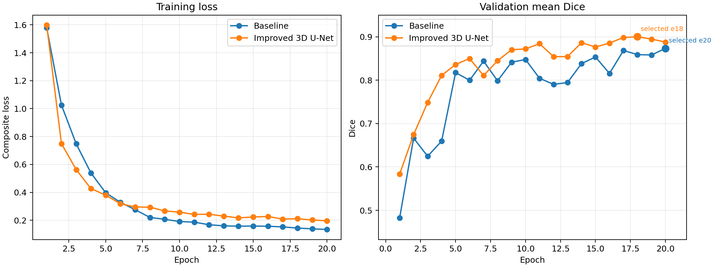

Improved's objective includes auxiliary losses, so loss magnitudes are not directly equivalent between arms. Similar training and validation curves alone do not prove the absence of overfitting.

#### Validation Animation

The animations below show the same fixed validation case (`G021_Week0`) at epochs 1, 5 and 19 of the later Context-v2 B validation run. Each frame moves through the full resized volume and displays MRI, reference prostate, predicted prostate, false positives in red and false negatives in cyan. They illustrate how the validation prediction changes during training; they are not held-out test evidence and are not used to select results after test evaluation.

**Epoch 1**


**Epoch 5**

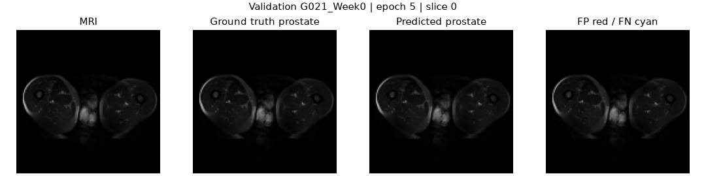

**Epoch 19 (validation-selected checkpoint)**


### Testing

Both formal jobs completed with exit status `0:0` at code revision `4232e0d`. The following tables report the retained matched comparison.

| Foreground class | Baseline Dice | Improved Dice | Baseline IoU | Improved IoU |
| ---------------- | ------------: | ------------: | -----------: | -----------: |
| Body             |      0.958148 |      0.977807 |     0.919909 |     0.956600 |
| Bones            |      0.859094 |      0.904555 |     0.753894 |     0.825973 |
| Bladder          |      0.957028 |      0.960610 |     0.917811 |     0.924386 |
| Rectum           |      0.852767 |      0.861629 |     0.747437 |     0.758714 |
| Prostate         |      0.822599 |      0.831385 |     0.702348 |     0.715546 |

The table above averages available scan-level class metrics and excludes background. Dice is `2TP/(2TP+FP+FN)` and IoU is `TP/(TP+FP+FN)`; mutually absent classes have no defined score. The headline below first averages prostate Dice within each patient, then gives all five patients equal weight.

| Test patient   |           Baseline |           Improved |          Difference |
| -------------- | -----------------: | -----------------: | ------------------: |
| B037           |           0.736256 |           0.674195 |           -0.062061 |
| H007           |           0.781378 |           0.839755 |           +0.058377 |
| K042           |           0.887015 |           0.878500 |           -0.008516 |
| L011           |           0.781136 |           0.795553 |           +0.014417 |
| M013           |           0.871957 |           0.879931 |           +0.007974 |
| **Mean** | **0.811548** | **0.813587** | **+0.002038** |

| Resource measure                           |    Baseline |    Improved |
| ------------------------------------------ | ----------: | ----------: |
| Trainable parameters                       |   1,400,646 |   1,423,106 |
| Peak training allocated memory             |   977.6 MiB | 1,193.4 MiB |
| Peak inference allocated memory            | 1,047.4 MiB | 1,047.5 MiB |
| Recorded forward time per volume           |  0.060885 s |  0.064924 s |
| Mean cumulative inference time per patient |  0.231362 s |  0.246713 s |

Patient time sums inference over that patient's weekly scans, whereas the forward-time row is per volume. These timings do not establish end-to-end clinical workflow latency. The maintained evaluator synchronizes the GPU around model/sliding-window inference on preprocessed tensors. The timed call includes host-to-device transfer of the input. This timing excludes NIfTI reading, normalization/resizing, checkpoint loading, panel rendering and prediction serialization. No separate warm-up or repeated-run timing distribution is retained for the historical table. Peak allocated memory is reset and recorded separately for training and validation/inference in the maintained code. The historical numbers cannot establish process-wide or device-wide peaks. Allocated VRAM is not total GPU reservation. Improved increases peak training allocation by approximately 22%.

The `+0.002038` mean difference is below the project's predeclared `+0.01` meaningful-upgrade target. Improved helped three patients and regressed on two; B037 deteriorated materially. Five repeatedly inspected patients and one seed do not support statistical-significance or clinical-generalization claims.

#### Frozen Context-v2 B held-out evaluation

Context-v2 B was selected and frozen using validation evidence before held-out evaluation. Its source validation job was `692354`; no held-out score was used to choose its checkpoint or configuration. Rangpur inference job `699109` produced a successful process exit record and complete evaluation outputs on 26 October 2026. The retained `sacct_at_exit.txt` snapshot was captured while Slurm still reported `RUNNING|0:0|00:07:15`, so this package does not independently establish the terminal scheduler state. The downloaded evidence contains the checkpoint/configuration snapshot, re-audited manifest, environment records, five failure panels, 19 full-volume prediction tensors and `test_metrics.json`. Retained hashes verify the transferred archive, checkpoint, manifest and source files listed in `sha256_verified.txt`; a complete 45-file hash manifest is not retained.

| Test patient | Baseline | Improved | Context-v2 B | Context-v2 B minus Baseline |
| ------------ | -------: | -------: | -----------: | --------------------------: |
| B037         | 0.736256 | 0.674195 |     0.732719 |                   -0.003537 |
| H007         | 0.781378 | 0.839755 |     0.738632 |                   -0.042746 |
| K042         | 0.887015 | 0.878500 |     0.865469 |                   -0.021546 |
| L011         | 0.781136 | 0.795553 |     0.784114 |                   +0.002978 |
| M013         | 0.871957 | 0.879931 |     0.857561 |                   -0.014396 |
| **Mean**     | **0.811548** | **0.813587** | **0.795699** | **-0.015849** |

The headline Context-v2 B value is the equal-patient mean of prostate Dice. Its scan-aggregated class-5 Dice is `0.814222`; that different aggregation must not replace `0.795699` in patient-level model comparisons. The run recorded `1304.29 MiB` peak inference VRAM and `0.2152 s` mean cumulative model-inference time per patient under its own timing scope. These resource values are retained as evidence but are not presented as a strictly matched resource comparison with the historical jobs.

Context-v2 B failed the declared upgrade rule: it did not exceed Baseline by `0.01`, and H007 and K042 each regressed by more than `0.02`. Baseline therefore remains preferred. R0, R1, R2, P1, P2 and P3 will not be evaluated on the held-out set after observing job `699109`; doing so would turn the test set into a model-selection instrument. A same-environment Baseline recovery inference is optional only if teaching staff explicitly require a same-job or same-environment resource comparison, and it must reuse the frozen Baseline checkpoint without retraining.

### Failure Case Autopsy

Five cases were selected to cover all five held-out patients. Scans were ranked by the mean whole-volume prostate FP+FN across both arms, and only the highest-ranked scan from each patient was retained. Each panel compares the same MRI, GT and slice for Baseline and Improved; the displayed slice maximizes paired error within the GT prostate extent. Patient ID and case ID resolve ties. The resulting [selection manifest](assets/failure_selection.json) records the rule, repository base revision, indices and counts. White indicates prostate FP and red indicates prostate FN.

| Case       | Baseline FP / FN | Improved FP / FN | Failure conclusion                                                                                                                                               |
| ---------- | ---------------: | ---------------: | ---------------------------------------------------------------------------------------------------------------------------------------------------------------- |
| B037 Week0 |      393 / 2,495 |      166 / 3,123 | Improved reduces FP by 227 voxels but increases FN by 628. The displayed slice confirms severe under-segmentation and a material loss of prostate coverage.       |
| L011 Week2 |         894 / 68 |        738 / 159 | Improved reduces FP by 156 voxels but increases FN by 91. Reduced outward extension is accompanied by greater omission of reference prostate.                    |
| K042 Week0 |        432 / 439 |        208 / 673 | Improved reduces FP by 224 voxels but increases FN by 234. The more compact contour loses additional reference tissue and is not a uniform accuracy improvement. |
| M013 Week0 |         581 / 85 |        407 / 171 | Improved reduces FP by 174 voxels but increases FN by 86. Total error falls, while reference-tissue coverage becomes less complete.                               |
| H007 Week0 |        432 / 155 |        121 / 245 | Improved reduces FP by 311 voxels but increases FN by 90. The substantial reduction in excess contour is accompanied by lower prostate recall.                    |

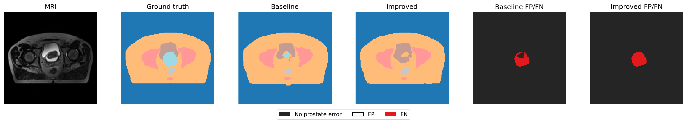

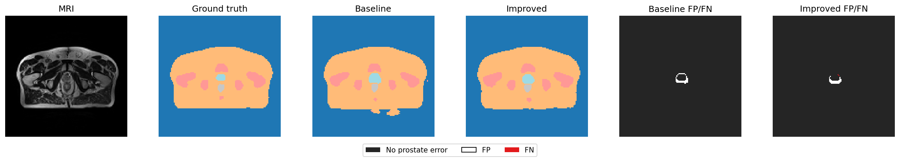

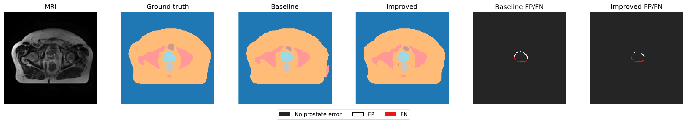

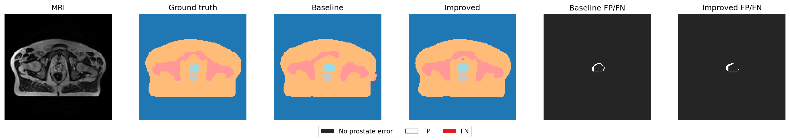

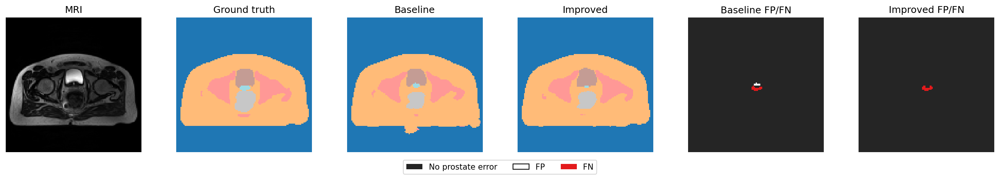

Across one independently selected scan from every held-out patient, Improved decreases false-positive voxels and increases false-negative voxels in all five cases. The repeated direction across B037, H007, K042, L011 and M013 indicates a systematic shift toward more conservative prostate contours rather than an effect confined to repeated scans of one patient. B037 Week0 is the clearest regression: its 227-voxel FP reduction is accompanied by 628 additional missed prostate voxels. H007 Week0 and M013 Week0 reduce total FP+FN, but both still lose reference-tissue coverage. These findings support Baseline as the conservative operational reference and limit Improved to human-reviewed contour drafting.

The counts are whole-volume measurements; each figure displays one selected slice. Low soft-tissue contrast, partial-volume effects and downsampling are plausible contributors, not experimentally isolated causes. Spatial checks on the source NIfTI affines confirm L/P/S axis codes for all five selected cases; tensor depth follows the superior direction after the loader transposes axes `(2,1,0)`. The table locates each displayed slice within the reference prostate extent in the resized tensor (zero-based indices). Position is `(slice - inferior)/(superior - inferior)`; it is a geometric fraction, not an anatomical landmark annotation.

| Case       | Inferior / superior GT slice | Displayed slice | Relative position |
| ---------- | ---------------------------: | --------------: | ----------------: |
| B037 Week0 |                      42 / 79 |              70 |             0.757 |
| L011 Week2 |                      62 / 88 |              70 |             0.308 |
| K042 Week0 |                      51 / 82 |              72 |             0.677 |
| M013 Week0 |                      46 / 69 |              65 |             0.826 |
| H007 Week0 |                      47 / 72 |              72 |             1.000 |

Four panels depict interior slices and H007 Week0 depicts the superior endpoint of its reference extent. The geometric positions alone cannot substantiate clinical base/apex failure claims. At the inferior and superior ends, small reference cross-sections make one-slice omission disproportionately important; a worst-error slice does not characterize continuity across the full end region. Clinical base/apex landmark verification and native-resolution boundary-distance measurements remain unavailable. No base/apex label or millimetre accuracy is inferred from these fractions.

### Boundary Bands, Organ Leakage and Disconnected Predictions

A post-hoc audit on 26 October 2026 inspected all **19 retained paired test predictions** from the primary experiment, without rerunning either network or selecting a new model. [The analysis record](assets/boundary_analysis.json) contains source prediction SHA-256 hashes, per-case counts and the selection method. Source NIfTI affines identify increasing tensor depth as superior for all 19 cases.

For each reference prostate extent of `N` axial slices, the inferior and superior bands contain the first and last `ceil(0.20*N)` slices respectively. These are geometric end regions relevant to apex/base review, not clinician-annotated apex/base landmarks. Dice and FP/FN below are pooled **within each scan's specified band**, across the complete in-plane image; they are neither patient means nor native-resolution surface distances. The 20% definition was chosen for this retrospective diagnostic analysis and was not a predeclared model-selection rule.

| Case and region | Axial range | Baseline Dice | Improved Dice | Baseline FP / FN | Improved FP / FN | Observed failure and conclusion |
| --------------- | ----------- | ------------: | ------------: | ---------------: | ---------------: | --------------------------- |
| B037 Week0 inferior | 42–49 | 0.828909 | 0.914716 | 222 / 10 | 77 / 25 | Improved reduces excess contour while slightly increasing omissions; the inferior gain does not extend uniformly to the superior region. |
| B037 Week0 superior | 72–79 | 0.541455 | 0.000000 | 0 / 271 | 0 / 431 | Improved misses the complete reference in this band: 431/431 prostate voxels. The superior extent is unsuitable as an unattended draft. |
| L011 Week2 inferior | 62–67 | 0.567219 | 0.583012 | 235 / 0 | 213 / 3 | Excess contour remains larger than the 154-voxel reference despite the small Dice increase. |
| L011 Week2 superior | 83–88 | 0.723247 | 0.446429 | 18 / 57 | 19 / 105 | Improved recall falls from 0.632258 to 0.322581, establishing markedly earlier loss of superior coverage. |
| K042 Week0 inferior | 51–57 | 0.788462 | 0.689507 | 20 / 90 | 11 / 134 | Reduced excess accompanies more missing prostate; a visually cleaner draft is insufficient evidence of better coverage. |
| K042 Week0 superior | 76–82 | 0.845683 | 0.876404 | 171 / 56 | 122 / 54 | The superior region improves while the inferior band regresses, demonstrating spatially inconsistent benefit. |

Each paired panel displays one inferior and one superior slice, chosen by the highest summed Baseline-plus-Improved FP+FN within that band; the larger slice index resolves ties. Green shows prostate, white FP and red FN. The tables aggregate entire bands, whereas images display selected slices.

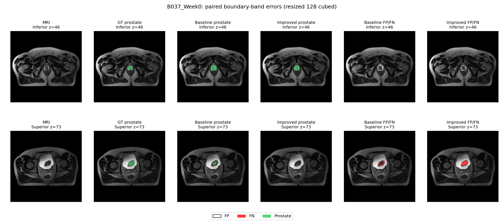

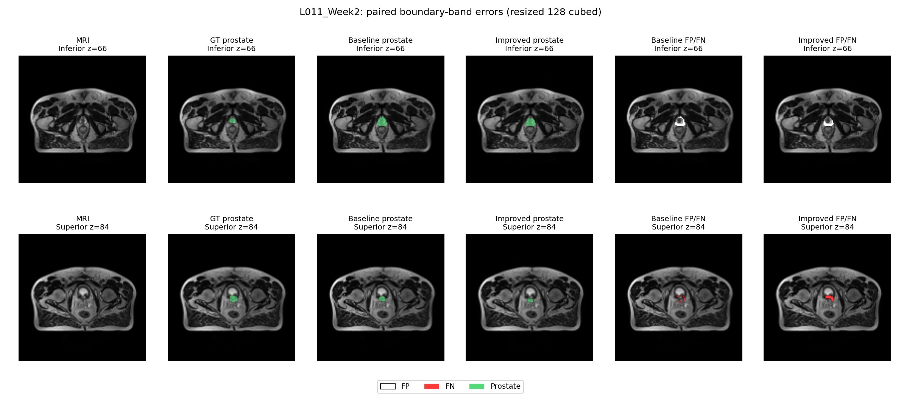

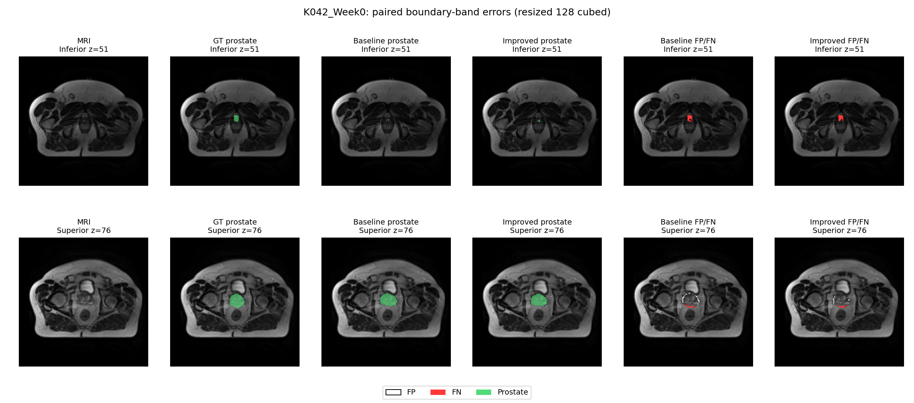

**Adjacent-organ confusion.** Across the 19 scans, Baseline assigns prostate to 272 reference-bladder voxels and 9 reference-rectum voxels; Improved assigns prostate to 13 and 9 respectively. These are counts on the resized annotation grid, not penetration distances or clinical injury estimates. The reduction in bladder-label confusion coexists with the B037 superior omission, so aggregate false-positive improvement does not resolve the coverage problem.

**Disconnected artifacts.** With 26-neighbour three-dimensional connectivity and no component filtering, Baseline has multiple prostate components in 6/19 scans; Improved has one component in every scan. Baseline's voxels outside its largest component total 136, and all 136 are false positives: L011 Weeks 1/4/6/7 contribute 4/14/11/21 voxels and M013 Weeks 2/5 contribute 1/85. These small islands are distinct from the large false-negative problem. Connectivity alone cannot establish correctness: the fully connected Improved B037 prediction still loses its superior band. Largest-component cleanup could remove these particular islands retrospectively, but its safety on other cases is untested and it is not part of the reported inference protocol.

**Interpretation.** The matched 3D experiment supports a specific trade-off: residual/deep-supervised training reduces some excess contours and disconnected artifacts, but may terminate the prostate too early. The five case autopsies and three paired end-region panels show that the Improved output remains unsuitable for unattended use. Low contrast and resizing remain plausible contributors; neither was isolated experimentally. No new 2D comparison, clinical landmark annotation or millimetre boundary claim is introduced.

## Feasibility Review

[One-page review with supporting appendices](assets/HipMRI_Feasibility_Review_v4.pdf). This section preserves the midpoint proposal's preliminary status and adds a dated resource plan; the update is not evidence that these numerical limits existed at the original consultation. Tutor check-off remains an external record.

**User need and scope.** A radiotherapy contouring specialist needs reviewable prostate and organ-at-risk drafts. Compare a plain 3D U-Net against a residual, deep-supervised 3D Improved U-Net on downsampled HipMRI volumes (Hard option). Investigate whether added complexity improves boundary coverage enough to justify its memory and runtime cost. This comparison does not isolate 3D versus 2D.

**Method and course concepts.** Use one seed-42 patient-disjoint manifest, MRI/mask spatial checks, z-score normalization, 128³ full volumes and 96³ training crops. Volumetric convolution supplies local spatial context; skip connections recover resolution, residual shortcuts refine features and intermediate segmentation heads add training supervision. Weighted cross entropy plus soft Dice addresses six-class segmentation and small foreground regions. Select checkpoints on validation only.

**Five acceptance criteria.** (1) Zero patient overlap and valid image-mask alignment. (2) Held-out patient-mean prostate Dice at least 0.70, with per-class Dice/IoU and patient scores. (3) Evidence from 3–5 real paired FP/FN failure panels, including geometric end regions and disconnected components. (4) For a future controlled repeat, peak training allocated VRAM no greater than 1.35× the matched Baseline, with identical geometry and runtime measurement scope. (5) Baseline remains preferred unless the candidate improves patient-mean prostate Dice by at least 0.01 and does not worsen any patient's Dice by more than 0.02. Criteria 4–5 are the explicit **26 October follow-up plan**, not retroactive historical pass conditions.

**Preliminary evidence.** At the midpoint, synthetic-NIfTI checks covered pairing, missing-pair rejection, shape/affine validation, deterministic patient separation, finite forward/backward computation and auxiliary outputs. They established software feasibility, not real-data accuracy. Completed formal results and the present boundary audit are reported separately in Results.

**Risks, budget and experiment boundary.** Memory demand, small end slices, downsampling, orientation mistakes, I/O and interrupted jobs are the principal technical risks. The retained 20-epoch histories sum training plus validation to 1,427.77 s for Baseline and 1,408.68 s for Improved: **0.788 GPU-hours combined**, excluding queueing, startup, test inference and other unrecorded work. Context-v2 B has now received its single frozen held-out evaluation in job `699109`; no other validation candidate should be tested in response to that score. A future multi-seed study would require a new predeclared protocol, independent training for every seed and validation-only checkpoint selection before one uniform test phase. It is not required to repair the present result record. Historical peak training allocation was 977.6/1,193.4 MiB; memory reservation and device-wide peaks were not measured.

**Fallback and decision.** The plain 3D U-Net remains the selected fallback because both added-complexity candidates miss the declared upgrade rule. All outputs remain human-reviewed drafts, particularly at superior/inferior extents and adjacent-organ boundaries. The historical Improved mean gain of `0.002038`, its B037 regression of `0.062061`, and Context-v2 B's mean deficit of `0.015849` support retaining Baseline. Clinical time savings and safety are not established by the available evidence. Tutor confirmation remains an external requirement for consultation completion.

## Engineering Recommendation and Limitations

Baseline is the conservative tested reference, and every proposed contour remains subject to human correction. The Improved package passed aggregate overlap targets, but its small mean change and severe B037 regression do not justify a stronger operational claim. Context-v2 B also passed the minimum `0.70` patient-mean threshold but scored below Baseline overall and exceeded the allowed `0.02` patient regression for H007 and K042.

The evidence does not establish clinician time savings, treatment safety, external-cohort generalization, native-resolution boundary accuracy, HD95 performance or superiority of 3D over 2D. No further candidate will be selected using these held-out results. A defensible future comparison requires a new frozen protocol, paired seeds, preserved validation/resource evidence and a single uniform held-out evaluation after validation-only selection.

## References

1. Çiçek et al. [3D U-Net: Learning Dense Volumetric Segmentation from Sparse Annotation](https://arxiv.org/abs/1606.06650), 2016.
2. Isensee et al. [Brain Tumor Segmentation and Radiomics Survival Prediction: Contribution to the BRATS 2017 Challenge](https://arxiv.org/abs/1802.10508), 2018. This is architectural inspiration, not the source of HipMRI data.
3. CSIRO. [Labelled weekly MR images of the male pelvis](https://data.csiro.au/collection/csiro%3A51392), DOI [10.25919/45T8-P065](https://doi.org/10.25919/45T8-P065).

## Artificial Intelligence Usage Disclosure

### AI Tools Used

OpenAI ChatGPT and OpenAI Codex were used during development and documentation. No AI system was treated as an experimental data source or as evidence that a model was correct.

### Tasks Assisted by AI

AI assisted with drafting and refactoring Python code, proposing unit and command-line checks, interpreting error messages, organizing the README, preparing plotting and audit utilities, checking internal consistency, and packaging the final project files. AI also assisted with wording and layout for the architecture diagram, result tables, failure analysis and reproducibility instructions. The reported metrics, job identifiers, prediction counts and resource values were taken from retained experiment artifacts rather than generated by AI.

### Author Audit and Verification

I reviewed the resulting code and documentation against the course specification, the dataset description, the frozen patient split and the retained experiment records. I inspected changes before accepting them, ran the automated tests and command-line entry points, checked README links and file hashes, and compared reported values with the saved JSON, logs and prediction artifacts. I also reviewed the architecture image, validation animations, failure figures and the rendered README PDF. AI suggestions were revised or rejected when they were unsupported, inconsistent with the implementation, or outside the available evidence. I remain responsible for the submitted code, analysis and claims.
