# HipMRI segmentation: is 3D spatial context worth its cost?

Author: Baoxu Wang (s4927782). COMP3710, 2026.

**Original v1 experiment (seed42):** a residual, deeply supervised **3D Improved U-Net
(Hard)** versus a standard **2D U-Net**, with 30 epochs each on one A100.
The original test evaluation covers 30 scans from six patients held out during
v1 training and model selection.
Patient-balanced foreground Dice is **0.8375 (3D)** versus **0.8409 (2D)**;
prostate Dice is **0.6772** versus **0.6790**. The 3D model improves prostate
Dice for five patients, but a severe failure on M015 offsets those gains.
The feasibility review's prostate Dice >=0.70 target is **unmet**.

An imaging specialist is the intended user of draft anatomical contours. The
question is whether 3D context improves prostate end regions and adjacent-organ
interfaces enough to justify its cost. These results do not justify replacing
the cheaper baseline. The prototype requires specialist correction and further
validation; native-resolution clinical accuracy is outside the experiment.

## Data, labels and leakage control

The strict audit matched **211 MRI/mask pairs from 38 anonymous patients** in
HipMRI. All matching pairs passed shape, orientation, spacing and affine checks.
A seeded patient split (3710) assigns **26/6/6 patients** and **143/38/30 scans**
to training/validation/test. All visits, slices and augmentations of a patient
stay in that partition. Equal patient weighting prevents an eight-visit patient
from counting eight times as much as a one-visit patient.

| Class index / raw ID | Official label |
|---|---|
| 0 | Background |
| 1 | Body |
| 2 | Bones |
| 3 | Bladder |
| 4 | Rectum |
| 5 | Prostate |

The [original CSIRO v2 label key](https://data.csiro.au/dap/ws/v2/collections/52549/support/5034)
confirms these meanings; [label_schema.json](label_schema.json) records its URL
and SHA-256 (`dc3a99204684ced859872d79a75707af3c0ad31d00f5f3213063ce5e30727ee6`).
The dataset is [Dowling and Greer, 2021, v2](https://doi.org/10.25919/45t8-p065).
Of the native arrays, 210 are 256x256x128 and K019/Week1 is
256x256x144; all use LPS orientation. Each pair is reoriented to
canonical RAS, then resampled to **D,H,W = 64,128,128** with centre-aware affine
updates, linear images and nearest-neighbour masks. Physical spacing is retained
per case; equal array shape does not imply equal physical field of view.

Each scan's nonzero intensities are independently z-normalized and clipped to
[-5,5]. No validation/test statistics fit normalization or loss weights.
All 211 cached image, mask and spacing arrays were reloaded and their class
counts checked. Five deterministic TRAIN patients were visually reviewed before
training; the sampled contours align. Header and sampled visual checks do not
prove every annotation is anatomically correct.

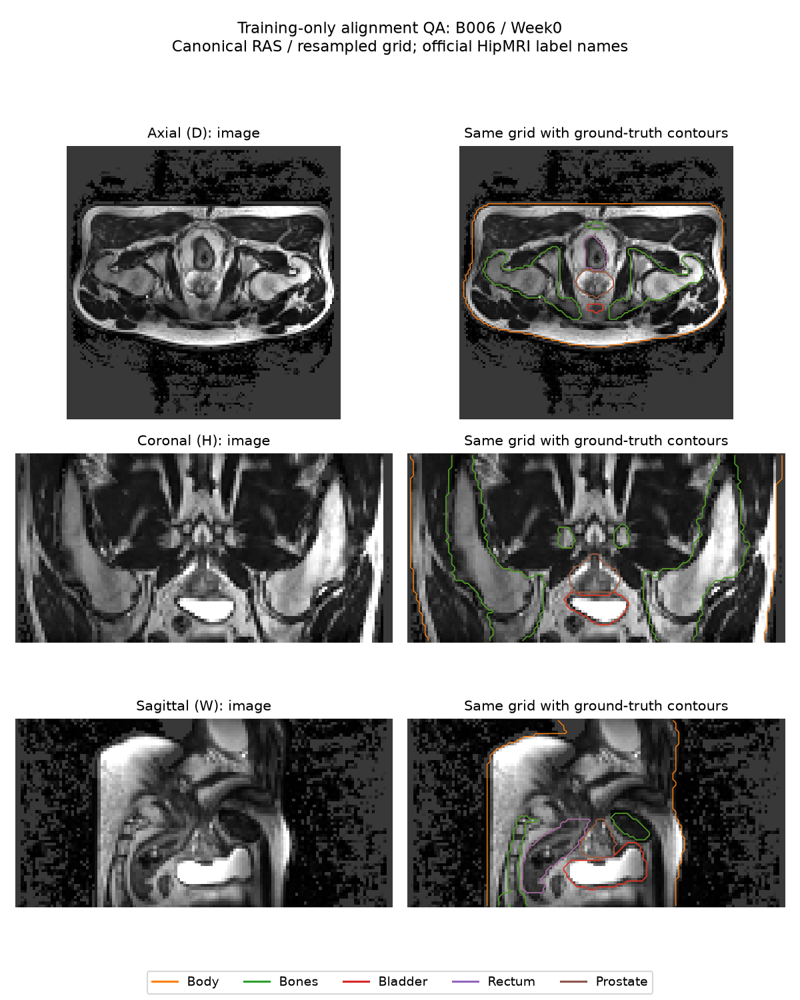

## Feasibility review

The following is the **pre-final-experiment snapshot**, retained with its pilot
observations and planned criteria. Its statement that test accuracy was
unmeasured applies to that earlier stage. The completed outcomes follow it.

<!-- FEASIBILITY_REVIEW_START -->
**Student:** s4927782 · **Check-off:** Wednesday, 28 October 2026 · **Difficulty:** Hard

### User need and scope

An imaging specialist needs draft prostate contours for review. This prototype investigates whether 3D spatial context improves difficult base/apex boundaries and interfaces with the bladder or rectum enough to justify additional memory and runtime. It compares a 3D Improved U-Net against a standard 2D U-Net on HipMRI, using identical patient-level train/validation/test assignments. Clinical deployment is outside scope.

### Measurable acceptance criteria

1. **Leakage:** assert zero patient overlap across splits, including repeated volumes and derived slices; verify image/mask pairing and spatial alignment before training.
2. **Accuracy:** target held-out prostate Dice **≥0.70** for the 3D model; report per-class Dice and IoU for both models. Use validation data for model selection.
3. **Boundary benefit:** compare patient-level and inferior/mid/superior results (approximate apex/base thirds), supplemented by grid-aware HD95 in millimetres, and identify where 3D context helps or fails relative to 2D.
4. **Failure analysis:** examine **3–5** representative test failures with input, ground truth, prediction and false-positive/false-negative overlays; give a justified recommendation on specialist review and computational trade-offs.
5. **Resources:** train on **one GPU**, using **volume batch size 1** for 3D. Peak allocated training VRAM **≤24 GiB** is the initial target. Report GPU, parameters, training time, peak VRAM and per-case inference time.

### Model choice and preliminary evidence

The Hard model uses volumetric convolutions, residual units, skip connections and deep supervision on downsampled HipMRI volumes. Relevant course concepts include convolutional spatial context, segmentation losses, generalisation and computational complexity. Isensee et al., [arXiv:1802.10508](https://arxiv.org/abs/1802.10508), is an architectural starting reference.

All **211 image/mask grids from 38 patients** passed cache checks, split **26/6/6** (143/38/30 scans). **75 checks passed**, including AMP overflow recovery and checkpoint resume. Five TRAIN patients were visually reviewed. [CSIRO's original key](https://data.csiro.au/dap/ws/v2/collections/52549/support/5034) confirms **class 5 is prostate**. Two full-data A100 pilot epochs completed per model: validation foreground Dice reached **0.740 (2D)** and **0.535 (3D)**. These are early validation observations; **final test accuracy remains unmeasured**.

### Risks, budget and next experiment

Main risks are class imbalance, thin-boundary loss during downsampling and the short turnaround. Both models use class weights derived only from training voxels. Measured 3D pilot training peak was **2.23 GiB** on a 40-GB A100; training took about **51 s/epoch** versus **9 s/epoch** for warmed 2D. The next experiment resumes each model to **30 epochs**, selecting checkpoints only by validation. The initial 18-GPU-hour budget is revised to a **one-GPU-hour allocation** from the measured pilot cost; queue waiting is additional.

The preselected fallback reduces 3D patch size and channel counts while retaining residual units and deep supervision, preserving the approved Hard architecture. Moving instead to a Normal model would cap implementation at 15/20.

**Planning:** 30 October is an unconfirmed final-deadline assumption; verify the official date. Follow the course specification, pp. 5–6 and 12–16, including progressive commits, AI disclosure, PR and subsequent review response.
<!-- FEASIBILITY_REVIEW_END -->

### Outcome against the original criteria

The patient-disjoint split and cache-integrity criteria passed. The measured
3D prostate Dice **0.6772** misses the original **0.70** target. Boundary evidence
is mixed: superior-third Dice improves, but mean HD95 worsens because of M015.
Five patient-distinct error autopsies are provided below. The one-GPU resource
criterion passes: peak training allocation is **2.23 GiB**, below 24 GiB.

The Hard option in the course table specifies test Dice >=0.7 without defining
its aggregation. The prespecified foreground macro score is **0.8375**; the
clinical prostate score and the stricter feasibility target must also remain
visible. An aggregate above 0.7 does not establish success for every organ or
guarantee a particular assessment mark.

## Models and learning procedure

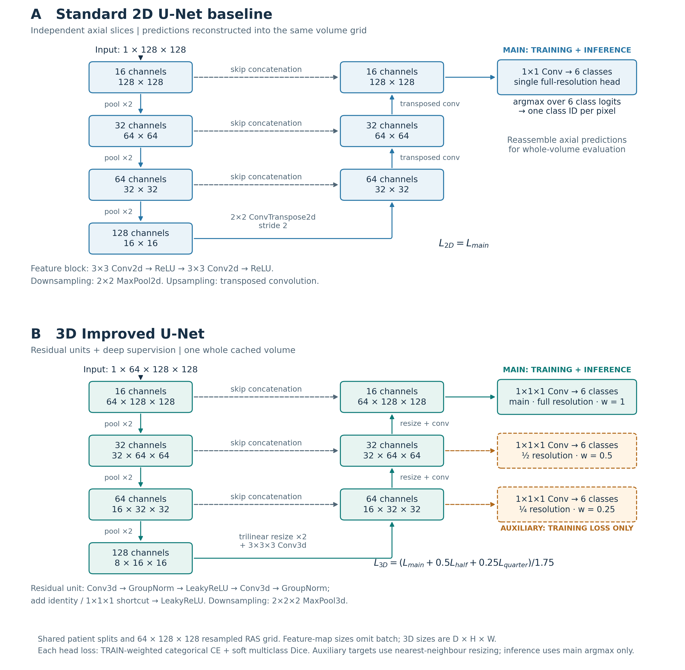

The [editable architecture SVG](figures/model_architecture.svg) reflects
`modules.py`, with base width 16 and three pooling levels. Encoder features
supply fine spatial detail through concatenated skip connections while the
bottleneck captures broader context. The baseline operates independently on
axial slices: double convolutions with ReLU, transposed-convolution upsampling
and widths 16/32/64/128. Its slice predictions are reassembled into whole volumes.
It follows the U-Net design [6] and the author's own Demo 2 experience [3].

The 3D network uses volumetric convolutions, residual blocks with additive
shortcuts, GroupNorm and LeakyReLU, followed by resize-plus-convolution decoders.
Residual paths support gradient flow through the deeper feature hierarchy.
Main, half-resolution and quarter-resolution segmentation heads supervise
multiple decoder scales; ground-truth class labels are resized with nearest-neighbour interpolation
to each auxiliary head's native grid for loss calculation. Inference uses only the main head's hard argmax, although
forward computes all heads. Relative to Isensee et al. [2], max pooling,
GroupNorm instead of InstanceNorm, no dropout and independently weighted
auxiliary losses are explicit adaptations, not an exact paper reproduction.

Every head predicts six mutually exclusive classes. The objective is weighted
categorical cross-entropy plus soft multiclass Dice averaged over all classes,
including background. The 3D main/half/quarter losses have weights 1/0.5/0.25,
normalized by 1.75; 2D uses only its main loss. CE weights come from a single
unaugmented pass over TRAIN masks: inverse square root frequencies, normalized
to mean one, clipped to [0.05,10], then renormalized. Resolved weights are
approximately **0.100, 0.128, 0.416, 0.991, 2.019, 2.346** for classes 0–5.
Prostate occupies about 0.108% of training voxels, motivating this weighting.

Both models use seed **42**, AdamW (learning rate **0.001**, weight decay
**0.0001**), gradient clipping at norm **5**, AMP and zero loader workers.
The 2D batch is **16 slices**; the 3D batch is **one complete cached volume**.
Paired image/mask flips occur independently on H and W with probability 0.5
per axis in training only. There is no rotation, intensity augmentation,
postprocessing or prostate-specific ROI cropping. The 2D loader retains an
unaugmented volume cache capped at 2 GiB to avoid repeated decompression.

The fixed budget is **30 total epochs per model**, including the first two
pilot epochs; each epoch covers the same 143 training volumes. Equal epochs
are not equal optimizer updates or compute. Checkpoints are selected by the
highest patient-balanced whole-volume **foreground validation Dice**, with
an earlier epoch winning a tie. Test data never select a checkpoint.

## Metrics and frozen comparison

Hard-label Dice is 2TP/(2TP+FP+FN), and IoU is TP/(TP+FP+FN). A class absent
from both target and prediction is undefined and excluded; a false positive
for an absent target scores zero. Foreground means classes 1–5 per case,
then visits per patient, then equal patients. Per-class results follow the
same patient weighting; background is reported separately.

Prostate HD95 is the 95th percentile of pooled bidirectional nearest distances
between six-connected voxel surfaces, in the cached grid's millimetres. It is
undefined when either mask is empty. The paired distance comparison uses the
same both-present visits for both models and reports exclusions. Missing
predictions retain Dice zero. Inferior/mid/superior scores use thirds of the
GT depth extent (D increases superiorly); these approximate end regions,
without independently annotated anatomical apex/base landmarks. FP outside
the GT extent is also reported because third-only scores can hide it.

Both training histories were inspected and both selected checkpoints were
independently reloaded for validation. Their scores exactly match the selected
history. [test_protocol.json](test_protocol.json) was committed **before the
first final test**, frozen at **2026-10-26 14:32:33 UTC** (27 October 00:32 AEST).
It fixes checkpoint and manifest digests, 30 epochs, main-head argmax without
postprocessing, bootstrap and failure selection. Each final model then underwent
one complete benchmark on the same test cases. Later selected-case inference
replays are explicitly retrospective correctness diagnostics; they do not
replace the benchmark, change weights or authorize test-based tuning.

## Results

### Validation and training behaviour

Validation covers 38 scans from six patients. Both models improve substantially
from their two-epoch pilot; the 3D best epoch is late, so this fixed-budget run
is not evidence of complete convergence.

| Model | Epochs | Selected epoch | Foreground Dice | Prostate Dice | Prostate IoU |
|---|---:|---:|---:|---:|---:|
| 2D U-Net | 30 | 26 | 0.8675 | 0.7920 | 0.6588 |
| 3D Improved U-Net | 30 | 29 | 0.8748 | 0.8332 | 0.7154 |

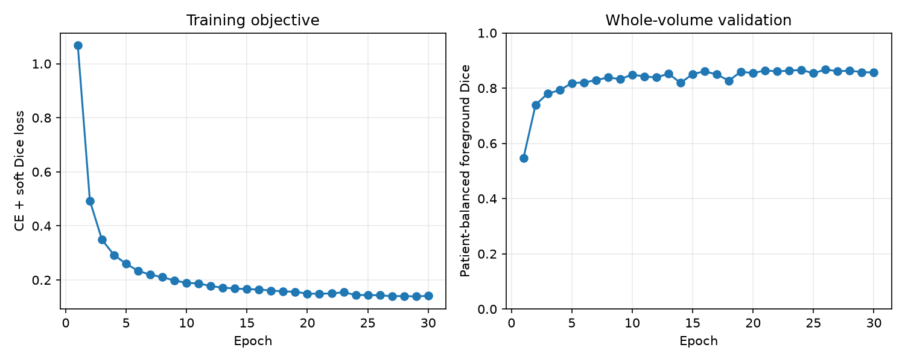

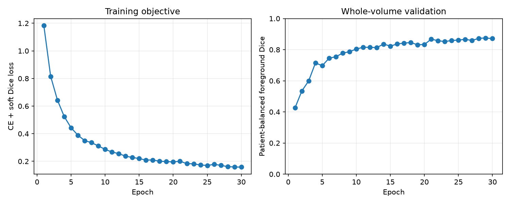

### Final test: class and patient results

All test tables use **six patients / 30 scans** and the fixed downsampled grid.
Dice and IoU are averaged independently; applying Dice = 2IoU/(1+IoU) to an
already averaged IoU does not recover averaged Dice.

| Class | 2D Dice | 3D Dice | 2D IoU | 3D IoU |
|---|---:|---:|---:|---:|
| 0: Background | 0.9898 | 0.9905 | 0.9803 | 0.9813 |
| 1: Body | 0.9738 | 0.9711 | 0.9494 | 0.9441 |
| 2: Bones | 0.8857 | 0.8730 | 0.7960 | 0.7755 |
| 3: Bladder | 0.8651 | 0.8300 | 0.7742 | 0.7547 |
| 4: Rectum | 0.8010 | 0.8363 | 0.6726 | 0.7207 |
| 5: Prostate | 0.6790 | 0.6772 | 0.5296 | 0.5642 |
| Foreground mean (1–5) | 0.8409 | 0.8375 | 0.7444 | 0.7519 |

The 3D result improves rectum Dice but loses bladder and bone Dice. Prostate
IoU rises while mean Dice remains almost unchanged because the distribution
of patient/visit outcomes changes. Neither model meets the original prostate
Dice target. The validation-to-test prostate decrease is substantial, especially
for 3D (0.8332 to 0.6772), demonstrating limited generalisation on this split.

| Patient | Visits | 2D prostate Dice | 3D prostate Dice | Delta | 2D HD95 mm | 3D HD95 mm |
|---|---:|---:|---:|---:|---:|---:|
| B037 | 1 | 0.5772 | 0.7773 | +0.2001 | 15.60 | 8.84 |
| L011 | 8 | 0.7919 | 0.8326 | +0.0407 | 5.96 | 5.01 |
| M015 | 8 | 0.5601 | 0.1136 | -0.4465 | 10.65 | 33.46 |
| M020 | 4 | 0.8629 | 0.8643 | +0.0014 | 4.54 | 4.24 |
| W029 | 8 | 0.5327 | 0.6028 | +0.0701 | 13.70 | 9.03 |
| W041 | 1 | 0.7490 | 0.8725 | +0.1234 | 6.99 | 3.12 |

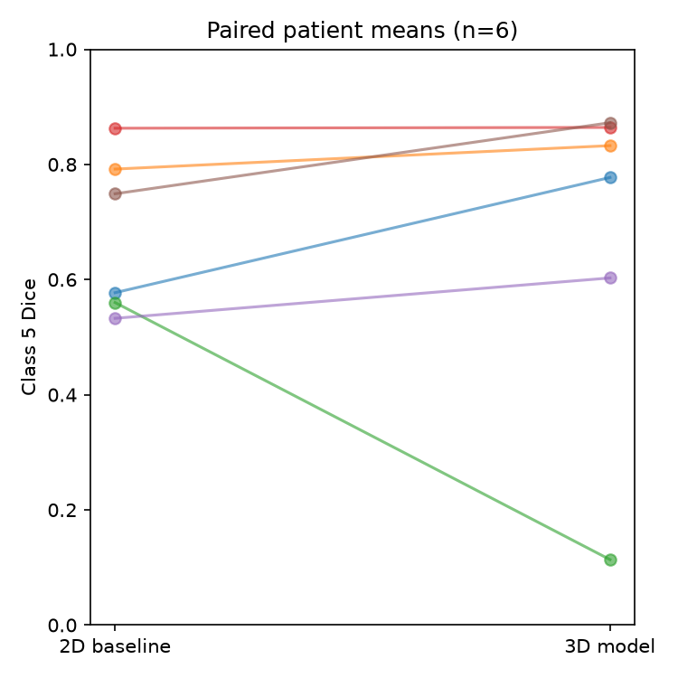

Five patients improve, but **M015 worsens across its eight visits**, with mean
Dice falling from 0.5601 to 0.1136. It remains in every aggregate. The paired
3D-minus-2D prostate Dice difference is **-0.0018**, with **95% patient-bootstrap
CI [-0.1908, 0.1287]** (2,000 resamples, seed 3710). Six independent patients
and one training seed provide weak precision; this interval supports neither
a reliable improvement nor equivalence. Correlated visits are not treated as
30 independent patients.

### End regions and boundaries

| Prostate measure, patient balanced | 2D | 3D |
|---|---:|---:|
| Inferior-third Dice | 0.7411 | 0.7056 |
| Middle-third Dice | 0.7089 | 0.7136 |
| Superior-third Dice | 0.4535 | 0.5806 |
| Paired HD95 (mm; lower is better) | 9.573 | 10.615 |
| FP voxels outside GT depth extent | 17.46 | 14.29 |

HD95 uses **30 eligible paired visits, six patients, zero exclusions**. Both
models produce nonempty prostate masks for every case: missed-mask, FP-only and
both-empty counts are all zero. A nonempty mask is not a quality guarantee;
M015 Week2 contains only one correctly labelled prostate voxel in 3D.
The 3D superior-third benefit is accompanied by worse inferior Dice and worse
mean HD95. M015's mean HD95 rises from 10.65 to 33.46 mm; the other five patients
improve. These coarse-grid distances do not establish native clinical precision.

### Resource cost

Both models ran sequentially on an **NVIDIA A100-PCIE-40GB**, using the same
cache and AMP. Parameter totals include auxiliary heads. Inference measurements
come from separate predictor processes, not training processes retaining
optimizer state.

| Resource | 2D U-Net | 3D Improved U-Net |
|---|---:|---:|
| Parameters | 481,830 | 1,627,634 |
| Training loop, all 30 epochs (s) | 264.168 | 999.797 |
| Successful optimizer updates | 17,152 | 4,288 |
| AMP overflow updates skipped | 8 | 2 |
| Peak training allocated VRAM (GiB) | 0.154 | 2.227 |
| Mean whole-case inference (ms) | 11.299 | 52.009 |
| Peak inference allocated VRAM (GiB) | 0.140 | 1.737 |

Training loop time includes cached reads and updates, and excludes validation,
checkpoint writes and queue waiting. Full-case latency includes synchronized
input transfer, forward, argmax and output transfer after one case warmup;
it excludes loading, preprocessing, metrics and plotting. 2D uses slice batch
32; 3D uses a full volume. GPU allocated peaks exclude allocator reserve and
are not total device usage. The 3D model costs about **4.60x inference latency**,
**12.36x inference allocation** and **3.78x training loop time**. AMP skipped
overflowing updates during training and recovered through GradScaler; skipped updates
are disclosed rather than silently counted as successful training steps.

## Five fixed failure autopsies

The selection rule was fixed before test: choose each patient's worst defined
3D prostate Dice visit, then the five worst distinct patients. Zero Dice is
eligible. These deliberately adverse examples explain errors rather than
estimate their prevalence. Each ROI below uses the same plane and crop across
MRI, GT, both predictions and FP/FN panels; red is prostate FP and cyan is FN.
Full-field galleries linked with each example show GT extent thirds and each
model's largest FP+FN slice across the **entire** depth, including outside GT.

### 1. M015 Week2: near-total prostate omission

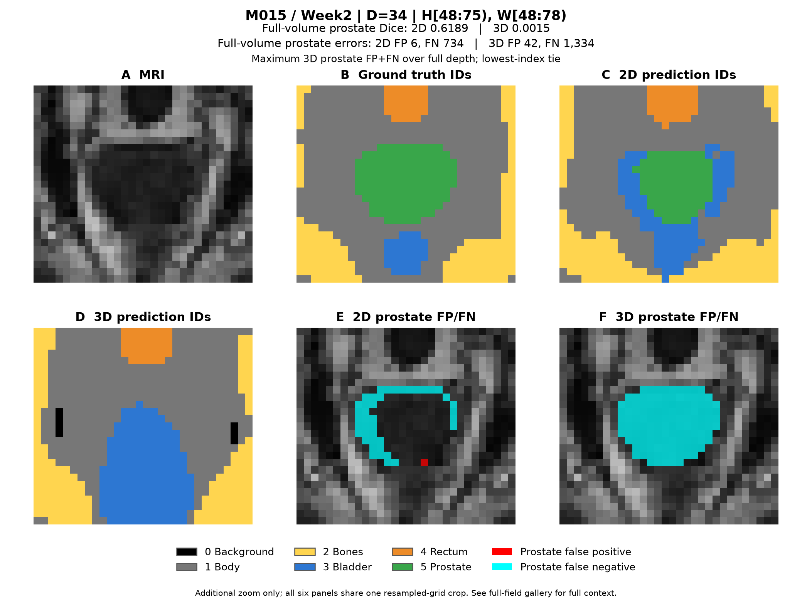

3D prostate Dice is **0.0015** versus **0.6189** for 2D; HD95 is **53.10** versus
**10.04 mm**. GT contains 1,335 voxels, but 3D predicts only 43 (TP 1, FP 42,
FN 1,334). Of its missed target voxels, 716 become Body and 612 Bladder.
The displayed central target is almost entirely cyan; the residual predicted
island does not rescue the organ. The 2D baseline retains a partial contour.
[Full-depth context](figures/failure_full_01.png).

Across M015 visits, mean 3D predicted/GT volume ratio is **0.074** and mean
centroid error **25.11 mm**, versus **0.404** and **4.26 mm** for 2D. A post-test
CPU diagnostic compares GT descriptors with the 26 training-patient means:
M015's normalized H centroid is **0.4516**, below their range **0.4581–0.5322**;
its mean volume and D/W centroids remain within the training ranges. However,
the worst visit, Week2, has H centroid **0.4749**, inside the TRAIN visit range
**0.4319–0.5499**; other ordinary-position visits also fail. A simple H-centroid
outlier explanation is not consistently supported. M015 spacing is within TRAIN ranges. Its raw
intensity mean and standard deviation exceed TRAIN values, but MRI scale is
arbitrary and per-case normalization removes a pure gain/offset change on
unchanged nonzero support.
The source-to-model investigation below quantifies an appearance difference
and strong class confusion, but does **not establish an acquisition-level cause**.
Prediction-only intermodel Dice averages 0.229 for M015; disagreement could be
studied as a future review flag, but no detector or threshold is validated here.

### 2. W029 Week0: lower FP with substantially greater omission

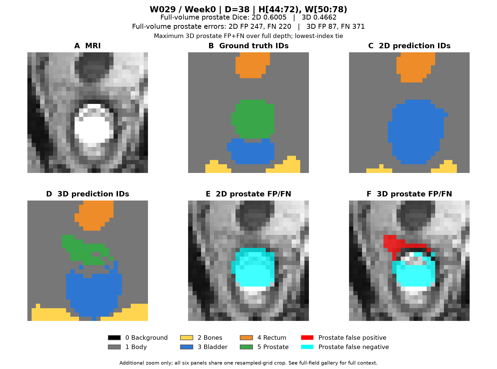

3D Dice is **0.4662** versus **0.6005**. FP falls from 247 to 87 voxels, but FN
rises from 220 to 371: 241 missed voxels become Body and 130 Bladder in 3D.
HD95 worsens from 9.36 to 12.11 mm. The large cyan target remainder shows that
reducing spurious labels alone is insufficient. W029 improves on average
across visits, so this case also exposes within-patient variability.
[Full-depth context](figures/failure_full_02.png).

### 3. B037 Week0: helpful 3D context with a substantial residual error

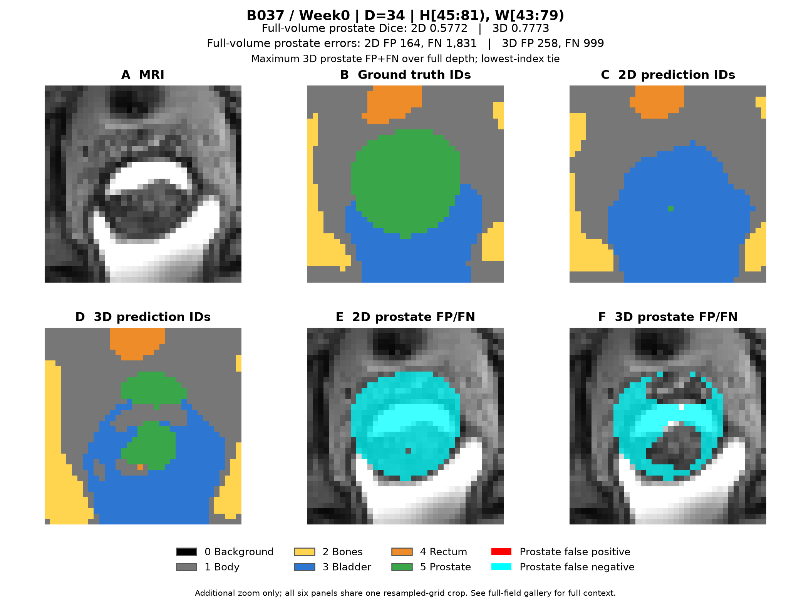

3D Dice improves **0.5772 to 0.7773**, and HD95 improves **15.60 to 8.84 mm**.
The 2D mask misses 1,831 target voxels, including 1,259 classified as Bladder;
3D reduces FN to 999 (715 Body, 264 Bladder, 20 Rectum). Recovery is incomplete,
with visible fragmented contour and cyan residual target. 3D FP rises from
164 to 258 voxels, a recall/precision trade-off rather than a uniformly better
boundary. [Full-depth context](figures/failure_full_03.png).

### 4. L011 Week4: extra slices despite better recall

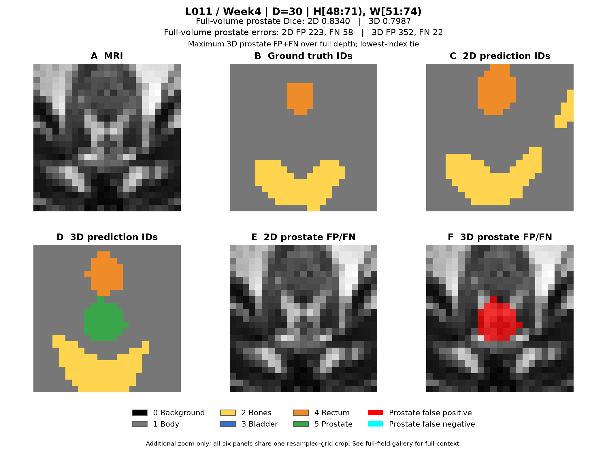

3D Dice falls **0.8340 to 0.7987**, while FN improves **58 to 22**. FP rises
**223 to 352**, including **88** prostate-labelled voxels outside the GT depth
extent versus zero for 2D. The displayed plane has no GT prostate, yet 3D
adds a green island and red FP. HD95 worsens **4.75 to 6.24 mm**. A smoother
volumetric model can still extend a contour through the wrong slices.
[Full-depth context](figures/failure_full_04.png).

### 5. M020 Week2: small boundary trade-offs persist

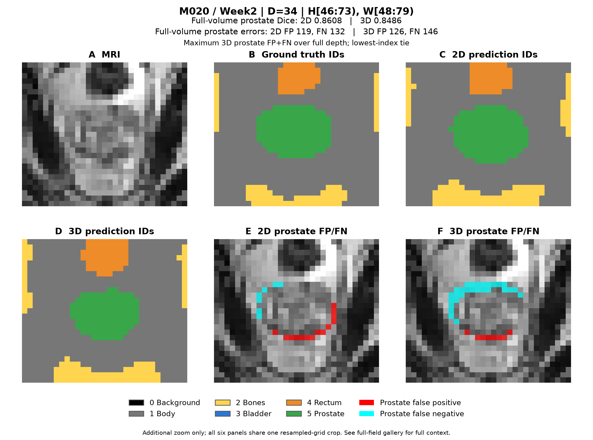

Both models recover most of the organ. 3D Dice is **0.8486** versus **0.8608**;
FP changes **119 to 126**, FN **132 to 146**, and HD95 is **4.58 mm** for both.
The overlays reveal peripheral additions and omissions hidden by a similar
whole-organ score. All 146 3D FN voxels become Body. Small coarse-grid boundary
changes matter, and 3D context does not resolve every interface.
[Full-depth context](figures/failure_full_05.png).

## Retrospective correctness diagnostics

These checks were planned **after inspecting the v1 test failures**. They
investigate implementation errors and preserve all original results; they
are not a new independent test or a model-selection exercise. The machine-readable
[diagnostic evidence](evidence/diagnostic_review.json) records scope and limits.

| Check | Actual evidence | What remains unverified |
|---|---|---|
| Saved evidence | 136 prediction files across both models' validation and test evaluations: counts, metric algebra and patient aggregation agree | This audit alone does not independently remeasure GT intersections |
| Native-to-cache alignment | Independent resampling of all eight M015 visits and four TRAIN/VAL controls: 12/12 images exact, maximum error 0; 12/12 masks have zero differing voxels | Anatomical annotation correctness and unexamined source cases |
| Frozen direct inference | 20/20 available saved AMP predictions reproduced voxel-for-voxel; independently recomputed GT confusion and metrics agree | Shared model modules and training-time behaviour |
| Precision sensitivity | All 48 forwards finite; largest absolute AMP/FP32 prostate Dice change 0.0014603; M015 Week2 remains 0.0014514 in both | Training-time AMP effects and other numerical configurations |

The independent resampler uses Nibabel's affine resampling rather than the
original cache-preparation function. Twelve three-plane panels were reviewed;
the displayed slices show no obvious relative image/label displacement,
mirror or axis swap. Below, the failed M015 Week2 retains its labelled target
in both cached and independently reconstructed views. Coarse-grid blurring is
visible, but is not by itself proof of the failure mechanism.

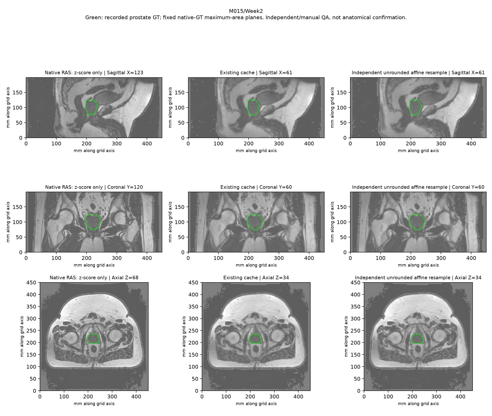

No actionable discrepancy was found **within these checks**. This does not
prove the whole implementation is bug-free, certify full-volume anatomical
labels, exclude training-time AMP effects, or identify the cause of M015's
failure. In the examined cases and recorded configurations, it rules against
the specific checked resampling, inference-order, saved-prediction and
inference-precision explanations. The five original
failures and the unmet prostate target remain part of the report.

### Source-to-model investigation and one-factor intervention

The subsequent **D1** audit (CPU **702061**, GPU **702062**) examines original
sources and frozen v1 computations. **D2** (**702134**) then tests one specific
input operation suggested by D1. Both are exploratory, after the observed test
failure. All **14** declared cases are retained: eight M015 visits, four original
TRAIN/VAL controls, and two TRAIN cases selected after descriptive contrast
ranking. The [anonymized evidence](evidence/source_diagnostic_review.json)
retains the per-case results, identities, scopes and counterevidence.

**Source identity and image handling.** All 211 course MRI files match the
official ZIP's byte lengths and CRC32 values; CRC32 is an accidental-integrity
check, not cryptographic proof. Course/official label gzip containers differ,
but all eight M015 labels and one TRAIN control have **identical complete
decompressed NIfTI bytes and SHA-256**. Their differences are gzip metadata,
not changed labels. The remaining 202 label contents were not compared this way.
All 422 source headers agree with frozen geometry. Across M015, cached GT
prostate volume retains **98.07%–100.07%** of native physical volume; none of
its target intensities reach the clipping boundaries. This does not certify
the original anatomical annotations.

**Measured appearance difference.** Define global contrast as the bladder
median minus the class-1 Body median, divided by the Body IQR. In the frozen
cache, M015's eight values are **[-0.6664, -0.4615]**, below all **143 TRAIN**
scans (minimum **-0.3318**); all 38 VAL values are positive (minimum **0.3127**).
M015's negative contrast is already present in the original scaled MRI,
before normalization, and remains through all five inspected stages. Raw
pixels were inspected for the 14 declared cases, not all 189 descriptive
cache cases. This GT-based, global reference is neither a local boundary
measure nor a deployable detector. Two low-contrast TRAIN controls nevertheless
have high 3D GT-prostate probabilities (**0.778/0.971**); contrast alone is
not a sufficient explanation, and these seen TRAIN cases are not matched unseen
counterfactual patients.

**Model behaviour.** For M015 Week2's GT prostate, mean class-5 probability is
**0.4362** in 2D but **0.0274/0.0399/0.0400** in the 3D main/half/quarter heads.
The main head instead assigns mean probabilities **0.5071** to Body and
**0.4512** to Bladder. Its median class-5 margin against the strongest rival
is **-4.7805**; class 5 ranks third or worse in **1,140/1,335** target voxels.
The auxiliary targets still contain **167/20** prostate voxels. Independently
computed CE/Dice/weighted losses agree within **4.77e-7/1.79e-7/1.87e-7**;
three real-case backward checks give finite, nonzero gradients to all 58
parameter tensors. These checks constrain current frozen computations, not
the unrecorded historical gradients or all possible implementation defects.

**Single-factor D2 check.** D1 found that final nearest-support zeroing directly
affects only **16/10,521** M015 prostate voxels, but changes tens of thousands
of whole-image voxels, leaving an indirect context explanation open. D2 removes
only that operation at fixed weights in FP32, with autocast and TF32 disabled.
Reinstating it must reproduce each baseline input exactly before inference.
All 14 reconstructions pass; checkpoint and parameter hashes remain unchanged.
Removing zeroing makes 3D prostate Dice **worse in seven of eight M015 visits**;
Week2 changes from **0.0014514 to 0** (TP **1 to 0**, FP **42 to 172**).
Week5 improves slightly (**0.1574 to 0.1693**), so the effect is not uniform.
This intervention does not rescue the demonstrated 3D failure. It does not
isolate GroupNorm mediation or test training from scratch with another policy.
No new aggregate TEST benchmark or replacement input policy is selected.

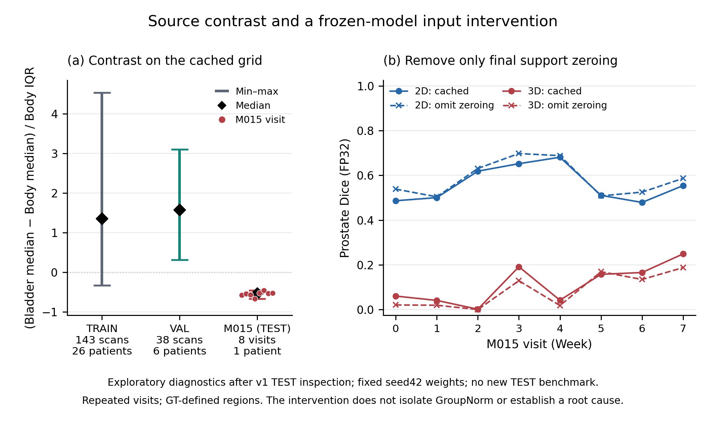

The best-supported interpretation is **patient-specific generalization failure
associated with a real appearance difference and strong multiscale class-5
suppression**, not a confirmed unique cause. The original CAN3D paper describes
LFOV T2 SPACE inputs, prostate labels propagated from SFOV T2, and N4 correction
in its experiments [7]. No per-case sequence/registration records establish a
M015-specific error, and whether the released MRI already received N4 is
unknown. Neither a T1 mix-up, incorrect official label nor omitted-N4 cause
is demonstrated. These findings motivated the prespecified TRAIN/VAL appearance
ablation below. Independent data remain necessary for a later test claim;
repeating training merely to obtain a better M015 score would not resolve
this evidence gap.

### Completed validation robustness study

[followup_protocol.json](followup_protocol.json) was committed as **27527d3**
before submitting job **701767**. It changes only the training seed to **43**
for both original models: the same split, cache, architecture, losses,
30-epoch budget and foreground-validation checkpoint selector remain fixed.
Both models completed all 30 epochs sequentially on one A100 in job **701767**;
dependent analysis **701791** also completed successfully. The same A100 model,
Python 3.11.15, PyTorch 2.13.0+cu130 and CUDA 13.0 are recorded for both seeds.
Prepared cloud migration tools were not used for training. New outputs are
separate from v1 and cover **validation only**, with all 38 scans and six
validation patients retained. [Machine-readable evidence](evidence/seed_followup_review.json)
records the independently matching remote/local summaries and actual byte-hash
checks of all four selected checkpoints.

All values below are patient-balanced validation results. Checkpoint selection
continues to maximize foreground Dice, not prostate Dice.

| Seed | Model | Selected epoch | Foreground Dice | Prostate Dice | Prostate IoU |
|---|---|---|---|---|---|
| 42 | 2D | 26 | 0.8675 | 0.7920 | 0.6588 |
| 42 | 3D | 29 | 0.8748 | 0.8332 | 0.7154 |
| 43 | 2D | 25 | 0.8622 | 0.7809 | 0.6437 |
| 43 | 3D | 27 | 0.8764 | 0.8351 | 0.7185 |

The prespecified mean of paired patient prostate Dice differences (3D minus 2D)
is **+0.0412** for seed42 and **+0.0542** for seed43. Every validation patient
has a positive difference in each run; all six are eligible and none is excluded.
For IoU, the corresponding paired means are **+0.0565** and **+0.0748**.

| Validation patient | Dice difference, seed42 | Dice difference, seed43 |
|---|---|---|
| B040 | +0.0124 | +0.0196 |
| J026 | +0.0386 | +0.0966 |
| K008 | +0.0319 | +0.0659 |
| K018 | +0.1113 | +0.0948 |
| M030 | +0.0492 | +0.0391 |
| S022 | +0.0037 | +0.0093 |
| Mean, same six patients | +0.0412 | +0.0542 |

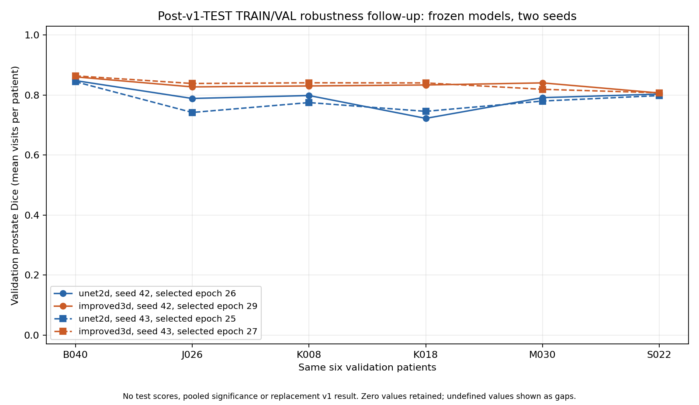

The 3D prostate mean changes by **+0.0019** between seeds, while the 2D mean
changes by **-0.0111**. This supports a consistent direction of the complete
3D model's advantage on **these validation patients in these two runs**. It
does not identify M015's failure cause, establish superiority on new patients,
or show that the frozen test target has been repaired. No seed43 TEST evaluation
was performed and no seed is selected to replace v1. These validation patients
also select checkpoints, so their scores are not an independent estimate of
generalization. Repeated measurements on
six patients do not become twelve independent patients; two runs do not support
a seed-population confidence interval or a pooled significance claim. Unsupported
categorical-CE and 3D max-pool backward kernels still permit nondeterminism under
the recorded warn-only setting, so the comparison is not a bitwise seed-effect
isolation. It is also not an ablation of residual blocks or deep supervision.

Resource observations retain the same measurement definitions as the original
study. Training-loop seconds exclude validation, checkpoint writes and queue
waiting. Peaks are allocated CUDA memory, not total device use. These validation
latencies use each run's full-case warmup protocol; timing variation between runs
is not an architectural change or an improved inference implementation.

| Seed / model | Train loop (s) | Train peak (MiB) | VAL latency (ms) | VAL peak (MiB) |
|---|---|---|---|---|
| 42 / 2D | 264.17 | 157.46 | 11.08 | 143.86 |
| 42 / 3D | 999.80 | 2280.85 | 52.23 | 1778.23 |
| 43 / 2D | 245.01 | 157.46 | 10.87 | 143.86 |
| 43 / 3D | 955.49 | 2280.85 | 38.34 | 1778.23 |

### Completed appearance ablation: robustness has a clean-image cost

Commit **5c49de3** fixed [the A1 protocol](appearance_protocol.json) before
training; GPU job **702249** completed both new 30-epoch runs and all
**4 models × 5 conditions × 38 VAL scans** in **40m06s**, exit 0:0.
Both new arms retain the original 3D architecture, loss, optimizer, 143 TRAIN
volumes, seed42 and clean foreground-VAL selector. Their initial parameter
SHA-256 and recorded A100/software environments match. The added image RNG is
keyed independently by case/epoch, preserving the original shuffle/flip RNG.
CUDA's warn-only nondeterminism still prevents a bitwise causal-isolation claim.

**A: gamma only** applies signed gamma with probability 0.5, drawing its exponent
log-uniformly from [0.7,1.5], then clipping to [-5,5]. **B: gamma + polarity**
uses identical gamma draws and independently negates intensities with probability
0.25. Both preserve input-zero locations; neither uses GT for augmentation or
changes labels/geometry. Positive gamma cannot intentionally reverse intensity
ordering; polarity is an explicitly synthetic reversal. This is a project
adaptation inspired by standard intensity augmentation [8], not nnU-Net/GIN
reproduction or a known simulation of M015 acquisition.

After clean-VAL checkpoint selection (A epoch **30**, B **29**), every model
is evaluated on clean inputs and four separately applied, fixed stress inputs:
signed gamma 0.7, signed gamma 1.5, polarity inversion, and a linear H-axis
gain of 0.7–1.3. All are **cache-space synthetic perturbations**. The gain is
not claimed to simulate a physical MRI bias field. The
[complete anonymous evidence](evidence/appearance_review.json) retains all
760 case evaluations' prostate counts, all patient values, six-class summaries,
resources and receipt identities. Independent reaggregation from TP/predicted/GT
counts agrees with all 20 evaluations and every training epoch's clean-VAL scores.

| 3D configuration | Clean prostate Dice | Polarity prostate Dice | Clean foreground Dice |
|---|---|---|---|
| Original seed42 | 0.83323 | 0.00000 | 0.87480 |
| Reference seed43 | 0.83513 | 0.00000 | 0.87642 |
| A: gamma only | 0.83356 | 0.00000 | 0.87351 |
| B: gamma + polarity | 0.80714 | 0.78817 | 0.86238 |

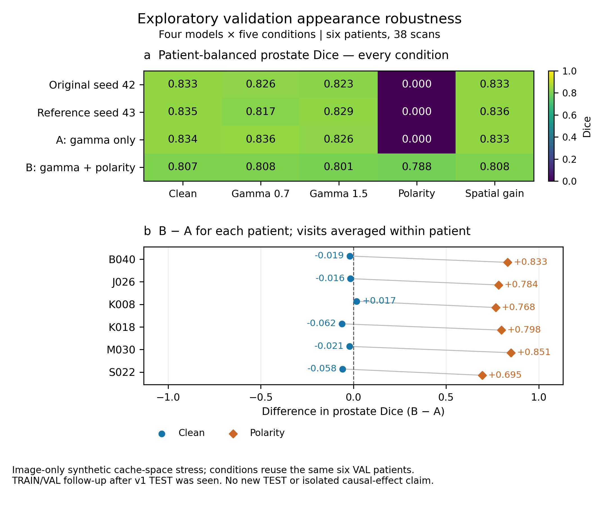

The extra polarity augmentation learns useful invariance to this synthetic
condition: all six patients improve under polarity. However, clean prostate
Dice falls by **0.02642** versus A, with **five of six patients worse**.
The largest clean drops are K018 (**-0.06219**) and S022 (**-0.05850**);
K008 improves (**+0.01727**). The minimum patient mean changes from **0.79091**
(A, K008) to **0.75240** (B, S022). A's clean mean is close to the original
seed42 value and below the seed43 reference, not a demonstrated overall advance.

The predeclared engineering indication required B's clean prostate and
foreground drops each to be no more than **0.02**, and polarity prostate gain
to be at least **0.05**. The observed differences are
**-0.02642 / -0.01113 / +0.78817**: the prostate guard fails, so the overall
indication **fails**. B is not adopted as a replacement. Training-loop time is
**1,023.29/1,021.84 s** for A/B, each peaking at **2.23 GiB**; each records
**4,287 successful updates and 3 AMP overflow skips**, all disclosed.
The job wall time also includes checks, smokes, validation, plotting and saving.

This establishes a measured synthetic robustness/clean-image trade-off in
this experiment, not M015's unique cause or its repair. These remain the same
six checkpoint-selecting VAL patients across all conditions, not thirty
independent patients. No new TEST was run, no favourable condition was selected
for reporting, and no extra arm or parameter adjustment follows the observed
scores. The original test benchmark and public v1 release remain unchanged;
later weights are retained outside Git and are not added to that release.

## Engineering recommendation and limitations

Retain the **2D baseline as the lower-cost research comparator**. On the frozen
v1 TEST, the 3D model offers no reliable mean prostate Dice benefit, worsens mean HD95 and
has a severe patient-level failure at substantially higher cost. Neither model
is justified for unattended contouring; draft masks require specialist review.
A nonempty-mask check alone would miss the demonstrated near-total omission.
The consistent validation ranking across two training runs does not overturn
that test result or remove its patient-level failure. The appearance ablation
also fails its clean-prostate guard, despite improving synthetic polarity
robustness, so it supplies no basis for replacing the original configuration.

Further work should use a new prespecified TRAIN/VAL design: investigate spatial
translations, improved end-region resolution or ROI localization, and
loss/sampling choices for the tiny prostate class. The completed appearance
ablation shows why clean-image harm must be measured alongside stress gains;
D2 gives no basis for removing support zeroing as a repair.
Ablate residual blocks and deep supervision separately before attributing any
benefit to one component. Validate prediction-only disagreement or volume-based
review flags with independent labels and prespecified thresholds. Evaluate any
new settings on a **new held-out cohort**, since this test split has now been
examined. These are proposed experiments, not claimed improvements.

The v1 test comparison has one training seed, six test patients, uneven visit counts,
a fixed 30-epoch budget, no architecture ablation, possible annotation error
and information lost in downsampling. Patient weighting addresses repeated
visits but does not establish representativeness or eliminate acquisition
bias. Measured latency is cached-grid inference, not end-to-end clinical time.

## Reproduce the supplied results

### Environment and checks

Python **3.11.15**, PyTorch **2.13.0+cu130**, CUDA **13.0**, NumPy **2.4.6**,
Matplotlib **3.11.2**, Nibabel **5.3.2**, SciPy **1.16.3** and
importlib_resources **7.1.0** were verified on Rangpur. Direct versions are in
[requirements.txt](requirements.txt). The project virtual environment reuses
`~/miniconda3/envs/torch` read-only and installs only pinned extras. From this
project directory, create `logs`, then submit `jobs/setup_cpu.slurm` and wait
for completion. On another machine install `requirements.txt` in Python 3.11
with a compatible PyTorch/driver build. This CUDA build lacks Pascal/P100 support.

The original final CPU suite passed **95 checks** in job 701569, including split/cache
geometry, model gradients, metrics/empty classes, AMP recovery, checkpoint
resume, provenance, HD95 support, failure selection and cache reconstruction.
The same job rebuilt one real TRAIN NIfTI pair with byte-identical decoded
arrays under the unchanged manifest. Run checks with:

```bash
.venv/bin/python -m unittest discover -s tests -v
```

The later diagnostic CPU job **701739** passed **114 checks**, adding independent
resampling and frozen-forward diagnostic checks. Its real-data audit and GPU
job **701740** produced the retrospective evidence above. Reproduce on compute
nodes with `jobs/diagnose_native_cache.slurm` and
`jobs/diagnose_frozen_inference.slurm`; the latter names the selected test
cases and explicitly acknowledges retrospective use. Diagnostic outputs use
new job-specific directories and do not overwrite v1 predictions.

The source/mechanism D1 jobs passed **11 source + 4 archive + 11 Torch**
fixtures; D2 passed **6** further fixtures on the cluster, with no dependency
skips. Their recorded scripts and pre-execution hashes are in
`jobs/diagnose_source_inputs_D1.slurm`, `jobs/diagnose_model_mechanism_D1.slurm`,
`jobs/diagnose_support_D2.slurm` and the two diagnostic protocol JSONs.
The [official ZIP catalogue](evidence/official_zip_catalog_D1.json) contains
metadata only; copy it to `artifacts/official_zip_catalog_D1.json` for the
source-identity check. Reconstruct the all-split frozen cache before examining
the declared TRAIN/VAL controls. `tools/describe_cache_contrast.py` reproduces
the 189-case descriptive comparison with decoded-array identity checks.
Its independent rerun reproduced **all 189 descriptor records exactly**;
the [reproduction record](evidence/cache_contrast_reproduction_D1.json) retains
the original and reusable-script identities.
Original execution guards bind the original report bytes. For a new D2
repetition, use `tools/diagnose_support_intervention.py` with an explicit
`--d1-source-report` from the completed new D1 run and a fresh output directory;
preserve the original plans and results as historical evidence.

For the appearance study, `jobs/train_appearance_A1.slurm` runs the two new
arms sequentially, then all fixed validation conditions under
`appearance_protocol.json`. Its two 8-test suites passed on the actual GPU
environment, followed by isolated five-batch smokes requiring a successful
optimizer update. The postrun summary's **7 additional fixtures** passed;
two independent audits also reaggregated the actual class/patient results.
After recreating the declared artifacts, use fresh outputs:

```bash
python experiments/summarize_appearance.py \
  --protocol appearance_protocol.json \
  --evaluation artifacts/appearance_evaluation_A1_702249/appearance_evaluation.json \
  --output artifacts/reproduced_appearance_review.json
python experiments/plot_appearance.py \
  --summary artifacts/reproduced_appearance_review.json \
  --output artifacts/reproduced_appearance_plot.png
```

The A1 summary verifies the original protocol/source hashes, checkpoint and
receipt identities, full 30-epoch histories, earliest-tie clean selection and
all 20 complete evaluations. It recomputes metrics from recorded counts;
this audit does not certify anatomical labels. Retraining uses the protocol's
same fixed conditions but is not promised bitwise identical.

Python, NumPy and PyTorch are seeded; cuDNN benchmarking is disabled and
deterministic kernels are requested with warnings for unsupported operations.
This build warns about nondeterministic categorical-CE and 3D max-pool backward
kernels. Seeded retraining is not guaranteed bit-identical across runs or builds.

### Trained weights and exact cache reconstruction

The public [24.77 MB result bundle](https://github.com/Jack-hithub/PatternAnalysis-2026/releases/tag/demo3-hipmri-seed42-v1)
contains both selected checkpoints, **the frozen manifest, decoded-array digest
book, source sidecars, histories and score JSON**, with no raw MRI, mask or
prediction arrays. Download `demo3_hipmri_seed42.zip` from the release assets;
GitHub's uploaded-asset digest matches the verified local archive. ZIP SHA-256:
`2b2904d92afc73fb93ebb129ffea01161379cee3bcb4e256a7bb7347516d3365`.
Extract `demo3_hipmri_seed42.zip` in a fresh checkout's project directory to
populate ignored `artifacts/`. Obtain HipMRI separately through the course or
the cited dataset under its usage terms. Data and weights remain outside Git.

Use the provided manifest, not a regenerated audit manifest: its exact bytes
are bound to the checkpoints. On a CPU compute node, rebuild test caches from
the original data using the unchanged preprocessing:

```bash
.venv/bin/python tools/cache_identity.py rebuild \
  --manifest artifacts/cache64/manifest.json \
  --identity artifacts/cache64/cache_identity.json \
  --data-root /home/groups/comp3710/HipMRI_Study_open --split test
```

This verifies geometry, class counts, preprocessing digest and exact decoded
image/mask/spacing hashes before writing each cache. It leaves the manifest
unchanged and refuses mismatching existing arrays. Rebuilding all supplied
cases uses `--split all`. A new audit embeds a new timestamp and digest; use
that path for **new training**, not as a replacement beside original weights.

Frozen manifest SHA-256:
`c47fe880d353629348786b852e3f699291af1a4d5628b2980bf42a74635d0424`.
Selected checkpoint SHA-256:

- 2D, epoch 26: `cfdcfa08147c295962e7d19f2ad16eb20a08590f9a28e00e95a281417aec3c10`.
- 3D, epoch 29: `9ea46e13a95617ec4ad80c21ba459087fb62941fb04406c7ffeade22ad014b62`.

The core training/preprocessing/prediction source is byte-identical to commit
`69400a70b9b7bbed1971408e74785e926236410a`. [training_sources.json](training_sources.json)
records eleven file digests plus the manifest digest. Later report and analysis
helpers do not change model behaviour. `tools/record_provenance.py` verified
actual remote files and recorded the selected checkpoint hashes in sidecars.

### Inference and paired analysis

Run supplied weights on a GPU compute node, using fresh output directories so
published evaluations are not overwritten. `--final-test` is an explicit guard;
reproducing frozen inference does not authorize tuning on these test labels.

```bash
for model in unet2d improved3d; do
  .venv/bin/python predict.py --manifest artifacts/cache64/manifest.json \
    --checkpoint "artifacts/full_seed42/$model/best.pt" \
    --split test --final-test --output-dir "artifacts/reproduced/$model" \
    --batch-size 32 --device cuda --target-class 5
done
```

Then analyze on a CPU compute node:

```bash
.venv/bin/python tools/analyze_pair.py --manifest artifacts/cache64/manifest.json \
  --baseline-eval artifacts/reproduced/unet2d/evaluation.json \
  --model-eval artifacts/reproduced/improved3d/evaluation.json \
  --output-dir artifacts/reproduced/paired --target-class 5 \
  --bootstrap-samples 2000 --seed 3710
.venv/bin/python tools/plot_failure_details.py \
  --manifest artifacts/cache64/manifest.json \
  --baseline-eval artifacts/reproduced/unet2d/evaluation.json \
  --model-eval artifacts/reproduced/improved3d/evaluation.json \
  --pair-analysis artifacts/reproduced/paired/pair_analysis.json \
  --output-dir artifacts/reproduced/details
```

The supplemental `tools/analyze_localization.py` reads unchanged predictions
and TRAIN masks and exports location/size descriptors. It is retrospective,
JSON-only, and changes no model decisions or scores. Its Slurm script is
`jobs/analyze_localization.slurm`; `--split all` reconstruction is needed to
supply the training-reference masks.

### Retraining rather than reproducing the original checkpoint

From this project directory on a CPU compute node:

```bash
.venv/bin/python tools/audit_dataset.py \
  --data-root /home/groups/comp3710/HipMRI_Study_open \
  --output artifacts/new_audit.json
.venv/bin/python tools/prepare_cache.py --audit artifacts/new_audit.json \
  --output-dir artifacts/new_cache --shape 64 128 128 --label-ids 0 1 2 3 4 5
.venv/bin/python tools/attach_label_schema.py \
  --manifest artifacts/new_cache/manifest.json --schema label_schema.json
```

Attach label metadata **before** training because it changes the digest. These
preparation commands refuse to overwrite existing output. For new GPU training:

```bash
for model in unet2d improved3d; do
  batch_size=1
  if [ "$model" = unet2d ]; then batch_size=16; fi
  .venv/bin/python train.py --manifest artifacts/new_cache/manifest.json \
    --model "$model" --output-dir "artifacts/new_run/$model" \
    --epochs 30 --batch-size "$batch_size" --base-channels 16 --lr 0.001 \
    --workers 0 --seed 42 --device cuda --amp --eval-batch-size 32
done
```

Resume interrupted training with `--resume artifacts/new_run/<model>/latest.pt`
and the same settings/output directory; `--epochs` is the new total, not an
increment. Resume restores optimizer, scaler and RNG state. Partial smoke runs
are marked development-only and cannot be used for formal test evaluation.
Never have two jobs write one run directory. For the original pilot/continuation,
`jobs/train_pilot.slurm` ran two epochs then `jobs/train_pair.slurm 30` resumed
sequentially on one GPU; the latter skips models already at 30 epochs.
A new experiment must record new source/manifest identities rather than reuse
the original provenance claim.

For the fixed second-seed study, rebuild the identical **all-split** cache and
verify its immutable manifest, then submit `jobs/train_pair_seed43.slurm`.
The job verifies the frozen protocol's source hashes, uses only TRAIN/VAL,
checks resumed-run and validation identities, and records new checkpoint
provenance under `artifacts/followup_seed43`. Do not run it concurrently with
another writer or use its validation results to replace the v1 test model.
After both models and their independent validation finish, reproduce the
strict summary from JSON evidence without loading TEST or prediction arrays:

```bash
python tools/analyze_seed_followup.py \
  --seed42-root artifacts/full_seed42 \
  --seed43-root artifacts/followup_seed43 \
  --seed42-val artifacts/validation_seed42 \
  --seed43-val artifacts/validation_seed43 \
  --manifest artifacts/cache64/manifest.json \
  --protocol followup_protocol.json \
  --output-dir artifacts/reproduced_seed_followup
```

Use a fresh output directory. The evidence checks require complete 30-epoch
histories, the original sourcebook and frozen file hashes, selected-checkpoint
provenance, all six validation patients, and agreement between selected history
and standalone validation. Rehash checkpoint files separately against the
recorded digests; the JSON summarizer does not open checkpoint bytes.

## Development evidence and submission

Progressive commits record real milestones: environment/feasibility, patient
pairing and splits, model implementations, cache/training, verified labels and
analysis, pilot measurements, architecture/provenance, validation/protocol freeze,
and final failure analysis. [AUDIT_SUMMARY.md](AUDIT_SUMMARY.md) retains the
chronological engineering evidence. Original experiments completed as Slurm
700974 (pilot), 700981 (30 epochs), 701513 (independent validation), 701544
(final test), 701555 (paired analysis), 701560 (ROI figures), 701569 (95 checks
and real cache rebuild), and 701590 (retrospective localization).
Additional milestones record independent diagnosis (701739/701740), the
post-test fixed validation robustness plan (27527d3), completed paired training
(701767), independent analysis (701791), source/mechanism audit (702061/702062)
and one-factor input intervention (702134). D1/D2 plans were committed before
their respective executions, after the earlier diagnostic observations.
Appearance plan **5c49de3** and audit-tool milestone **4e23d40** preceded the
completed A1 job **702249**, whose failed clean-prostate guard is retained.
The original v1 test remains unchanged.

The project belongs under `recognition/ImprovedUNet3D_s4927782` on
`topic-recognition`. The initial submission consists of the upstream PR and a
PDF of this README for Turnitin, with the complete one-page feasibility review
included. Planned tutor check-off is **28 October 2026**; the final LMS date
must be verified. Teaching-team code review and responses occur in the later
official window; initial submission does not complete that future requirement.

## References

1. COMP3710/COMP7710 Report, Version 2.5 (2026), supplied assessment specification:
   segmentation pp. 5–6, feasibility p. 12, structure/marking/submission pp. 13–16.
2. Isensee et al., *Brain Tumor Segmentation and Radiomics Survival Prediction:
   Contribution to the BRATS 2017 Challenge* (architectural starting reference):
   https://arxiv.org/abs/1802.10508.
3. The author's own Demo 2 standard U-Net:
   https://github.com/Jack-hithub/comp3710-demo2-part4.
4. Dowling, J.; Greer, P. (2021), *Labelled weekly MR images of the male pelvis*,
   v2, CSIRO: https://doi.org/10.25919/45t8-p065. Original label key:
   https://data.csiro.au/dap/ws/v2/collections/52549/support/5034.
5. Dowling et al. (2015), *Automatic Substitute Computed Tomography Generation
   and Contouring for MRI-Alone External Beam Radiation Therapy From Standard
   MRI Sequences*: https://doi.org/10.1016/j.ijrobp.2015.08.045.
6. Ronneberger, O.; Fischer, P.; Brox, T. (2015), *U-Net: Convolutional Networks
   for Biomedical Image Segmentation*: https://arxiv.org/abs/1505.04597.
7. Dai et al. (2021), *CAN3D: Fast 3D Medical Image Segmentation via Compact
   Context Aggregation*, section 4.1 (source acquisition, annotation propagation
   and experimental preprocessing): https://arxiv.org/abs/2109.05443.
8. Isensee et al. (2021), *nnU-Net: a self-configuring method for deep
   learning-based biomedical image segmentation*, and the authors' intensity
   augmentation implementation (inspiration, not a reproduction):
   https://github.com/MIC-DKFZ/nnUNet/blob/master/nnunetv2/training/nnUNetTrainer/nnUNetTrainer.py.

Data were provided by HipMRI Study and Calvary Mater Newcastle Hospital
(Professor Peter Greer). Use follows the dataset's non-commercial research
terms and no attempt is made to identify or contact participants.
