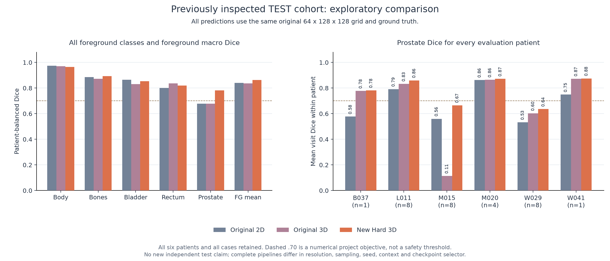
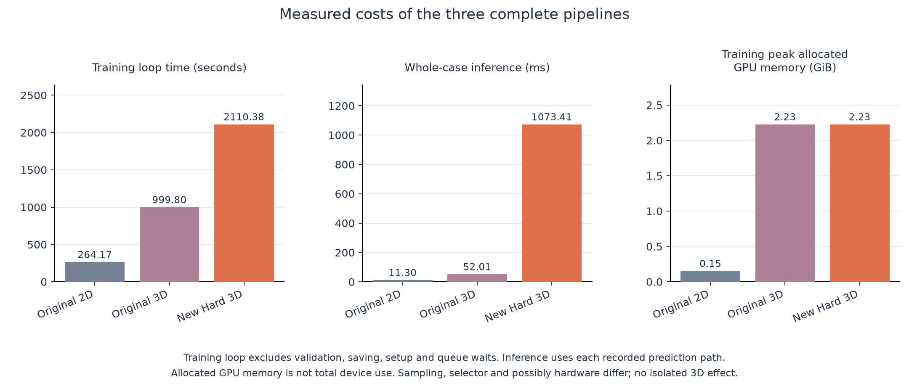
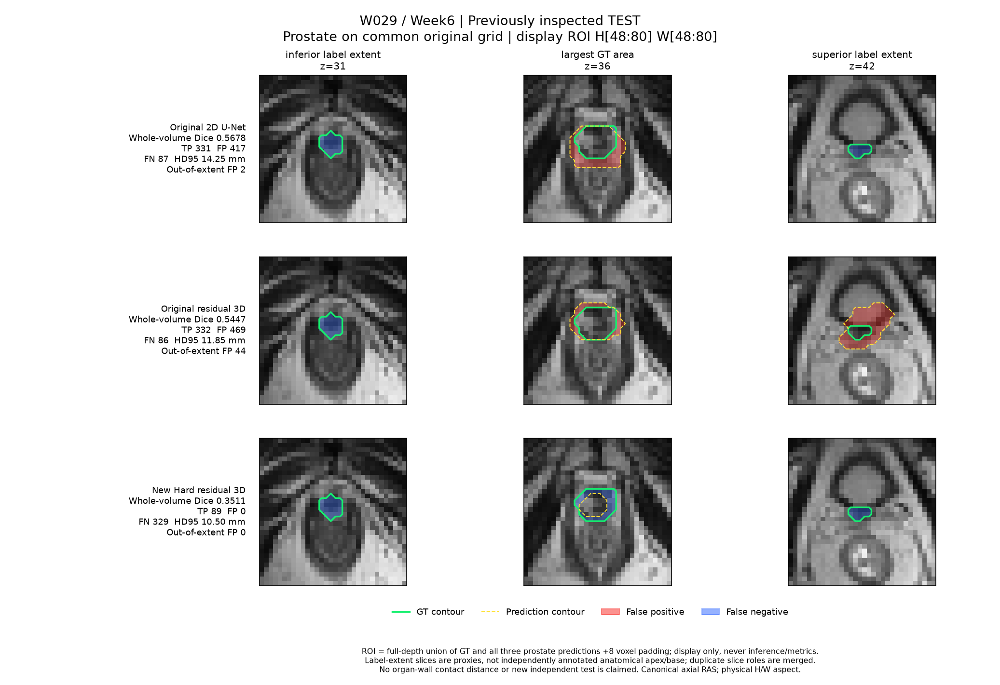
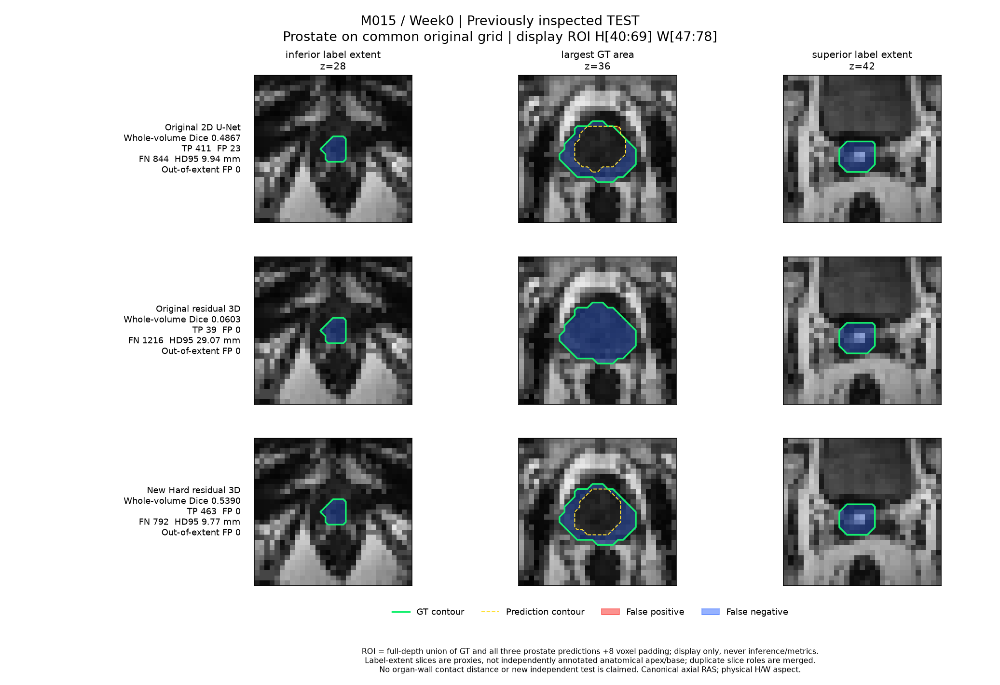
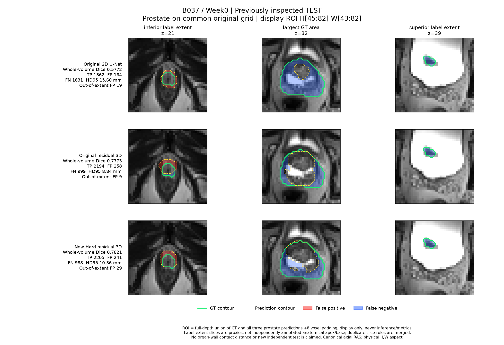
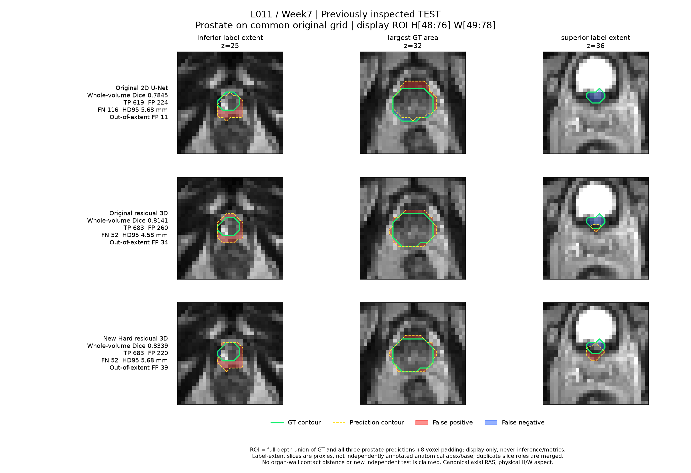
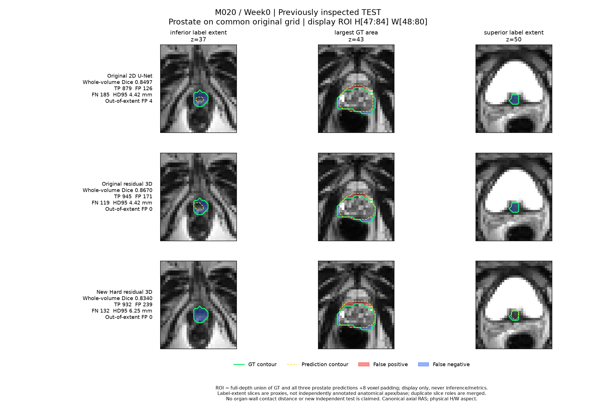

# HipMRI segmentation: a higher-resolution residual 3D U-Net and its trade-offs

Author: Baoxu Wang (s4927782). COMP3710, 2026.

**Current Hard implementation:** the residual, deeply supervised 3D Improved
U-Net now uses a higher-resolution input grid, organ-balanced TRAIN patches,
prostate-based validation selection and complete-image sliding-window inference.
On the **same original evaluation grid**, its patient-balanced prostate Dice is
**0.7818**, compared with **0.6772** for the original 3D model and **0.6790** for
the standard 2D U-Net. Foreground Dice is **0.8629** and prostate HD95 is
**6.26 mm**. The numerical prostate target of 0.70 is met under the stated
aggregation, but **10/30 scans remain below 0.70**, especially M015 and W029.

An imaging specialist is the intended user of draft pelvic-organ contours.
The engineering question is whether added spatial detail/context improves
prostate end regions and adjacent-organ interfaces enough to justify cost.
The revised pipeline improves average scores on these cases, with about
**2.11x the original 3D training-loop time and 20.64x inference latency**.
It is a research prototype requiring specialist correction, not a clinically
validated automatic contourer.

**Evaluation status:** the original v1 test was frozen before its first final
benchmark. The revised Hard study occurred after those test results and several
exploratory studies had been inspected. Its six TEST patients / 30 scans are
therefore a **retrospective comparison, not a new blind test**. The old results,
failed experiments and unchanged source identities are retained. The full
previous report, including all original failures and later studies, is
[README_V1_HISTORY.md](README_V1_HISTORY.md). New source, fixed plans, evidence
and reproduction guidance are in [hard_v2/](hard_v2/README.md).

## Data, labels and patient separation

The strict audit matched **211 MRI/mask pairs from 38 anonymous patients**.
All matched shapes, orientation, spacing and affine checks. The unchanged
seeded patient split (3710) assigns **26/6/6 patients** and **143/38/30 scans**
to TRAIN/VAL/TEST. Every visit, slice and derived patch from a patient stays in
that partition. The fixed 70/15/15 patient allocation reserves separate people
for learning, selection and evaluation; rounding 38 patients gives 26/6/6.
Six VAL and six TEST people give limited precision, regardless of visit count.

| Raw ID / class index | Official label |
|---|---|
| 0 | Background |
| 1 | Body |
| 2 | Bones |
| 3 | Bladder |
| 4 | Rectum |
| 5 | Prostate |

[CSIRO's original v2 label key](https://data.csiro.au/dap/ws/v2/collections/52549/support/5034)
and [label_schema.json](label_schema.json) establish this mapping; labels were
not assigned from visual guesses. The data are [Dowling and Greer, 2021,
v2](https://doi.org/10.25919/45t8-p065). Native arrays are 256x256x128 except
K019/Week1 (256x256x144), originally LPS. Image/mask pairs are reoriented to
canonical RAS with matched geometry. Images use linear interpolation; masks
use nearest-neighbour interpolation. Per-scan nonzero-intensity z-scores are
clipped to [-5,5]; no VAL/TEST labels or pooled cohort statistics fit this step.

The original grid is D,H,W = **64,128,128**; the revised input grid is
**96,192,192**. Each case retains its centre-aware affine and physical spacing.
A shared array shape does not imply equal field of view. Label-guided sampling
is confined to TRAIN. VAL, TEST and deployment scan the complete image without
GT-derived crops, normalization regions or postprocessing.


Five TRAIN patients were visually reviewed before original training. All 211
cached images, masks, spacings and counts were reloaded and checked; this does
not certify every anatomical annotation. Later independent checks recomputed
38 original VAL prediction arrays and passed image-only preprocessing and
prediction equality on two TRAIN patients. No old mainline pairing, counting
or inference arithmetic error was reproduced in that scope.

## Feasibility review

The complete one-page review below is the **original pre-final-experiment
snapshot**. Its pilot observations, planned check-off and unmeasured-test
statement describe that earlier stage; they are not a tutor completion record.
The 2026 course profile now lists the assessment window as 19-30 October;
the snapshot's earlier deadline uncertainty is retained as history.

<!-- FEASIBILITY_REVIEW_START -->
**Student:** s4927782 · **Planned check-off:** Wednesday, 28 October 2026 · **Difficulty:** Hard

### User need and scope

An imaging specialist needs draft prostate contours for review. This prototype investigates whether 3D spatial context improves difficult base/apex boundaries and interfaces with the bladder or rectum enough to justify additional memory and runtime. It compares a 3D Improved U-Net against a standard 2D U-Net on HipMRI, using identical patient-level train/validation/test assignments. Clinical deployment is outside scope.

### Measurable acceptance criteria

1. **Leakage:** assert zero patient overlap across splits, including repeated volumes and derived slices; verify image/mask pairing and spatial alignment before training.
2. **Accuracy:** target held-out prostate Dice **≥0.70** for the 3D model; report per-class Dice and IoU for both models. Use validation data for model selection.
3. **Boundary benefit:** compare patient-level and inferior/mid/superior results (approximate apex/base thirds), supplemented by grid-aware HD95 in millimetres, and identify where 3D context helps or fails relative to 2D.
4. **Failure analysis:** examine **3–5** representative test failures with input, ground truth, prediction and false-positive/false-negative overlays; give a justified recommendation on specialist review and computational trade-offs.
5. **Resources:** train on **one GPU**, using **volume batch size 1** for 3D. Peak allocated training VRAM **≤24 GiB** is the initial target. Report GPU, parameters, training time, peak VRAM and per-case inference time.

### Model choice and preliminary evidence

The Hard model uses volumetric convolutions, residual units, skip connections and deep supervision on downsampled HipMRI volumes. Relevant course concepts include convolutional spatial context, segmentation losses, generalisation and computational complexity. Isensee et al., [arXiv:1802.10508](https://arxiv.org/abs/1802.10508), is an architectural starting reference.

All **211 image/mask grids from 38 patients** passed cache checks, split **26/6/6** (143/38/30 scans). **75 checks passed**, including AMP overflow recovery and checkpoint resume. Five TRAIN patients were visually reviewed. [CSIRO's original key](https://data.csiro.au/dap/ws/v2/collections/52549/support/5034) confirms **class 5 is prostate**. Two full-data A100 pilot epochs completed per model: validation foreground Dice reached **0.740 (2D)** and **0.535 (3D)**. These are early validation observations; **final test accuracy remains unmeasured**.

### Risks, budget and next experiment

Main risks are class imbalance, thin-boundary loss during downsampling and the short turnaround. Both models use class weights derived only from training voxels. Measured 3D pilot training peak was **2.23 GiB** on a 40-GB A100; training took about **51 s/epoch** versus **9 s/epoch** for warmed 2D. The next experiment resumes each model to **30 epochs**, selecting checkpoints only by validation. The initial 18-GPU-hour budget is revised to a **one-GPU-hour allocation** from the measured pilot cost; queue waiting is additional.

The preselected fallback reduces 3D patch size and channel counts while retaining residual units and deep supervision, preserving the approved Hard architecture. Moving instead to a Normal model would cap implementation at 15/20.

**Planning:** 30 October is an unconfirmed final-deadline assumption; verify the official date. Follow the course specification, pp. 5–6 and 12–16, including progressive commits, AI disclosure, PR and subsequent review response.
<!-- FEASIBILITY_REVIEW_END -->

### Outcome against the planned criteria

Patient isolation and cache checks passed. Original v1 3D prostate Dice
**0.6772** missed the stated **0.70** objective. The revised pipeline reaches
**0.7818** in the retrospective comparison; it does not turn that into a new
held-out confirmation. Five patient-distinct new failure analyses and original
end-region results are retained below. New training peak is **2.23 GiB**, below
the original 24-GiB resource target, while latency is substantially greater.

The course Hard row specifies residual volumetric units, deep supervision and
test Dice >=0.7 without defining the class or aggregation. This report declares
patient-balanced prostate Dice as its clinical target and reports every class;
it does not substitute a favourable macro score for a missed prostate goal or
claim the numerical target guarantees a grade.

## Architecture, loss and what changed


The [editable architecture SVG](figures/model_architecture.svg) matches
[modules.py](modules.py). U-Net's encoder pools spatial context while skip
connections restore fine features in its decoder. The standard baseline
operates on independent axial slices, using double convolutions with ReLU,
transposed upsampling and widths 16/32/64/128; its slices are reassembled into
whole volumes. It follows Ronneberger et al. [6] and the author's own Demo 2
experience [3].

Both old and new 3D runs use **the same 1,627,634-parameter model**: volumetric
convolutions, additive residual shortcuts, GroupNorm, LeakyReLU and
resize-plus-convolution decoding. Main, half- and quarter-resolution heads
provide deep supervision; labels are resized with nearest-neighbour mapping
to each head's native grid. Relative to Isensee et al. [2], max pooling,
GroupNorm instead of InstanceNorm, no dropout and explicit native-scale
auxiliary weighting are adaptations, not an exact paper or nnU-Net reproduction.

Every head predicts six exclusive classes. Masks remain integer IDs for CE;
soft Dice converts them to six-channel one-hot tensors with `F.one_hot`, even
when an organ is absent. Each head uses class-weighted categorical CE plus
soft Dice over all classes, including background. Main/half/quarter losses
have weights 1/0.5/0.25, normalized by 1.75. CE weights are inverse square-root
TRAIN full-grid frequencies, normalized, clipped to [0.05,10] and renormalized.
New resolved weights are approximately **0.0993, 0.1290, 0.4170, 0.9903,
2.0191, 2.3454**. They use only new-grid TRAIN counts, not VAL/TEST labels.

| Complete pipeline setting | Original 2D | Original 3D | Revised Hard 3D |
|---|---|---|---|
| Input grid D/H/W | 64/128/128 | 64/128/128 | 96/192/192 |
| TRAIN examples per scan/epoch | All 64 slices | One full volume | Two 64/128/128 patches |
| Batch size | 16 slices | 1 volume | 1 patch |
| Training seed | 42 | 42 | 3711 |
| Epoch budget | 30 | 30 | 30 |
| Validation selection | Foreground Dice | Foreground Dice | Prostate Dice |
| Validation schedule | Every epoch | Every epoch | 1/5/10/15/20/25/30 |
| Selected epoch | 26 | 29 | 30 |
| Full-image inference | Slice assembly | One volume | 8 overlapping windows |

The revised patch sampler chooses a uniform spatial centre with probability
0.5; otherwise it chooses uniformly among five foreground classes and samples
around a voxel of that class. A missing class falls back to uniform spatial
sampling and is recorded. Direct prostate-centred probability is about 10%,
not 50%. Actual 30-epoch sampling requested 4,311 foreground patches out of
8,580, including 837 prostate centres, with no missing-class fallback. The
old full-volume run also contained the prostate; it was not absent from TRAIN.

Both generations use AdamW (lr 0.001, weight decay 0.0001), clipping at norm 5,
AMP and paired H/W flips with probability 0.5 per axis. There is no new
intensity transformation, TTA or prediction postprocessing. New inference
averages softmax probabilities across eight 50%-overlapping windows before
argmax. It runs only the main segmentation output, although the model forward
also computes auxiliary heads. Original v1 instead uses whole-volume main-head
argmax. Sliding windows retain a complete-image prediction without a GT ROI.

Higher sampling density may retain small-organ detail; foreground patches may
increase local organ exposure; prostate-based validation aligns selection with
the stated objective. These are plausible mechanisms, **not isolated causal
findings**. Resolution, sampling, successful updates, seed, selection and
inference change together; there is no single-factor ablation or equal-compute
comparison. The new pipeline was trained from scratch, not from its QA weights.

## Fixed execution and retained negative evidence

The original proposed new 2D/3D pair did not pass its all-or-none TRAIN QA.
At the fixed final 400th step, new 2D prostate/foreground Dice was
**0.8224/0.8683**, below 0.90; new 3D was **0.9233/0.9574** and passed.
Original combined QA remains failed and new 2D was not formally trained.
A separate, explicitly scope-reduced Hard-only study then fixed one seed,
30 epochs and a 60-minute GPU limit before new model VAL/TEST scores. This
was an adaptive scope revision, not the original pair completing unchanged.
Different 2D/3D QA crop exposure is not proof of the failed fit's cause or of
generalization. The complete plans and scope identities are preserved in
[hard_v2](hard_v2/README.md).

The new model selected the strict maximum patient-balanced VAL prostate Dice
among seven scheduled checkpoints, earliest on ties. Selection was frozen
before preparing its new TEST cache and evaluating all 30 known cases. This
prevents within-run TEST checkpoint selection; the cases had already influenced
prior work, so it cannot restore overall blindness.

An extra VAL gain rule in the historical study was **self-imposed, not a
teacher requirement**. Its recorded outcome is preserved. The user later
removed it as a restriction on including the new implementation in this
assignment. This post-result documentation decision changes no weight, epoch,
metric or original rule outcome; it is not a new validation pass.

Actual GPU job **705405** completed in **47:03**, exit 0; dependent CPU
**705447** completed in **2:55**, exit 0. CPU preparation first timed out after
25:23, leaving 159 complete cache files; the recorded engineering recovery
completed in 8:06 and retained the failed output. Total preparation wall time
is 33:29, not an unreported success inside the first 25-minute limit.

## Evaluation and results

### Common grid and patient-balanced metrics

All three pipelines are compared on the **same immutable original
64x128x128 GT grids and physical spacing**. New-grid hard predictions are
mapped by affine nearest-neighbour sampling to that grid. New96 raw scores
are retained separately and are not mixed with old64 scores. Mapping does not
recover downsampling detail or establish native-resolution accuracy.

Hard Dice is 2TP/(2TP+FP+FN); IoU is TP/(TP+FP+FN). Both-empty classes are
undefined and excluded; one-sided nonempty masks score zero. Per-class values
are averaged first across a patient's visits, then equally across patients.
Foreground is the independent mean over classes 1-5; background is separate.
These are not pooled-voxel Dice. Averaging IoU then transforming it also does
not reproduce averaged Dice.

HD95 uses the 95th percentile of pooled bidirectional nearest distances between
six-connected surfaces, in grid-aware millimetres. Paired comparisons use the
same both-present visits. All 30 TEST scans / six patients are eligible for
all three models, with no empty-surface exclusion. Missing predictions would
retain Dice zero even if distance were undefined. Coarse-grid HD95 does not
measure millimetre-thin bladder/rectal-wall contact or clinical dose impact.

| Patient-balanced measure | Original 2D | Original 3D | Revised Hard |
|---|---:|---:|---:|
| VAL prostate Dice | 0.7920 | 0.8332 | 0.8406 |
| VAL foreground Dice | 0.8675 | 0.8748 | 0.8807 |
| Retrospective TEST prostate Dice | 0.6790 | 0.6772 | **0.7818** |
| Retrospective TEST foreground Dice | 0.8409 | 0.8375 | **0.8629** |
| TEST prostate HD95, mm | 9.573 | 10.615 | **6.264** |

Original v1 scores above reproduce the original frozen outputs; their first
TEST was sealed in [test_protocol.json](test_protocol.json) before execution.
New common-grid VAL prostate gain versus old 3D is **+0.007404**; TEST gain
is **+0.104593**. Their different size highlights cohort variability, not a
license to select another test-based candidate. Only six TEST patients and one
new training seed limit precision.

### Every class, including trade-offs

| Class | 2D Dice | Old 3D Dice | New Dice | 2D IoU | Old 3D IoU | New IoU |
|---|---:|---:|---:|---:|---:|---:|
| 0: Background | 0.9898 | 0.9905 | 0.9838 | 0.9803 | 0.9813 | 0.9687 |
| 1: Body | 0.9738 | 0.9711 | 0.9651 | 0.9494 | 0.9441 | 0.9331 |
| 2: Bones | 0.8857 | 0.8730 | 0.8941 | 0.7960 | 0.7755 | 0.8098 |
| 3: Bladder | 0.8651 | 0.8300 | 0.8544 | 0.7742 | 0.7547 | 0.7724 |
| 4: Rectum | 0.8010 | 0.8363 | 0.8190 | 0.6726 | 0.7207 | 0.6973 |
| 5: Prostate | 0.6790 | 0.6772 | 0.7818 | 0.5296 | 0.5642 | 0.6554 |

The new pipeline improves prostate and bone Dice relative to old 3D but reduces
body and rectum Dice. Bladder improves against old 3D but remains below 2D.
The mean prostate improvement must not hide these other-organ losses.
[Complete TEST counts](hard_v2/artifacts/hard_common_test/comparison.json)
and [VAL counts](hard_v2/artifacts/hard_common_validation/comparison.json) retain
all cases, class intersections, confusion matrices, identities and exclusions.
Their historical `adoption_gate` field retains the original study-rule outcome;
current assignment interpretation is the one stated here and in the package.

### Patients, severe misses and uncertainty

| Patient | Visits | 2D prostate Dice | Old 3D | New Hard | New minus old 3D |
|---|---:|---:|---:|---:|---:|
| B037 | 1 | 0.5772 | 0.7773 | 0.7821 | +0.0047 |
| L011 | 8 | 0.7919 | 0.8326 | 0.8600 | +0.0273 |
| M015 | 8 | 0.5601 | 0.1136 | 0.6656 | +0.5520 |
| M020 | 4 | 0.8629 | 0.8643 | 0.8720 | +0.0077 |
| W029 | 8 | 0.5327 | 0.6028 | 0.6359 | +0.0331 |
| W041 | 1 | 0.7490 | 0.8725 | 0.8751 | +0.0027 |

M015 improves markedly but remains below 0.70; W029 also remains below it.
**Ten of 30 new TEST scans score below 0.70**, concentrated in those patients.
Every patient's mean improves versus old 3D, but individual visits can worsen.
M015's mean change accounts arithmetically for about 88% of the overall
prostate increase; that decomposition does not identify its biological or
algorithmic cause. Pooled prostate FN decrease from **12,594 to 8,203**, and
FP from **4,868 to 3,047**; these error burdens are not patient-macro Dice.



For the original v1 3D-minus-2D prostate difference, patient bootstrap gave
**-0.0018, 95% CI [-0.1908, 0.1287]** (2,000 resamples, seed 3710).
That original interval is retained, not transferred to the new pipeline.
No new independent cohort, confirmatory confidence claim or clinical operating
threshold was established. Thirty correlated scans are not 30 independent people.

### Resources and reproducibility cost

| Resource | Original 2D | Original 3D | Revised Hard |
|---|---:|---:|---:|
| Parameters | 481,830 | 1,627,634 | 1,627,634 |
| Training loop, 30 epochs (s) | 264.17 | 999.80 | 2,110.38 |
| Successful updates / AMP skipped | 17,152 / 8 | 4,288 / 2 | 8,577 / 3 |
| Peak training allocated GiB | 0.154 | 2.227 | 2.227 |
| Whole-case inference (ms) | 11.30 | 52.01 | 1,073.41 |
| Peak inference allocated GiB | 0.140 | 1.737 | 1.749 |

All three recorded runtimes use **A100-PCIE-40GB**, Python **3.11.15**, Torch
**2.13.0+cu130**, CUDA **13.0**; NumPy **2.4.6**, SciPy **1.16.3** and Nibabel
**5.3.2** support preprocessing and analysis. Training loop excludes validation,
saving, setup and queueing; the new recorded run including validation/saving is
2,440.71 s. Inference uses one full-case warmup and synchronized transfer,
network and output; new timing includes CPU window probability accumulation.
It excludes disk loading, preprocessing, scoring and plotting. Allocated GPU
bytes are not total device usage.



The new method has about **2.11x old 3D training time and 20.64x inference time**.
It changes the time/detail trade-off despite the same parameter count and peak
training memory. CUDA deterministic requests use `warn_only`; CE-forward and
3D max-pool backward reported unsupported deterministic operations. Seeds and
recorded versions do not promise bitwise-identical retraining.

## Five fixed failure autopsies

The fixed gallery rule selects each patient's worst defined new-Hard prostate
visit, then the five worst distinct patients. Each figure uses identical MRI
planes and intensity window across models. **Green = GT, dashed yellow =
prediction, red = FP, blue = FN.** Inferior/superior GT depth endpoints and the
largest-GT plane locate residual errors, but they are not expert-annotated
anatomical apex/base landmarks. Full-volume scores include unshown planes.
Display ROI is the projected GT-plus-all-prediction union with padding, only
for magnification; it is never an inference crop or scoring region.

### 1. W029 Week6: worse overlap despite fewer false positives



New Dice **0.3511** is worse than old 3D **0.5447** and 2D **0.5678**.
New TP/FP/FN is **89/0/329**; 300 missed prostate voxels become Body, eight
Bladder and 21 Rectum. The target has 418 voxels, but only 89 are predicted.
HD95 improves from 11.85 to 10.50 mm while the mask shrinks severely, showing
why a smaller distance or zero FP does not imply a usable contour.
[Full field](hard_v2/artifacts/hard_failure_gallery/W029_Week6_full_fov.png).

### 2. M015 Week0: large mitigation, still incomplete



Dice rises from old 3D **0.0603** to **0.5390**, above 2D **0.4867**.
New TP/FP/FN is **463/0/792**, so most target voxels remain missed despite
substantial recovery. Of the FN, 764 become Body and 28 Rectum. HD95 decreases
from 29.07 to 9.77 mm. The endpoint panels retain visible review locations;
this is mitigation rather than a repaired patient or complete end-region contour.
[Full field](hard_v2/artifacts/hard_failure_gallery/M015_Week0_full_fov.png).

### 3. B037 Week0: similar Dice with a worse boundary distance



Dice changes from **0.7773 to 0.7821**, but HD95 worsens **8.84 to 10.36 mm**.
New TP/FP/FN is **2,205/241/988**. Out-of-GT-depth prostate FP rise from
nine to 29, and 367 missed target voxels become Bladder. A slight overlap gain
does not resolve end-region leakage or missing contour.
[Full field](hard_v2/artifacts/hard_failure_gallery/B037_Week0_full_fov.png).

### 4. L011 Week7: better overlap does not settle the end slices



Dice improves **0.8141 to 0.8339** mainly through fewer FP (**260 to 220**),
while FN remains **52**. Out-of-depth FP nevertheless rises **34 to 39**, and
HD95 worsens **4.58 to 5.68 mm**. Local endpoint errors remain despite a strong
whole-volume score; the displayed upper label extent should still be reviewed.
[Full field](hard_v2/artifacts/hard_failure_gallery/L011_Week7_full_fov.png).

### 5. M020 Week0: a genuine regression is retained



New Dice **0.8340** is below old 3D **0.8670** and 2D **0.8497**. FP increases
**171 to 239**, FN **119 to 132**, and HD95 **4.42 to 6.25 mm**. Most FN are
classified as Body (116 voxels), with smaller errors involving other organs.
Improved population average does not guarantee improvement for this visit.
[Full field](hard_v2/artifacts/hard_failure_gallery/M020_Week0_full_fov.png).

These findings establish error morphology, not a unique root cause. Class
confusion does not measure organ-wall contact, and three axial planes cannot
prove 3D connectedness or absence of discontinuities. M015 and W029 remain
unsuitable for unreviewed automated drafting. The other cases also lack a
validated image-only acceptance rule.

## Engineering recommendation

Present the revised Hard pipeline as the implemented higher-detail research
option, with the original 2D U-Net and original 3D as explicit comparators.
Its numerical prostate objective is met on the stated retrospective population,
and its average coarse-grid boundary distance improves, at a substantial
latency cost. Retain the cheap 2D pipeline for cost comparison; the new study
does not establish a matched-budget or single-factor 3D benefit.

Specialist correction is required. Review both ends and neighboring-organ
interfaces rather than relying on an aggregate Dice or nonempty-mask check.
No trusted prediction-only flag, native-resolution accuracy assessment,
independently marked anatomical apex/base study or prostate-to-bladder/rectal
wall-distance assay was completed. No clinical deployment is justified.
Future independent-cohort validation and controlled ablations would be needed
for a generalization or mechanism claim; they are proposed work, not extra
experiments performed for this submission. Training and tuning stop here.

## Code organization and reproduction

### Required modular files and revised entry points

| File | Role |
|---|---|
| [modules.py](modules.py) | Standard 2D and residual/deeply supervised 3D PyTorch models, categorical and multiscale loss; reused without changing original bytes. |
| [dataset.py](dataset.py) | Original manifest/split checks and loaders; revised pipeline imports verified geometry/cache helpers. |
| [train.py](train.py) | Preserved original v1 TRAIN/VAL updates, curves and checkpoint resume. |
| [predict.py](predict.py) | Preserved original v1 inference and guarded final evaluation. |
| [README.md](README.md) | Current report, complete historical feasibility review and original/revised comparison. |
| [hard_v2/README.md](hard_v2/README.md) | Revised implementation, exact executable commands, portable package checks and evidence map. |
| [hard_v2/train_hard_followup.py](hard_v2/train_hard_followup.py) | Executed Hard-only trainer and strict VAL selection; uses the verified shared model/loss. |
| [hard_v2/predict.py](hard_v2/predict.py) | Portable image-only entry for the unchanged `infer_v2.py` sliding-window and native-geometry implementation; no GT input. |
| [hard_v2/compare_hard_followup.py](hard_v2/compare_hard_followup.py) | Common-grid, all-case metrics and matched-surface analysis. |

Additional original `tools/`, `tests/` and `jobs/` remain for baseline analysis
and cluster entry points. The new source is organized under `hard_v2/` rather
than replacing the original model or pretending its old weights used new
preprocessing. Source copies retain recorded identities; integration adapters
and package manifests distinguish relocation from scientific changes.

### Environment, checks and supplied artifacts

Use Python 3.11 and a compatible Torch/CUDA build from
[requirements.txt](requirements.txt); recorded extra versions are in
[requirements-extra.txt](requirements-extra.txt). On Rangpur, the verified
virtual environment reused the school's Torch environment with pinned extras.
A fresh installation on another operating system was not exercised in this
submission.

Original verification comprised **95 checks**, all 211 cache-integrity checks,
independent selected-checkpoint VAL reload and a real NIfTI-to-cache rebuild
matching decoded hashes. New execution checks include source guards, actual
selected-weight metadata, all 30 epochs and early-tie selection. The count
audit covers 1,224 common-grid class rows and 204 six-class confusion matrices
across three models and two splits, plus 408 class rows on the new 96-grid
(1,632 class rows in total).
The final independent arithmetic audit made 17,758 assertions; these are
assertions, not 17,758 separate model experiments. HD95 support and aggregation
were independently checked locally; its pixel distances were computed in the
recorded server CPU analysis, not independently rerun from MRI locally.

From this project directory, check integrated source identities and recompute
saved count-based metrics without MRI, weights or GPU:

```bash
python hard_v2/verify_package.py
```

After obtaining the separately supplied selected weight and original baseline
artifacts, include external identity checks:

```bash
python hard_v2/verify_package.py --require-external \
  --checkpoint artifacts/hard_followup/improved3d/best.pt
```

For one authorized MRI, the portable wrapper runs complete-image sliding-window
inference and native-geometry export using the selected weight, with no GT:

```bash
python hard_v2/predict.py --image /path/to/scan.nii.gz \
  --checkpoint artifacts/hard_followup/improved3d/best.pt \
  --output-dir /fresh/prediction --device cpu
```

The executed Hard trainer remains available for a separately recorded study.
The following is a documented entry, **not an instruction to retrain this
completed submission**; it requires the recorded new cache and QA receipt:

```bash
python hard_v2/train_hard_followup.py --mode train \
  --protocol hard_v2/protocol_v2.json \
  --scope-plan hard_v2/hard_followup_protocol.json --project-root . \
  --manifest /path/to/cache_v2/manifest.json \
  --qa-receipt hard_v2/artifacts/qa_v2/qa_receipt.json \
  --output-dir /fresh/new_hard_run --device cuda
```

Exact preparation, inference and analysis prerequisites are in
[hard_v2/README.md](hard_v2/README.md). Pixel-level reproduction requires
authorized HipMRI data, frozen manifests and original baseline artifacts.
Historical Slurm scripts record actual school paths; the integration wrapper
separates relocation from frozen scientific sources. Use fresh outputs rather
than weakening SHA checks or overwriting old runs. No new training or real-data
inference was performed while integrating this report.

The original [v1 Release](https://github.com/Jack-hithub/PatternAnalysis-2026/releases/tag/demo3-hipmri-seed42-v1)
assets remain unchanged. Its 24,772,853-byte `demo3_hipmri_seed42.zip` contains selected
2D/3D checkpoints, manifest, identity book, histories and scalar metadata, with
no raw MRI/masks/prediction arrays. ZIP SHA-256:
`2b2904d92afc73fb93ebb129ffea01161379cee3bcb4e256a7bb7347516d3365`.
The revised selected checkpoint is epoch30, SHA-256
`852e3e1ee0a8f41be8a50902b7f6f2e28ffaa8227144d6ddf7806e06670e88bf`;
the separately supplied local archive is `demo3_hipmri_hard_seed3711_v2.zip`
(18,221,187 bytes), ZIP SHA-256:
`2c424dc514dd28837adfb40d9799b8a103d84576eba9f76e538320bd6b0ba101`.
Extract it in this project directory, so the weight is placed under
`artifacts/hard_followup/improved3d/best.pt`. No public download URL for this
new archive is claimed at this stage; its data prerequisites are in the
revised package guide. Weights and image arrays are never committed to Git.

For full original commands, exact cache reconstruction and provenance, see
[the retained v1 reproduction section](README_V1_HISTORY.md#reproduce-the-supplied-results).
The original manifest digest is
`c47fe880d353629348786b852e3f699291af1a4d5628b2980bf42a74635d0424`;
original selected 2D/3D weights remain epochs26/29 with SHA checks. Original
core training/preprocessing/inference files remain byte-identical to their
recorded `training_sources.json` identities.

Original resume writes each checkpoint atomically, but `latest.pt` and
`best.pt` are separate writes. An interruption between them could leave an old
best; this is not a paired transactional guarantee. The completed v1 selected
weights were independently reloaded and matched VAL, with no evidence of this
failure. The report does not reinterpret this hypothetical boundary as the
cause of M015.

## Development evidence and submission

Progressive commits retain real milestones from data/split validation, model
implementation, pilot/full training, protocol freeze, label verification,
metric correction, independent audits, failures and report development.
[AUDIT_SUMMARY.md](AUDIT_SUMMARY.md) and the full historical report preserve
those records. Original v1 jobs include 700974 (pilot), 700981 (30 epochs),
701513 (VAL reload), 701544 (first final TEST), 701555 (paired analysis) and
701569 (checks/rebuild). The revised run is separately recorded as 705405
and 705447; its failed pair-QA and preparation timeout are not erased.

This project remains under `recognition/ImprovedUNet3D_s4927782` on the
`topic-recognition` branch. Submission comprises the existing upstream PR
and a PDF export of this README for Turnitin, including the complete one-page
review. The 2026 course profile lists the project assessment window as
**19-30 October 2026**; the student's exact LMS slot and tutor completion
record are external to these files. The planned **28 October** check-off is
not asserted to have occurred. Teaching-team review responses belong to the
later official window and are not claimed complete by initial submission.

## Appendix: original v1 comparison and subsequent exploration

The entire previous report is retained at
[README_V1_HISTORY.md](README_V1_HISTORY.md), with original results, every
old failure panel, exact historical reproduction commands, citations and the
post-test D0/D1/D2, seed43, A1/M1/R1/M2 investigations. The present report
integrates the new complete pipeline without deleting that evidence or
rewriting unsuccessful rounds as successes.

Original v1 quantitative end-region evidence remains:

| Original patient-balanced prostate measure | 2D | Original 3D |
|---|---:|---:|
| Inferior GT-depth third Dice | 0.7411 | 0.7056 |
| Middle GT-depth third Dice | 0.7089 | 0.7136 |
| Superior GT-depth third Dice | 0.4535 | 0.5806 |
| HD95, mm | 9.573 | 10.615 |
| FP voxels outside GT depth extent | 17.46 | 14.29 |

These thirds approximate end regions, not expert anatomical base/apex.
Original 3D's superior-third benefit coexists with a worse inferior third and
M015 failure. No new per-third numerical result is invented for the revised
pipeline; its endpoint evidence is the fixed gallery plus common-grid HD95.

| Original fixed failure | 2D Dice | Original 3D Dice | Retained finding |
|---|---:|---:|---|
| M015/Week2 | 0.6189 | 0.0015 | 1 TP, 42 FP, 1,334 FN: near-total prostate omission. |
| W029/Week0 | 0.6005 | 0.4662 | Reduced FP accompanies greater omission; local superior benefit does not fix whole-case error. |
| B037/Week0 | 0.5772 | 0.7773 | Better recall and HD95, but 999 FN and 258 FP remain. |
| L011/Week4 | 0.8340 | 0.7987 | Extra slices: 88 out-of-GT-depth FP, HD95 worsens. |
| M020/Week2 | 0.8608 | 0.8486 | Both recover most tissue; small FP/FN boundary trade-offs persist. |

The retained post-test studies provide useful negative evidence: scoped
correctness checks did not establish a unique root cause; appearance model B
improved the already-seen M015 case but harmed clean VAL; bounded recovery
C/D partially recovered clean VAL but failed their fixed recovery/retention
criteria. Every round's original rules and outcome remain in the history and
scalar evidence. Later per-round plans cannot eliminate adaptive bias from
repeatedly seeing the same six VAL and TEST people. No follow-up numerical
result is relabelled as a fresh independent confirmation.

## References


1. COMP3710/COMP7710 Report, Version 2.5 (2026), supplied assessment specification:
   segmentation pp. 5–6, feasibility p. 12, structure/marking/submission pp. 13–16.
2. Isensee et al., *Brain Tumor Segmentation and Radiomics Survival Prediction:
   Contribution to the BRATS 2017 Challenge* (architectural starting reference):
   https://arxiv.org/abs/1802.10508.
3. The author's own Demo 2 standard U-Net:
   https://github.com/Jack-hithub/comp3710-demo2-part4.
4. Dowling, J.; Greer, P. (2021), *Labelled weekly MR images of the male pelvis*,
   v2, CSIRO: https://doi.org/10.25919/45t8-p065. Original label key:
   https://data.csiro.au/dap/ws/v2/collections/52549/support/5034.
5. Dowling et al. (2015), *Automatic Substitute Computed Tomography Generation
   and Contouring for MRI-Alone External Beam Radiation Therapy From Standard
   MRI Sequences*: https://doi.org/10.1016/j.ijrobp.2015.08.045.
6. Ronneberger, O.; Fischer, P.; Brox, T. (2015), *U-Net: Convolutional Networks
   for Biomedical Image Segmentation*: https://arxiv.org/abs/1505.04597.
7. Dai et al. (2021), *CAN3D: Fast 3D Medical Image Segmentation via Compact
   Context Aggregation*, section 4.1 (source acquisition, annotation propagation
   and experimental preprocessing): https://arxiv.org/abs/2109.05443.
8. Isensee et al. (2021), *nnU-Net: a self-configuring method for deep
   learning-based biomedical image segmentation*, and the authors' intensity
   augmentation implementation (inspiration, not a reproduction):
   https://github.com/MIC-DKFZ/nnUNet/blob/master/nnunetv2/training/nnUNetTrainer/nnUNetTrainer.py.

Data were provided by HipMRI Study and Calvary Mater Newcastle Hospital
(Professor Peter Greer). Use follows the dataset's non-commercial research
terms and no attempt is made to identify or contact participants.
