# 3D Improved U-Net for Prostate MRI Segmentation

By Alano Davin Mandagi Awuy (49800414)

**Chosen model.** 3D Improved U-Net [2] on the downsampled HipMRI 3D volumes (Hard difficulty).

## Abstract

This report presents a 3D Improved U-Net [2] for multi-class segmentation of pelvic MRI volumes in prostate radiotherapy planning. The volumes are standardised and downsampled by a factor of two to 128×128×64, and predictions are upsampled to full resolution before scoring. Over three training seeds, the model reaches a test prostate Dice of 0.876 ± 0.010, tied within the seed spread with a 3D U-Net baseline [3] at 0.878 ± 0.009, and every label exceeds the 0.7 threshold in all runs. Scored on identical voxels, both 3D models outperform 2D models on the prostate in all six paired comparisons, by 0.021 (Improved U-Net) and 0.016 (baseline) on average, while using under 2.7 GB of training memory and under 6 minutes of training per run. The gain is concentrated in the mid-gland. The prostate apex remains poorly segmented in both 2D and 3D, and leakage of predicted prostate into the bladder exceeds the 1% acceptance limit in three of six runs. The 3D pipeline is therefore recommended as a contour-drafting prototype that requires clinician review of the apex and of the prostate–bladder interface.

## Introduction

Adaptive radiotherapy for prostate cancer requires the prostate, bladder and rectum to be contoured on weekly pelvic MRI. Manual contouring is slow, and the resulting contours vary between observers. This work trains the **3D Improved U-Net** of Isensee et al. [2] to segment the HipMRI volumes of a prostate radiotherapy study [5] into six classes (background, body, bone, bladder, rectum and prostate) and compares it with a 3D U-Net baseline [3] on the same test split. The specification sets a target Sørensen–Dice coefficient of at least **0.7** on the test set, and the approved feasibility review tightens this to every foreground label (AC1) and adds four further acceptance criteria (AC2–AC5), which include comparing the 3D model with a 2D model on identical voxels. The task is heavily imbalanced, since the prostate occupies only 0.10% of all voxels.

Following the progression recommended by the specification, the model was developed on 2D data before being scaled to 3D. The same code, in which a single `dims` argument selects 2D or 3D layers, was first trained and validated as a 2D Improved U-Net against a 2D U-Net baseline [1] on two datasets. The first is the OASIS brain slices [4] (Easy difficulty), with four classes (background, cerebrospinal fluid (CSF), grey matter and white matter) and a target Dice of at least **0.9 on every label**. The second is the HipMRI 2D slices (Normal difficulty), which are coronal sections of the same scans, with a target Dice of at least **0.75 on the prostate**. These stages are summarised under "Development Pathway", and the HipMRI 2D models also serve as the 2D reference for the research question.

The research question posed by the specification asks whether true volumetric context removes the hazardous boundary and slice-transition errors of a 2D model, or merely smooths easy central slices at several times the GPU memory and training time. The errors in question are failures at the base and apex of the prostate, and leakage across the thin interfaces with the rectal wall and the bladder. They are clinically significant because they determine which tissue is irradiated. Beyond Dice and IoU, the evaluation therefore scores the 3D and 2D models on identical voxels and measures prostate Dice along the gland from apex to base, leakage into the neighbouring organs, whether the predicted prostate forms a single connected component, and memory and time against the budget of the feasibility review. On OASIS, where a high global Dice can conceal fragmented cortical grey matter, connected components are counted for each class.

## Method

The Improved U-Net is an encoder–decoder network with skip connections, as in the U-Net [1], extended with four modifications from Isensee et al. [2].

**Residual context modules.** Every encoder level contains a context module of two pre-activation 3×3 convolutions with a dropout rate of 0.3, whose output is added to its input. Each level therefore learns a residual correction, which eases gradient flow through the deep encoder.

**Strided convolutions.** Downsampling uses 3×3 convolutions with a stride of 2 instead of max-pooling, so the network learns how to reduce resolution.

**Upsampling and localisation modules.** The decoder upsamples by nearest-neighbour interpolation followed by a 3×3 convolution, concatenates the skip connection, and then applies a 3×3 and a 1×1 convolution.

**Deep supervision.** The three finest decoder levels each produce a segmentation map. These maps are upsampled and summed into the output, so the coarser levels receive gradient directly from the loss.

Instance normalisation and leaky ReLU activations with a slope of 0.01 are used throughout. Both networks accept a `dims` argument of 2 or 3 that selects 2D or 3D layers, so the same code also builds the 3D networks of Çiçek et al. [3].

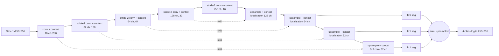

The diagram shows the OASIS configuration. For HipMRI 2D the input is 1×256×128, each level halves both spatial dimensions in the same way, and the output has six classes. For HipMRI 3D every convolution is 3×3×3 and the input is 1×128×128×64, so the coarsest level is 8×8×4.

**Loss function.** Training minimises the sum of the cross-entropy and a multi-class soft Dice loss. The Dice term averages over classes, so a small class contributes as much as a large one. CSF, about 6% of OASIS pixels, therefore counts as much as background at about 72%, and the prostate, 0.43% of HipMRI pixels, as much as the body at 68%. Isensee et al. [2] use this loss to resolve class imbalance, so it is retained for HipMRI without additional class weighting. Weighted cross-entropy, as in [1] and [3], was the planned fallback if the validation prostate Dice remained below 0.75, but it was not required.

## Feasibility Review


**Feasibility Review: 3D Improved U-Net for Prostate Radiotherapy Contouring**

### 1. User Need, Scope and Acceptance Criteria

**User:** radiation oncology staff contouring the prostate, bladder and rectum on weekly pelvic MRI for adaptive radiotherapy, which is slow and varies between observers.

**Scope:** a research prototype that drafts a 3D contour set for clinician review; no dose decisions, HipMRI data only. Criteria, tested on the same 9 held-out test scans (3 patients) as the 2D models:

| ID | Criterion and test | Pass threshold |
|---|---|---|
| AC1 | Pooled test Dice for each foreground label (body, bone, bladder, rectum, prostate) | ≥ 0.70 on every foreground label |
| AC2 | Prostate Dice in the apex and base thirds (foot–head axis), at full resolution, on the slab the 2D model also sees | 3D ≥ 2D (apex 0.82, base 0.85) |
| AC3 | Share of predicted prostate voxels that are truly rectum, and bladder | < 1% each (2D: 0.4%, 0.7%) |
| AC4 | Predicted prostate forms one connected 3D component | At least 8 of 9 test volumes |
| AC5 | Peak training VRAM; 30-epoch training time; inference per volume (A100 40 GB) | ≤ 10 GB; ≤ 1 h; ≤ 1 s |

### 2. Model Choice and Course Concepts

**Data:** 211 HipMRI volumes from 38 patients (256×256×128, LPS, labels 0–5), using the 2D patient-level split (train 31 patients / 191 scans, validate 4 / 11, test 3 / 9), so no patient appears in two splits and 2D and 3D share test scans. Each volume is standardised, downsampled ×2 to 128×128×64 (images averaged, masks by majority label) and flipped left–right for augmentation. 
**Model:** 3D Improved U-Net [2] with residual context modules, strided convolutions, deep supervision and instance normalisation (9.46 M parameters), against a 3D U-Net baseline [3] (22.6 M), both the same tested code as my 2D models with dims=3.
 **Course concepts:** 3D convolutions extend the local, weight-shared feature extraction of CNNs (Lecture 7) to the slices above and below each voxel, the context the dilemma asks about; U-Net skip connections [1] keep the boundary detail organ interfaces need; soft Dice loss counters the imbalance (prostate is 0.10% of voxels) [2]; Adam with learning rate 5e-4 ×0.985 per epoch and batch 2 follows [2], unchanged from 2D so only the context differs.

### 3. Preliminary Feasibility Evidence

- **Data audit**: 211 paired volumes, one 144-slice volume centre-cropped with no organ voxels lost; in-plane spacing 1.41–1.80 mm, 1.56 mm slices; voxel shares bladder 0.57%, rectum 0.14%, prostate 0.10%.
- **Loader check**: all 540 2D test slices matched their volumes voxel for voxel. Downsampling ×2 shifted one volume's prostate voxel count by +3.6%, so 3D will be scored at full resolution. The 3D training pipeline ran end to end on synthetic volumes.

**2D reference results** to beat

| 2D model | Prostate Dice | Apex | Mid | Base | Parameters |
|---|---|---|---|---|---|
| U-Net baseline | 0.862 ± 0.009 | 0.84 | 0.90 | 0.86 | 7.76 M |
| Improved U-Net | 0.855 ± 0.008 | 0.82 | 0.89 | 0.85 | 3.19 M |

**Measured VRAM**:

| Input size | Improved U-Net, batch 2 | Improved U-Net, batch 4 | Baseline, batch 2 |
|---|---|---|---|
| 64×64×32 | 0.42 GB (0.02 s) | 0.71 GB | 0.70 GB |
| 128×128×64 | 2.41 GB (0.10 s) | 4.68 GB | 2.62 GB |
| 256×256×128 (full) | 18.3 GB (0.53 s) | 36.5 GB (batch 8 out of memory) | 18.6 GB |

### 4. Risks, Budget and Fallback

- **Tiny test set** (3 patients, 7 of 9 scans from one): run 3 seeds per model and claim only differences larger than the seed spread.
- **Imbalance and thin structures:** empty or fragmented prostate, lost rectal wall after downsampling. Mitigate with the Dice loss, full-resolution scoring, and weighted cross-entropy [1], [3] if needed.
- **Data loading** (191 compressed volumes per epoch) may bottleneck: 8 workers, and cache downsampled volumes if an epoch exceeds 2 min. Unresampled voxel spacing is accepted for the prototype.

**Budget:** about 95 steps per epoch at 0.10 s plus loading, so ≤ 30 min per run; 2 models × 3 seeds ≈ 3–4 A100-hours.

**Next experiment:** both 3D models at 128×128×64, batch 2, 30 epochs, seed 42, then seeds 1 and 2, scored against AC1–AC5 and the 2D models.

**Fallback:** drop to 64×64×32, add weighted cross-entropy, or train full-resolution patches. If 3D cannot beat 2D on AC2–AC3, that answers the dilemma, and the completed 2D Normal result (prostate Dice 0.855) remains a working prototype.

[1] Ronneberger et al., U-Net, MICCAI 2015. [2] Isensee et al., BraTS 2017 contribution, BrainLes 2018. [3] Çiçek et al., 3D U-Net, MICCAI 2016.

## Data and Preprocessing

Each dataset was checked with `data_audit.py` before its loader was created, so that the layout, shape and label value reported in this section was measured on the data rather than based on any assumptions. All three datasets pass through the same sequence of steps, namely leakage-free splitting, image–mask pairing, cropping or resampling to a fixed shape, intensity normalisation, label validation and one-hot encoding for the Dice loss, and training-time augmentation. The table below summarises the choices for each dataset, and the subsections that follow describe and justify them.

| Step | HipMRI 3D (chosen model) | HipMRI 2D | OASIS |
|---|---|---|---|
| Split | Inherited from the 2D slices (191 / 11 / 9 scans) | Provided patient-level split (31 / 4 / 3 patients) | Provided patient-level split (302 / 35 / 17 patients) |
| Spatial preprocessing | Centre crop of one 144-slice volume to 128 slices, then ×2 downsampling to 128×128×64 | Centre crop of one 256×144 scan to 256×128 | None required (all slices 256×256) |
| Intensity normalisation | Zero mean and unit variance per volume | Zero mean and unit variance per slice | Division by 255 |
| Labels | Integers 0–5, validated | Integers 0–5, validated | Grey levels 0, 85, 170, 255 mapped to 0–3 |
| Augmentation (training only) | Random left–right flip | Random left–right flip | Random left–right flip |

### HipMRI 3D volumes

The volumes are stored in `semantic_MRs/` (`<L>PPP_WeekW_LFOV.nii.gz`) and `semantic_labels_only/` (`<L>PPP_WeekW_SEMANTIC.nii.gz`) [5]. The initial letter of each filename varies between patients, so images and masks are paired by patient and week rather than by filename. The dataset contains 211 pairs from 38 patients, all stored as int32 in LPS orientation at 256×256×128, except for one volume at 256×256×144. Voxels measure 1.41–1.80 mm in plane and 1.56 mm between slices. The classes occupy 60.4% (background), 35.5% (body), 3.37% (bone), 0.57% (bladder), 0.14% (rectum) and 0.10% (prostate) of all voxels. No downsampled copy of the dataset is provided, so the loader performs the downsampling itself.

**Splitting.** Each volume inherits the split of its 2D slices, so the 2D and 3D models are trained, validated and tested on the same 191, 11 and 9 scans. The patient-level separation of the 2D split therefore carries over unchanged, and the loader raises an error if a scan exists only as slices or only as a volume.

**Correspondence with the 2D slices.** Slice `s` of a 2D scan equals `volume[:, 98 + s, :]` flipped along its first axis. `python dataset.py --dataset hipmri3d` confirms this for all 540 test slices with a maximum image difference of zero. This establishes that the 2D slices are coronal sections, and it allows the 2D and 3D models to be scored on identical voxels.

**Spatial cropping.** The single 144-slice volume is centre-cropped to 128 slices, and the loader verifies that the crop removes no organ voxel.

**Intensity normalisation.** Each volume is standardised to zero mean and unit variance over all of its voxels. The statistics come from the volume alone, so no information passes between splits.

**Downsampling.** At full resolution the 3D Improved U-Net requires 18.3 GB of training memory at batch size 2, against 2.41 GB at 128×128×64, so every volume is downsampled by a factor of two as per the feasibility review. Images are averaged over each 2×2×2 block, and each mask voxel takes the majority label of its block. Majority voting was chosen over nearest-neighbour sampling, which keeps a single voxel per block and can delete thin organ boundaries. Blocks that are split evenly between classes are resolved at random with a fixed seed. The initial runs assigned such ties to the smaller organ, and the effect of that choice is analysed under "Mask downsampling tie rule". Predictions are upsampled back to 256×256×128 before scoring, so every 3D result is measured at the resolution of the original masks.

**Caching.** Decompressing and downsampling 191 volumes took about 180 s per epoch, so each preprocessed volume is written to `outputs/cache/` on first use at about 5 MB per volume. The cached data are identical to freshly processed data, and an epoch then takes 7–9 s.

**Augmentation.** During training only, each volume is flipped left–right at random, along the same anatomical axis as in 2D.

### HipMRI 2D slices

The 2D slices [5] (`/home/groups/comp3710/HipMRI_Study_open/keras_slices_data`) are Nifti files named `case_PPP_week_W_slice_S.nii.gz`. They come from weekly pelvic scans of 38 patients, with 60 coronal slices per scan and masks labelled 0–5. Each slice is a section of the corresponding 3D volume (sections 98–157 of its anterior–posterior axis), in which rows run left–right and columns run from foot to head. Files are read one at a time, following `load_data_2D` in Appendix B of the specification.

| Split | Patients | Scans | Slices |
|---|---|---|---|
| Train | 31 | 191 | 11460 |
| Validate | 4 | 11 | 660 |
| Test | 3 | 9 | 540 |

Over the training split, the classes occupy 17.3% (background), 67.5% (body), 12.5% (bone), 1.94% (bladder), 0.36% (rectum) and 0.43% (prostate) of all pixels.

**Splitting.** The provided split is patient-level and is used unchanged, and `split_pairs` asserts on every run that no patient appears in two splits. All weekly scans of a patient remain in one split, because successive weeks of the same patient show nearly identical anatomy and would otherwise leak between training and test. The test and validation splits are small, and each is dominated by one patient. Patient 40 contributes 7 of the 9 test scans (420 of 540 slices), and one patient contributes 8 of the 11 validation scans, which limits how far the test results can be generalised.

**Spatial cropping.** All slices are 256×128 except those of one training scan at 256×144. These are centre-cropped to 256×128, and the loader verifies that the crop removes no bladder, rectum or prostate pixel.

**Intensity normalisation.** The scans are stored as unnormalised float32 with no common intensity scale (maxima of 592–1212 across splits), so each slice is standardised to zero mean and unit variance. Only the statistics of the slice itself are used, so no information passes between splits.

**Label validation.** Mask values must be integers from 0 to 5, otherwise loading fails. The label order (0 background, 1 body, 2 bone, 3 bladder, 4 rectum, 5 prostate) follows the specification's description of the dataset and was confirmed on an overlay of the slices with the most label-5 pixels (`python dataset.py --dataset hipmri`). Label 5 is the round gland at the centre of the pelvis, label 3 is the larger fluid-filled organ adjacent to it, and label 2 marks the femoral heads. Label 4 does not appear in those slices and was identified by elimination.

**Augmentation.** During training only, slices are flipped left–right at random along the rows, at whose two ends the femoral heads lie. A flip along the columns would invert the pelvis and place the bladder below the prostate, an anatomically impossible configuration.

### OASIS brain slices

The OASIS 2D dataset [4] (`/home/groups/comp3710/OASIS`) consists of 256×256 8-bit greyscale PNG slices, 32 per patient, whose masks store the four classes as grey levels 0, 85, 170 and 255.

| Split | Patients | Slices |
|---|---|---|
| Train | 302 | 9664 |
| Validate | 35 | 1120 |
| Test | 17 | 544 |

**Splitting.** The provided split is already patient-level and is used unchanged, and `dataset.split_pairs` raises an error if any patient appears in two splits. A slice-level split would place neighbouring slices of the same brain in both the training and the test set and inflate the reported scores.

**Image–mask pairing.** Each image is matched to its mask by patient and slice number rather than by sorted position, so a single missing file cannot misalign all subsequent pairs.

**Intensity normalisation.** Intensities are scaled to [0, 1] by division by 255. The transform is fixed and therefore uses no statistics from any split.

**Label encoding.** Mask grey levels are mapped to class indices 0–3 through an explicit lookup table, and any other value raises an error.

**Augmentation.** During training only, image and mask are flipped left–right together. Axial brain slices are approximately symmetric, and a flip moves pixels without interpolation, so the labels remain exact.

### Training configuration

All models are trained following [2], with Adam at a learning rate of 5e-4 decayed by a factor of 0.985 per epoch, a weight decay of 1e-5, 30 epochs and bfloat16 mixed precision. The batch size is 16, except for HipMRI 3D, where the feasibility review fixed it at 2. The checkpoint with the highest mean validation Dice is retained and evaluated once on the test set.

## HipMRI 3D Results

Both 3D networks were trained on 128×128×64 volumes at a batch size of 2 with seeds 42, 1 and 2. Their logits are upsampled trilinearly to 256×256×128, and every score is pooled over the nine test volumes at full resolution against the original masks (`results/hipmri3d_*_neutral*`). A case is one volume, which corresponds to one weekly scan and hence to one 2D case. The table reports the mean ± sample standard deviation over the three seeds.

| Metric | 3D U-Net baseline [3] | 3D Improved U-Net [2] |
|---|---|---|
| Best epoch (per seed) | 27, 25, 27 | 30, 19, 22 |
| Dice body | 0.9841 ± 0.0025 | 0.9829 ± 0.0011 |
| Dice bone | 0.9164 ± 0.0120 | 0.9120 ± 0.0054 |
| Dice bladder | 0.9326 ± 0.0466 | 0.9553 ± 0.0006 |
| Dice rectum | 0.8304 ± 0.0085 | 0.8234 ± 0.0080 |
| **Dice prostate** | **0.8779 ± 0.0090** | **0.8760 ± 0.0104** |
| IoU prostate | 0.7825 ± 0.0143 | 0.7795 ± 0.0164 |
| Prostate Dice, worst test volume (per seed) | 0.819, 0.859, 0.854 | 0.858, 0.847, 0.838 |
| Prostate Dice at apex / mid-gland / base | 0.845 / 0.925 / 0.869 | 0.845 / 0.925 / 0.873 |

All six runs exceed the target of 0.7 on every label, the lowest score being a rectum Dice of 0.816. On the prostate, the two models are tied within the seed spread. The large spread of the baseline's bladder Dice originates from seed 42, whose test bladder Dice is 0.879, against 0.958 and 0.961 for the other seeds. Its validation bladder Dice oscillates between 0.76 and 0.83 over the final ten epochs (the validation split contains four patients), and the checkpoint was selected at the peak of one such oscillation. The training curves for seed 42 are shown below.

| 3D U-Net baseline | 3D Improved U-Net |
|---|---|
| 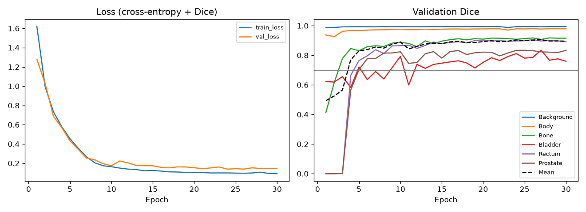 | 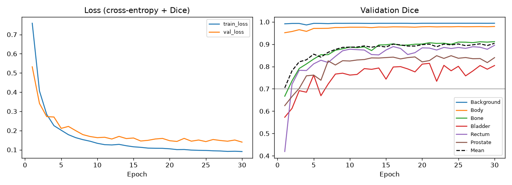 |

### Acceptance criteria

The table evaluates each criterion of the feasibility review for every run, where B denotes the baseline and I the Improved U-Net, followed by the seed. AC2 compares each 3D run with the 2D run of the same model and seed on the same voxels, as described in the next subsection.

| ID | Test | B 42 | B 1 | B 2 | I 42 | I 1 | I 2 |
|---|---|---|---|---|---|---|---|
| AC1 | Lowest foreground Dice ≥ 0.70 | 0.824 ✓ | 0.828 ✓ | 0.840 ✓ | 0.822 ✓ | 0.816 ✓ | 0.832 ✓ |
| AC2 | Apex / base, 3D vs 2D | 0.813 / 0.861 vs 0.838 / 0.867 ✗ | 0.857 / 0.881 vs 0.816 / 0.851 ✓ | 0.864 / 0.864 vs 0.854 / 0.857 ✓ | 0.846 / 0.879 vs 0.807 / 0.846 ✓ | 0.854 / 0.879 vs 0.817 / 0.862 ✓ | 0.836 / 0.862 vs 0.832 / 0.853 ✓ |
| AC3 | Larger leakage share < 1% | 0.54% ✓ | 0.52% ✓ | 1.12% ✗ | 0.66% ✓ | 1.16% ✗ | 2.38% ✗ |
| AC4 | Volumes with one prostate component ≥ 8 of 9 | 9 ✓ | 9 ✓ | 9 ✓ | 9 ✓ | 8 ✓ | 9 ✓ |
| AC5 | VRAM ≤ 10 GB, training ≤ 1 h, inference ≤ 1 s | 2.62 GB, 4.3 min, 0.02 s ✓ | 2.62 GB, 4.3 min, 0.02 s ✓ | 2.62 GB, 4.3 min, 0.02 s ✓ | 2.41 GB, 5.5 min, 0.04 s ✓ | 2.41 GB, 3.7 min, 0.04 s ✓ | 2.41 GB, 3.7 min, 0.04 s ✓ |

AC1, AC4 and AC5 are met in all six runs. AC2 is met in five, since the Improved U-Net outperforms its 2D counterpart at both ends of the gland in every seed and the baseline does so in two of three. AC3 is met in three runs. Every AC3 failure is caused by leakage into the bladder, whereas leakage into the rectum remains at or below 0.05% in five of the six runs. Seed 2 produces the highest bladder leakage for both models.

### 3D against 2D on the same voxels

The 2D models observe only coronal sections 98–157 of each volume. For the comparison, `predict.py --compare` reconstructs the 2D model's input slices from each test volume, stacks its predictions into that slab, and scores the 3D model on the same slab. The slab contains the entire prostate, as the 3D prostate scores are identical on the slab and on the full volume, so the prostate rows compare the two model families on exactly the same voxels. Values are means over the three seeds, with each 3D run paired with the 2D model of the same seed.

| Metric | 2D baseline | 3D baseline | 2D Improved | 3D Improved |
|---|---|---|---|---|
| Prostate Dice | 0.8623 | 0.8779 | 0.8553 | 0.8760 |
| Paired gain, 3D − 2D (per seed) | | +0.004, +0.033, +0.009 | | +0.036, +0.023, +0.003 |
| Apex / mid-gland / base | 0.836 / 0.901 / 0.858 | 0.845 / 0.925 / 0.869 | 0.819 / 0.891 / 0.854 | 0.845 / 0.925 / 0.873 |
| Prostate Dice, worst test volume | 0.840 | 0.844 | 0.800 | 0.848 |
| Volumes with one prostate component (of 9, per seed) | 9, 9, 9 | 9, 9, 9 | 8, 8, 7 | 9, 8, 9 |
| Predicted prostate that is really bladder (per seed) | 1.29, 0.32, 0.32% | 0.40, 0.52, 1.12% | 0.73, 0.88, 0.56% | 0.66, 1.16, 2.38% |
| Predicted prostate that is really rectum (per seed) | 0.03, 0.47, 0.01% | 0.54, 0.00, 0.02% | 0.36, 0.28, 0.47% | 0.02, 0.05, 0.04% |
| Rectum Dice on the slab | 0.8701 | 0.8581 | 0.8484 | 0.8471 |
| Bladder Dice on the slab | 0.9638 | 0.9429 | 0.9631 | 0.9577 |

| 3D baseline vs 2D baseline | 3D Improved vs 2D Improved |
|---|---|
| 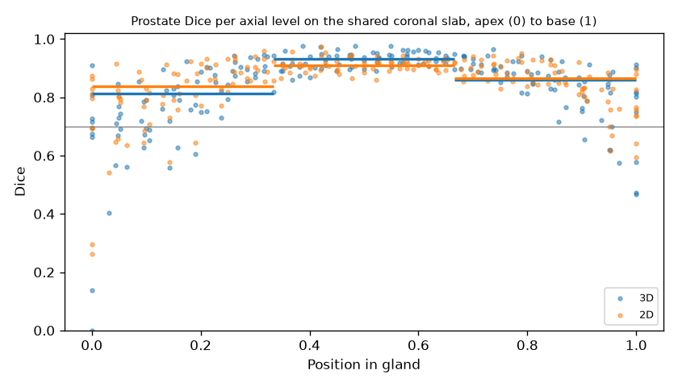 | 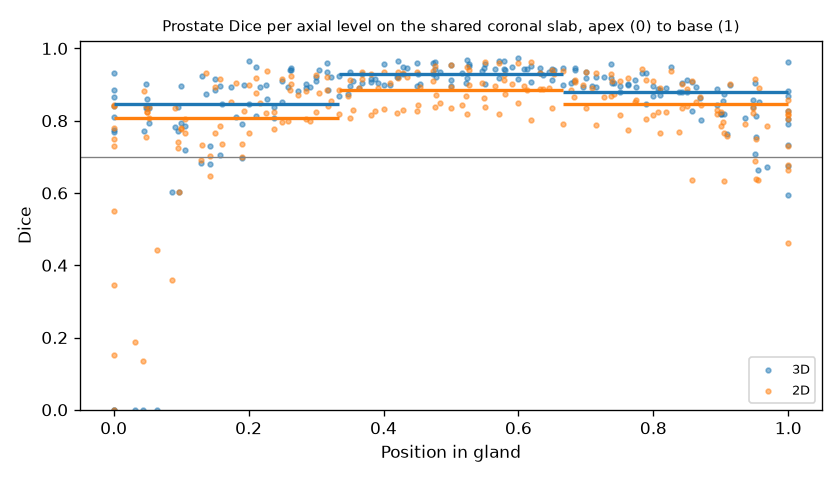 |

The 3D models outperform their 2D counterparts on the prostate in all six paired comparisons, by between 0.003 and 0.036. The gain is largest in the mid-gland (+0.024 for the baseline and +0.033 for the Improved U-Net), which improves in every run. The Improved U-Net gains more than the baseline at the apex (+0.027 against +0.009) and on its worst test volume (from 0.800 to 0.848). Its stacked 2D predictions split the prostate into several 3D components in one or two volumes per seed, whereas the 3D model produces a single component in 26 of 27 volumes. The position plots (seed 42) show that the remaining failure lies at the apex tip, where a few axial levels score below 0.5, some close to zero, in both 2D and 3D and for both models.

The 3D models are not better in every aspect. Rectum and bladder Dice on the slab are equal to or lower than in 2D. The Improved U-Net's prostate-to-rectum leakage falls from 0.37% to 0.04%, but its prostate-to-bladder leakage rises from 0.72% to 1.40% on average, so the choice between them depends on which interface matters more clinically.

### Mask downsampling tie rule

When a mask is downsampled by a factor of two, each low-resolution voxel takes the majority label of a 2×2×2 block, and a block may be split evenly between classes (for example four voxels against four). The first 3D runs assigned such ties to the higher label, which is the smaller organ. On the volume used by the dataset self-check, that rule enlarges the prostate by 3.6%, the rectum by 3.8%, the bladder by 2.3% and bone by 2.7%, at the expense of background (−1.0%), whereas breaking ties at random with a fixed seed changes every class by less than 0.3%. Because the first runs failed AC3 in five of six cases, all through bladder leakage, both models were retrained with random tie-breaking and otherwise identical settings. The first runs are retained as an ablation in `results/hipmri3d_<model>[_seed1|_seed2]`.

| Metric (3 seeds) | Baseline, ties to smaller organ | Baseline, random ties | Improved, ties to smaller organ | Improved, random ties |
|---|---|---|---|---|
| Prostate Dice | 0.8749 ± 0.0047 | 0.8779 ± 0.0090 | 0.8626 ± 0.0097 | 0.8760 ± 0.0104 |
| Apex / mid-gland / base | 0.847 / 0.927 / 0.868 | 0.845 / 0.925 / 0.869 | 0.831 / 0.919 / 0.861 | 0.845 / 0.925 / 0.873 |
| Predicted prostate that is really bladder (per seed) | 1.44, 0.99, 2.19% | 0.40, 0.52, 1.12% | 1.37, 1.60, 2.35% | 0.66, 1.16, 2.38% |
| Runs passing AC2 / AC3 | 1 / 1 of 3 | 2 / 2 of 3 | 3 / 0 of 3 | 3 / 1 of 3 |

Random tie-breaking raises the Improved U-Net's prostate Dice by 0.013 and roughly halves the baseline's bladder leakage, which identifies the bias of the original rule towards the smaller organs as one cause of the AC3 failures. It is not the only cause, since seed 2 leaks the most under both rules for both models and the Improved U-Net still exceeds 1% bladder leakage in two seeds. The seed-42 runs of the ablation were trained before the volume cache was introduced and took 87 and 93 minutes, so they fail AC5 on training time. This reflects a data-loading cost rather than a property of the models, which train in about 4 minutes with the cache.

## Example Inputs and Outputs

The figures below show the output of `predict.py` for the Improved U-Net.

### HipMRI 3D

The figure shows the five test volumes with the lowest prostate Dice. Each volume occupies two rows, at its worst apex level and its worst base level, cropped around the prostate. The columns show the input, the ground truth and the 3D prediction, followed by the prostate false positives marked by red and false negatives marked by blue of the 3D model and of the 2D model at the same level.

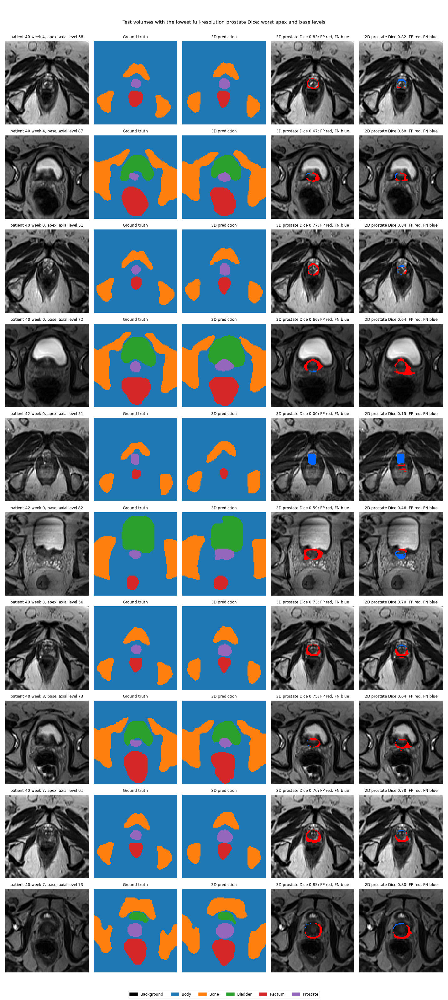

### HipMRI 2D and OASIS

For the 2D datasets, each row shows an input slice, its ground truth, the prediction and an overlay of false positives (red) and false negatives (blue) for the worst class of that slice. The rows are the five worst test slices (see "Failure Case Autopsy"), first for HipMRI 2D and then for OASIS.

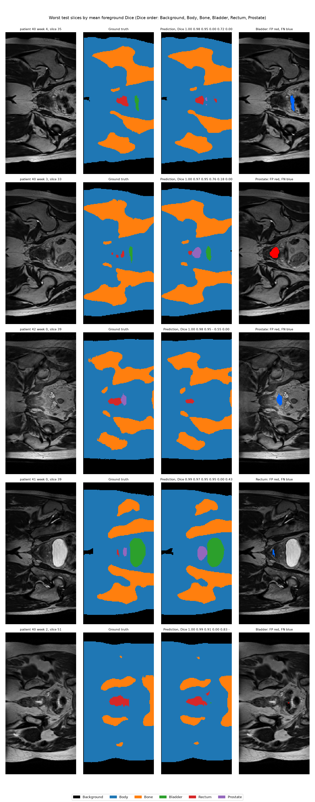

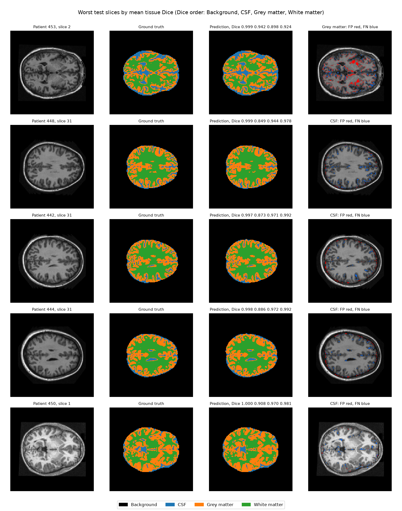

## HipMRI 2D Results

A case is one weekly scan of 60 slices, giving nine test cases from three patients. The table reports the test-set Dice of the best checkpoint, pooled over all 540 test slices (seed 42, `results/hipmri_*/test.json`).

| Model | Best epoch | Background | Body | Bone | Bladder | Rectum | Prostate |
|---|---|---|---|---|---|---|---|
| Baseline U-Net [1] | 8 | 0.9967 | 0.9851 | 0.9372 | 0.9640 | 0.8789 | 0.8639 |
| Improved U-Net [2] | 8 | 0.9969 | 0.9847 | 0.9373 | 0.9635 | 0.8486 | 0.8464 |

Both models exceed the prostate target of 0.75. The pooled test-set IoU is reported below.

| Model | Background | Body | Bone | Bladder | Rectum | Prostate |
|---|---|---|---|---|---|---|
| Baseline U-Net | 0.9934 | 0.9707 | 0.8819 | 0.9306 | 0.7840 | 0.7604 |
| Improved U-Net | 0.9938 | 0.9699 | 0.8820 | 0.9296 | 0.7371 | 0.7337 |

Per-case Dice over the nine test scans is reported as the mean ± standard deviation, with the worst scan in parentheses.

| Model | Bone | Bladder | Rectum | Prostate |
|---|---|---|---|---|
| Baseline U-Net | 0.9373 ± 0.0077 (min 0.9286) | 0.9609 ± 0.0099 (min 0.9465) | 0.8754 ± 0.0321 (min 0.8250) | 0.8640 ± 0.0101 (min 0.8474) |
| Improved U-Net | 0.9374 ± 0.0075 (min 0.9301) | 0.9609 ± 0.0127 (min 0.9450) | 0.8375 ± 0.0537 (min 0.7285) | 0.8493 ± 0.0433 (min 0.7621) |

Background and body exceed 0.98 on every scan for both models. The Improved U-Net's worst prostate scan is patient 40, week 3 (0.7621).

### Variation across training seeds

The validation split contains four patients, so the mean validation Dice used for checkpoint selection is noisy. In the seed-42 Improved U-Net run, for example, epoch 8 was selected on a one-epoch spike in bladder Dice (curves below). To establish whether the difference between the models exceeds run-to-run variation, both were retrained with seeds 1 and 2 and all other settings unchanged. The table reports the mean ± sample standard deviation over seeds 42, 1 and 2 (`results/hipmri_*`, `results/hipmri_*_seed1`, `results/hipmri_*_seed2`).

| Metric | Baseline U-Net | Improved U-Net |
|---|---|---|
| Best epoch (per seed) | 8, 24, 8 | 8, 26, 28 |
| Dice body | 0.9848 ± 0.0004 | 0.9848 ± 0.0003 |
| Dice bone | 0.9364 ± 0.0028 | 0.9368 ± 0.0014 |
| Dice bladder | 0.9638 ± 0.0007 | 0.9631 ± 0.0004 |
| Dice rectum | 0.8701 ± 0.0161 | 0.8484 ± 0.0031 |
| **Dice prostate** | **0.8623 ± 0.0085** | **0.8553 ± 0.0079** |
| Prostate Dice, worst test scan | 0.8399 ± 0.0158 | 0.8004 ± 0.0334 |
| Prostate Dice at apex / mid-gland / base | 0.84 / 0.90 / 0.86 | 0.82 / 0.89 / 0.85 |
| Slices with prostate predicted but none present (of 345, per seed) | 1, 5, 2 | 7, 8, 14 |
| Coronal prostate slices with no prostate predicted (of 195, per seed) | 25, 20, 19 | 24, 25, 17 |
| Slices where the rectum prediction is more fragmented than the truth | 5.7% ± 1.7% | 10.8% ± 2.0% |

All six runs exceed the prostate target, the lowest score being 0.8464. The prostate gap of 0.018 observed for seed 42 shrinks to 0.007 on average, which is less than one standard deviation of either model. The differences that persist across all seeds are the Improved U-Net's larger number of false-positive prostate slices and its more fragmented rectum.

| Baseline U-Net | Improved U-Net |
|---|---|
| 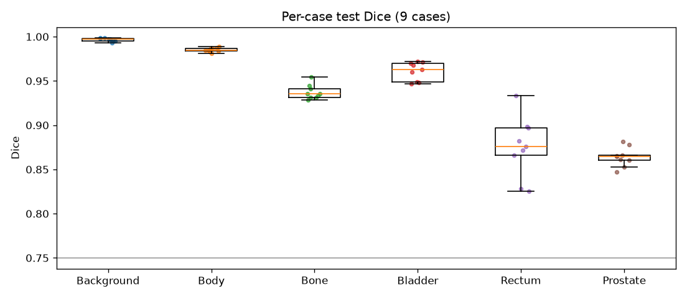 | 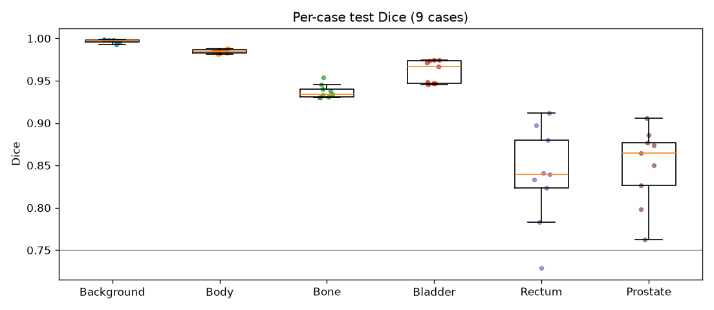 |

| Baseline U-Net | Improved U-Net |
|---|---|
| 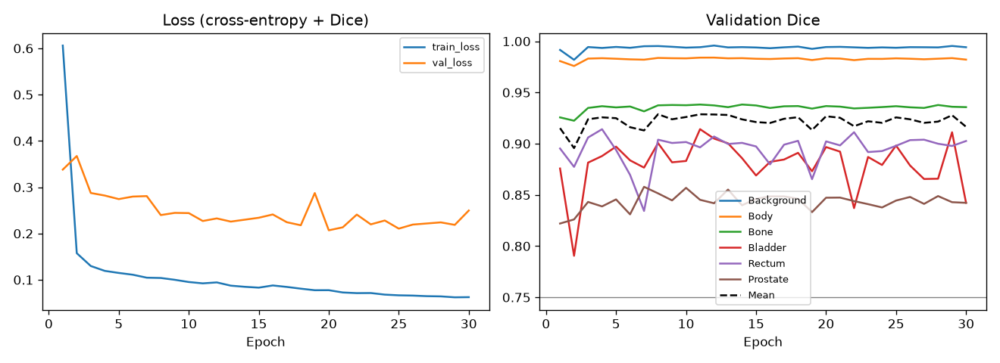 | 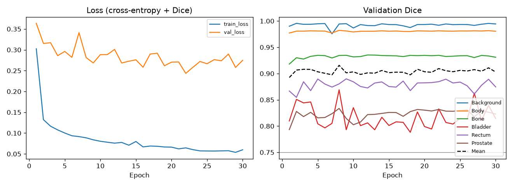 |

### Prostate boundary analysis

Global prostate Dice does not reveal where along the gland the errors occur. The gland extends from the apex (inferior) to the base (superior) along the foot–head axis, which is the column axis of the coronal slices. For each test scan, `predict.py` stacks the 60 slices and assigns every axial level (column) that contains prostate a position from apex (0) to base (1). The base is defined as the end nearer the bladder, which lies superior to the prostate, so the direction is derived from the labels rather than from an assumed axis order. Dice is then pooled over each third of the gland (seed 42).

| Model | Apex third | Mid-gland third | Base third |
|---|---|---|---|
| Baseline U-Net | 0.8379 | 0.9102 | 0.8669 |
| Improved U-Net | 0.8071 | 0.8861 | 0.8460 |

| Baseline U-Net | Improved U-Net |
|---|---|
| 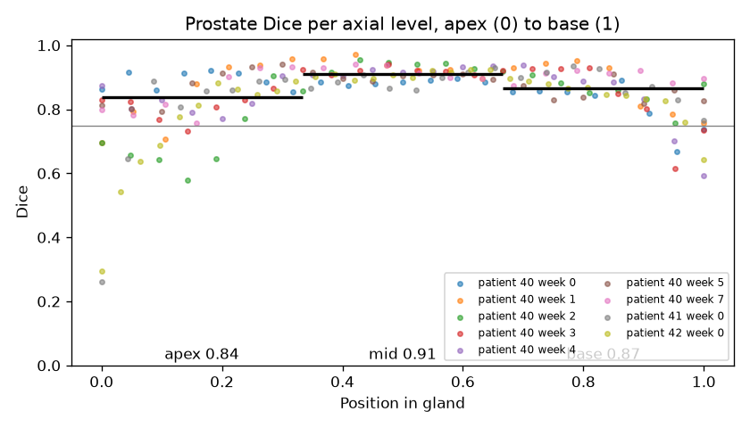 | 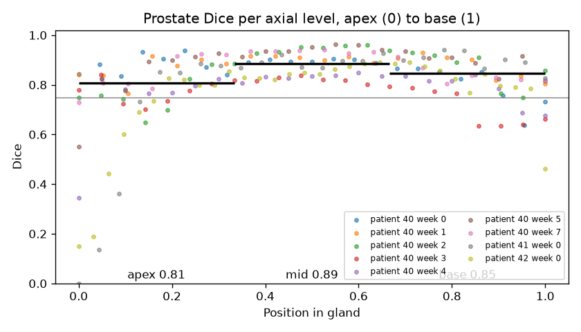 |

Both models score about 0.89–0.91 in the middle third and lower towards both ends. The apex is the weakest region, where several levels (mostly from patients 41 and 42) fall below 0.5 for the Improved U-Net, and averaged over the three seeds the apex third is the weakest for both models (baseline 0.84, Improved U-Net 0.82). The table below reports slice-level errors on the coronal input slices and leakage across the organ interfaces (seed 42).

| | Baseline U-Net | Improved U-Net |
|---|---|---|
| Prostate slices with no prostate predicted (missed) | 25 of 195 (12.8%) | 24 of 195 (12.3%) |
| Slices without prostate where prostate is predicted | 1 of 345 (0.3%) | 7 of 345 (2.0%) |
| Median size of those false-positive regions | 68 pixels | 45 pixels |
| Predicted prostate pixels that are really rectum | 0.03% | 0.36% |
| Predicted prostate pixels that are really bladder | 1.29% | 0.73% |
| True prostate pixels predicted as rectum | 0.55% | 0.17% |
| True prostate pixels predicted as bladder | 0.05% | 0.20% |

Leakage into the rectum and bladder remains below 1.5% of prostate pixels for both models. The larger errors occur at the level of whole slices, as about one in eight coronal slices that contain prostate receives no prostate prediction at all. Each coronal slice is a section at one anterior–posterior position through the gland, so these are missed sections that the per-level Dice does not reveal.

### Connectivity

Connected components (8-connectivity) were counted per class on every test slice, in the ground truth and in the prediction (seed 42). The bladder, rectum and prostate should each form a single component on the slices in which they appear.

| Class | Ground-truth components per slice | Baseline prediction | Improved prediction | Slices more fragmented than truth (baseline / Improved) | Slices with fewer components (baseline / Improved) |
|---|---|---|---|---|---|
| Body | 1.62 | 1.63 | 1.65 | 11% / 13% | 13% / 10% |
| Bone | 4.25 | 4.04 | 4.17 | 15% / 18% | 25% / 25% |
| Bladder | 0.75 | 0.75 | 0.79 | 1% / 4% | 1% / 1% |
| Rectum | 0.48 | 0.48 | 0.64 | 5% / 12% | 4% / 3% |
| Prostate | 0.37 | 0.32 | 0.35 | 0% / 2% | 5% / 5% |

## OASIS Results

The table reports the test-set Dice of the best checkpoint, pooled over all 544 test slices (`results/*/test.json`).

| Model | Best epoch | Background | CSF | Grey matter | White matter | Mean |
|---|---|---|---|---|---|---|
| Baseline U-Net [1] | 30 | 0.9993 | 0.9642 | 0.9658 | 0.9794 | 0.9772 |
| Improved U-Net [2] | 28 | 0.9994 | 0.9664 | 0.9669 | 0.9802 | 0.9782 |

Both models exceed the target of 0.9 on every label. The pooled test-set IoU (`predict.py`) is reported below.

| Model | Background | CSF | Grey matter | White matter |
|---|---|---|---|---|
| Baseline U-Net | 0.9986 | 0.9309 | 0.9338 | 0.9597 |
| Improved U-Net | 0.9988 | 0.9349 | 0.9360 | 0.9612 |

Per-case Dice over the 17 test patients is reported as the mean ± standard deviation, with the worst patient in parentheses.

| Model | Background | CSF | Grey matter | White matter |
|---|---|---|---|---|
| Baseline U-Net | 0.9993 ± 0.0002 (min 0.9990) | 0.9555 ± 0.0291 (min 0.8805) | 0.9656 ± 0.0072 (min 0.9497) | 0.9793 ± 0.0054 (min 0.9695) |
| Improved U-Net | 0.9994 ± 0.0002 (min 0.9991) | 0.9596 ± 0.0227 (min 0.8949) | 0.9664 ± 0.0084 (min 0.9427) | 0.9801 ± 0.0062 (min 0.9647) |

CSF is the least consistent class. For one test patient, both models fall below a CSF Dice of 0.9 (Improved U-Net 0.8949, baseline 0.8805), even though the test set as a whole exceeds the target. Such local shortfalls are concealed by a single pooled score.

| Baseline U-Net | Improved U-Net |
|---|---|
| 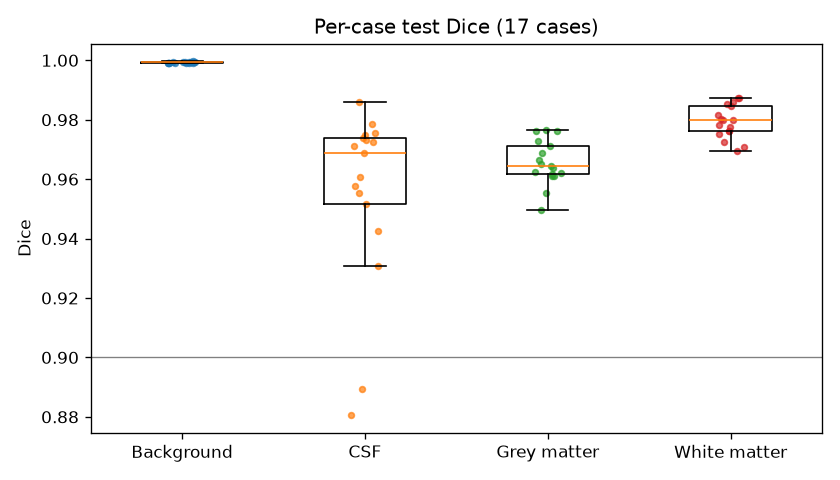 | 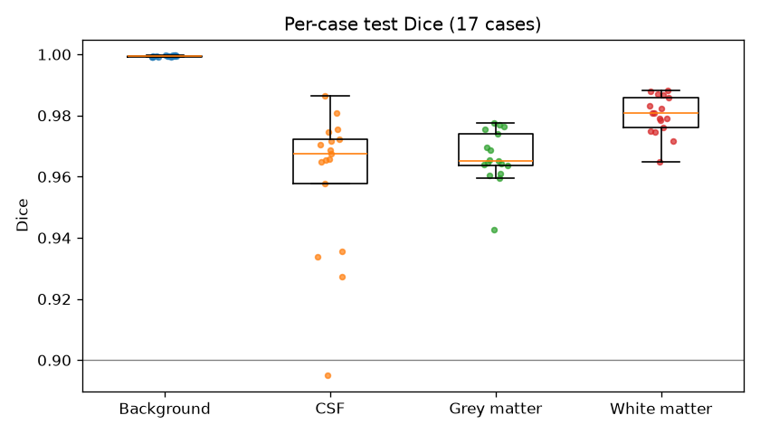 |

| Baseline U-Net | Improved U-Net |
|---|---|
| 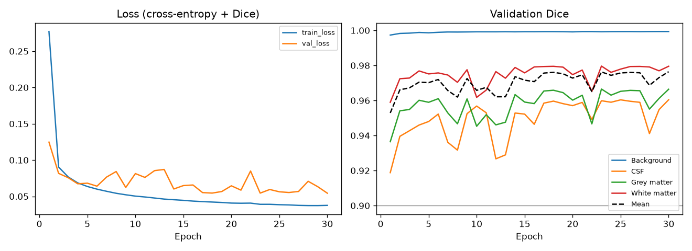 | 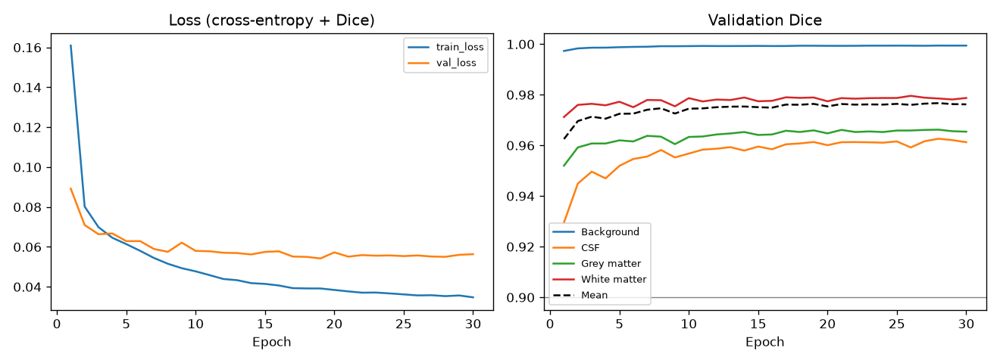 |

### Connectivity

A high global Dice can conceal topologically incorrect output, such as thin cortical grey matter broken into fragments. `predict.py` therefore counts the connected components (8-connectivity) of each tissue class on every test slice, in both the ground truth and the prediction.

| Class | Ground-truth components per slice | Baseline prediction | Improved prediction | Slices more fragmented than truth (baseline / Improved) | Slices with fewer components (baseline / Improved) |
|---|---|---|---|---|---|
| CSF | 37.37 | 38.51 | 37.79 | 57% / 48% | 32% / 39% |
| Grey matter | 13.11 | 14.39 | 14.04 | 57% / 54% | 24% / 30% |
| White matter | 8.09 | 8.49 | 8.44 | 44% / 43% | 28% / 29% |

Both models produce more components than the ground truth for every tissue, either by breaking structures apart or by adding small spurious islands. Grey matter is the most affected, with 9.8% (baseline) and 7.1% (Improved U-Net) more components per slice, despite a Dice of about 0.967. The Improved U-Net's component counts are closer to the ground truth for all three tissues, and it fragments CSF on fewer slices (48% against 57%). It eliminates neither failure mode, however, since more than half of its slices still contain additional grey-matter components.

## Resource Profiling

All measurements were taken on one NVIDIA A100-PCIE-40GB. Inference processes one case per batch with bfloat16 mixed precision, after one untimed warm-up pass.

For HipMRI 3D, one case is one volume (input 128×128×64, training batch size 2, random-tie runs, seeds 42 / 1 / 2).

| Model | Parameters | Training time (30 epochs) | Peak training VRAM | Peak evaluation VRAM | Inference per volume |
|---|---|---|---|---|---|
| 3D U-Net baseline | 22.58M | 4.3 / 4.3 / 4.3 min | 2.62 GB | 1.20 GB | 23–24 ms |
| 3D Improved U-Net | 9.46M | 5.5 / 3.7 / 3.7 min | 2.41 GB | 0.80 GB | 37–38 ms |

Inference time includes upsampling the logits to 256×256×128, and peak evaluation VRAM is measured with the 2D comparison model also loaded. The training time of the first run (Improved U-Net, seed 42) includes building the volume cache. The 3D Improved U-Net has 42% of the baseline's parameters and requires 67% of its evaluation memory, but it is about 1.6 times slower per volume. Every 3D run remains well within the budget of the feasibility review, using less than a quarter of its 10 GB of VRAM, a tenth of its hour of training and a twenty-fifth of its 1 s of inference.

For HipMRI 2D, one case is one scan of 60 slices of 256×128 (training batch size 16, seed 42).

| Model | Parameters | Training time (30 epochs) | Peak training VRAM | Peak inference VRAM | Latency per case (60 slices) | Latency per slice |
|---|---|---|---|---|---|---|
| Baseline U-Net | 7.76M | 17.9 min | 0.94 GB | 1.11 GB | 21.9 ms | 0.36 ms |
| Improved U-Net | 3.19M | 18.3 min | 0.81 GB | 0.76 GB | 23.8 ms | 0.40 ms |

Both models train in about the same time on HipMRI 2D (17.9–21.6 min over the six runs), and the Improved U-Net requires 69% of the baseline's inference memory.

For OASIS, one case is one patient of 32 slices (training batch size 16).

| Model | Parameters | Training time (30 epochs) | Peak training VRAM | Peak inference VRAM | Latency per case (32 slices) | Latency per slice |
|---|---|---|---|---|---|---|
| Baseline U-Net | 7.76M | 15.0 min | 1.73 GB | 1.18 GB | 23.6 ms | 0.74 ms |
| Improved U-Net | 3.19M | 9.9 min | 1.56 GB | 0.81 GB | 24.8 ms | 0.77 ms |

The Improved U-Net has 41% of the baseline's parameters, trains in 66% of the time and requires 69% of the inference memory. Its inference latency is comparable to that of the baseline, at 1.1 ms more per case.

## Failure Case Autopsy

### HipMRI 3D

The table lists the five test volumes with the lowest full-resolution prostate Dice (seed 42).

| Rank | 3D baseline (volume, Dice) | 3D Improved U-Net (volume, Dice) |
|---|---|---|
| 1 | patient 40 week 4 (0.8189) | patient 40 week 4 (0.8582) |
| 2 | patient 40 week 7 (0.8382) | patient 40 week 0 (0.8715) |
| 3 | patient 40 week 3 (0.8392) | patient 42 week 0 (0.8762) |
| 4 | patient 40 week 2 (0.8573) | patient 40 week 3 (0.8765) |
| 5 | patient 42 week 0 (0.8751) | patient 40 week 7 (0.8782) |

Patient 40 week 4 is the worst test volume in 9 of the 12 HipMRI runs (2D and 3D, both models, three seeds each). The figures (Improved U-Net under "Example Inputs and Outputs", baseline below) show each volume at two levels, namely the axial level with the lowest 3D prostate Dice in the apex third of the gland and the corresponding level in the base third. Four observations follow (seed 42, both models).

**Over-contouring at the apex.** At 8 of the 10 worst apex levels, the error is a ring of false positives around the true gland, so the predicted prostate is wider than the ground truth.

**A missed apex.** Patient 42 week 0 is the exception. At level 51 the true apex is missed almost entirely, with a 3D Dice of 0.00 for the Improved U-Net and 0.14 for the baseline, against 0.15 and 0.30 in 2D.

**Leakage at the prostate–bladder interface.** The errors at the base lie where the prostate meets the bladder. The clearest case is patient 42 week 0 at level 82, where both 3D models predict prostate across the floor of the bladder (Dice 0.59 for the Improved U-Net and 0.47 for the baseline), which is the leakage measured by AC3. In the opposite direction, the baseline misses a band of prostate beneath the bladder in patient 40 week 3 (Dice 0.47).

**3D against 2D at these levels.** The 2D model performs better at 3 of the 5 Improved U-Net apex levels and at all 5 baseline apex levels. These levels were selected as the worst of the 3D model, which biases the comparison towards 2D, and pooled over the whole apex third the 3D models perform better (see "3D against 2D on the same voxels"). 3D context therefore reduces apex errors on average but does not eliminate them.

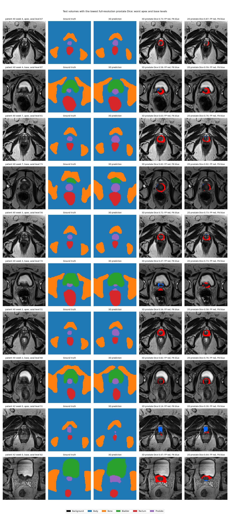

### HipMRI 2D

The table lists the five worst test slices by mean Dice over the five foreground classes, with at most one slice per scan (seed 42).

| Rank | Baseline U-Net (scan, slice, Dice) | Improved U-Net (scan, slice, Dice) |
|---|---|---|
| 1 | patient 40 week 3, slice 33 (0.6056) | patient 40 week 4, slice 35 (0.5302) |
| 2 | patient 40 week 7, slice 34 (0.6116) | patient 40 week 3, slice 33 (0.5740) |
| 3 | patient 41 week 0, slice 39 (0.6595) | patient 42 week 0, slice 39 (0.6203) |
| 4 | patient 42 week 0, slice 39 (0.6662) | patient 41 week 0, slice 39 (0.6617) |
| 5 | patient 40 week 4, slice 33 (0.6774) | patient 40 week 2, slice 51 (0.6803) |

All five of the baseline's worst slices and four of the Improved U-Net's lie in slices 33–39, and three appear in both lists (patient 40 week 3 slice 33, patient 41 week 0 slice 39 and patient 42 week 0 slice 39). The Improved U-Net's panels show four types of error, namely a missed thin bladder region adjacent to the rectum (patient 40 week 4), prostate predicted on a slice whose ground truth contains none (patient 40 week 3), prostate present in the ground truth but not predicted at all (patient 42 week 0), and a missed small rectum region beside an over-predicted prostate (patient 41 week 0, prostate Dice 0.43).

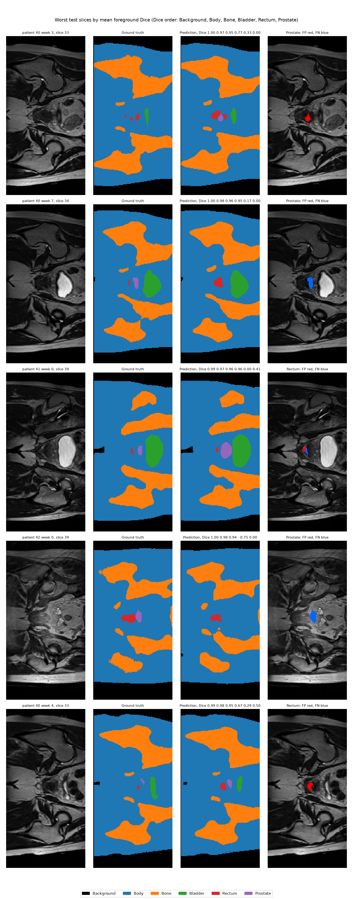

### OASIS

The table lists the five worst test slices by mean tissue Dice (background excluded), with at most one slice per patient.

| Rank | Baseline U-Net (patient, slice, Dice) | Improved U-Net (patient, slice, Dice) |
|---|---|---|
| 1 | 450, slice 1 (0.9024) | 453, slice 2 (0.9213) |
| 2 | 448, slice 1 (0.9331) | 448, slice 31 (0.9238) |
| 3 | 442, slice 31 (0.9425) | 442, slice 31 (0.9449) |
| 4 | 449, slice 4 (0.9446) | 444, slice 31 (0.9499) |
| 5 | 457, slice 5 (0.9496) | 450, slice 1 (0.9529) |

Each patient contributes 32 slices, numbered 0–31. All five of the Improved U-Net's worst slices lie within three slices of either end of a patient's stack (slices 1, 2 and 31), as do three of the baseline's five. Patients 442, 448 and 450 appear in both lists.

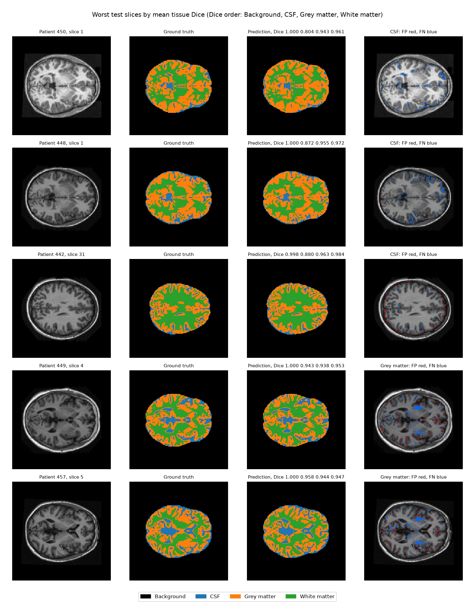

### Interpretation

**HipMRI 3D.** Patient 40 week 4 is the worst test volume in 9 of the 12 HipMRI runs, across 2D and 3D, both models and all seeds, which indicates a property of the scan rather than of any model. The cause was not isolated within the scope of this work; comparing the scan's gland size, contrast and contour against the same patient's other six test scans would identify it.

Within the gland, 3D context improves the mid-gland and keeps the prostate in one piece, but it does not resolve the apex, where some levels score below 0.5 in 2D and 3D alike. At the worst apex levels the 3D models mostly over-contour, and in one volume they miss the tip altogether. The gland tapers to a point at the apex, and after downsampling by a factor of two a voxel measures about 2.8–3.6 mm in plane and 3.1 mm between slices, so the tip spans only a few low-resolution voxels. Upsampling this coarse prediction is a plausible cause of the over-contoured ring, although this hypothesis was not tested.

The second weakness is the prostate–bladder interface. Predicted prostate on bladder voxels exceeds 1% in three of the six runs (1.12–2.38%) and varies with the seed. Leakage into the rectum remains at or below 0.05% in five of the six runs, so the rectal interface is handled well in 3D.

**HipMRI 2D.** Nine of the ten worst slices across both models are coronal slices 33–39 of patients 40–42. The four error types identified above all occur where the cross-section of an organ is small and borders tissue of similar contrast. A 2D model processes each slice in isolation and cannot use the neighbouring slices to determine whether the gland continues. The slice-level counts are consistent with this explanation, since over the three seeds both models miss about 11% of the coronal slices that contain prostate, and the Improved U-Net predicts prostate on 7–14 slices that contain none.

**OASIS.** The worst slices lie at the ends of each patient's stack, where the brain cross-section is small and each tissue covers few pixels. A few misclassified boundary pixels therefore change Dice substantially, and partial-volume blurring between tissues affects a larger fraction of each structure. Even so, the worst slice scores 0.90 (baseline) and 0.92 (Improved U-Net), so these failures are thin boundary bands rather than missed structures. The more serious failure is topological, as more than half of all slices contain additional grey-matter components despite a Dice of 0.967. Both models break the thin cortical ribbon or add small islands to it, so any application that depends on cortical topology requires review of the grey matter.

**Anatomy that remains unsuitable for automated drafting.** Two regions should not be drafted without review. The first is the prostate apex, where every model, 2D or 3D, has levels below 0.5 Dice. The errors occur in both directions, since over-contouring irradiates the tissue surrounding the gland and a missed tip risks recurrence. The second is the prostate base against the bladder for the 3D models, where leakage above 1% in half of the runs would place bladder wall inside the target volume. The mid-gland prostate, the bladder away from the prostate, bone and the body outline are accurate enough to be drafted for rapid clinician review.

## Development Pathway

The chosen model is the final stage of the progression below, in which the first two stages developed and validated the same code on 2D data.

**Stage 1 (Easy), 2D Improved U-Net on OASIS.** Both models exceed a Dice of 0.9 on every label over the test set (Improved U-Net mean 0.9782, baseline 0.9772). The Improved U-Net is slightly more accurate on every class, uses 41% of the parameters and trains about a third faster. One test patient falls below a CSF Dice of 0.9 with both models, and both models over-fragment tissue relative to the ground truth.

**Stage 2 (Normal), 2D Improved U-Net on HipMRI.** Both models exceed the prostate target of 0.75 in all three seeds (Improved U-Net 0.8553 ± 0.0079, baseline 0.8623 ± 0.0085), so they are tied on prostate Dice within run-to-run variation. The Improved U-Net uses 41% of the parameters but, in every seed, predicts prostate on more slices that contain none and fragments the rectum more. Both models score about 0.89–0.90 in the middle third of the gland and lowest at the apex (0.82–0.84 averaged over seeds), which is the failure mode described by the research question, and they miss about 11% of the coronal slices that contain prostate entirely.

**Stage 3 (Hard), 3D Improved U-Net on downsampled HipMRI volumes.** Both 3D models exceed a Dice of 0.7 on every label in all three seeds (Improved U-Net prostate 0.8760 ± 0.0104, baseline 0.8779 ± 0.0090) and train in under 6 minutes each. On the same voxels, the 3D models outperform their 2D counterparts on the prostate in all six paired runs, by 0.021 (Improved U-Net) and 0.016 (baseline) on average. The gain is largest in the mid-gland and, for the Improved U-Net, also at the apex and on the worst volume. Stacked 2D predictions split the Improved U-Net's prostate into several components in one or two volumes per seed, whereas the 3D model keeps it in one piece in 26 of 27 volumes. Of the approved acceptance criteria, AC1, AC4 and AC5 are met in every run, AC2 in five of six and AC3 in three of six, with prostate predicted on bladder voxels exceeding 1% in one baseline and two Improved U-Net runs. A tie-rule ablation shows that the mask downsampling of the first runs, which assigned tied blocks to the smaller organ, contributed to that leakage.

## Recommendation

**The 3D pipeline is recommended for advancement as a contour-drafting prototype for clinician review. It should not be used unreviewed, and the prostate apex and the prostate–bladder interface must be checked on every scan.**

**Computational cost.** 3D context justifies its budget at this scale. At 128×128×64 the 3D models require about three times the training memory of the 2D models (2.4–2.6 GB against 0.8–0.9 GB). With the volume cache they train in 4–6 minutes, against 18–22 minutes in 2D, and process a whole volume in 0.02–0.04 s. This is far below the five- to tenfold cost anticipated by the research question, and every run fits the budget of the feasibility review.

**Benefits of 3D context.** On identical voxels, the 3D models achieve a higher prostate Dice than the 2D models in all six paired runs, on average by 0.016 for the baseline and 0.021 for the Improved U-Net. They produce one connected prostate in 26 of 27 volumes, whereas the stacked 2D Improved U-Net splits it in one or two volumes per seed, and the Improved U-Net's prostate-to-rectum leakage falls from 0.37% to 0.04%.

**Limitations.** The gain is largest in the mid-gland, the easiest central region, so part of it corresponds to the smoothing of central slices that the research question suspects. The apex tip remains poorly segmented in 3D. The Improved U-Net's prostate-to-bladder leakage rises from 0.72% to 1.40%, and AC3 fails in three of six runs.

**Model choice.** The two 3D models are tied on prostate Dice (Improved U-Net 0.876, baseline 0.878). The Improved U-Net has 42% of the baseline's parameters and the most consistent bladder Dice, and it outperforms its 2D counterpart at both the apex and the base in every seed. The baseline leaks less into the bladder, meeting AC3 in two of three runs against one of three. The Improved U-Net is retained as the chosen model for its consistency at the ends of the gland, although neither model is clearly superior.

**Prerequisites for clinical evaluation.** Three steps are required before any clinical evaluation. First, the model must be tested on more patients, since three test patients, with seven of nine scans from one, cannot support a clinical claim. Second, bladder leakage should be reduced with the fallbacks of the feasibility review, either by training on full-resolution patches so that the interface is not blurred into 3 mm voxels, or by weighted cross-entropy. Third, checkpoint selection should be made less noisy, as the validation split contains four patients and one baseline checkpoint was selected on a bladder spike.

## Implementation and Reproduction

### Repository layout

| File | Purpose |
|---|---|
| `data_audit.py` | Reports folder layout, filename patterns, shapes, dtypes, mask values and their pixel shares, patient and scan counts, and split overlap |
| `dataset.py` | OASIS PNG and HipMRI Nifti loaders with pairing, the patient-overlap assertion, normalisation, cropping, one-hot encoding, augmentation and a label overlay check, together with the HipMRI 3D loader with downsampling, a preprocessed-volume cache and a voxel-for-voxel check against the 2D slices |
| `modules.py` | `UNet` baseline and `ImprovedUNet`, both 2D or 3D through `dims` (pure PyTorch) |
| `train.py` | Training, validation, testing, checkpointing and curve plots (`--dataset oasis\|hipmri\|hipmri3d`), with `--vram-test` measuring 3D training memory per input and batch size |
| `predict.py` | Test-set evaluation with per-case Dice and IoU, confusion matrix, connectivity, profiling and failure figures, plus prostate Dice by position, leakage and slice-level errors for HipMRI, and full-resolution scoring, the 2D comparison on the shared coronal slab and acceptance criteria AC1–AC5 for HipMRI 3D |
| `slurm/` | Rangpur batch scripts for the audit, training and evaluation |
| `results/` | Training curves, histories, test scores and evaluation outputs, included for transparency (model weights are not committed) |

### Dependencies

| Package | Version |
|---|---|
| Python | 3.11.16 |
| PyTorch | 2.14.0 (CUDA 13.0 build) |
| torchvision (pulls in NumPy and Pillow) | 0.29.0 |
| NumPy | 2.4.6 |
| Pillow | 12.3.0 |
| nibabel (HipMRI Nifti files) | 5.4.2 |
| matplotlib | 3.11.2 |
| SciPy (`predict.py` only) | 1.17.1 |

All experiments were run on an NVIDIA A100-PCIE-40GB on the UQ Rangpur cluster.

**Reproducibility.** `train.py` fixes the random seed (`--seed 42` by default), which determines weight initialisation, data shuffling and augmentation. cuDNN may still select non-deterministic kernels, so repeated runs agree closely but not bit for bit. The HipMRI 2D and 3D models were additionally trained with seeds 1 and 2 to quantify run-to-run variation.

### Reproduction

All commands assume that this folder is at `~/ImprovedUNet_Segmentation_S49800414` on Rangpur and that a conda environment named `torch` exists.

#### OASIS

```bash
cd ~/ImprovedUNet_Segmentation_S49800414
sbatch slurm/audit.sh                                    # optional: data audit
sbatch -J oasis-improved slurm/train.sh improved         # Improved U-Net, 30 epochs
sbatch -J oasis-baseline slurm/train.sh baseline         # baseline U-Net, same settings
sbatch -J eval-improved  slurm/predict.sh improved       # test-set evaluation
sbatch -J eval-baseline  slurm/predict.sh baseline
```

#### HipMRI 2D

```bash
DATA_ROOT=/home/groups/comp3710/HipMRI_Study_open/keras_slices_data \
    sbatch -J hipmri-audit slurm/audit.sh --scan-regex "(\d+_week_\d+)"   # optional: data audit
python dataset.py --dataset hipmri                       # loader self-check and label overlay (compute node)
sbatch -J hipmri-improved slurm/train.sh improved --dataset hipmri
sbatch -J hipmri-baseline slurm/train.sh baseline --dataset hipmri
sbatch -J eval-hipmri-improved slurm/predict.sh hipmri_improved
sbatch -J eval-hipmri-baseline slurm/predict.sh hipmri_baseline
# repeat runs: --seed 1 --out outputs/hipmri_improved_seed1, then slurm/predict.sh hipmri_improved_seed1
```

#### HipMRI 3D

The HipMRI 3D runs must follow the HipMRI 2D runs, since `--compare` scores against the 2D checkpoints.

```bash
# loader self-check: 2D slices against their volumes, voxel counts under both tie rules
sbatch --account=comp3710 --partition=comp3710 --gres=gpu:1 --cpus-per-task=4 --time=00:30:00 \
    --job-name=hipmri3d-check --output=%x_%j.out --error=%x_%j.err \
    --wrap "source ~/miniconda3/bin/activate && conda activate torch && python -u dataset.py --dataset hipmri3d"
sbatch -J vram3d slurm/train.sh improved --vram-test     # optional: training VRAM of both models per input and batch size
ARGS="--dataset hipmri3d --downsample 2 --batch-size 2"
sbatch -J hipmri3d-improved slurm/train.sh improved $ARGS --out outputs/hipmri3d_improved_neutral
sbatch -J hipmri3d-baseline slurm/train.sh baseline $ARGS --out outputs/hipmri3d_baseline_neutral
sbatch -J eval-hipmri3d-improved slurm/predict.sh hipmri3d_improved_neutral --compare outputs/hipmri_improved/best.pt
sbatch -J eval-hipmri3d-baseline slurm/predict.sh hipmri3d_baseline_neutral --compare outputs/hipmri_baseline/best.pt
# repeat runs: --seed 1 --out outputs/hipmri3d_improved_neutral_seed1, compared against outputs/hipmri_improved_seed1/best.pt
# tie-rule ablation: --mask-ties smaller --out outputs/hipmri3d_improved (and _seed1, _seed2)
```

The first 3D run writes the downsampled volumes to `outputs/cache/` (about 5 MB each), and later runs read them from there. The remaining training jobs should therefore start after the first one (`sbatch --dependency=afterok:<job>`) so that they reuse its cache rather than rebuild it. The cache is keyed by source file, downsampling factor and tie rule but not by the preprocessing code, so `outputs/cache/` must be deleted after any change to that code.

Outputs are written to `outputs/<run>/` (`best.pt`, `history.csv`, `curves.png`, `test.json`) and `outputs/<run>/eval/`, where `<run>` defaults to `<model>` for OASIS and to `<dataset>_<model>` otherwise. `predict.py` reads the dataset from the checkpoint. Every hyperparameter is exposed as a command-line flag (see `python train.py --help`), and `slurm/train.sh improved --epochs 2 --limit 64 --out outputs/smoke` provides a quick smoke test.

## Artificial Intelligence Usage Disclosure

**Tools.** Claude Code, which runs Anthropic's Claude models in the terminal, was used throughout the project.

**Assisted tasks.** The tool assisted with guiding and fixing the Python code based on my supervision and choices. It also aided in the Slurm scripts. It helped me debug issues with the training and other minor code challenges like not being able to handle booleans that turned into JSON or displaying the wrong test slice. It also helped guide, check and recommend content for my README.

**Decisions made by the author.** I chose the development pathway and the final model, the loss (cross-entropy with soft Dice, with weighted cross-entropy as the fallback), the 3D input and batch size from the measured VRAM, the acceptance criteria in the approved feasibility review, and the additional experiments. I also ennsured that the code ran properly and no data was fabricated. The implementation, training, evaluation, and interpretation are still my responsibilites and my contributions to the work. AI simply assisted in doing that by accelarting code and offering guidance but a majority was my contributions.

**Verification.** Before writing each loader, I ran the data audit, so that shapes, label values and splits were taken from the data rather than assumed. Built-in self-checks were run on Rangpur. `python modules.py` checks output shapes, gradient flow to every layer and the disabling of dropout at evaluation, and `python dataset.py` checks image–mask pairing, the patient-overlap assertion and a voxel-for-voxel match of all 540 2D test slices against their 3D volumes. Labels were checked visually against the anatomy in an overlay, short smoke tests were run on Rangpur before each full run, and three seeds per model separated real differences from run-to-run noise. Every number in this README was checked against the result files in `results/`, all of which were produced on Rangpur, and I read and tested every change before committing it.

## References

[1] O. Ronneberger, P. Fischer, and T. Brox, “U-Net: Convolutional networks for biomedical image segmentation,” in *Medical Image Computing and Computer-Assisted Intervention – MICCAI 2015*, Lecture Notes in Computer Science, vol. 9351. Cham, Switzerland: Springer, 2015, pp. 234–241, doi: [10.1007/978-3-319-24574-4_28](https://doi.org/10.1007/978-3-319-24574-4_28).

[2] F. Isensee, P. Kickingereder, W. Wick, M. Bendszus, and K. H. Maier-Hein, “Brain tumor segmentation and radiomics survival prediction: Contribution to the BRATS 2017 challenge,” in *Brainlesion: Glioma, Multiple Sclerosis, Stroke and Traumatic Brain Injuries*, BrainLes 2017, Lecture Notes in Computer Science, vol. 10670. Cham, Switzerland: Springer, 2018, pp. 287–297, doi: [10.1007/978-3-319-75238-9_25](https://doi.org/10.1007/978-3-319-75238-9_25).

[3] Ö. Çiçek, A. Abdulkadir, S. S. Lienkamp, T. Brox, and O. Ronneberger, “3D U-Net: Learning dense volumetric segmentation from sparse annotation,” in *Medical Image Computing and Computer-Assisted Intervention – MICCAI 2016*, Lecture Notes in Computer Science, vol. 9901. Cham, Switzerland: Springer, 2016, pp. 424–432, doi: [10.1007/978-3-319-46723-8_49](https://doi.org/10.1007/978-3-319-46723-8_49).

[4] D. S. Marcus, T. H. Wang, J. Parker, J. G. Csernansky, J. C. Morris, and R. L. Buckner, “Open Access Series of Imaging Studies (OASIS): Cross-sectional MRI data in young, middle aged, nondemented, and demented older adults,” *Journal of Cognitive Neuroscience*, vol. 19, no. 9, pp. 1498–1507, 2007, doi: [10.1162/jocn.2007.19.9.1498](https://doi.org/10.1162/jocn.2007.19.9.1498).

[5] J. Dowling and P. Greer, “Labelled weekly MR images of the male pelvis,” version 2, CSIRO Data Collection, 2021, [Dataset], doi: [10.25919/45t8-p065](https://doi.org/10.25919/45t8-p065).
