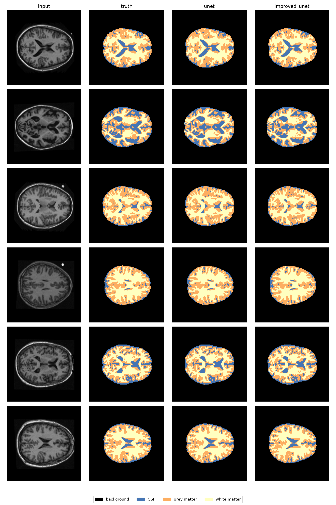
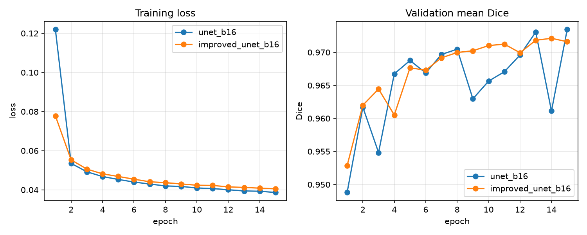
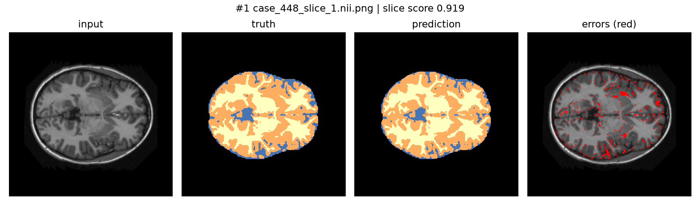
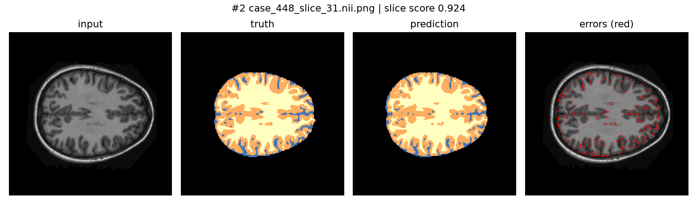
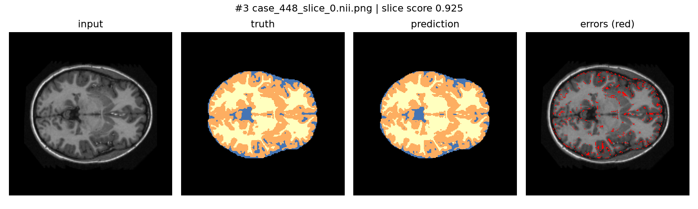
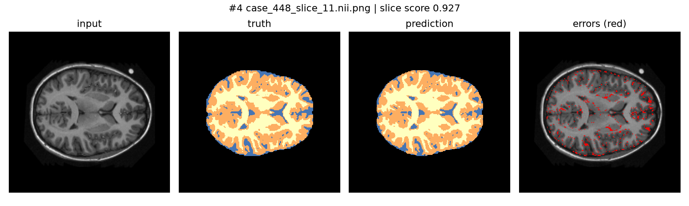

# Improved U-Net for brain tissue segmentation (OASIS, 2D)

Student ID: s4980054

COMP3710 Pattern Recognition report

Task: 2D Improved U-Net on OASIS brain MRI

## 1. Overview

**The problem.** Given a 2D axial MRI slice of the brain (256 × 256, greyscale), label every
pixel as one of four classes: background, cerebrospinal fluid (CSF), grey matter or white matter.
The motivating scenario is an annotation assistant that proposes tissue contours for a specialist
to review and correct, saving contouring time. The target is a Dice score of at least 0.9 on every
label of the test set.

**How it works.** The model is a 2D version of the Improved U-Net of Isensee et al. (BraTS 2017). Like a plain U-Net it has an encoder that halves the
image size while increasing the number of feature channels (16, 32, 64, 128, 256), a decoder that
brings it back to full size, and skip connections that pass fine detail from the encoder to the
decoder. It differs from the plain U-Net in three ways, as described by Isensee et al.:

- **Residual context blocks.** Each encoder stage uses a pre-activation residual block, following the design of He et al.: two 3×3 convolutions, each preceded by normalisation and activation, with dropout between them, and the block's input added to its output. Down-sampling between stages is done by a
  3×3 convolution with stride 2.
- **Instance normalisation** instead of batch normalisation, which is more stable with small batches
  (we train with batches of 8).
- **Deep supervision.** Segmentation outputs are taken from the last three decoder levels, upscaled
  and summed.

The improved U-Net outputs one score per class per pixel (3.18 M parameters) and is trained with a Dice
loss. A plain U-Net (1.94 M parameters) is trained on the same data split as the baseline.
Both models reach a Dice above 0.9 on every label; the Improved U-Net did not outperform the
baseline (see Results).



*Six evenly spaced slices from the test set. Colours: black = background, blue = CSF,
orange = grey matter, cream = white matter.*

## 2. Feasibility Review

This review plans a plain 2D U-Net baseline and a 2D Improved U-Net on OASIS.

### User need, scope and acceptance criteria

**User.** A radiologist who reviews machine-drafted brain-tissue contours on 2D MRI slices.

1. The Improved U-Net reaches Dice ≥ 0.9 on every label on the test set.
2. On the same split, its Dice on the lowest-scoring label is at least the baseline's, and the difference is reported.
3. The 3–5 lowest-Dice test slices are inspected (input, truth, prediction, error overlay).
4. Resource limit: peak GPU memory of at most 6 GB during training.

### Model choice and key concepts

I chose the **2D Improved U-Net \[Easy\]** on **OASIS 2D** (task sheet, Section 2.2, ref \[2\]), with a **plain 2D U-Net** baseline on identical splits. Concepts from the lectures that the design rests on:

- **U-Net.** The encoder learns *what* is in the image, the decoder restores *where*, and skip connections carry fine detail across, which matters at tissue boundaries.
- **Residual connections.** A block learns a small correction (output = F(x) + x), which improves gradient flow. The Improved U-Net uses pre-activation residual blocks.
- **Dropout.** Random neurons are switched off during training to reduce overfitting.
- **Instance normalisation.** Replaces batch normalisation, which degrades with small batches.
- **Deep supervision.** Outputs from several decoder levels are summed, giving early layers a stronger training signal.
- **One-hot masks and multiclass Dice loss.** One binary channel per class. Dice is computed per class, so the large background does not dominate, where plain cross-entropy is weak. I train with multiclass Dice loss (1 minus Dice, averaged over the four classes).

**Supporting evidence.** Isensee et al. introduced these changes, and on the BraTS 2015 test set they scored Dice 0.85 / 0.74 / 0.64 (whole tumour / core / enhancing) against 0.85 / 0.72 / 0.61 for the best earlier U-Net, ranking first on the leaderboard at the time (their Table 1). That is a 3D tumour task, so it supports the design rather than the OASIS target.

### Preliminary feasibility evidence

The data arrives pre-split, and case IDs show no overlap between train, validation and test, so the splits are patient-level.

| Split | Cases | Slices |
| --- | --- | --- |
| Train | 302 | 9,664 |
| Validation | 35 | 1,120 |
| Test | 17 | 544 |

Each case has 32 slices, and image and mask counts match in every split. Masks are 256×256 images with four values (0, 85, 170, 255), which map to background, CSF, grey matter and white matter. A CUDA test job on the Rangpur `comp3710` partition returned `CUDA available: True`.

### Risks, budget and fallback

- **Rangpur GPU queue.** *Mitigation:* Use the virtual GPU lab.
- **Overfitting.** Each case gives 32 similar slices. *Mitigation:* dropout.
- **Budget.** Three GPU runs of up to 3 hours per run (Baseline, Improved, one spare).
- **Next step.** Benchmark about 50 training batches (seconds per batch, peak GPU memory) to check the 6 GB limit and set the epoch count, then train the baseline and record validation Dice per label.
- **Fallback.** If Rangpur is unavailable, use the virtual GPU lab; if needed, train on my laptop by using a narrower network or a subset of whole patients (same splits for both models). If the Improved U-Net still cannot finish, report the baseline plus a shorter Improved run, with an honest comparison and what is incomplete.

## 3. Repository structure and usage

| File | Purpose |
|---|---|
| `modules.py` | Model components in PyTorch only: the plain `UNet`, the `ImprovedUNet` with its building blocks (context block, decoder stage, deep supervision head) and `DiceLoss` |
| `dataset.py` | OASIS data loader: reads slices and masks, one-hot encodes masks, applies augmentation (training split only) and checks that no case appears in more than one split |
| `train.py` | Trains and validates either model, keeps the weights with the best validation Dice, writes `history.json` and `training_curves.png` |
| `predict.py` | Loads saved weights, evaluates on the test set, prints a per-class Dice comparison and saves the prediction and failure-case figures |
| `benchmark.py` | Measures parameter count, peak GPU memory, training speed and inference time |
| `scripts/` | Slurm scripts used on Rangpur: `train_job.sh` and `benchmark_job.sh` |
| `figures/` | Figures used in this README |
| `requirements.txt` | Python dependencies with exact versions |

**Install.** `pip install -r requirements.txt`

**Data.** `--root` is the folder holding the six `keras_png_slices_*` folders (`train`, `validate`,
`test` and their `seg_` mask folders). On Rangpur this is `/home/groups/comp3710/OASIS`.

**Train.** Run once per model. Everything not listed was left at its default in `train.py`.

```
python train.py --root <OASIS folder> --model unet --base-channels 16 --epochs 15 --num-workers 4
python train.py --root <OASIS folder> --model improved_unet --base-channels 16 --epochs 15 --num-workers 4
```

Each run writes `runs/<model>_b16/` containing `best.pt`, `config.json`, `history.json` and
`training_curves.png`. Datasets and weights are not committed, so you must train before running
`predict.py`.

**Predict and evaluate.**

```
python predict.py --root <OASIS folder> \
    --unet-weights runs/unet_b16/best.pt \
    --improved-weights runs/improved_unet_b16/best.pt
```

This prints the test Dice for each class and model, then saves `figures/predictions.png` and the
five lowest-scoring slices as `figures/failure_1.png` to `figures/failure_5.png`.

**Benchmark.** Peak memory is measured on CUDA GPUs only.

```
python benchmark.py --root <OASIS folder> --model unet --base-channels 16 --num-workers 4
python benchmark.py --root <OASIS folder> --model improved_unet --base-channels 16 --num-workers 4
```

## 4. Dependencies and reproducibility

Python 3.11 with the packages in `requirements.txt`. Two machines were used:

| | Training and benchmarking | Test evaluation and figures |
|---|---|---|
| Machine | Rangpur, NVIDIA A100-PCIE-40GB | MacBook Air (Apple GPU, `mps`) |
| Python | 3.11.15 | 3.11.16 |
| PyTorch | 2.13.0 | 2.5.1 |
| torchvision | 0.28.0 | 0.20.1 |
| Pillow | 12.3.0 | 13.0.0 |
| NumPy | 2.4.6 | 2.4.6 |
| Matplotlib | not installed | 3.11.2 |

`requirements.txt` lists the MacBook versions. The weights trained under PyTorch 2.13.0 were loaded
and evaluated under PyTorch 2.5.1, so the code and checkpoints work across both versions.

**Training settings** (identical for both the Improved U-Net and the baseline U-Net):

| Setting | Value |
|---|---|
| Optimiser | Adam, learning rate 1e-3 |
| Loss | Dice loss |
| Batch size | 8 |
| Epochs | 15 |
| Base channels | 16 (so 16, 32, 64, 128, 256 channels per level) |
| Dropout (Improved U-Net) | 0.3 |
| Precision | float32 (no mixed precision) |
| Random seed | 0 |
| Model selection | weights with the best mean validation Dice over the 15 epochs |

Each run saves its settings in `config.json`, so every reported result can be traced to its
settings. The commands in section 3 reproduce the runs.

**Note about reproducibility:** The Slurm scripts in `scripts/` are the ones that were used on my Rangpur environment and use hardcoded paths.

## 5. Data, preprocessing and splits

**Data.** The OASIS brain MRI dataset as provided for the course: 354 cases, each with 32
slices, saved as 256 × 256 greyscale PNG images with matching segmentation masks (four classes:
background, CSF, grey matter, white matter).

**Splits.** I used the train / validation / test folders supplied with the dataset and did not
re-split:

| Split | Cases | Slices | Share of cases | Used for |
|---|---|---|---|---|
| Train | 302 | 9,664 | 85% | fitting the weights |
| Validation | 35 | 1,120 | 10% | choosing the best epoch |
| Test | 17 | 544 | 5% | final results only |

The supplied splits are by case, so all 32 slices of a patient sit in one split. Splitting by slice would
put neighbouring, almost identical slices in both training and test and inflate the scores.
`dataset.py` checks this on every load and raises an error if a case appears in more than one split.
The test set was not used to choose any setting or epoch. It is small (17 cases), so the test scores
are noisy estimates.

**Preprocessing.**

- Pixel intensities are scaled to the range [0, 1].
- Masks are converted to class indices 0–3 and one-hot encoded into four channels, which the Dice loss needs.

**Augmentation (training split only).** A random horizontal flip (probability 0.5) and a random
rotation of up to ±10°. Both keep anatomy plausible while adding variety. The validation and test
splits are not augmented.

## 6. Results

### 6.1 Test-set Dice

Both models were trained once on the same split with identical settings (section 4) and evaluated
on the 544 test slices. Dice is computed per class over all test slices pooled together, taking the
highest-scoring class at each pixel.

| Label | Plain U-Net (baseline) | Improved U-Net | Difference |
|---|---|---|---|
| Background | 0.9987 | 0.9984 | −0.0003 |
| CSF | 0.9565 | 0.9542 | −0.0023 |
| Grey matter | 0.9618 | 0.9614 | −0.0003 |
| White matter | 0.9771 | 0.9766 | −0.0005 |
| Mean of the four labels | 0.9735 | 0.9727 | −0.0009 |

Differences are calculated from unrounded values. The Improved U-Net is slightly lower on every
label, with a largest gap of 0.0023 on CSF. These gaps are small. As a rough guide to how much the
numbers move, the baseline's mean validation Dice fell by as much as 0.0119 from one epoch to the
next (epoch 13 to 14), and the Improved U-Net's by as much as 0.0039 (epoch 3 to 4). This is not a
measured seed-to-seed variance, and each model was trained only once and tested on 17 cases. So I do
not claim that either model is better on Dice.

**Acceptance criteria** (from my feasibility review):

| # | Criterion | Result |
|---|---|---|
| 1 | Improved U-Net reaches Dice ≥ 0.9 on every label on the test set | **Met.** Lowest label is CSF at 0.9542 |
| 2 | On the same split, its Dice on the lowest-scoring label is at least the baseline's, and the difference is reported | **Not met.** CSF 0.9542 against 0.9565 (−0.0023), within the noise described above |
| 3 | The 3–5 lowest-Dice test slices are inspected.| **Met.** Five slices in section 7
| 4 | Peak training GPU memory at most 6 GB | **Met.** 1.26 GB |

### 6.2 Training curves



*Training loss (left) and validation mean Dice (right) per epoch, for both models.*

Both losses fall quickly and flatten, and both were still decreasing slowly at epoch 15. The Improved
U-Net starts lower (0.0778 against 0.1220 at epoch 1) but ends slightly above the baseline
(0.0405 against 0.0387 at epoch 15). Its
validation Dice rises more smoothly: the baseline's mean validation Dice falls by more than 0.005 at
epochs 3, 9 and 14, while the Improved U-Net's never does. The best epoch was chosen by mean
validation Dice: epoch 15 for the baseline (0.9735) and epoch 14 for the Improved U-Net (0.9721).

### 6.3 Resource profile

| | Plain U-Net | Improved U-Net |
|---|---|---|
| Parameters | 1,942,340 | 3,181,724 (1.6×) |
| Peak GPU memory, training, batch 8 | 0.73 GB | 1.26 GB (1.7×) |
| Mean time per epoch (training + validation) | 30.3 s | 37.7 s (1.2×) |
| Inference time, one slice | 2.5 ms | 3.6 ms (1.4×) |

Measured on an NVIDIA A100-PCIE-40GB in float32, with 256 × 256 inputs, batch size 8 and 4 data-loader
workers. Peak memory is PyTorch's `torch.cuda.max_memory_allocated`, which counts tensors only. Both models are far
below the 6 GB limit. Timings vary by a few percent between runs.

## 7. Failure case analysis

The five lowest-scoring test slices were found by scoring each slice as the mean Dice over the tissue
classes present in its ground truth, then ranking the Improved U-Net's slices. The median slice
score is 0.963; these five score 0.919 to 0.928, with CSF Dice of 0.84 to 0.88 against 0.954 over the
whole test set. Each figure shows the input, ground truth, prediction and the pixels that differ
(red). In the truth and prediction panels, blue is CSF, orange is grey matter and cream is white
matter.







**What they have in common.** In all five, the prediction closely matches the truth. The large cream
(white matter) regions and the outline of the brain are correct, and no large region is missed or
mislabelled. The red pixels are scattered, one to a few pixels wide, and lie where two classes meet,
mostly where grey matter, CSF and white matter touch near the outer edge of the brain. There are also
a few denser red clusters. The CSF Dice is the lowest of the classes on these slices.

| # | Slice | Score: Improved / plain U-Net | Notes |
|---|---|---|---|
| 1 | case_448, slice 1 | 0.919 / 0.924 | Scattered red along the class boundaries, with small clusters at the upper right and lower middle of the brain |
| 2 | case_448, slice 31 | 0.924 / 0.923 | Thin blue (CSF) lines near the outer edge with thin red lines along them, and a few small clusters near the centre |
| 3 | case_448, slice 0 | 0.925 / 0.932 | Almost the same as slice 1, with clusters in the same places |
| 4 | case_448, slice 11 | 0.927 / 0.940 | Scattered red along the class boundaries near the outer edge and inside the brain |
| 5 | case_448, slice 2 | 0.928 / 0.930 | Same as slices 0 and 1, with a cluster at the lower right |

**Likely trigger.** The errors sit where one class meets another, and in the truth images the blue
(CSF) regions are thin, only a few pixels wide in places. For a region that thin, one wrong pixel is
a large share of it, so the Dice drops. I did not test this directly.

**A caution on the comparison.** The slices were ranked by the Improved U-Net's score, so the
baseline looking better on four of the five is expected and is not evidence that it handles these
slices better.

### All five failures come from one patient

All five slices come from one test patient (case_448). Slices 0, 1 and 2 are neighbours with nearly
identical images, so they are not independent failures. I did not compute scores per patient, so I
cannot say whether this whole case is hard.

## 8. Recommendation to the project manager

**Use the plain 2D U-Net for the contouring assistant.** On this evidence the Improved U-Net did not
earn its extra complexity: it was no better on Dice (slightly lower on every label, within noise),
and it costs 1.6× the parameters, 1.7× the training memory, 1.2× the epoch time and 1.4× the
inference time. Both meet the Dice ≥ 0.9 target on every label.

**What the specialist should check.** The errors are on thin boundaries between tissue classes, not
in large regions, so the review should focus on the boundaries, especially around CSF, which has the
lowest Dice of the four labels for both models (0.9565 and 0.9542). The large white matter regions
were correct in the failure cases I examined.

**Limits of this evidence.**

- Each model was trained once, for 15 epochs, and both training losses were still falling. A longer
  or repeated run might change the comparison.
- The test set has 17 patients, and all five failures come from one of them.
- The model is 2D and sees one slice at a time. I did not test whether 3D context would reduce the
  boundary errors.

## 9. Artificial Intelligence Usage Disclosure

**Tools used.** Claude (Anthropic), ChatGPT

**What AI assisted with.**

- **Concepts and reading.** Explaining U-Net, residual blocks, instance normalisation, deep
  supervision and Dice, and helping me find and understand passages in the two reference papers.
- **Code.** Claude proposed the code for `dataset.py`, `modules.py`, `train.py`, `predict.py` and
  `benchmark.py` in small steps. I pasted each piece into my files, ran it, and committed in stages.
  Claude also wrote the Slurm job scripts and helped with Rangpur usage. Most first drafts of the
  code came from Claude; the decisions about what to keep, change or remove were mine (for example,
  I removed an unused mixed-precision option).
- **Writing.** Claude helped draft the feasibility review and this README. I edited the text and
  checked every number against the outputs of my own runs.

**How I checked the work.**

- **Model:** parameter counts (1,942,340 and 3,181,724) and output shape (batch, 4, 256, 256). A
  test that sets a residual block's weights to zero and checks that the output equals the input. A
  test that dropout is active in training mode and off in evaluation mode.
- **Data:** a check that no case appears in more than one split, checks of one-hot masks, and a
  visual check of the augmented images.
- **Against the papers:** I compared Claude's explanations of the architecture with Isensee et al.
  and He et al. and corrected statements the papers do not make.
- **Results:** short smoke-test runs before the full training runs. All reported numbers come from
  my own runs of `train.py`, `predict.py` and `benchmark.py`, and I compared the failure-case
  figures with the printed scores by eye.

I am responsible for every line of code, loss formula and metric in this submission.

## 10. References

- Isensee, F., Kickingereder, P., Wick, W., Bendszus, M. and Maier-Hein, K. H. (2017). Brain tumor
  segmentation and radiomics survival prediction: Contribution to the BRATS 2017 challenge.
  *International MICCAI Brainlesion Workshop*, Springer, pp. 287–297.
- He, K., Zhang, X., Ren, S. and Sun, J. (2016). Identity mappings in deep residual networks.
  *European Conference on Computer Vision*, Springer, pp. 630–645.
