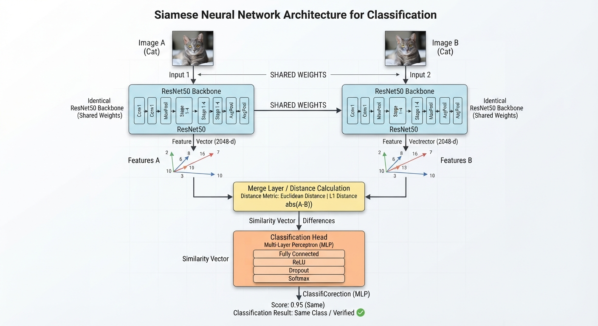
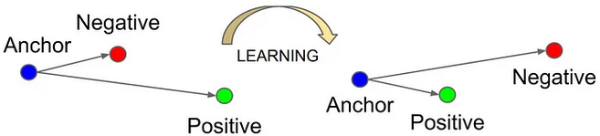
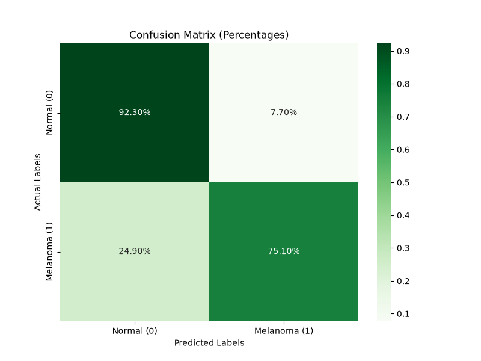
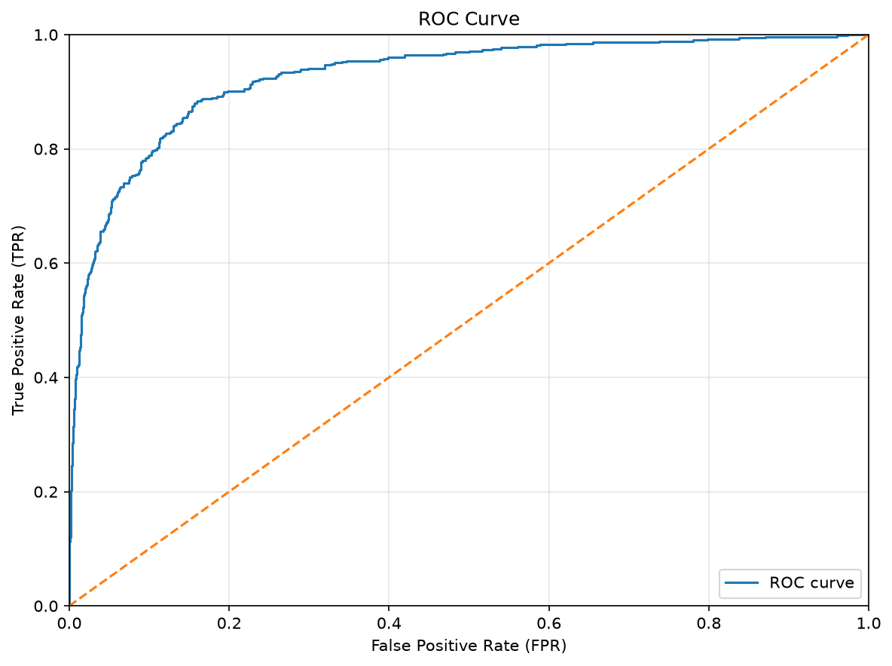
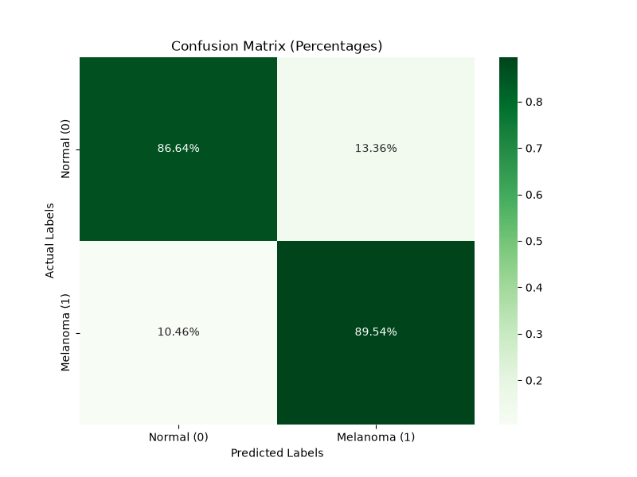
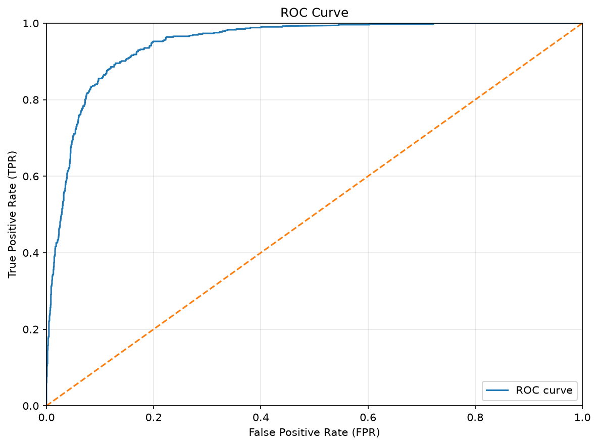
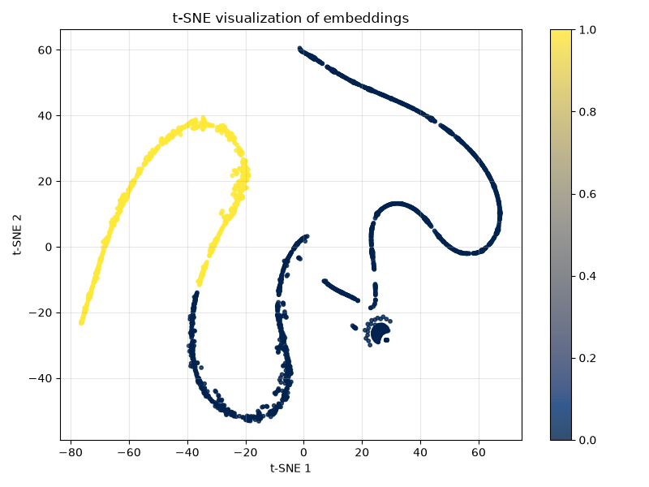

# COMP3710 Melanoma Detection using Siamese Network - s4612969

## Description

Using Siamese Neural Network to classify possible melanoma and benign skin conditions. The results will be compared to a ResNet-50 based classifier trained on the same dataset.

The intended users for the model are doctors and pathologists who want to be able to detect cancer cells early. The model should be able to detect obvious melanoma cases whilst ensuring that more borderline cases are not misdiagnosed as benign.

## Environment Setup

### 1. Getting the Data

- Download image data from https://www.kaggle.com/datasets/roua91/isic-melanoma-dataset-resized-to-224x224/data
- Extract the compressed contents to './'Siamese_Melanoma_robert' folder

### 2. Installing Dependencies

- Create a python venv and install the listed dependencies in requirements.txt

```bash
python3 -m venv venv
source venv/bin/activate
pip install -r recognition/Siamese_Melanoma_robert/requirements.txt
```

### 3. Running Training

The below command also runs testing on the same 

```bash
python3 train.py
```

## Dataset Overview

- Source: ISIC 2020 Challenge Dataset (224x224 Resized version)
- Link: https://www.kaggle.com/datasets/roua91/isic-melanoma-dataset-resized-to-224x224/data
- Split by patient ID rather than just by image ID to prevent contamination of test set
- Details:
    - Image dimensions: 224x224
    - Classes: 0 for benign ; 1 for malignant
    - Total images: 24453 | 19227 benign | 5266 malignant
    - CSV file: Contains image IDs, labels, and patient IDs
    - Balanced target distribution: this provided dataset has undersampled the 'target=0.0' (benign) images of the 
        original full ISIC dataset, resulting in a relatively balanced dataset (~21.5% malignant)

## Model Architecture



The model being used is a Siamese Neural Network, which uses the same weights on two different inputs to determine their similarity. This can be used for the classification of melanoma since the model should be able to differentiate the malignant tumors for benign blemishes. 



It is being trained using triplet loss, which takes 3 images (an anchor, positive image of the same class, and negative image of a different class) and attempts to minimise to distance between the anchor and positive, whilst increasing the distance between the anchor and negative image.

A Resnet-50 subnetwork structure was chosen since it is effective for capturing intricate details from images. This will also be used as the baseline model to compare the performance of the Siamese network to. This comparison should showcase the strengths of the Siamese architecture. Particularly in its robustness with respect to inter-class variance and intra-class similarity. Due to the afforementioned triplet loss pushing differing classes further apart, the clustering of the two classes should be much more distinct in the feature space compared with 

### Risks

- Siamese networks can become very large, and computationally expensive to train, especially as the amount of training images grows.
- The images may come from the same patient, so model might recognise certain features from a patient in the training set when predicting outcomes of images in the test set (data leakage)

### Relevant Parameters
| Parameter             | Value             |
|---------------------- | ----------------- |
| Subnetwork            | ResNet50          |
| Epochs                | 25                |
| Learning Rate         | 0.001             |
| Margin                | 1.0               |
| Batch Size            | 64                |
| Optimiser             | Adam              |
| Embedding Dimension   | 512               |
| Comparison Metric     | AUC-ROC           |

## Data Preprocessing

- Input **224 x 224** dermoscoptic images
- Split: **80/10/10** train/validation/test splits
    - Maintains balance between model generalisation and evaluation stability
    - Split by 'patient_id' to prevent data leakage between training, validation and test sets
- Augmentation: random rotations, color jitter, horizontal/vertical flips on training set

## Success Criteria
A positive melanoma diagnosis would require a medical professional to check before any further medical procedures. As such, the risk of a false negative prediction from the model is disproportionately worse than a false positive, since the cost of an undiagnosed malignant melanoma is greater than the time which I doctor uses to verify the model's predictions.

The model should also return a level of confidence when predicting the class of a given input image.

Ideally there will be a point where a statistically significant number of true positive (malignant) classifications still exists, whilst no false negatives are predicted.

Overall, the false negative prediction rate is equally as important as the true positive prediction rate for evaluating the models.

To quantify this, a Area Under the Receiver Operating Characteristic (AUC-ROC) curve will be used. This graph plots that true positive rate against the false positive rate, where the area under the curve (AUC) ranges between 0 and 1. This quantifies the model's ability to discriminate between the two classed. Generally, an AUC value greater than 0.8 is considered good performance. However, given that the specific usecase is the classification of suspected skin cancer images, a higher AUC value, perhaps above 0.9 is preferable. The AUC-ROC metric is preferable to traditional metrics such as accuracy because it is able to measure the models' classification performance independent of any thresholds.

## Model Results

### Baseline Model - ResNet50

The baseline model is a ResNet50 model which uses ImageNet pretrained weights as a starting point before further training and finetuning using the melanoma skin lesion images.

|  |  |
| :---: | :---: |
| Confusion Matrix for Baseline ResNet50 | AUC-ROC for Baseline ResNet50|

The baseline model does very well with correctly classifying benign images. However, it has an almost 25% false negative rate. TWith a AUC-ROC value of ~0.82, the ResNet is relatively successful at differentiating between the benign and malignant cases. However, a false negative rate this high for medical disgnosis is unacceptable, meaning that this baseline model should not be considered for the task of automated classification of suspected melanoma.

### Siamese Network

The Siamese network uses the baseline ResNet50 model as a backbone/subnetwork.

|  |  |
| :---: | :---: |
| Confusion Matrix for Siamese Network | AUC-ROC for Siamese Network |

The Siamese network trades some accuracy when classifying benign images. However, the false negative rate has more than halved to ~10.5%. With an AUC-ROC value of ~0.89, the Siamese network is more capable of separating the two classes from one another.

A way to see this is through t-distributed Stochastic Neighbour Embedding (t-SNE), which has been used to visualise the high-dimension (512 in this case) output from the Siamese model in a 2D graph. The yellow points represent malignant melanoma, whilst the blue points represent benign skin conditions. 

| |
| :----: |
| t-SNE Embeddings for Siamese Network|

The melanoma embeddings are concentrated along a curve on the left-hand side of the graph. This region has a relatively consistent distribution of embeddings, and are mostly separated from the benign embeddings. However, there is a section of benign embeddings which are nearby - possibly accounting for the model's incorrect predictions whenever an image seems to be borderline between malignant and benign.

There are multiple clusters of blue benign embeddings. This is because benign lesions are not necessarily visually similar, and may have many kinds of colours, shapes, textures, etc. It may also be due to image acquisition differences, image charateristics, or t-SNE projection effects.

There seems to be a substantial spatial separation between the malignant and benign embedding points. This suggests that the network has learned representations with some discriminatory information regarding melanoma compared with benign lesions. However, since t-SNE preserves local neighbourhood relationships over failful preservation of global distances, whether the original embedding space has as clear class separation as seen in the plot cannot be concluded.

## Conclusions

Overall, the Siamese neural network shows some promise for differentiating malignant melanoma from benign lesions. It has managed to reach a testing accuracy of over 0.8, but still has a somewhat high number of false negatives (~10.5%). Therefore, the current model is still insufficient for actual medical diagnosis. Overall, whilst the Siamese network does meet the requirements of this assignment, it would not necessary be sufficient to be deployed in a real medical setting.

To reach a point where the model may be actually be useful, training for more epochs or incorporating more images is likely to improve the performance. Furthermore, hard negative mining could be implemented to improve selection of images for triplets. This might be able to further widen the gap between benign and malignant embeddings, resulting in a better classifier.

## Training Logs

- 26/10/2026 | 1st Training run failed
- 27/10/2026 | 2nd Training run failed
- 29/10/2026 | 3rd Training run failed
- 31/10/2026 | 4th Training run failed after pc crash after ~40 epochs -> Changed hyperparameters
- 01/11/2026 | 5th Training run success (Achieved over 0.8 accuracy)

## Relevant Papers
- [Siamese Neural Networks for One-shot Image Recognition](https://www.cs.toronto.edu/~zemel/documents/oneshot1.pdf)
- [FaceNet: A Unified Embedding for Face Recognition and Clustering](https://arxiv.org/abs/1503.03832)
- [Deep Residual Learning for Image Recognition](https://openaccess.thecvf.com/content_cvpr_2016/papers/He_Deep_Residual_Learning_CVPR_2016_paper.pdf)

## AI Declaration

Artificial Inteligence was used during this project to improve understanding of the underlying models
and used for the generation of plans and outlines of how the Siamese and baseline networks should be implemented.

Google Gemini 3.5 Flash-Lite was used to give overviews on the Siamese network's implementation and the was used to adapt the Siamese network code for the baseline model comparison.

Google Gemini was also used for the generation of the Siamese network architecture diagram.

ChatGPT GPT-5.6 Luna was used to parse error logs and help fix issues regarding why the training would repeatedly fail.

All ideas, and code generated by the LLMs was reviewed by me, and was refactored to fit in best with my understanding.
