# Melanoma Classification: ResNet-18 Baseline and Siamese Auxiliary-Head Model

## StudentID: 48036261
## Name: Thirumurugan Thirunanthanan (Nandos)

This project tests whether a Siamese network improves melanoma recognition and uncertainty-based triage over a ResNet-18 classifier on ISIC 2020. Both models use the same frozen patient-separated splits. The completed repository-script experiment is the primary evaluation: both classifiers achieve 80.84% test accuracy, while the baseline detects 72 of 89 melanomas and the Siamese classifier detects 65. The practical question is whether metric learning offers enough benefit in recognition, confidence and referral decisions to justify its added training cost.

The Siamese model passes two images through one shared ResNet-18 encoder. A projection head produces unit-length embeddings for contrastive learning, while an auxiliary classifier predicts melanoma from each image's encoder features. Training combines both objectives; ordinary inference uses the classifier head. A separate prototype analysis compares embeddings with class means computed from training images. Validation data determines checkpoints, operating thresholds and uncertainty bands; test data measures their held-out performance.

```text
Training pair A, B (different patients)
                  |
       Shared ResNet-18 encoder
                  |
       512-dimensional features
          /                  \
Linear 512 -> 128        Linear 512 -> 1
L2-normalised embedding Classifier logit
          |                  |
Contrastive pair loss    Binary cross-entropy
          \                  /
             Combined loss

Single-image inference: encoder -> classifier -> sigmoid score
Supplementary analysis: encoder -> embedding -> distances to training prototypes
Baseline: separate ResNet-18 -> binary classifier (weighted cross-entropy)
```

*Architecture overview: the two Siamese branches share encoder weights; the baseline is trained separately. Scores are assessed for calibration rather than assumed to be reliable probabilities.*

**Reading this report:** Sections 6-9 contain the completed rerun, results and recommendation. Sections 11-12 preserve superseded notebook results for comparison. All report figures are stored locally under `images/`; reading the report requires no access to private experiment storage. Repeating the experiment requires separately obtained dataset images and training new checkpoints.

## Feasibility Review: Melanoma Classification

| Project | Proposed model | Difficulty |
|---|---|---|
| ISIC 2020 dermoscopic images | Siamese network | Hard |

### Feasibility decision

This is a feasible research project for prioritising lesions for clinician review. It is not a deployable screening system or autonomous diagnostic tool. I would proceed with the Siamese model and a ResNet-18 baseline, as long as the split is patient-level, the threshold is chosen only on validation data, and the report clearly shows the false-negative burden and referral trade-off.

### User need and scope

The intended users are dermatology clinicians or trained image reviewers who need decision support when assessing dermoscopic lesions. The prototype classifies the supplied images as melanoma or benign and tests whether pairwise representation learning improves triage compared with a standard CNN. A positive or uncertain result should be sent for expert review; a negative result should not be treated as ruling out melanoma.

### Testable acceptance criteria

- Keep all images from each patient in exactly one split; verify that the 70/15/15 train, validation and test partitions have no patient overlap.
- Train and compare the Siamese model and ResNet-18 baseline on the same partitions; report AP, AUROC, accuracy, macro-F1, per-class precision and recall.
- Select the operating threshold using validation data only, targeting at least 80% specificity while maximising melanoma sensitivity; report test performance at that fixed threshold without retuning.
- Inspect 3–5 held-out test errors, including false positives and false negatives, and document image-level observations as plausible triggers rather than proven causes.
- Run inference over all 5,000 test images on one Colab GPU; record GPU type, peak allocated VRAM and inference time, with a prototype resource target below 8 GB VRAM.

### Model choice and preliminary evidence

The audited ISIC 2020 cohort contains 33,126 images from 2,056 patients; 584 are melanoma (1.76%). The frozen patient-separated split contains 23,188 training images (403 melanoma), 4,938 validation images (92 melanoma) and 5,000 test images (89 melanoma). The audit found 425 duplicate pairs, none crossing patient IDs, and no conflicting lesion labels. These checks support a leakage-controlled experiment, even though the positive class remains very small.

The baseline is an ImageNet-pretrained ResNet-18 trained with weighted binary cross-entropy. The Siamese model uses a shared ResNet-18 encoder, a 128-dimensional embedding, contrastive loss and an auxiliary binary classifier. This fits the course themes well: transfer learning, residual CNNs, metric learning, imbalance-aware sampling, patient-grouped validation and precision–recall evaluation. The smoke test and completed training runs show that the pipeline works on Colab GPUs.

### Risks, resource budget and fallback

A melanoma prevalence of 1.76% means accuracy is easy to misread. Balanced pair sampling gives the model more exposure to melanoma examples without creating new patients, but it can also increase overfitting. The validation-selected specificity may not transfer cleanly to the test set, and repeated inspection of test mistakes can make the evaluation exploratory. Colab GPU availability and session time are also constraints, so checkpoints and image archives are kept outside GitHub. Frozen split manifests and duplicate-pair metadata are included for reproducibility.

If the Siamese model does not improve the clinically relevant trade-off or exceeds the resource target, the safer fallback is to keep ResNet-18 as the benchmark and use human-reviewed triage only. Neither model should be treated as clinically ready without external validation, calibration and workflow assessment.

### Selected sources

- SIIM-ISIC 2020 Challenge Dataset, [doi:10.34970/2020-DS01](https://doi.org/10.34970/2020-DS01).
- He et al., “Deep Residual Learning for Image Recognition” (2016), [doi:10.1109/CVPR.2016.90](https://doi.org/10.1109/CVPR.2016.90).
- Koch et al., “Siamese Neural Networks for One-shot Image Recognition” (2015).


## 1 Introduction

Melanoma is a serious health issue in Australia. The country has one of the highest melanoma incidence rates in the world, and the Australian Institute of Health and Welfare estimated 17,400 new cases in 2025. That figure is a projection based on earlier incidence data, not a final observed count ([Australian Institute of Health and Welfare, 2026](https://www.aihw.gov.au/reports/cancer/cancer-data-in-australia/contents/cancer-data-commentaries/melanoma-of-the-skin-in-australia)). Early detection matters because deeper and thicker melanomas are harder to treat ([Cancer Council Australia, n.d.-a](https://www.cancer.org.au/about-us/policy-and-advocacy/prevention/uv-radiation/related-resources/early-detection-of-skin-cancer)).

This project does not propose population-wide automated screening. Australia does not have a formal melanoma screening program, and Cancer Council Australia does not recommend routine population-based skin-cancer screening because the evidence for a mortality benefit is limited ([Cancer Council Australia, n.d.-b](https://www.cancer.org.au/about-us/policy-and-advocacy/prevention/uv-radiation/related-resources/detection-and-screening)). Instead, the guidance is to seek medical advice for new or changing lesions and to target assessment at higher-risk people ([Cancer Council Australia, n.d.-a](https://www.cancer.org.au/about-us/policy-and-advocacy/prevention/uv-radiation/related-resources/early-detection-of-skin-cancer)).

This project looks at whether image-classification methods could help with triage and review of dermoscopic skin-lesion images. The goal is not to replace clinicians or make a diagnosis, but to test whether a model can recognise patterns linked to melanoma and flag cases that may need expert review. This is a difficult task because melanoma is a small minority of the ISIC 2020 images, while benign lesions can look similar to malignant ones. Some images also include artefacts such as hair or ruler markings. In that setting, overall accuracy can be misleading: a model that predicts “benign” most of the time can look strong while missing many melanoma cases.

I use the ISIC 2020 dataset to compare a ResNet-based CNN baseline with a Siamese network that learns image representations through pairwise comparison and then uses an auxiliary classification head to predict the lesion class. Both models are evaluated with patient-separated training, validation and test sets, so images from the same patient stay in the same split. The dataset contains 33,126 images, and melanoma makes up less than 2% of each split. That class imbalance means it is important to look at melanoma sensitivity, specificity, precision and precision–recall performance alongside overall accuracy. The comparison also asks whether a threshold can be selected on the validation set to balance missed melanomas against the extra false positives produced by referral.

This work is limited to the supplied dataset and to a working prototype, baseline comparison, error analysis and evidence-based recommendation. The labels and images do not capture every factor used in clinical assessment, and performance on this dataset cannot tell us how the models would generalise across Australia’s diverse population or in routine clinical practice. The results should therefore be treated as a model evaluation on a defined dataset, not as evidence of clinical readiness. The key question is whether the more complex Siamese approach offers a meaningful benefit over the baseline for finding melanoma cases and supporting clinician review, given the trade-offs in false negatives, false positives and compute cost.

## 2 Data

### 2.1 Preliminary Analysis

A brief analysis of the data yielded the following information:

| Parameter       | Value   |
|-----------------|---------|
| Total Images    | 33,126  |
| Unique Patients | 2,056   |
| Unique Lesions  | 32,701  |
| Benign Cases    | 32,542  |
| Benign %        | 98.237% |
| Melanoma        | 584     |
| Melanoma %      | 1.763%  |

*Table 1: Dataset parameters*

The disparity is visualised as shown:

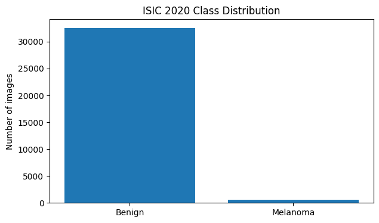

*Figure 1: Class imbalance visualised*

The data has a strong imbalance between benign and melanoma present cases, which provides an avenue for the model to guess benign and have a 98.237% accuracy. This motivates using average precision and PR-AUC alongside class-specific recall, rather than accuracy alone.

### 2.2 Preprocessing: Missing Values and Inconsistent Labelling

Before training, the data must be checked for missing values and inconsistent labels. An analysis yielded the following:

| Possible Errors                  | \# of cases |
|----------------------------------|-------------|
| image_name                       | 0           |
| patient_id                       | 0           |
| lesion_id                        | 0           |
| sex                              | 65          |
| age_approx                       | 68          |
| anatom_site_general_challenge    | 527         |
| Diagnosis                        | 0           |
| benign_malignant                 | 0           |
| target                           | 0           |
| Patients with both classes       | 427         |
| Lesions with conflicting classes | 0           |
| Duplicate Pairs                  | 425         |

*Table 2: Possible data errors and frequency*

### 2.3 Duplicate Analysis

The supplied duplicate metadata lists 425 image pairs. The completed audit confirms that every endpoint is present in the frozen manifests, every pair has consistent labels, and no pair crosses train, validation or test partitions. This prevents the listed duplicate images from leaking between partitions. It does not establish that no additional, unlisted visual near-duplicates exist.

The following parameters were investigated:

| Parameter                       | Value |
|---------------------------------|-------|
| Duplicate pairs                 | 425   |
| Pairs with missing metadata     | 0     |
| Pairs across different patients | 0     |
| Pairs across different lesions  | 8     |
| Pairs with conflicting labels   | 0     |

*Table 3: Duplicate analysis across the dataset*

The analysis shows that duplicate pairs are patient-unique, which enables splits based on patient_ids. However, there are pairs across different lesions. This could be due to metadata inconsistencies or different lesion identifiers assigned to duplicate images.

## 3 Data Plan

The completed patient-separated split is shown below. The target proportions were 70% training, 15% validation and 15% test; group separation resulted in the image counts shown.

| Data Type  | Percentage | Number | Melanoma Cases |
|------------|------------|--------|----------------|
| Training   | 70%        | 23,188 | 403            |
| Validation | 15%        | 4,938  | 92             |
| Test       | 15%        | 5,000  | 89             |

*Table 4: Training, validation and test split*

The original frozen manifests are included in [splits/](splits/), unchanged from the supplied CSVs. Their counts and image/patient/lesion separation have been verified; [manifest_audit.json](splits/manifest_audit.json) records SHA-256 hashes and audit status. The original [duplicate-pair CSV](ISIC_2020_Training_Duplicates.csv) is included unchanged. The full metadata leakage audit passes: all 425 known duplicate pairs have endpoints present, consistent labels and no cross-split leakage. See [RUNNING.md](RUNNING.md) for commands. Images and model weights are not included.

In this dataset, the main leakage risk is that multiple images from the same patient are highly similar. If those images are spread across train, validation and test sets, the model can learn patient-specific patterns instead of true melanoma signals. Grouping by patient_id ensures all images from one patient stay in the same split.

The development notebook uses two stages of GroupShuffleSplit grouped by patient_id. For each seed from 0 through 99, it reserves 15% of patient groups for test, then reserves 0.15/0.85 of the remaining groups for validation. It selects the first candidate minimizing the sum, over train/validation/test, of the absolute image-proportion deviation from 70/15/15 plus twice the absolute melanoma-prevalence deviation from the full cohort. This is a one-time split-definition procedure, not model selection on test performance. `prepare_splits.py` reproduces this rule and records the selected seed, library version and file hashes. All model entry points audit image, patient, lesion and known-duplicate separation across the frozen three-way split before use. See [RUNNING.md](RUNNING.md) for commands and required metadata.

## 4 Model Plan

The final Siamese model learned representations by comparing pairs of images using a shared ResNet-18 backbone. Each image was mapped to an embedding, and contrastive loss encouraged same-class pairs to have closer embeddings and different-class pairs to have embeddings further apart. An auxiliary classification head was trained jointly with the backbone to predict the class of each image.

Pair sampling increased exposure to melanoma images during Siamese training. The training split contained 403 melanoma images among 23,188 images (1.738%), reduced from 584 among 33,126 images (1.763%) in the full dataset. This severe imbalance motivates deliberate class-aware pair sampling rather than relying on the original image frequencies.

Siamese training used pairs labelled as **same class** or **different classes**. Pair types were balanced across benign–benign, melanoma–melanoma, benign–melanoma and melanoma–benign combinations, excluding images from the same patient within a pair. This increases exposure to the limited melanoma images but did not create new independent melanoma cases or guarantee protection against overfitting. Performance was evaluated on patient-separated validation and test sets.

The auxiliary classification head was trained in conjunction with the contrastive-learning components. Then, at inference, each test image was processed by the trained backbone and auxiliary classification head to produce its melanoma score. The decision threshold was selected using validation data before evaluation on the held-out test set. The operating rule maximises validation sensitivity subject to at least 80% specificity.

## 5 GitHub File

### 5.1 Repo Structure

The code structure for the repo is as follows:

```text
recognition/Siamese_Nandos/
    README.md
    RUNNING.md
    requirements.txt
    requirements-cpu.txt
    dataset.py
    modules.py
    train.py
    train_baseline.py
    train_aux.py
    predict.py
    runtime.py
    training_utils.py
    reporting.py
    run_colab.ipynb
    split_utils.py
    prepare_splits.py
    test_pipeline.py
    test_splits.py
    test_training_utils.py
    test_reporting.py
    ISIC_2020_Training_Duplicates.csv
    splits/
        train.csv
        val.csv
        test.csv
        manifest_audit.json
    images/                       # report figures, not training JPEGs
```

### 5.2 File Breakdown

| File              | Purpose                                                                                                                                                                                                      |
|-------------------|--------------------------------------------------------------------------------------------------------------------------------------------------------------------------------------------------------------|
| README.md         | Describes the project, how the models work, how to run the code, and the experiments and results.                                                                                                            |
| dataset.py        | Loads the ISIC image data, applies preprocessing and training augmentations, and creates image pairs for Siamese training. It also provides optional RAM caching for resized training and validation images. |
| modules.py        | Defines the ResNet-18 baseline and the Siamese network with an auxiliary classification head, along with the contrastive loss used to train image embeddings.                                                |
| train.py          | Provides one command-line entry point. The selected model determines whether it runs train_baseline.py or train_aux.py.                                                                                      |
| train_baseline.py | Trains the ResNet-18 baseline, evaluates it on the validation split, and saves the best checkpoint and training results.                                                                                     |
| train_aux.py      | Trains the Siamese model using image pairs, contrastive loss and the auxiliary classification head. It also evaluates on the validation split and saves the best checkpoint and training results.            |
| predict.py        | Loads a trained checkpoint, selects a classification threshold using validation data, evaluates the model on the test split, and saves prediction results, metrics and plots.                                |

Additional reproducibility files:

| File | Purpose |
|---|---|
| `split_utils.py` | Validates all three manifests and rejects image, patient, lesion and known-duplicate leakage. |
| `prepare_splits.py` | Reproduces the development notebook's split search; refuses to overwrite frozen manifests. |
| `reporting.py` | Generates learning curves, both-class metrics, calibration and referral summaries, run manifests and inference profiles. |
| `test_reporting.py` | Checks classification metrics, referral boundaries and finite all-negative threshold handling. |
| `training_utils.py`, `test_training_utils.py` | Checkpoint recovery, atomic output writing, progress reporting and recovery tests. |
| `runtime.py` | Requires CUDA by default, with explicit CPU selection for smoke tests. |
| `splits/` | Original experiment manifests and their SHA-256 audit record. |
| `ISIC_2020_Training_Duplicates.csv` | Original 425-pair metadata, loaded automatically for the included splits. |
| `test_pipeline.py`, `test_splits.py` | Synthetic pipeline, model compatibility, leakage rejection and device-selection tests. |
| `RUNNING.md` | Detailed setup, notebook compatibility and reproduction limitations. |

### 5.3 Architecture Breakdown

The training scripts select the relevant pipeline, while `dataset.py` handles image loading and preprocessing and `modules.py` defines the model architecture. After training, `predict.py` loads the saved checkpoint and applies the same preprocessing to produce test predictions and evaluation outputs.

Training JPEGs, trained checkpoints and generated run outputs are kept outside the source-code folder. The original split manifests, duplicate-pair metadata and report figures are included. Training and evaluation audit all three manifests before using the model; test labels are not used for model fitting or threshold selection.

### 5.4 Original dependency specification (rerun versions in Section 6.2)

The table below describes the existing dependency pins in `requirements.txt`, not the environment used for the completed rerun. Section 6.2 is the authoritative record of the rerun: PyTorch 2.14.1+cu130 and torchvision 0.29.1+cu130 on an A100. The Colab notebook checks and records its installed packages rather than replacing them with these older pins. `requirements-cpu.txt` supports separate local synthetic tests.

| Package      | Pinned version | Use                               |
|--------------|----------------|-----------------------------------|
| Python       | Not pinned     | Notebook runtime                  |
| PyTorch      | 2.11.0+cu130     | Model training and inference      |
| torchvision  | 0.26.0+cu130     | ResNet-18 and image transforms    |
| NumPy        | 2.1.3          | Array and numerical operations    |
| pandas       | 2.2.3          | Split manifests and result tables |
| Pillow       | 11.3.0         | JPEG image loading                |
| scikit-learn | 1.6.1          | Classification metrics            |
| matplotlib   | 3.10.0         | Prediction plots                  |

Use Python 3.12 for these dependency pins. Experiment entry points default to `--device cuda` and fail clearly when CUDA is unavailable; use `--device cpu` explicitly for smoke tests. CUDA availability alone does not imply identical floating-point precision: the existing baseline and Siamese AMP policies are retained.


### Providing your own dataset and storage

The original experiments used the author's private Google Drive. That storage
is not shared by this public repository. The repository includes code, frozen
split manifests, duplicate-pair metadata and report figures; **the full JPEG
dataset, image archive and trained weights are not included**.

Obtain your own SIIM-ISIC 2020 Training JPEGs from the dataset provider (dataset
identifier: DOI `10.34970/2020-DS01`) and follow its access and usage terms.
The supplied image IDs must match the included split manifests. Do not upload
dataset JPEGs, archives or model weights to GitHub. Selected report figures and small, reviewed metric/provenance files may be included; keep bulk predictions and run directories outside the repository.

In `run_colab.ipynb`, configure:

| Setting | What to provide |
|---|---|
| `IMAGE_DIR` | Your extracted JPEG directory on the remote Colab runtime; subfolders are supported. |
| `ARCHIVE` | Optional path to your uploaded JPEG ZIP; leave `None` when images are already extracted. |
| `USE_GOOGLE_DRIVE` | Currently `True` for this run. Mount your own Drive, or set `False` when using runtime-local images and outputs. |
| `OUTPUT_ROOT` | Your results/checkpoint folder outside the repository. `/content/isic_runs` is temporary. |
| `CHECKPOINTS` | Your model checkpoint paths when `MODE="evaluate"`; training fills these after each model completes. |
| `RESUME_RUN` | Optional existing run folder containing recovery checkpoints from the updated trainers; leave `None` for a fresh run. |
| `MODE` | Currently `"train"`; choose `"smoke"` for one epoch per model, or `"evaluate"` for existing checkpoints. |

The notebook currently contains the run's `COMP3710` Drive paths. Other users must replace `ARCHIVE` and `OUTPUT_ROOT` with their own locations; mounting Drive does not grant access to someone else's files.

For example, upload an archive to `/content/ISIC_2020_Training_JPEG.zip`, set
`ARCHIVE` to that path, and let the notebook extract to `/content/isic2020/jpeg`.
Alternatively point `IMAGE_DIR` at an existing complete image directory and leave
`ARCHIVE=None`. These are remote Linux paths, not local Windows paths.
For persistence, enable Drive and choose a folder in your own Drive; otherwise
download results before the Colab runtime ends. The command-line scripts use
`--images`, `--output` and `--checkpoint` for the same user-supplied locations.

Git ignore rules guard common dataset/archive/weight/output paths. They do not
remove files already tracked, so check `git status` before committing. Notebook
outputs should be cleared before publication to avoid sharing personal paths.

### 5.5 Running the Implementation


**Setup and execution sequence**

1. Use a separate checkout of source commit `5ce0a02aff506504a212b11e2de8e6d71ef2110d` for the recorded implementation. The report describes that revision even if later documentation commits are present.
2. Obtain the ISIC 2020 training JPEGs and extract the complete archive. `--images` accepts a directory tree containing `.jpg` or `.jpeg` files whose stems match `image_name` in the included manifests. Duplicate image stems are rejected. Keep all three partitions available when using prototype evaluation.
3. In Colab, select a GPU runtime, configure the notebook paths, and run setup, dependency checks and extraction before launching experiments. The observed versions are listed in Section 6.2; a newly allocated Colab runtime may differ. Inspect the recorded environment before treating a run as a reproduction.
4. For a separate local environment using the historical pins, use Python 3.12 and `python -m pip install -r recognition/Siamese_Nandos/requirements.txt`. For CPU-only synthetic checks use `requirements-cpu.txt` instead. These installation options are distinct from the recorded Colab environment.
5. Run the synthetic checks in Section 5.6, then use notebook `MODE="smoke"` for one epoch of each model and checkpoint evaluation. Confirm metrics and plots are produced before selecting `MODE="train"` for the full experiment. Use fresh output folders for each experiment and keep smoke-test results separate.
6. Run the four commands below, or the corresponding notebook training and evaluation cells. For evaluation only, supply your saved checkpoints. The notebook's evaluation-only extraction currently selects validation/test images; extract the training images too before enabling Siamese prototypes. Its early diagnostic Drive-mount cell must be skipped when using runtime-local storage without Drive.

**Preprocessing:** JPEGs are converted to RGB and resized to 224 x 224 with bilinear interpolation. Training applies random horizontal and vertical flips and rotation up to 15 degrees, followed by conversion to a tensor and ImageNet normalisation (mean `[0.485, 0.456, 0.406]`, standard deviation `[0.229, 0.224, 0.225]`). Validation and test omit random augmentation. RAM caching stores resized RGB pixels before augmentation. These steps match the pretrained encoder's channel convention while allowing the training pipeline to vary image orientation.

For the recorded experiment, use the Colab environment in Section 6.2 and the pinned source commit. Configure your own paths in `run_colab.ipynb`, run setup and extraction, then use `MODE="train"` and `RESUME_RUN=None`. The following equivalent script commands make the run settings explicit (from the repository root). Replace `DATA/jpeg` and the output paths with your own locations outside the checkout; `../isic_runs/full_rerun` is an example sibling directory.

```powershell
python recognition/Siamese_Nandos/train.py --model baseline --splits recognition/Siamese_Nandos/splits --images DATA/jpeg --output ../isic_runs/full_rerun/baseline/training --device cuda --epochs 10 --batch-size 32 --cache-images --workers 2 --log-every 25
python recognition/Siamese_Nandos/train.py --model siamese_aux --splits recognition/Siamese_Nandos/splits --images DATA/jpeg --output ../isic_runs/full_rerun/siamese_aux/training --device cuda --epochs 12 --batch-size 64 --pairs-per-epoch 24000 --cache-images --workers 2 --log-every 25
python recognition/Siamese_Nandos/predict.py --model baseline --checkpoint ../isic_runs/full_rerun/baseline/training/best.pt --splits recognition/Siamese_Nandos/splits --images DATA/jpeg --output ../isic_runs/full_rerun/baseline/evaluation --device cuda --batch-size 64 --workers 2 --threshold-policy val_specificity80_max_sensitivity --referral-fraction 0.2
python recognition/Siamese_Nandos/predict.py --model siamese_aux --checkpoint ../isic_runs/full_rerun/siamese_aux/training/best.pt --splits recognition/Siamese_Nandos/splits --images DATA/jpeg --output ../isic_runs/full_rerun/siamese_aux/evaluation --device cuda --batch-size 64 --workers 2 --threshold-policy val_specificity80_max_sensitivity --referral-fraction 0.2 --prototype
```

Other training defaults are recorded in Section 6.2 and each run manifest. Installing the historical `requirements.txt` is a separate environment choice and should not be presented as an exact recreation of this Colab run. Run the dependency checks before training. Cache construction decodes images sequentially and can take substantial time without progress output in commit `5ce0a02`; it finishes before epoch logging starts. Each trainer builds its own cache. Evaluation also has no batch-progress logging in that revision.

The included duplicate CSV is found automatically beside `splits/`. Use `--duplicates PATH` if it lives elsewhere. Missing audit files or leakage stop execution. The original manifests are consumed unchanged; training never regenerates partitions. Each trainer saves `best.pt`, validation predictions and `history.csv`. Both trainers save `last.pt` after each completed epoch for explicit `--resume`, including optimizer, history, split hashes and main-process random states. Training and validation print batch progress and phase ETA. To resume an interrupted training run, repeat its command with the same output folder and settings plus `--resume`; `last.pt` must exist. Resume starts after the last completed epoch, so an interrupted epoch is repeated. Main-process random states are restored, but persistent-worker augmentation state is not, so a multi-worker resumed run is not guaranteed to be bit-for-bit identical. Keep `best.pt` alongside `last.pt`. Training rejects a nonempty output folder without explicit resume; prediction currently overwrites matching files, so always give evaluation a fresh directory. Training also saves `learning_curves.png` and run manifests. Prediction saves validation/test predictions, both-class metrics, confusion-matrix, precision-recall, ROC, reliability and confidence plots, referral outcomes, failure-case CSVs and resource profiles. Siamese `--prototype` adds a separate `prototype/` result directory and requires training images.

**Example output from the completed baseline evaluation**

```text
Test accuracy: 0.8084; macro-F1: 0.5115
Test average precision: 0.2163
Test AUROC: 0.8810
Melanoma precision: 0.0711
Melanoma recall: 0.8090
TN=3,970  FP=941  FN=17  TP=72
```

The input is the user-supplied JPEG tree plus the included split manifests and a trained checkpoint. The output is a directory of predictions, metric tables and figures, illustrated in Section 7.3. Numerical agreement requires matching trained weights, preprocessing and numerical settings; merely using the same command does not guarantee identical retraining results.

### 5.6 Verification and Reproducibility Limits

For CPU-only synthetic checks, install the CPU requirements and run:

```powershell
python -m pip install -r recognition/Siamese_Nandos/requirements-cpu.txt
python -m unittest discover -s recognition/Siamese_Nandos -v
```

The initial 11 regression tests passed locally, covering synthetic training and evaluation for both models, Siamese resume, checkpoint compatibility, cached preprocessing, worker epoch updates, leakage rejection and explicit device selection. The suite now also tests exact zero-worker CPU resume equivalence for both models, nonempty-output rejection, random-state recovery, failed-save preservation and progress messages. The tests select CPU and do not download pretrained weights. Local repair tests used Python 3.14 with newer compatible supporting libraries, so they do not validate the exact pinned Python 3.12 environment or CUDA execution.

The repaired Siamese model matches the supplied auxiliary-head notebook's outputs, combined loss and parameter gradients for identical CPU inputs and weights. The split-selection implementation matches the development notebook's membership, row order and score on a synthetic cohort. The supplied real manifests match the reported counts and pass the full metadata leakage audit, including all 425 listed duplicate pairs. Original file hashes are recorded in [manifest_audit.json](splits/manifest_audit.json).

The historical notebook experiment has now been followed by a complete real-data rerun of the repaired repository scripts. Sections 6-9 describe that rerun; the original results and figures are retained in the historical appendix. Synthetic checks establish implementation properties, while the completed GPU run establishes that the submitted training and evaluation paths execute on the real frozen splits. Neither establishes external clinical validity.

The rerun generates learning curves, both-class metrics, calibration and referral analysis, and inference resource profiles directly from the scripts. Section 8.4 provides visual observations and possible failure triggers for five rerun cases. These qualitative hypotheses have not been verified through controlled image perturbations; the historical failure panels are not evidence for the new checkpoints.

## 6 Repairs and experimental rerun

Following the second review, I reran both models using the repaired repository scripts. The Siamese pair sampler now generates fresh pairs each epoch. Both models used the existing frozen patient-level splits, and the scripts generated the reported metrics and figures. The results below replace the original notebook results as the primary evaluation of the submitted implementation. The one-epoch smoke test is excluded from these tables.

### 6.1 Provenance and changes

The full run used commit `5ce0a02aff506504a212b11e2de8e6d71ef2110d`, with run identifier `20261117T132323Z_613158f4`. The timestamp in the identifier is UTC; training and evaluation spanned 17-18 November 2026 in Brisbane. The commands, configuration, result tables and local figures below document this run. Checkpoints, full prediction files and execution logs are retained outside the repository; they are not needed to read this report and are not supplied as public reproducibility artifacts.

The training-relevant repair propagates the epoch to persistent pair-sampling workers. Previously affected runs reused pairs after the first epoch. The shared encoder, losses and augmentation were retained. RAM caching stores resized RGB pixels before augmentation; augmentation remains active. Caching changes data-loading cost rather than the intended training objective.

Reporting additions include training plots, accuracy and both-class metrics, calibration diagnostics, a validation-selected referral band, and resource profiling. Prototype scoring is an additional inference analysis of the same Siamese checkpoint, not another training run. Hardware and software also differ from historical runs, so changes in performance cannot be attributed solely to the pair-sampling repair.

### 6.2 Recorded configuration

| Setting | Full rerun |
|---|---|
| GPU | NVIDIA A100-SXM4-40GB |
| Python / CUDA build | 3.13.16 / 13.0 |
| PyTorch / torchvision | 2.14.1+cu130 / 0.29.1+cu130 |
| NumPy / pandas | 2.4.6 / 2.2.3 |
| Pillow / scikit-learn / matplotlib | 11.3.0 / 1.6.1 / 3.10.0 |
| Frozen train / validation / test | 23,188 / 4,938 / 5,000 images |
| Melanomas in train / validation / test | 403 / 92 / 89 |
| Baseline / Siamese training | 10 / 12 epochs; ImageNet initialization |
| Training batch size | Baseline: 32 images; Siamese: 64 pairs |
| Siamese pairs per epoch | 24,000 |
| Seed / learning rate / weight decay | 3710 / 0.0001 / 0.0001 |
| Baseline positive weight | 20 |
| Siamese embedding / margin / classifier-loss weight | 128 / 1.0 / 1.0 |
| Preprocessing / workers | 224 x 224, ImageNet normalization; 2 workers |
| RAM caching | Enabled for both trainers; 28,126 images, 3.94 GiB pixel storage each |
| Precision | Baseline training FP32; Siamese training BF16 autocast on A100; evaluation FP16 autocast |
| Evaluation batch size | 64 |

These are the observed Colab versions, not a claim that the older pinned requirements reproduce this environment. The table above transcribes the recorded environment; Section 5 provides execution and recovery instructions. Split hashes and known-duplicate audits were checked before execution; test images were not used for training or checkpoint selection.

The best validation-AP checkpoint was baseline epoch 9 (AP 0.215573) and Siamese epoch 11 (AP 0.211739). The Siamese checkpoint stores epoch `10` because its indexing starts at zero. Training loss fell substantially for Siamese while validation AP fluctuated; this is consistent with limited generalisation despite fresh pairs, rather than proof that the original pair bug explained all overfitting.

## 7 Full-run test results

### 7.1 Baseline and Siamese auxiliary classifier

Each operating threshold maximises validation sensitivity subject to at least 80% validation specificity, then remains fixed for test evaluation. Baseline validation recall/specificity were 0.8152/0.8225; Siamese values were 0.7391/0.8048. The CSV's blank validation-precision field reflects an uncomputed field in this policy, not a failed evaluation.

| Metric | Baseline | Siamese auxiliary classifier |
|---|---:|---:|
| Threshold | 0.187727604 | 0.000115919 |
| Accuracy | 0.8084 | 0.8084 |
| Macro-F1 | 0.5115 | 0.5060 |
| Benign precision | 0.9957 | 0.9940 |
| Benign recall / specificity | 0.8084 | 0.8098 |
| Benign F1 | 0.8923 | 0.8925 |
| Melanoma precision | 0.0711 | 0.0651 |
| Melanoma recall | 0.8090 | 0.7303 |
| Melanoma F1 | 0.1307 | 0.1195 |
| Average precision (AP) | 0.2163 | 0.1641 |
| Trapezoidal PR-AUC | 0.2126 | 0.1568 |
| AUROC | 0.8810 | 0.8737 |
| TN / FP / FN / TP | 3970 / 941 / 17 / 72 | 3977 / 934 / 24 / 65 |

These values were transcribed from the baseline and Siamese evaluation metric outputs for the run identified in Section 6.1. AP and trapezoidal PR-AUC are different summaries and are intentionally reported separately.

Both models exceed 80% accuracy, but the test set contains only 89 melanomas among 5,000 images. An always-benign classifier achieves 98.22% accuracy and zero melanoma recall. Accuracy therefore cannot determine success alone. The baseline detects seven more melanomas at the cost of seven additional false positives; it also has higher AP, AUROC and macro-F1. This single run does not establish statistical significance.

### 7.2 Supplementary prototype scoring

Training embeddings alone define one mean prototype per class. For each validation/test embedding, the script computes squared Euclidean distances to the benign and melanoma prototypes. Its bounded score is `sigmoid(distance_to_benign - distance_to_melanoma)`. This is not a calibrated probability. The prototype threshold and referral band are independently selected on validation data, using the same policy as the classifier heads.

| Metric | Siamese auxiliary head | Siamese prototypes |
|---|---:|---:|
| Threshold | 0.000115919 | 0.271042826 |
| Accuracy / macro-F1 | 0.8084 / 0.5060 | 0.8652 / 0.5325 |
| Benign precision / recall / F1 | 0.9940 / 0.8098 / 0.8925 | 0.9919 / 0.8699 / 0.9269 |
| Melanoma precision / recall / F1 | 0.0651 / 0.7303 / 0.1195 | 0.0779 / 0.6067 / 0.1381 |
| AP / trapezoidal PR-AUC | 0.1641 / 0.1568 | 0.1506 / 0.1460 |
| AUROC | 0.8737 | 0.7286 |
| TN / FP / FN / TP | 3977 / 934 / 24 / 65 | 4272 / 639 / 35 / 54 |

These values come from the separate prototype evaluation of the same Siamese checkpoint. Prototype scoring reduces false positives and improves threshold-dependent accuracy/macro-F1, but detects only 54 of 89 melanomas and has worse ranking performance. It does not justify replacing the auxiliary classifier. This assesses one use of the embedding; it does not isolate the contribution of contrastive loss, which would require a matched training ablation.

### 7.3 Script-generated figures

These local figures come from the completed full run and are stored in `images/rerun_20261117/`. Click a figure to inspect it at full size. Original notebook figures are retained in the historical appendix.

#### Training and validation

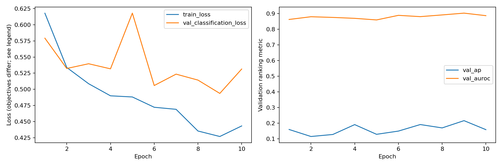

Baseline checkpoint selection uses validation AP rather than the last epoch or lowest loss; epoch 9 was selected.

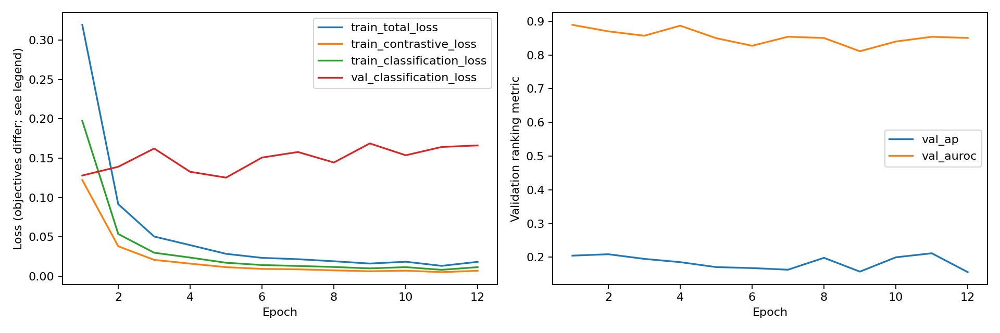

Siamese training loss falls while validation AP fluctuates. Its validation classification loss is not the same objective as its total paired training loss: the latter also includes contrastive loss. Cross-model loss magnitudes are not directly comparable because baseline classification loss uses positive-class weighting.

#### Confusion matrices

| Baseline | Siamese auxiliary classifier |
|---|---|
| 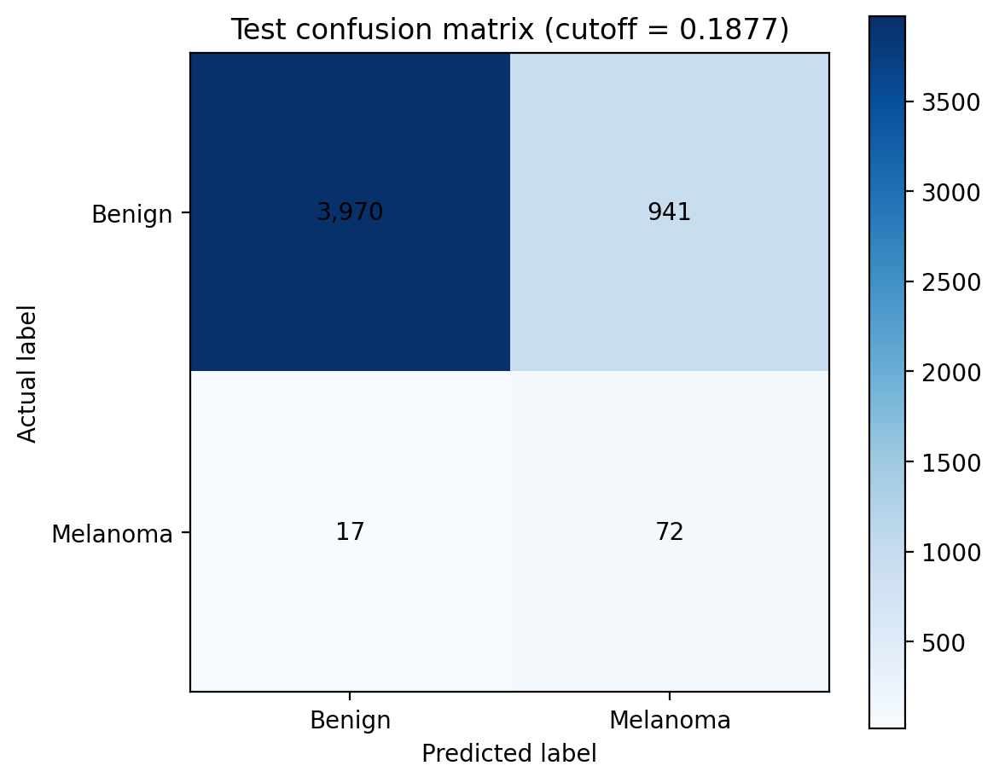 |  |

The baseline detects 72 melanomas versus 65 for Siamese, with seven additional false positives. Identical accuracy masks this difference.

#### Precision-recall curves

| Baseline | Siamese auxiliary classifier |
|---|---|
| 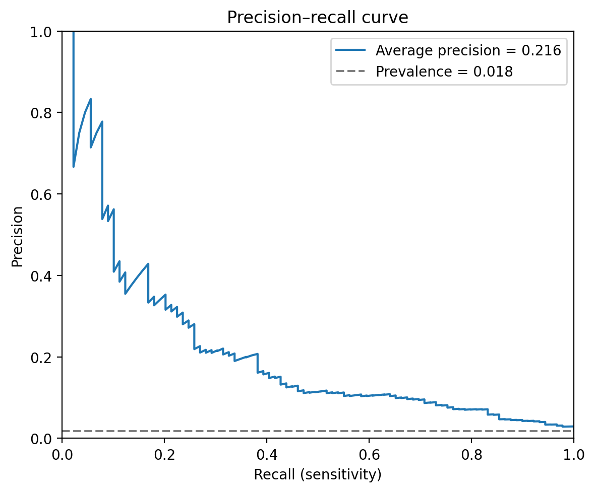 | 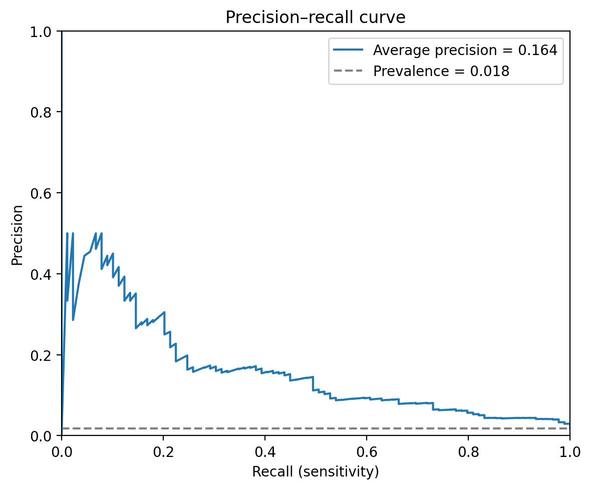 |

Baseline AP is 0.2163 versus 0.1641 for Siamese. Both operate on the same 1.78% test melanoma prevalence.

#### ROC curves

| Baseline | Siamese auxiliary classifier |
|---|---|
| 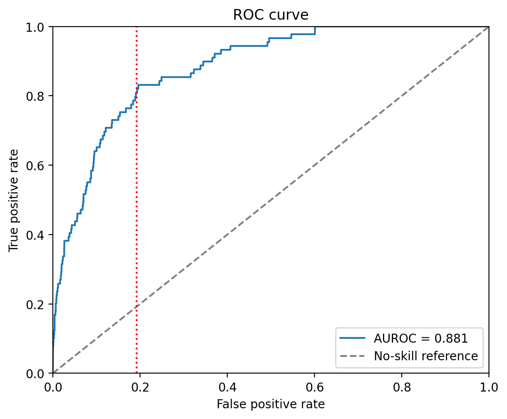 | 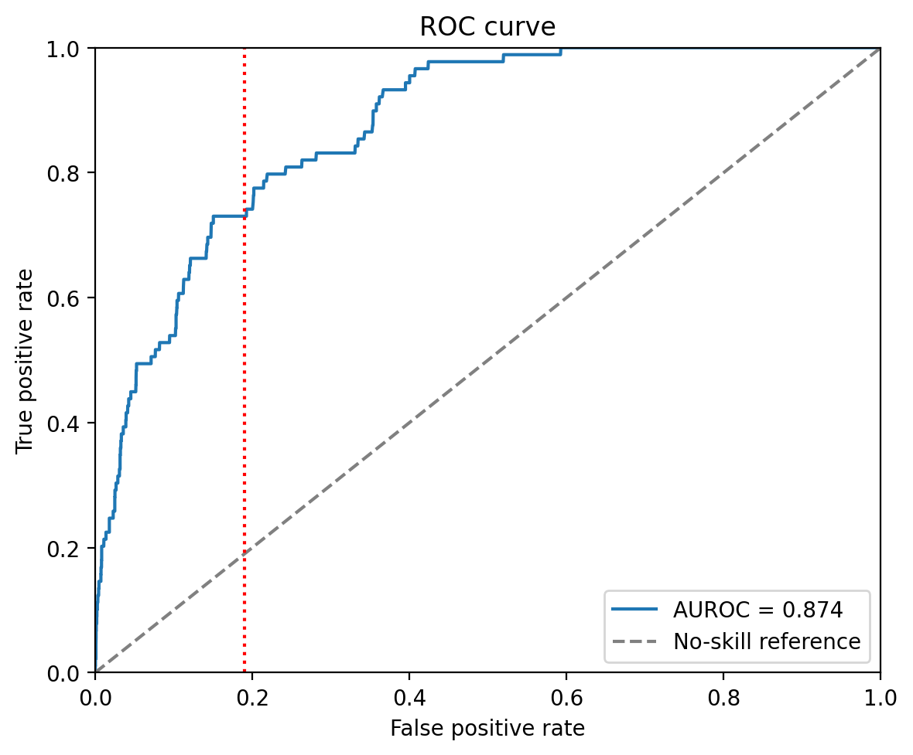 |

Baseline AUROC is 0.8810 versus 0.8737 for Siamese; this small difference has not been tested for statistical significance.

#### Reliability diagrams

| Baseline | Siamese auxiliary classifier |
|---|---|
| 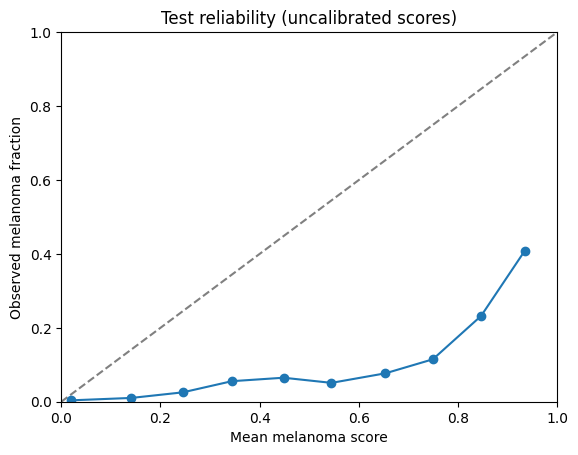 | 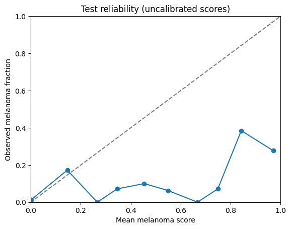 |

These diagrams compare mean melanoma score with observed frequency in ten bins. Interpret alongside bin counts and class imbalance, not as proof of clinical calibration.

#### Confidence and correctness

| Baseline | Siamese auxiliary classifier |
|---|---|
| 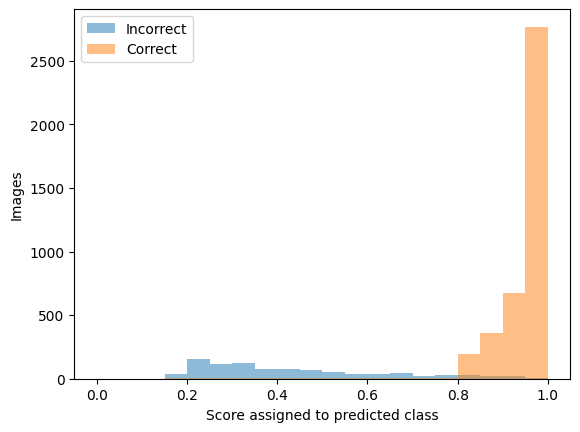 | 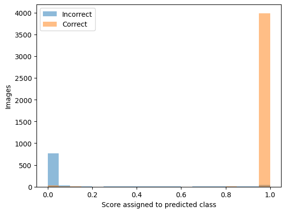 |

These plots show counts of correct and incorrect predictions by the score assigned to the predicted class. Unequal group sizes affect bar heights; the distributions do not establish a safe individual-case confidence cutoff.

#### Prototype scoring figures

These use the same trained Siamese checkpoint but a separately validation-selected distance-score threshold.


Prototype scoring detects 54 melanomas and misses 35, despite reducing false positives to 639.

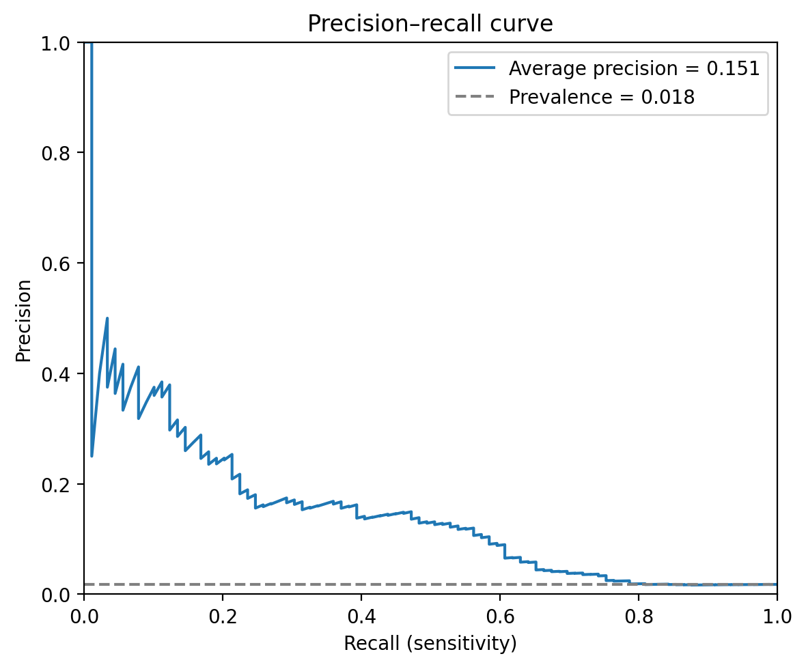

Prototype AP is 0.1506, below both classifier heads.

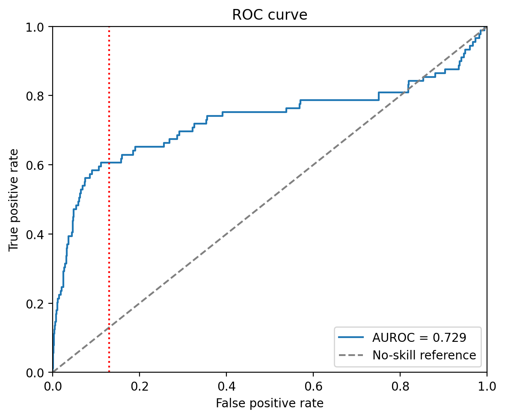

Prototype AUROC is 0.7286; the extra inference analysis does not demonstrate a ranking advantage.

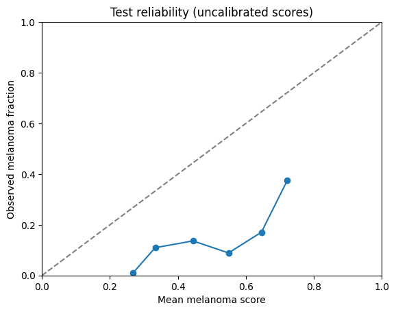

The sigmoid of the distance margin is a bounded score, not a fitted probability model. Prototype ECE is 0.2613.

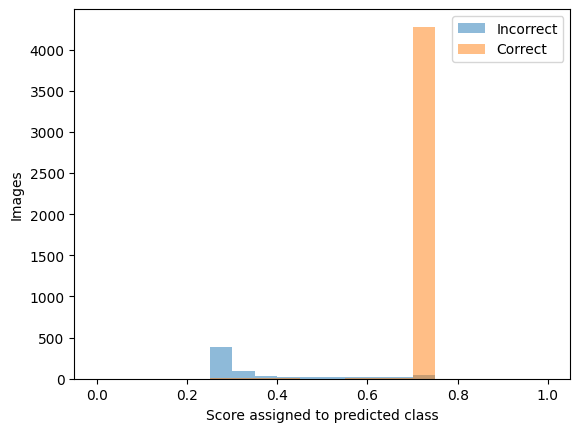

Read score distributions together with the classification threshold and errors; score magnitude alone is not a correctness guarantee.

## 8 Confidence, referral and resources

### 8.1 Confidence and referral policy

**Referral rate below means uncertainty-band referral only.** In the intended human-review workflow, positive predictions outside the band also require specialist assessment. Total specialist workload is the union of band referrals and positive predictions; it is not the approximately 20% shown here and has not been tabulated in this report. "Automatic coverage" means outside the uncertainty band, not cases that can safely bypass clinical review.

The referral band uses the validation 20th percentile of absolute distance from each operating threshold. Scores inside the band are referred; ties and test distribution differences mean test referral rates need not equal 20%. This is a workload-based experimental rule, not a sensitivity guarantee. It is applied unchanged to test data.

| Metric | Baseline | Siamese head | Prototypes |
|---|---:|---:|---:|
| Referral band [lower, upper) | [0.087400, 0.288056) | [0.000006490, 0.000225349) | [0.268974, 0.273112) |
| Test referral rate | 19.80% | 20.24% | 17.14% |
| Automatic coverage | 80.20% | 79.76% | 82.86% |
| Accuracy outside referral | 0.8339 | 0.7981 | 0.8759 |
| Referred melanomas | 15 | 17 | 8 |
| Melanoma misses outside referral | 11 | 7 | 29 |
| Brier score | 0.0504 | 0.0248 | 0.0853 |
| ECE (10 equal-width bins) | 0.1004 | 0.0256 | 0.2613 |

Siamese leaves fewer missed melanomas outside referral despite worse classifier recall. Referral is a separate decision policy; these figures do not assume specialists correctly diagnose every referred image. Brier score and ECE favour the auxiliary head among these methods, but strong class imbalance can hide poor minority-class calibration. For context, always assigning zero melanoma probability gives a Brier score of 89/5000 = 0.0178, lower than all three methods despite detecting no melanomas. The confidence plots use the score assigned to the thresholded predicted class, not necessarily `max(p, 1-p)`. Calibration and aggregate confidence summaries do not establish reliable decisions for individual patients.

**Answer to the confidence dilemma:** The available results do not establish that high model confidence reliably identifies correct decisions. Lower aggregate ECE for Siamese does not demonstrate calibrated melanoma risk, and the uncertainty rule still leaves 7 missed melanomas outside referral for Siamese and 11 for the baseline. Confidence plots and reliability diagrams provide diagnostics, but no repeated-seed analysis, minority-class calibration study or out-of-distribution evaluation was performed. The bands above are therefore experimental operating rules, not validated safe automation thresholds.

### 8.2 Resource profiling

| Measurement | Baseline | Siamese auxiliary head |
|---|---:|---:|
| Total/trainable parameters | 11,177,025 | 11,242,689 |
| Mean inference latency, ms/image | 3.264 | 3.325 |
| Median inference latency, ms/image | 3.253 | 3.327 |
| Peak inference allocated GPU memory, MiB | 61.599 | 61.849 |
| Maximum logged epoch allocated GPU memory, MiB | 865.951 | 1726.481 |
| Approximate training + validation time/epoch after caching | 26-28 seconds | 52-53 seconds |

Measurements were transcribed from the two script-generated resource profiles and training logs for the run in Section 6.1. Inference measurements use A100, batch one, 224-pixel inputs, FP16 autocast, five warm-up passes and twenty timed synchronized passes. They exclude JPEG decoding, preprocessing and transfers. Allocated GPU memory is not total device memory or reserved memory. The Siamese parameter total includes its projector, although the profiled classifier path does not use that projector. Prototype construction/scoring has not been separately profiled.

Epoch timing excludes cache construction, checkpoint I/O and plotting. Each trainer constructs its own 3.94 GiB host-RAM image cache, causing substantial startup time. These epoch timings must not be presented as end-to-end training times or as an isolated A100-versus-L4 speedup: caching and the runtime changed together.

### 8.3 Comparison with the original experiment

| Metric | Historical baseline | Rerun baseline | Historical Siamese | Rerun Siamese head |
|---|---:|---:|---:|---:|
| Accuracy | 0.7856 | 0.8084 | 0.7950 | 0.8084 |
| Melanoma recall | 0.8202 | 0.8090 | 0.7079 | 0.7303 |
| AUROC | 0.8836 | 0.8810 | 0.8195 | 0.8737 |
| AP | 0.1722 | 0.2163 | 0.1842 | 0.1641 |

Historical values are retained from the original notebook report. The rerun supersedes those measurements for assessing the repaired implementation. Siamese AUROC and recall improved, but its AP decreased; the repair does not improve every metric. Different pair sampling and environments prevent a controlled causal interpretation. No statistical uncertainty intervals or repeated-seed experiment were computed.

### 8.4 Selected failure cases and visual autopsy

The following five cases were selected by matching image IDs in the completed rerun's two `failure_cases.csv` files. Each file contains 958 errors, consistent with the reported confusion counts. The selection covers errors unique to each classifier, a shared false positive and two shared false negatives. These are illustrative cases, not a representative sample of all errors.

Scores are the recorded sigmoid outputs, interpreted against the validation-selected thresholds: **0.187727604 for ResNet-18** and **0.000115919 for Siamese**. They are not assumed to be calibrated probabilities. Referral below means membership in the experimental uncertainty band; positive predictions outside that band still require review in the proposed workflow.

| Case / image filename | Ground truth | Siamese auxiliary classifier | ResNet-18 baseline | Uncertainty-band outcome |
|---|---|---|---|---|
| `ISIC_1412843.jpg` | Melanoma | False negative; score 0.000000181 | Correct melanoma prediction* | Siamese does not refer; baseline band status unavailable here. |
| `ISIC_0207268.jpg` | Melanoma | Correct melanoma prediction* | False negative; score 0.029648 | Baseline does not refer; Siamese band status unavailable here. |
| `ISIC_6352565.jpg` | Melanoma | False negative; score 0.000007889 | False negative; score 0.005200 | Siamese refers; baseline does not. |
| `ISIC_0076545.jpg` | Benign | False positive; score 0.966976 | False positive; score 0.490800 | Neither falls inside its uncertainty band; both produce positive predictions. |
| `ISIC_6251753.jpg` | Melanoma | False negative; score 0.000003815 | False negative; score 0.186391 | Baseline refers; Siamese does not. |

*Correct classification is inferred from absence in the other model's complete failure list. Its exact score and referral status must be obtained from that model's full test-prediction CSV before completing the case panel. Failure files alone do not contain successful predictions.*

The fifth case complements `ISIC_6352565`: both classifiers miss the melanoma, but the baseline's uncertainty band catches `ISIC_6251753`, whereas the Siamese band catches `ISIC_6352565`. This illustrates that a wrong classification and failure to flag uncertainty are separate outcomes. It does not establish that either referral policy is safe overall.

**Selected report illustrations:** the five JPEGs below are included in `images/` under their original filenames. These selected cases support the report; the full image dataset remains outside the repository. The observations below come from visual inspection of these images. Possible explanations are hypotheses, not established causes of the model outputs.

| Image | Visible observations | Possible source of confusion |
|---|---|---|
| 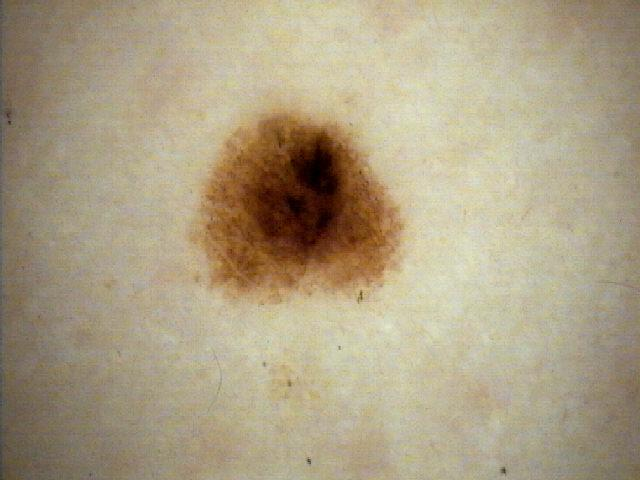 | A compact, roughly rounded brown lesion with a markedly darker patch toward the upper centre. Fine texture and the outer boundary appear soft. There is no prominent ruler or heavy hair occlusion. | Siamese may give greater weight to the overall compact shape and brown appearance than to uneven internal pigmentation. Limited fine detail could make that distinction harder. ResNet detects this case, but the disagreement alone does not identify which features either model used. |
| 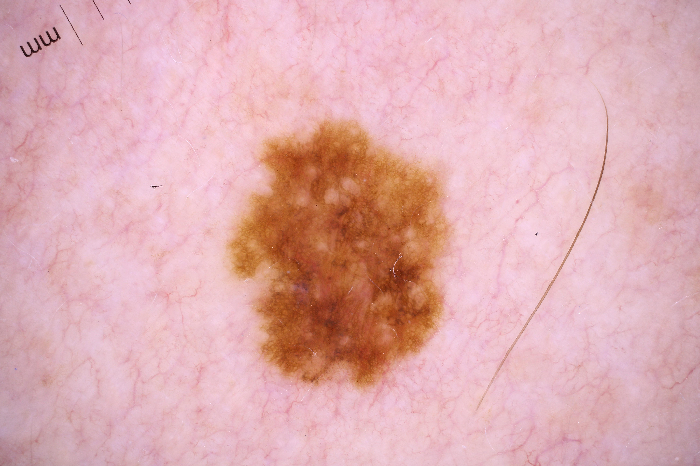 | An elongated lesion with an uneven outline, patchy brown pigmentation and lighter internal gaps. Ruler markings appear at the upper left; a long hair lies mainly beside the lesion rather than substantially obscuring it. | Resizing the full image to 224 x 224 may suppress fine pigment patterns, leaving the baseline more dependent on broad colour and shape. Ruler markings are a possible distracting cue, although their influence has not been tested. Siamese correctly classifies this case. |
| 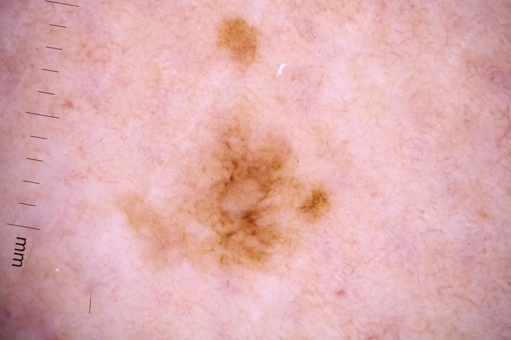 | Faint, irregular pigmentation blends into surrounding pink skin. Several separate pigmented areas are visible, with ruler marks along the left edge. | Low contrast and indistinct boundaries can make lesion localisation ambiguous. Whole-image resizing may weaken subtle structures further. Both models miss the melanoma; the Siamese uncertainty band nevertheless flags it for review, while the baseline band does not. |
| 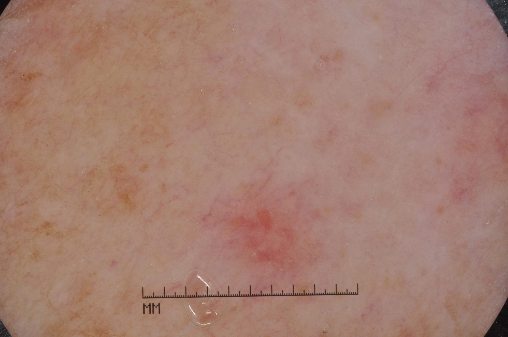 | A diffuse pink-red area with little dark pigmentation, numerous bubble-like circles and reflections, a prominent ruler and dark image corners. | Both models may respond to redness or acquisition artefacts rather than lesion-specific structure. The poorly defined target region makes background reliance a plausible explanation for the shared false positive, but the image alone cannot identify the responsible cue. |
| 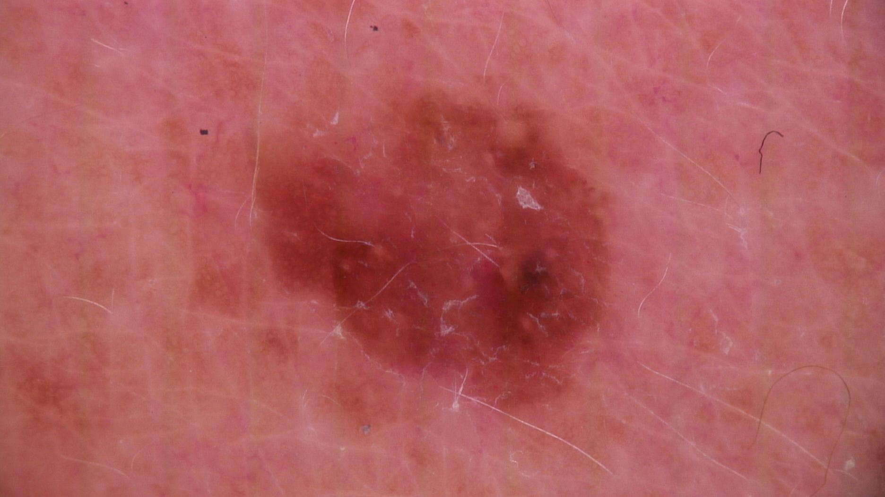 | A predominantly red lesion against a pink-red background, with darker focal patches, pale surface lines or flakes and fine hairs crossing it. | Limited lesion-background colour separation and surface detail may make this case difficult. The models may also underrepresent this appearance relative to brown-pigmented training examples; that hypothesis requires a training-cohort analysis. ResNet's score of 0.186391 is just below its 0.187728 threshold, so its false negative is a borderline decision and is caught by its uncertainty band. Siamese misses the case outside its band. |

These cases suggest possible sensitivity to low contrast, loss of fine structure during resizing, variation in pigmentation and imaging artefacts. They do not establish causal mechanisms: no controlled masking, crop comparison or other perturbation experiment was performed. Inspection here used the original JPEGs; comparison with the exact 224 x 224 model inputs would be needed to assess which details survive preprocessing. Neither error labels nor confidence scores prove which visual features drove a prediction.

**Ruler artefacts:** Rulers are visible in `ISIC_0207268`, `ISIC_6352565` and `ISIC_0076545`, but their association with errors and influence on predictions have not been established. Outcomes differ: Siamese correctly classifies `ISIC_0207268`, while both models fail on the other two images. Errors also occur in the selected images without prominent rulers. Because these five cases were selected for prediction failures, they cannot estimate whether ruler-containing images fail more often overall. Testing that association would require a representative sample of correct and incorrect predictions, annotated for ruler presence, with melanoma recall and benign false-positive rates compared separately. A further sensitivity experiment could compare predictions before and after ruler masking, using fixed checkpoints and thresholds and similarly sized background masks as controls; masking itself can introduce artefacts, so score changes would not alone prove a causal explanation.

**Background colour and illumination:** Variation in background colour and illumination may contribute to errors, but this has not been established by these cases. Natural skin-tone variation should be distinguished from differences in lighting or image acquisition. The current ImageNet channel normalisation does not standardise skin tone or correct illumination. Aggressive colour filtering could remove useful lesion-skin contrast or alter red and lightly pigmented appearances. Future work should compare conservative illumination correction or mild brightness/contrast augmentation against the current preprocessing, using training/validation data to choose settings. Any correction should be applied consistently during training and evaluation, with melanoma recall, AP and performance across skin-tone groups assessed where reliable annotations are available. These are proposed experiments, not changes used in the reported run, and should not be selected to improve the five already-inspected test cases.

Classification errors and uncertainty detection should be considered separately. Siamese flags `ISIC_6352565` despite misclassifying it, while ResNet flags `ISIC_6251753` despite its false-negative decision. Conversely, Siamese misses `ISIC_1412843` outside its uncertainty band. These examples support evaluating referral outcomes alongside aggregate recognition metrics, without treating a few selected cases as evidence of overall safety. Historical panels below retain their original scores and are separate from this rerun evidence.

## 9 Conclusion

The repaired scripts now produce a complete real-data training and evaluation run on the frozen patient-level splits. The baseline detects 72 of 89 test melanomas, compared with 65 for the Siamese auxiliary head and 54 for prototype scoring. It also achieves the highest AP and AUROC. The equal classifier accuracy of 80.84% hides different false-negative and false-positive trade-offs; the added Siamese complexity did not demonstrate an overall recognition advantage in this run.

For further research, the baseline is the stronger primary comparator. The Siamese referral policy leaves fewer missed melanomas outside referral at similar uncertainty-band referral rates, which merits separate investigation; total specialist workload has not been compared. Prototype scoring improves specificity but sacrifices sensitivity and ranking performance, so it is not preferred for this screening objective. Neither approach supports autonomous diagnosis or ruling out melanoma. External validation, minority-class calibration, subgroup evaluation and controlled testing of the proposed failure triggers remain necessary. Any subsequent tuning should use patient-grouped training/validation data rather than optimise against the already-inspected test results.

**Recommendation to the project manager:** Continue controlled research with ResNet-18 as the primary benchmark; the added Siamese training cost has not produced a recognition advantage in this run. Retain Siamese uncertainty-based referral as a separate hypothesis to test. For a prospective human-reviewed pilot, evaluate the stated validation-selected bands together with referral of all positive predictions, and measure the resulting total specialist workload and missed-melanoma burden. Do not approve automatic clearance of negative cases from these results. Test the failure hypotheses identified in the visual autopsies, assess calibration on patient-separated validation data and obtain independent evaluation before considering a deployment decision.

### 9.1 AI Disclosure Statement

ChatGPT was used to clarify model and evaluation concepts, assist with debugging and drafting evaluation code, and help prepare report documentation. The Colab notebooks were run to produce the reported training and test outputs, and the results were checked against the saved notebook outputs and report tables. Codex was used to help repair the python files with to match that of the original python notebooks.  I reviewed the changes, interpreted the results and verified the submitted implementation against the experiments.

## 10 References

Australian Institute of Health and Welfare. (2026). *Melanoma of the skin in Australia*. Cancer data in Australia. Updated 14 July 2026. [Melanoma of the skin in Australia](https://www.aihw.gov.au/reports/cancer/cancer-data-in-australia/contents/cancer-data-commentaries/melanoma-of-the-skin-in-australia). Accessed 30 October 2026.

Cancer Council Australia. (n.d.-a). *UV radiation: Early detection of skin cancer*. [Early detection of skin cancer position statement](https://www.cancer.org.au/about-us/policy-and-advocacy/prevention/uv-radiation/related-resources/early-detection-of-skin-cancer). Accessed 30 October 2026.

Cancer Council Australia. (n.d.-b). *Detection and screening*. [Detection and screening](https://www.cancer.org.au/about-us/policy-and-advocacy/prevention/uv-radiation/related-resources/detection-and-screening). Accessed 30 October 2026.

## 11 Historical training appendix (superseded)

### 11.1 Appendix 1: Full Baseline Training Data

**All epochs (validation): losses, overall metrics and runtime**

| epoch | train_loss | val_loss | pr_auc_ap | roc_auc | accuracy | macro_f1 | minutes |
|-------|------------|----------|-----------|---------|----------|----------|---------|
| 1     | 0.6188     | 0.6003   | 0.0941    | 0.8547  | 0.8593   | 0.5279   | 35.1250 |
| 2     | 0.5550     | 0.6076   | 0.1343    | 0.8282  | 0.9392   | 0.5676   | 35.7283 |
| 3     | 0.5327     | 0.5931   | 0.1079    | 0.8542  | 0.8032   | 0.5028   | 35.5817 |
| 4     | 0.5240     | 0.5478   | 0.1350    | 0.8675  | 0.9218   | 0.5740   | 33.5383 |
| 5     | 0.4945     | 0.5634   | 0.1408    | 0.8705  | 0.9129   | 0.5729   | 35.1983 |
| 6     | 0.4849     | 0.5122   | 0.2057    | 0.8856  | 0.8902   | 0.5637   | 33.3917 |
| 7     | 0.4585     | 0.5650   | 0.0894    | 0.8644  | 0.9048   | 0.5506   | 35.7833 |
| 8     | 0.4490     | 0.4932   | 0.1475    | 0.8962  | 0.8748   | 0.5519   | 35.2017 |
| 9     | 0.4469     | 0.5065   | 0.2228    | 0.8885  | 0.8473   | 0.5316   | 35.4400 |
| 10    | 0.4258     | 0.5852   | 0.1793    | 0.8673  | 0.9200   | 0.5816   | 35.3200 |

**All epochs (validation): melanoma metrics and case counts**

| epoch | melanoma_precision | melanoma_recall | melanoma_f1 | specificity | tp  | fp  | fn  | tn   | referrals |
|-------|--------------------|-----------------|-------------|-------------|-----|-----|-----|------|-----------|
| 1     | 0.0748             | 0.5761          | 0.1323      | 0.8646      | 53  | 656 | 39  | 4190 | 709       |
| 2     | 0.1119             | 0.3261          | 0.1667      | 0.9509      | 30  | 238 | 62  | 4608 | 268       |
| 3     | 0.0635             | 0.6957          | 0.1164      | 0.8052      | 64  | 944 | 28  | 3902 | 1008      |
| 4     | 0.1172             | 0.4891          | 0.1891      | 0.9300      | 45  | 339 | 47  | 4507 | 384       |
| 5     | 0.1159             | 0.5543          | 0.1917      | 0.9197      | 51  | 389 | 41  | 4457 | 440       |
| 6     | 0.1080             | 0.6739          | 0.1862      | 0.8943      | 62  | 512 | 30  | 4334 | 574       |
| 7     | 0.0909             | 0.4565          | 0.1516      | 0.9133      | 42  | 420 | 50  | 4426 | 462       |
| 8     | 0.0979             | 0.6957          | 0.1716      | 0.8783      | 64  | 590 | 28  | 4256 | 654       |
| 9     | 0.0821             | 0.7065          | 0.1471      | 0.8500      | 65  | 727 | 27  | 4119 | 792       |
| 10    | 0.1259             | 0.5543          | 0.2052      | 0.9270      | 51  | 354 | 41  | 4492 | 405       |

### 11.2 Appendix 2: Compute Time for Baseline Epochs

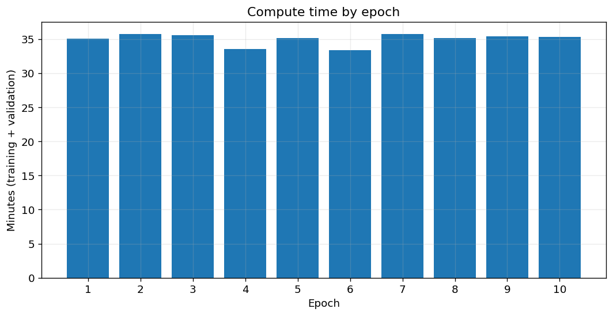


## 12 Historical notebook experiment (superseded)

The following original text, tables and figures are retained for provenance. Their conclusions apply only to the historical checkpoints. Sections 6-9 above are the current results.

<details>
<summary>Original notebook results and failure cases</summary>

### Historical baseline experiment

### Historical: Baseline Model

I used a standard ResNet-18 CNN as the baseline so I had a clear point of comparison for the Siamese model. The task was the same binary classification problem: deciding whether a dermoscopic image is melanoma or benign, using the ISIC 2020 dataset. This setup lets me judge whether the metric-learning approach adds anything over a more conventional supervised model.

The baseline uses **ResNet-18**, a residual CNN that performs well on image data and is easy to adapt with transfer learning. I initialised it with ImageNet-pretrained weights and replaced the final classification layer with a binary output for melanoma likelihood. That lets the model reuse useful visual features instead of learning everything from scratch.

To keep the comparison fair, both models were trained on the same patient-separated training, validation and test splits. The baseline saw 23,188 images, including 403 melanoma cases, which is only 1.738% of the training data. Keeping patient images together reduces the risk of leakage and gives a more realistic estimate of how the model generalises.

The class imbalance is substantial, so I used weighted binary cross-entropy with a positive-class weight of 20 to increase the penalty for missing melanoma cases. This is a practical choice for a dataset where melanoma makes up only about 1.7% of the training set, and it encourages the model to focus more on the rare positive class rather than being dominated by benign examples.

I trained the baseline for 10 epochs on an NVIDIA L4 GPU in Google Colab. Images were resized to 224 × 224 pixels, and validation performance was checked after each epoch. I tracked accuracy, but the main ranking metrics were **average precision (AP)**, AUROC, melanoma precision, recall and F1-score. Those are more informative than raw accuracy in a highly imbalanced problem, especially when the goal is to catch rare malignant cases without creating too many false alarms.

The checkpoint with the highest validation average precision was kept for evaluation. That made the model-selection step depend on performance on unseen validation patients rather than just the training loss. The result is a solid baseline for judging whether the Siamese model provides a meaningful gain over a conventional supervised classifier.

### Historical: Baseline Training

10 epochs were run of the ResNET-18 and the following plots were generated for analysis between the epochs. See Appendix 1 for full baseline testing data and parameters.

#### Historical: Training and Validation Loss

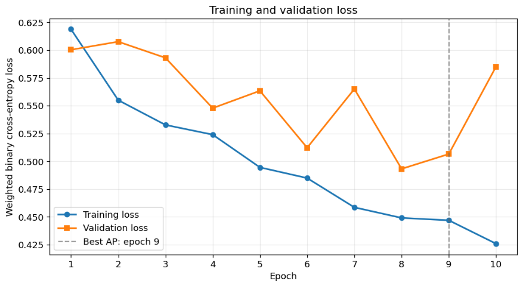

Figure 2 shows that training loss decreased throughout the ten epochs, from 0.6188 to 0.4258. Validation loss generally improved during training but fluctuated between epochs: it reached its lowest value at epoch 8, then increased at epoch 10 even as training loss continued to fall. This late divergence suggests that further fitting to the training data did not consistently improve performance on the validation data. However, the best checkpoint was selected using validation average precision rather than loss.

Figure 2: Training and validation loss for ResNet-18.

#### Historical: Average Precision and AUROC

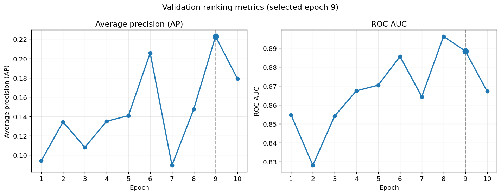

*Figure 3: Average precision and AUROC of ResNet-18 model*

The ranking metrics in Figure 3 show why average precision (AP) was used for checkpoint selection. Validation AP varied substantially, reaching its maximum of 0.2228 at epoch 9 before falling to 0.1793 at epoch 10. AUROC was less variable and reached its maximum of 0.8962 at epoch 8. The two metrics therefore favour different checkpoints: epoch 8 ranked cases well overall by AUROC, while epoch 9 performed best according to AP, which is more informative for identifying the rare melanoma class in this imbalanced dataset.

#### Historical: Melanoma Precision, Recall and F1

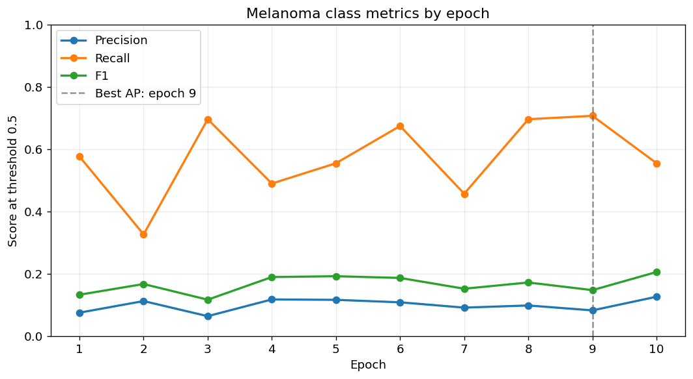

*Figure 4: Melanoma precision, recall and F1 with ResNet-18*

Figure 4 shows that melanoma precision, recall and F1-score also changed considerably across epochs when predictions were made at a threshold of 0.5. Recall ranged from 32.61% to 70.65%, while precision remained low, between 6.35% and 12.59%. At epoch 9, the selected checkpoint had the highest AP and the highest recall, 70.65%, but precision was only 8.21%. The F1-score peaked at epoch 10, at 0.2052, illustrating that the epoch selected by AP does not optimise every class-level measure.

#### Historical: Accuracy and Macro F1

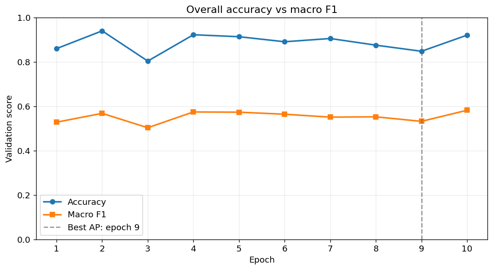

*Figure 5: Accuracy and macro-F1 for ResNet-18*

Figure 5 compares overall accuracy with macro-F1. Accuracy was high in some epochs, reaching 93.92% at epoch 2, but this did not indicate strong melanoma detection: at that epoch, melanoma recall was only 32.61%. Because benign images make up most of the validation set, accuracy is strongly influenced by performance on the benign class. Macro-F1 gives a more balanced view of performance across the two classes; it remained much lower than accuracy, ranging from 0.5028 to 0.5816.

#### Historical: Confusion Matrix Count and Referral Trade-off

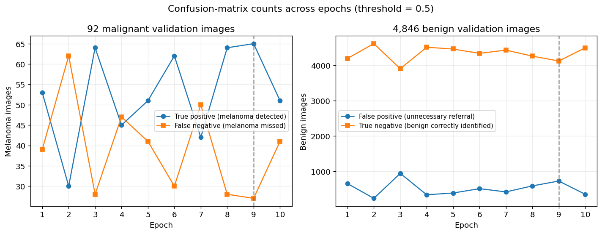

*Figure 6: Confusion matrix counts across epochs*

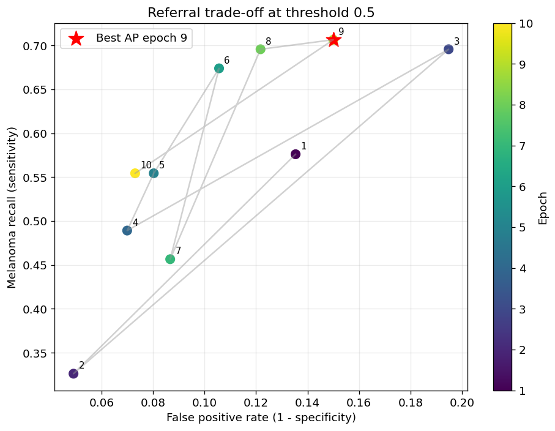

*Figure 7: Melanoma recall vs false-positive rate*

The confusion-count plot in Figure 6 shows how these metrics translate into validation cases. At the selected epoch 9, the model detected 65 of 92 melanomas but missed 27, while also incorrectly flagging 727 benign images. The referral trade-off plot in Figure 7 makes this balance clearer: at the fixed 0.5 threshold, epochs with higher melanoma sensitivity generally also produced more false positives. Overall, the plots show that the baseline learned to distinguish some melanoma cases, but its validation performance was sensitive to the training epoch and operating threshold. Epoch 9 was selected because it achieved the highest validation AP, not because it was best on every metric.

| Field                        | Value              |
|------------------------------|--------------------|
| Row index                    | 0                  |
| model                        | ResNet-18 baseline |
| device                       | NVIDIA L4          |
| test_images                  | 5000               |
| parameters_total             | 11177025           |
| parameters_trainable         | 11177025           |
| parameter_and_buffer_size_MB | 42.6737            |
| peak_GPU_allocated_GB        | 0.3188             |
| peak_GPU_reserved_GB         | 0.4609             |
| model_forward_seconds        | 0.8872             |
| model_forward_ms_per_image   | 0.1774             |
| end_to_end_seconds           | 339.1825           |
| end_to_end_ms_per_image      | 67.8365            |

*Table 5: Hardware performance of ResNet-18 on validation*

### Historical Siamese experiment

### Historical: Experimentation

An earlier contrastive-only Siamese model was evaluated using a prototype-based classifier. A subsequent validation-only experiment tested a class-aware k-nearest-neighbour rule on the frozen epoch-9 embeddings. Its best configuration produced an AP of 0.18357 and an AUROC of 0.76506, compared with 0.18345 and 0.76497 for the prototype method. The small differences did not indicate a meaningful validation improvement, and the k-NN configuration was not evaluated on the test set. These exploratory results were therefore excluded from the final comparison, which uses the later Siamese model with an auxiliary classification head.

### Historical: Model Setup

The Siamese network was implemented in PyTorch, with ResNet-18 as the shared feature extractor. I initialised it with ImageNet-pretrained weights, matching the baseline setup so it could reuse useful visual features. I replaced the original ResNet-18 classification layer with a projection head that produced 128-dimensional embeddings for similarity learning.

The model processes both images in a pair through the same ResNet-18 backbone. The features then split into two branches: a linear projection that produces 128-dimensional, L2-normalised embeddings for contrastive learning, and an auxiliary linear classifier that predicts the lesion class for each image. That gives the network both a pairwise similarity signal and a direct melanoma/non-melanoma prediction signal.

Each epoch generated 24,000 pairs. I balanced the pair types across benign–benign, melanoma–melanoma, benign–melanoma and melanoma–benign combinations, while excluding any pairs from the same patient. In the notebook sampling check, melanoma images accounted for 50.47% of sampled appearances. With 403 melanoma images in the training split, this works out to roughly 60 sampled appearances per melanoma image per epoch on average. This increased exposure to the available melanoma examples without adding new independent melanoma cases.

The batch size was 64 pairs, or 128 image appearances per batch, which gave 375 optimiser steps per epoch. I trained the model for 12 epochs using AdamW with a learning rate of $1 \times 10^{-4}$ and weight decay of $1 \times 10^{-4}$. The total loss combined contrastive loss and binary cross-entropy classification loss with equal weighting, and the contrastive margin was 1.0. Training images were randomly flipped horizontally and vertically, rotated by up to 15 degrees, and normalised using ImageNet channel statistics.

For validation, I used the auxiliary classifier head to score each image. Average precision and AUROC were computed from the continuous logits, and the checkpoint with the highest validation AP was saved. That was epoch 5, with a validation AP of 0.1979. I then selected the operating threshold separately on the validation data.

### Historical: Model Training

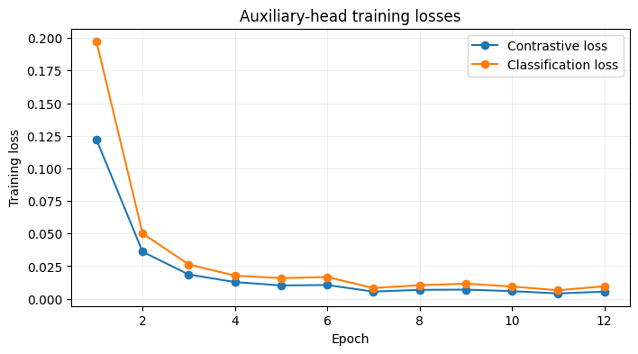

*Figure 8: Auxiliary-head training losses for Siamese model*

The contrastive and classification losses both decreased substantially during training. Total training loss fell from 0.3198 in epoch 1 to 0.0150 in epoch 12, although it reached its lowest value, 0.0106, in epoch 11. This indicates that the model increasingly fitted its training objective, but the validation metrics did not improve steadily. Validation AP reached its highest value of 0.1979 in epoch 5, fell to 0.1278 in epoch 9, and recovered to 0.1904 by epoch 12. AUROC followed a different pattern: it was highest in epoch 1 at 0.8833, fell to 0.7786 in epoch 3, and was 0.8391 in the AP-selected epoch 5. The model was therefore selected by AP rather than AUROC because AP was the chosen checkpoint metric for this imbalanced dataset. The divergence between steadily decreasing training loss and fluctuating validation metrics indicates unstable generalisation and may reflect overfitting, although these curves alone cannot establish its cause. Epoch 5 was retained because it achieved the highest validation AP.

#### Historical: Epoch Data

|     | epoch | train_total_loss | train_contrastive_loss | train_classification_loss | val_ap   | val_auroc | seconds   | peak_gpu_memory_gb |
|-----|-------|------------------|------------------------|---------------------------|----------|-----------|-----------|--------------------|
| 0   | 1     | 0.319752         | 0.122221               | 0.197530                  | 0.174303 | 0.883322  | 24.515279 | 1.815506           |
| 1   | 2     | 0.086187         | 0.036071               | 0.050116                  | 0.179962 | 0.869467  | 23.774871 | 1.797044           |
| 2   | 3     | 0.044831         | 0.018570               | 0.026261                  | 0.161120 | 0.778569  | 23.881832 | 1.797044           |
| 3   | 4     | 0.030574         | 0.012798               | 0.017776                  | 0.172259 | 0.868698  | 23.744870 | 1.797044           |
| 4   | 5     | 0.026037         | 0.010219               | 0.015818                  | 0.197880 | 0.839086  | 23.969150 | 1.797044           |
| 5   | 6     | 0.027177         | 0.010511               | 0.016666                  | 0.163683 | 0.843686  | 23.715839 | 1.797044           |
| 6   | 7     | 0.013704         | 0.005479               | 0.008226                  | 0.168072 | 0.869636  | 23.898763 | 1.797044           |
| 7   | 8     | 0.017224         | 0.006821               | 0.010403                  | 0.160450 | 0.840625  | 23.935144 | 1.797044           |
| 8   | 9     | 0.018582         | 0.007002               | 0.011580                  | 0.127779 | 0.864831  | 24.090767 | 1.797044           |
| 9   | 10    | 0.015198         | 0.005832               | 0.009365                  | 0.176768 | 0.852581  | 23.616481 | 1.797044           |
| 10  | 11    | 0.010607         | 0.004101               | 0.006507                  | 0.160296 | 0.848426  | 23.867814 | 1.797044           |
| 11  | 12    | 0.015027         | 0.005446               | 0.009581                  | 0.190419 | 0.844721  | 24.001358 | 1.797044           |

*Table 6: Metrics for different epochs in the Siamese model*

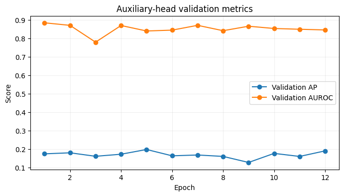

*Figure 9: Auxiliary-head validation metrics*

The validation AP and AUROC vary across epochs rather than improving steadily. AP peaks at 0.1979 in epoch 5, falls to 0.1278 in epoch 9, and recovers to 0.1904 by epoch 12. The peak AP is substantially above the validation melanoma prevalence of 1.86%, indicating that the classifier ranks melanoma cases above benign cases better than a prevalence-level baseline. AUROC follows a different pattern: it is highest in epoch 1 at 0.8833, falls to 0.7786 in epoch 3, and is 0.8391 at the AP-selected epoch 5. Because the checkpoint was selected using AP, epoch 5 was retained even though it did not have the highest AUROC. These metrics use continuous classifier scores, so their values do not depend on the classification threshold. Their fluctuation suggests that validation performance was sensitive to the training epoch.

### Historical test evaluation

### Historical: Baseline Testing vs Siamese Testing

#### Historical: Confusion Matrices

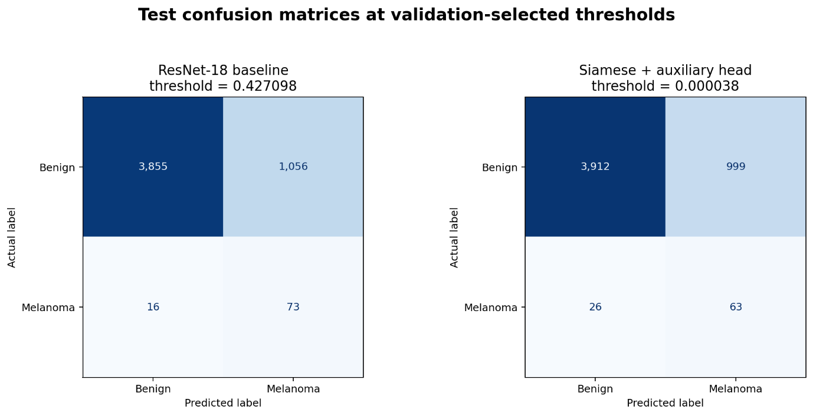

*Figure 10: Confusion matrices for model performance on the test split*

The ResNet baseline correctly identified **73 of 89 melanomas**, missing 16, while producing 1,056 false positives. The Siamese model identified 63 melanomas, missed 26, and produced 999 false positives. Thus, at the selected thresholds, ResNet detected 10 more melanomas but also flagged 57 more benign lesions. Both models generated many false-positive referrals: only about **one in 15–17 flagged cases** was melanoma.

#### Historical: Precision–Recall

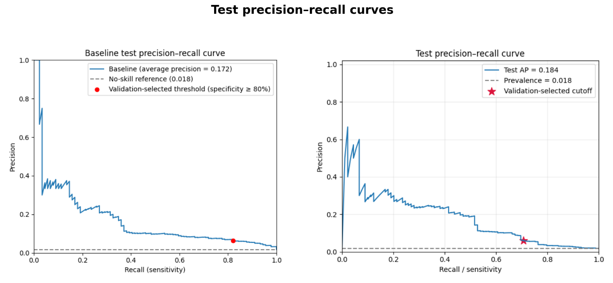

*Figure 11: Precision–recall curves on the test split*

Both curves sit well above the no-skill reference, which is the test-set melanoma prevalence of about **1.78%**. The Siamese model has the higher AP (**0.1842**, compared with **0.1722** for ResNet), indicating a modestly stronger precision–recall summary across thresholds. At the selected operating points, however, ResNet has higher recall (**0.8202 vs 0.7079**) and slightly higher precision (**0.0647 vs 0.0593**). The curves therefore show a trade-off: the Siamese model’s overall AP is higher, but ResNet’s chosen threshold catches more melanomas.

#### Historical: ROC

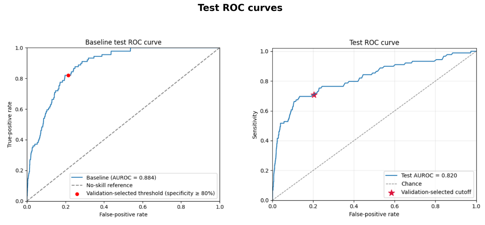

*Figure 12: ROC curves on the test split*

ResNet has the higher AUROC (**0.8836 vs 0.8195**), so it ranks positive cases above negative cases more effectively overall according to this measure. At the selected operating points, ResNet reaches a true-positive rate of 0.8202 with a false-positive rate of 0.2150. Siamese has a slightly lower false-positive rate of 0.2034, but its true-positive rate is also lower at 0.7079. This is consistent with the confusion matrices: Siamese makes fewer false-positive referrals, while ResNet detects more melanoma cases.

#### Historical: Prediction Score Distribution

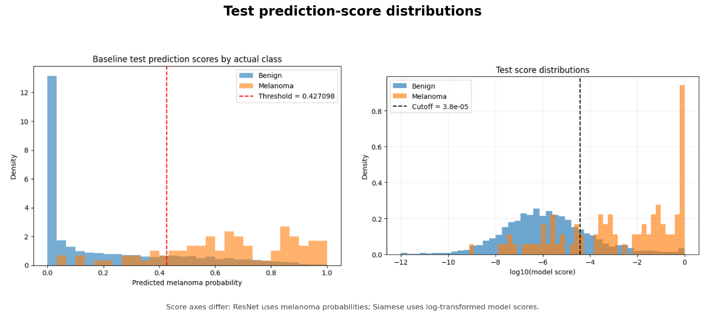

*Figure 13: Prediction score distributions on the test split*

For both models, melanoma scores tend to be higher than benign scores, but the distributions overlap. That overlap helps explain why both models produce many false positives while still missing melanomas. Read these plots qualitatively: the ResNet scores are probabilities, while the Siamese scores are log-transformed model scores. Their horizontal scales and threshold values are different, so the score magnitudes should not be compared directly.

#### Historical: Overall Comparison

Both thresholds below were selected on the validation set using the same rule: **maximise sensitivity while maintaining at least 80% specificity**. Test specificity is below 80% for both models; that is the measured result on the held-out test set.

**Prediction reproducibility:** the commands in Section 5.5 explicitly use `--threshold-policy val_specificity80_max_sensitivity`, matching the report's operating rule. The threshold is selected on validation predictions and applied unchanged to test predictions. Matching the policy alone does not guarantee the same numerical threshold without the original checkpoint, data, preprocessing and precision settings.

| **Metric**                    | **ResNet-18 baseline** | **Siamese + auxiliary head** |
|-------------------------------|------------------------|------------------------------|
| Validation-selected threshold | 0.427098               | 0.000038                     |
| Test AP                       | 0.1722                 | 0.1842                       |
| Test AUROC                    | 0.8836                 | 0.8195                       |
| Specificity                   | 0.7850                 | 0.7966                       |
| TP                            | 73                     | 63                           |
| FP                            | 1,056                  | 999                          |
| FN                            | 16                     | 26                           |
| TN                            | 3,855                  | 3,912                        |

*Table 7: Validation-selected thresholds, test ranking metrics and confusion counts*

| Model                    | Accuracy | Benign precision | Benign recall | Benign F1 |
|--------------------------|----------|------------------|---------------|-----------|
| ResNet-18 baseline       | 0.7856   | 0.9959           | 0.7850        | 0.8779    |
| Siamese + auxiliary head | 0.7950   | 0.9934           | 0.7966        | 0.8842    |

*Table 8: Test accuracy and benign-class performance*

| Model                    | Melanoma precision | Melanoma recall | Melanoma F1 | Macro-F1   |
|--------------------------|--------------------|-----------------|-------------|------------|
| ResNet-18 baseline       | 0.0647             | 0.8202          | 0.1199      | **0.4989** |
| Siamese + auxiliary head | 0.0593             | 0.7079          | 0.1095      | **0.4968** |

*Table 9: Test melanoma-class performance and macro-F1*

Overall, neither model performs best on every measure. ResNet has higher recall and AUROC; Siamese has slightly higher AP and specificity, with fewer false positives. The numerical thresholds themselves are on different score scales and should not be compared as though they were equivalent.

### Historical: Failure Autopsies

To further examine model performance, the failure modes of each model must be identified. The most critical failure in this context is a false negative, where a model identifies a lesion as benign when it is malignant.

The following table contains images that were misclassified by both models as well as an error each that was model unique:

| | |
|---|---|
| 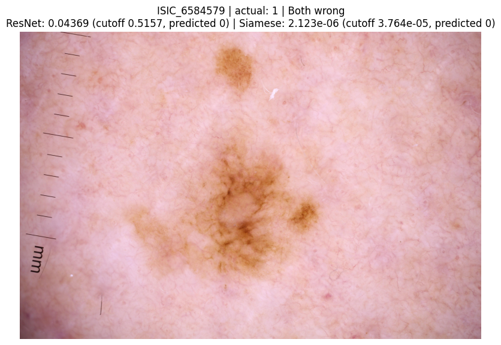 | 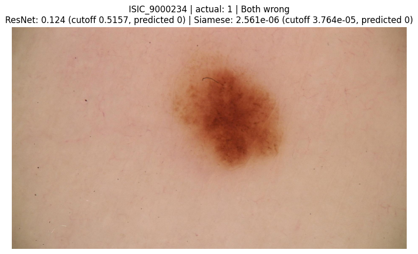 |
| 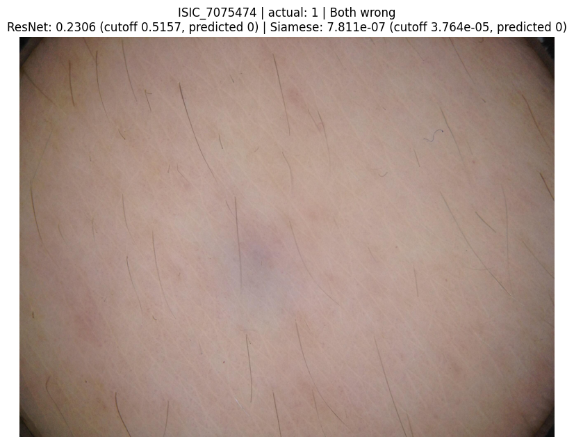 | 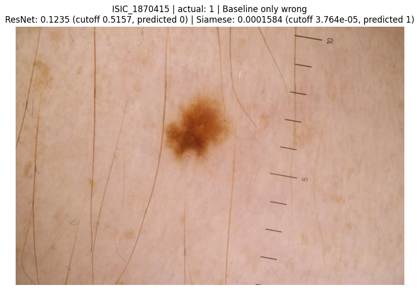 |
| 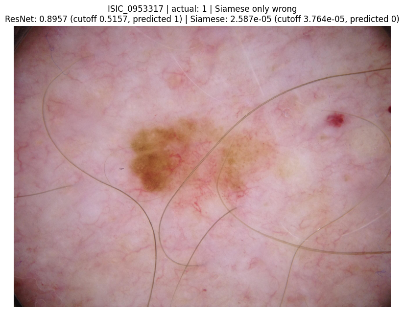 | 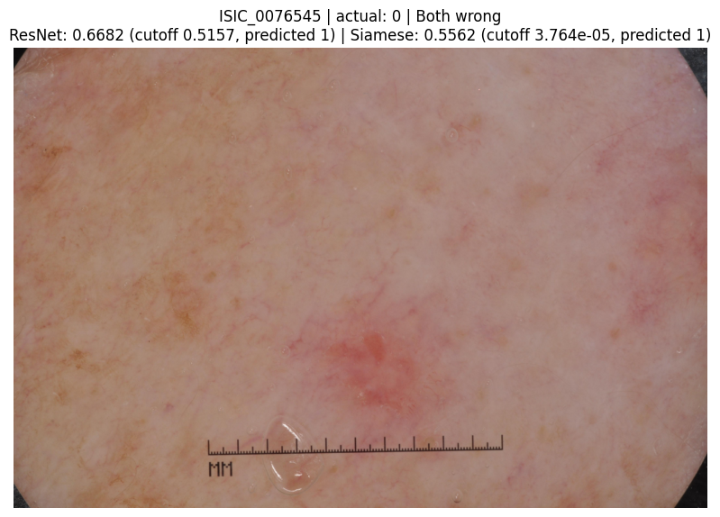 |
| 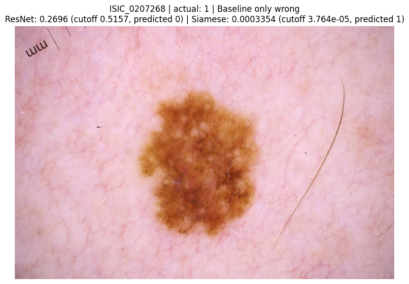 | |

*Table 10: Failure autopsies of both models*

The selected cases illustrate both shared errors and differences between the models. Predictions were assessed at thresholds chosen using the validation set: 0.427098 for ResNet and approximately 0.000038 for the Siamese model. The cases come from the held-out test set, so they show how the models performed on images not used for training or threshold selection.

Both models produced a false positive for **ISIC_0076545**, which was labelled benign. Its ResNet score was 0.6682, above the ResNet threshold, and its Siamese score was 0.5562, above the Siamese threshold. This shared error shows that both models can assign a melanoma prediction to a benign lesion. Such false positives may lead to unnecessary referrals for expert review. This is relevant to the test results, where both models produced many false positives: 1,056 for ResNet and 999 for Siamese.

The models differed on **ISIC_0207268**, a melanoma case that ResNet missed. Its ResNet score of 0.2696 fell below the ResNet threshold, while the Siamese score of 0.000335 exceeded the Siamese threshold, so the Siamese model correctly classified it. Conversely, for **ISIC_0953317**, ResNet correctly classified the melanoma, but the Siamese score fell below its threshold and the case was missed. These examples show that the models make different errors on some individual lesions, but a few cases alone cannot establish that one model is consistently better.

Both models also missed **ISIC_6584579**, another melanoma case. Its score was below each model’s threshold, so neither system flagged it for review. This shared false negative is particularly important because missed melanoma cases are a key risk in a screening or triage setting.

Overall, the examples reflect the trade-off shown in the test results. ResNet achieved higher melanoma recall (0.8202 compared with 0.7079 for Siamese), while the Siamese model had slightly higher specificity (0.7966 compared with 0.7850). The images provide examples of how these errors occur, while the aggregate metrics provide the stronger basis for comparing model performance. The scores should be interpreted relative to each model’s own threshold; their numerical scales are different and should not be compared directly.


</details>
