# TimeGAN LOB Simulation

## Project Overview

Limit order books (LOBs) are the backbone of modern financial markets, however tick by tick LOB data is expensive. This project aims to test the viability of training a TimeGAN [1] model to generate synthetic timeseries for level 10 LOBs across five different tickers using the LOBSTER sample data [2]. The developed model will then be evaluated against a set of acceptance criteria to determine recreation of market behaviour, LOB properties, and then lastly performance against a baseline generator, an autoregressive GRU (AR-GRU).

A TimeGAN model is constructed from five GRU networks all working with one another. The embedder and recovery networks make up an autoencoder which maps real windows into a lower-dimensional latent space and back again. The supervisor is trained to predict the next step in latent space given the previous steps, providing the architecture a cleaner option to express temporal dynamics. Then the generator takes a vector of random noise and converts it into latent sequences, which the supervisor refines. Lastly the discriminator reviews latent sequences from the generator and tries to tell them apart from real training data.

Training for a TimeGAN happens in three phases, firstly the autoencoder is trained to reconstruct real windows through the latent space, next the supervisor is trained to predict next step temporal dynamics, and then lastly a joint phase focusing on the generator and discriminator attempting to improve against the other, though all networks also contain to learn in this final phase. A diagram of how these networks connect via loss, training data, input and output is visually laid out in the figure below.

<p align="center">
  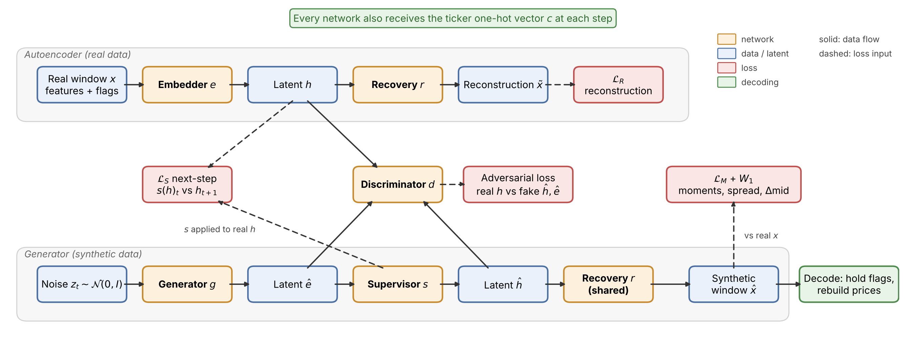
  <br>
  <sub><em>Conditional TimeGAN architecture, showing how each network connects through its inputs, outputs and losses.</em></sub>
</p>

As you can see there are several adjustments made to the original architecture described by Yoon et al. [1], these changes were made to better suit the model to the use case. The first of these changes was to condition the whole network, including the discriminator, using a one-hot vector which encoded the current ticker the model was working on, so that a single model could generate all five tickers. The second change was to add and tweak losses in the first and final phases of training with a reconstruction loss weighted by feature group, and a 1D Wasserstein (W1) loss [3] on the spread and mid-price change distributions. Both are covered and explained in Development.

## Feasibility Review

### User Need, Scope & Acceptance Criteria

- **User Needs:** The user is a quantitative research team testing and developing a market-making algorithm on L2 LOBs with 10 levels. Purchasing historic data is expensive so the team wants to see if TimeGANs are an appropriate solution for generating synthetic market data.
- **Scope:** To create a model able to generate 128s long sequences at a 1s per step time resolution with conditioning to generate five different tickers across two stock categories, small and large tick stocks.
- **Acceptance Criteria:** Synthetic windows from our model must capture the statistical market dynamics of the real data. Therefore the model will be tested and evaluated against a baseline generator on the following acceptance criteria and targets.
  
  | Criterion             | Measure                                                      | Target           |
  |:----------------------|:-------------------------------------------------------------|:-----------------|
  | LOB violations        | Crossed books, non-monotonic ladders and non-positive volume | ≤ 0.1%           |
  | Distribution fidelity | KL divergence of spread and VWAP log-returns                 | ≤ 0.1            |
  | Temporal features     | \|VWAP return\| autocorrelation ratio vs real                | 0.6–1.4          |
  | Depth structure       | Depth-heatmap SSIM ratio vs a real                           | 0.6–1.4          |
  | Resources             | Training time and peak VRAM on one RTX 3070                  | ≤ 1 hour, ≤ 2 GB |
  
### Model Choice & Course Concepts

- **Model Choice:** The project will focus on a TimeGAN model, which is labelled as HARD, using a 70/15/15 chronological split to avoid look-ahead bias. The LOBSTER data will be resampled to last 1s snapshots since TimeGAN expects evenly spaced steps and the original data is spaced by market events.
- **Course Concepts:** Implementing a TimeGAN combines the use of GRUs, an autoencoder and a generative adversarial network (GAN) which are all covered under course content.

### Preliminary Feasibility Evidence

As discussed the to be developed TimeGAN model will be compared to a baseline generator, this baseline generator will be an autoregressive GRU (AR-GRU) with predicts a Gaussian over the next step which is trained by maximum likelihood. The 40 features of our lOB will be fed, after scaling, directly into the model meaning LOB properties must be learnt. The figure below shows the synthetic sample output from the initial smoke-test trained on AMZN 128s windows.

<p align="center">
  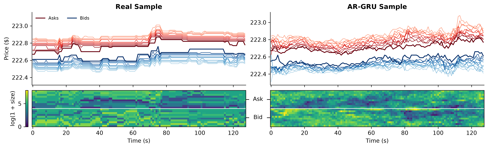
  <br>
  <sub><em>Comparing real and AR-GRU sample AMZN windows.</em></sub>
</p>

Inspecting this sample it's clear this naive approach has issues with 4% of steps leading to crossed books and 99.96% of steps having non-monotonic ladders for level prices across 1,000 generated windows.

Note that all figures are PNG files, this was chosen over the recommended GIF files as GIFs only show a single snapshot at a time, hiding the true path taking by the LOB. The figure I opted for instead shows a price chart with all 20 ask and bid prices coloured accordingly, with a heatmap below showing the size of each level at each point. This informs a viewer of all 40 features across the whole window at once.

### Risks, Budget & Fallback

- **Risks:** LOBSTER records have price and sizes as discrete ticks with steps being market events whilst TimeGAN assumes evenly spaced steps with continuous values, therefore there is a structural domain risk of implementing an architecture not well fit to the test. The single day of data also prevents risk with chronological splitting as the train, validation and test data may cover fundamentally different regimes.
- **Budget:** All training runs, experiments and smoke tests are expected to fit on a single local RTX 3070 (8 GB) GPU with up to 1 hour of maximum runtime.
- **Fallback:** A worst case fallback will be to move to an event-based model generating market events and sending them to a matching engine maintaining the LOB, which would model the underlying process directly. However, the priority and focus will be to apply TimeGAN with the best fit possible.
 
## Dataset and Preprocessing

### LOBSTER Dataset

Only having access to the LOBSTER sample data means on a single trading day (21 June 2012) of tick-by-tick Level 10 order book snapshots and the accompanying messages for five tickers. Unfortunately, an initial audit of the data shows our usable data must be trimmed even further since we are using chronological splits for evaluation. The reason for this is extreme regime changes in both price and volume behaviour at the open and close. Thus the first and final 15 minutes of each day are trimmed.

<p align="center">
  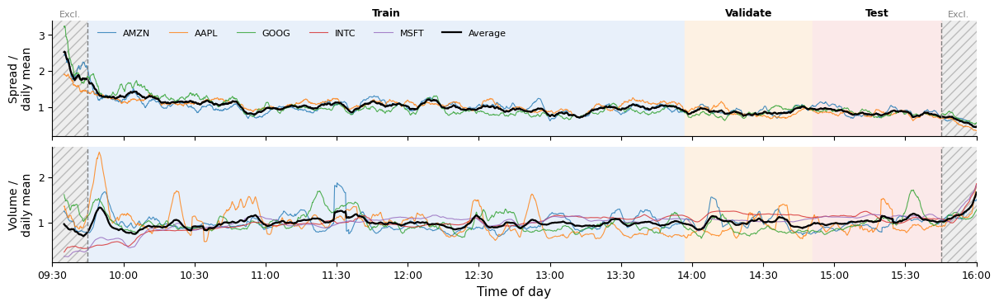
  <br>
  <sub><em>Train, validate, test split across LOBSTER sample data with excluded regimes.</em></sub>
</p>

Though event after trimming differences between the training and evaluation periods persist with spread declining through the day, this is an unavoidable limitation of chronological splits on a single day. Another change which reduces the available training data is resampling. Since each LOBSTER snapshot is the outcome of a single event each step has only 1 true change and steps are not evenly spread over time. Resampling to 1s partially addresses this, however it reduces the total usable data from 1,823,146 rows to 108,000.

The final key observation with including the five ticks is the distinct behaviour of small-tick (AAPL, AMZN, GOOG) and large-tick (INTC, MSFT) stocks. With large-tick stocks having their spread pinned at one tick and a mid-price that rarely moves, while small-tick stocks change price far more often. This needs to be considered in the final evaluation, with results reported per ticker as well as in aggregate, since an aggregate score alone could hide a model that fits one regime well and the other poorly.

<p align="center">
  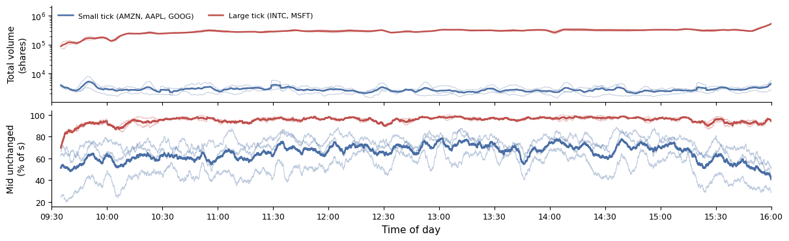
  <br>
  <sub><em>Comparing spread and volume behaviour between large and small tick stocks.</em></sub>
</p>

### Feature Engineering

From the baseline tests its clear LOB violations are common under naive modelling, thus the decision was made to explicitly design the features for TimeGAN such that the order book valid by construction. To do this I set started by describing the mid price relative to the first step, with a spread feature around this setting the price of the best quotes, then for each side there is nine gap features stating the number of ticks between hierarchical levels, and finally another 20 features encoding the log size of each level. Probabilistic flag allowing each feature to change or not were also implemented, though this was not an initial design decision and was made during development. The figure below provides a visual explanation of how this set of features ensures book validity by construction.

<p align="center">
  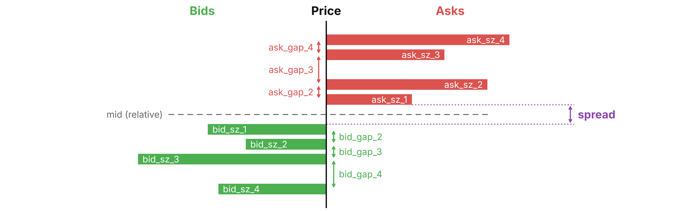
  <br>
  <sub><em>Visual representation of valid-by-construction LOB feature engineering.</em></sub>
</p>

A drawback of this representation is having to pass a reference price if you want to actually look at non-relative values, meaning that if run long enough (and assuming the model truly encodes the random walk of the market) it is possible that the absolute price could go negative.

To normalize the data a custom signed-log scaler was fit to each ticker’s training data only, so as not to leak validation data, with a signed-log compression followed by per-feature min-max scaling to [0, 1]. This was an appropriate option since the signed log handles the negative relative mid-price and compresses the heavy-tailed sizes, while [0, 1] matches the sigmoid outputs of the model.

## Development

### Wasserstein 1D Loss

As described in the overview I chose to implement a Wasserstein 1D (W1) loss, this was to encourage the fat tails in the real spread and mid-price return distributions. Initially I assumed a W1 weight of 10 was appropriate though this failed with the mid-price stayed within a narrow band while the best quotes moved symmetrically in opposite directions, likely because the Wasserstein term outweighed the discriminator. A weight of 1 patched this, with the metrics below showing how reducing the weight of W1 loss meant the model more closely captured the statistical behaviour of the real data.
  
| Metric                              | W1 weight ×10 | W1 weight ×1 | Real (train) | Real (test) |
|:------------------------------------|--------------:|-------------:|-------------:|------------:|
| Mid-price range per window (¢)      |          7.22 |        29.41 |        28.55 |       29.03 |
| Price level spacing variability (¢) |          0.82 |         1.21 |         1.16 |        0.80 |
| Lag-1 volatility clustering         |         0.038 |        0.137 |        0.135 |       0.182 |

With a weight of ×10, the mid-price only moves about 7¢ per window compared to roughly 29¢ in the real data, and its volatility clustering is close to zero, while the ×1 model closely matches the training data across all three metrics. Inspecting samples from our TimeGAN before and after this change from a W1 weight of ×10 to ×1 makes the difference clear. In the ×10 sample the symmetric jump behaviour, where the best quotes move in opposite directions on the same step is clear, while the ×1 sample moves much more like the real market.

<p align="center">
  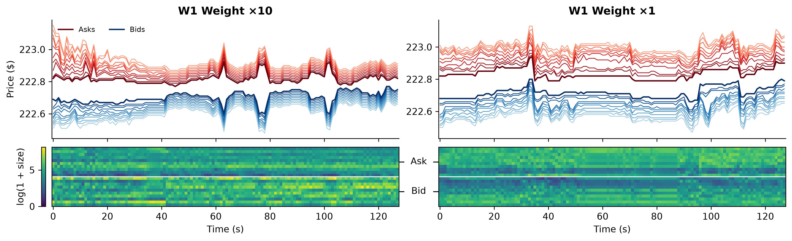
  <br>
  <sub><em>Comparing synthetic 128s AMZN windows with ×10 and ×1 Wasserstein weighting.</em></sub>
</p>

### Probabilistic Feature Flags

The next problem to be tackled was the unrealistic tick by tick jitter found in the synthetic windows. The cause of this was a fundamental feature of our architecture since TimeGAN outputs a continuous value for every feature every step, meaning small differences can lead to change in the discrete value once decoded. The solution for this was to add a flag to each feature, giving the probability that it changes on that step. When decoding, each flag is sampled, and any feature that is not flagged simply keeps its previous value. Looking at the metrics confirms this diagnosis and patch with the addition of flags better matching both the in and out of sample data.

| P(unchanged) per step | Without flags | With flags | Real (train) | Real (test) |
|:----------------------|--------------:|-----------:|-------------:|------------:|
| Top prices            |         57.1% |      75.3% |        80.2% |       73.7% |
| All prices            |         35.6% |      68.6% |        66.3% |       61.3% |
| All sizes             |          3.1% |      72.7% |        67.6% |       60.8% |

Once again inspecting samples before and after this fix, we see that the core behaviour our model was previously producing has not changed, though the unrealistic tick by tick jitter across both the prices and sizes has been addressed, with levels now holding steady for several seconds at a time like in the real market.

<p align="center">
  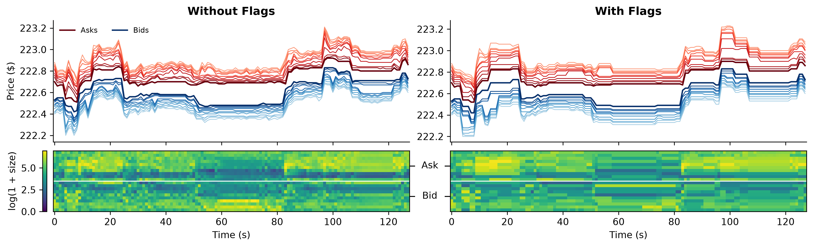
  <br>
  <sub><em>Comparing synthetic 128s AMZN windows with and without feature flags.</em></sub>
</p>

### Grouped MSE Loss

Adding the feature flags led to a collapse in variation for the synthetic windows. This was not mode collapse in the GAN but the autoencoder, since critical features like spread, mid, and gaps now had to compete with the flags within the MSE loss. Real flags are 0 or 1, so a missed flag costs up to 1 in squared error while the value features typically cost around 0.01. To fix this the autoencoder’s reconstruction loss was weighted by feature group, giving each group an equal share of the loss which in turn gave more importance to matching the feature that drive market behaviour.
  
| Group                 | Channels | Relative weight per channel (vs default MSE) |
|:----------------------|---------:|---------------------------------------------:|
| Mid-price (relative)  |        1 |                                          16× |
| Spread                |        1 |                                          16× |
| Gaps                  |       18 |                                         0.9× |
| Sizes                 |       20 |                                         0.8× |
| Flags                 |       40 |                                         0.4× |

Comparing this new autoencoder trained with a grouped loss shows a clear improvement, with MSE across all inputs dropping from 0.018 to 0.003, and most importantly R² for mid and spread improving from 0.57 and 0.18 to 0.997 and 0.97 respectively. Flag accuracy also improved from 97.1% to 99.75%, despite the flags lower weight. There is still room to improve however, since R² for gaps and sizes only improved to 0.69 and 0.72, from 0.12 and 0.06 respectively.

<p align="center">
  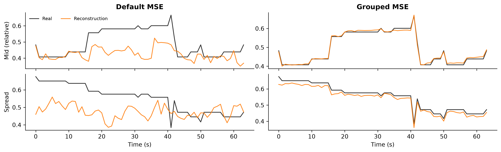
  <br>
  <sub><em>Comparing autoencoder reconstruction on default and grouped MSE loss.</em></sub>
</p>

## Evaluation

### Training and Stability

Profiling resource usage in training we see the TimeGAN's increased complexity coincides with higher parameter count, peak VRAM, and training duration. However, the TimeGAN has faster inference speeds than our baseline model. This is because the AR-GRU is autoregressive, meaning the baseline must generate each step sequentially, whilst the TimeGAN generates the entire window in a single call.

| Model   | Parameter Count | Peak VRAM | Training Duration | Inference Duration |
|:--------|----------------:|----------:|------------------:|-------------------:|
| AR-GRU  |          50,512 |   171 MiB |           1.6 min |      33.1 ± 4.6 ms |
| TimeGAN |         368,913 |  1620 MiB |          55.7 min |       1.1 ± 0.0 ms |

To take a closer look at how the TimeGAN model learnt through training, we can plot the value of each loss by epoch within each of the three phases of training. Each phase used the Adam optimiser with a fixed learning rate of 10⁻³.

- **Phase 1:** after 50 epochs both training and validation reconstruction losses are still falling, meaning the autoencoder has not converged and could be improved with longer training.
- **Phase 2:** after 15 epochs the supervisor has already converged, with training having to be halted to prevent overfitting on the training dataset, which makes sense as financial markets are notoriously noisy so next step prediction can only learn so much.
- **Phase 3:** after 100 epochs the generator is making a comeback though the discriminator is still winning, though for the first ~56 epochs the generator and discriminator are in healthy competition with all losses roughly balanced.

By the end of training the generator is coming back though still losing, so like in the first phase longer training may be beneficial, though it is not an option without breaking the 1 hour training time acceptance criteria.

<p align="center">
  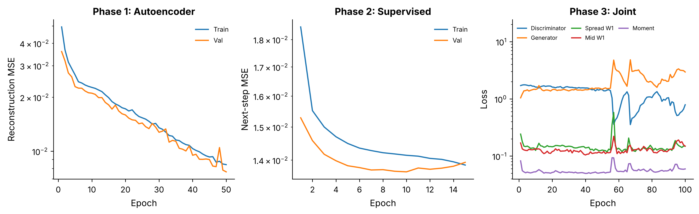
  <br>
  <sub><em>TimeGAN training losses by phase epoch.</em></sub>
</p>

Issues with TimeGAN models are the potential for instability and mode collapse during training. Our loss curve does show concerns about stability with the previously mentioned drop in discriminator loss at epoch ~56, though this did not lead to a divergence as the generator was able to somewhat recover. To check for mode collapse, and that conditioning keeps each ticker distinct, the table below compares the volatility of VWAP returns for real and synthetic windows. Each ticker keeps its own level of volatility, with the small-tick stocks more volatile than the large-tick stocks in both real and synthetic data, rather than collapsing to a single shared distribution.

| VWAP return std (bp) |        AMZN |        AAPL |        GOOG |        INTC |        MSFT |
|:---------------------|------------:|------------:|------------:|------------:|------------:|
| Real (train)         | 1.42 ± 0.03 | 1.09 ± 0.03 | 1.21 ± 0.02 | 0.94 ± 0.07 | 0.74 ± 0.03 |
| Real (val)           | 1.09 ± 0.01 | 0.73 ± 0.01 | 0.82 ± 0.01 | 0.39 ± 0.01 | 0.39 ± 0.00 |
| Real (test)          | 1.34 ± 0.01 | 0.83 ± 0.01 | 0.80 ± 0.00 | 0.56 ± 0.01 | 0.64 ± 0.01 |
| TimeGAN              | 1.68 ± 0.04 | 1.06 ± 0.01 | 1.41 ± 0.02 | 0.63 ± 0.01 | 0.66 ± 0.01 |

### Metrics and Synthetic Windows

We’ll start by comparing the TimeGAN and AR-GRU models against our test dataset on 128s AMZN windows, and we also add a direct train versus test analysis to examine regime differences. Synthetic windows for both models are generated with 10 extra burn-in steps so the GRUs warm up, anchored to the first mid-price of each test window. In the below table we see that the TimeGAN outperforms the AR-GRU in each area apart from depth SSIM ratio where all three tied. However TimeGAN did not pass any of the price dynamics tests, though this is not a reason to disqualify the model as even the train versus test evaluation failed two of the three targets. The exception is ∆VWAP KL, which train versus test passes easily, making it a genuine shortcoming of the model.

It should also be noted that although the TimeGAN model greatly beat out the AR-GRU on LOB violations rate this was not a result of the TimeGAN learning LOB properties explicitly but from the valid-by-construction features engineering.

| Metric                |  Target  |    AR-GRU vs Test |   TimeGAN vs Test |    Train vs Test |
|:----------------------|:--------:|------------------:|------------------:|-----------------:|
| LOB Violation Rate    |  ≤ 0.1%  |    99.9% ± 0.0 ❌ |     0.0% ± 0.0 ✅ |    0.0% ± 0.0 ✅ |
| Spread KL             |  ≤ 0.1   |  0.563 ± 0.028 ❌ |  0.256 ± 0.038 ❌ | 0.340 ± 0.032 ❌ |
| ∆VWAP KL              |  ≤ 0.1   |  0.287 ± 0.012 ❌ |  0.147 ± 0.004 ❌ | 0.033 ± 0.003 ✅ |
| ∆VWAP Autocorr. Ratio | 0.6–1.4  |    4.01 ± 0.49 ❌ |    1.88 ± 0.10 ❌ |   1.67 ± 0.10 ❌ |
| Depth SSIM Ratio      | 0.6–1.4  |    0.79 ± 0.02 ✅ |    0.80 ± 0.03 ✅ |   0.82 ± 0.03 ✅ |

Having accepted TimeGAN over the baseline model, we’ll now move onto a more in-depth analysis of TimeGAN performance. We’ll do this by evaluating the same metrics, excluding LOB violation rate as that is fixed to 0%, across each of the individual tickers. This time however, the evaluation will be against the validation dataset as it is it a closer fit to the regular regime in training but is still out of sample for the generator, though its loss was monitored in phases 1 and 2.
  
| TimeGAN vs Validation |  Target  |    AMZN |    AAPL |    GOOG |    INTC |    MSFT |
|:----------------------|:--------:|--------:|--------:|--------:|--------:|--------:|
| Spread KL             |  ≤ 0.1   | 0.085 ✅ | 0.092 🟠 | 0.164 ❌ | 0.062 ✅ | 0.144 🟠 |
| ∆VWAP KL              |  ≤ 0.1   | 0.072 ✅ | 0.081 ✅ | 0.099 🟠 | 0.379 ❌ | 0.521 ❌ |
| ∆VWAP Autocorr. Ratio | 0.6–1.4  |  1.15 ✅ |  1.03 ✅ |  2.13 ❌ |  2.38 ❌ |  6.45 ❌ |
| Depth SSIM Ratio      | 0.6–1.4  |  0.86 ✅ |  1.16 ✅ |  0.62 🟠 |  0.97 ✅ |  0.85 ✅ |

<sub><em>✅ passes the target, ❌ fails it, and 🟠 means the target falls within one standard deviation of the mean across the 5 runs.</em></sub>

As expected our model now performs better being evaluated against a familiar regime, though still fails each of the mean targets. The cause of this is poor performance on large tick stocks like INTC and MSFT with the model actually passing 7/9 price action targets for the small tick stocks being AMZN, AAPL and GOOG.

Now that we have a better understanding of TimeGANs quantitative performance in capturing the statistical behaviour of the different tickers we can inspect and compare synthetic windows versus windows from the real data. To do this we'll generate synthetic 128s windows and compare it to a randomly sampled window from the real data. The visualisation used gives context to each of the 40 LOB values we are trying to replicate as well as there value at each point within the window.

<p align="center">
  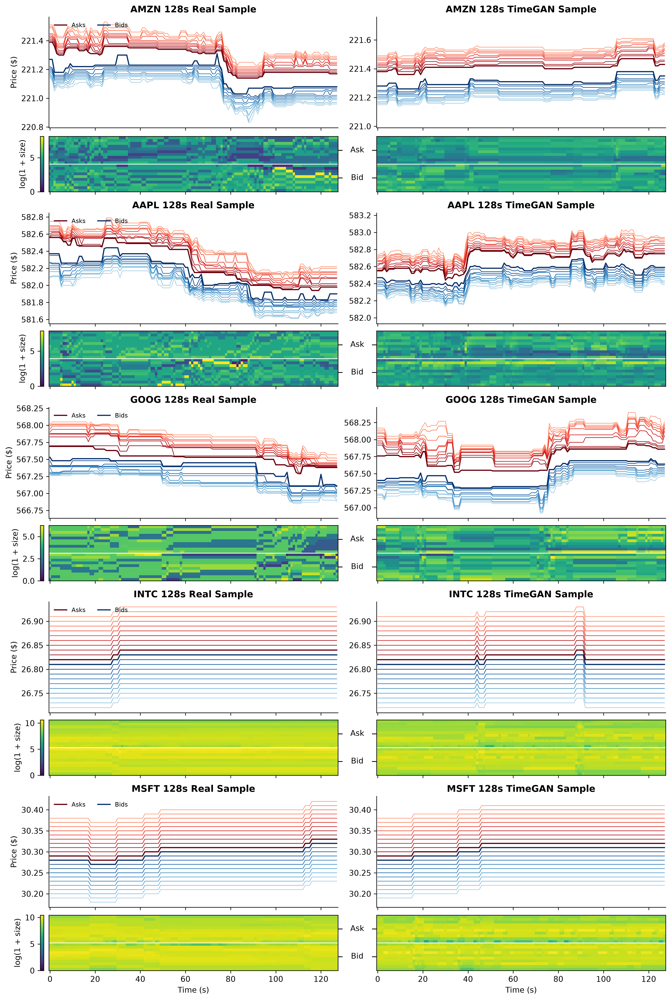
  <br>
  <sub><em>Comparing real and TimeGAN sample 128s ticker windows.</em></sub>
</p>

A benefit of TimeGAN is that the length of our synthetic windows are not capped by inference, meaning we can also generate and inspect a synthetic 512 step long sequence for AMZN. Doing this we see not obvious signs of degradation despite being ×8 the length of the sequences used in training.

<p align="center">
  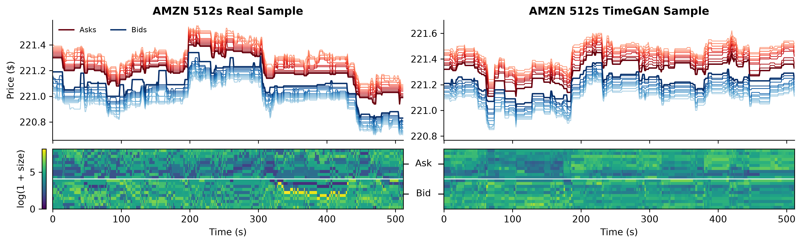
  <br>
  <sub><em>Comparing real and TimeGAN sample 512s AMZN windows.</em></sub>
</p>

### Structural Fails

Despite being a clear improvement over the baseline model and boasting a 0% LOB violation rate our TimeGAN model still has several structural pitfalls. 

- **Feature volatility by level:** Unfortunately, despite the improvements gained from the addition of feature flags, how often each level changes is still an issue. The following figure plots the probability of the price and size at each level being unchanged per step for real test and TimeGAN synthetic windows.

  <p align="center">
    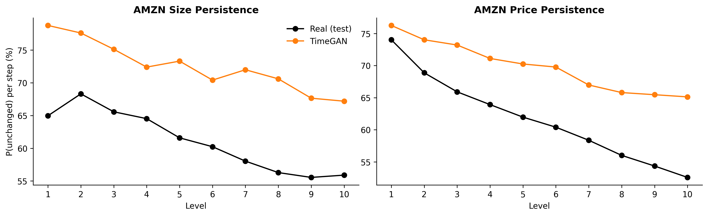
    <br>
    <sub><em>AMZN size and price persistence by level, real vs TimeGAN.</em></sub>
  </p>

  From the figure it's clear that TimeGAN has stunted some of the real structure of the book across all levels. Real books change sizes at the best level most often since that is where market makers and takers are most active, whilst TimeGAN has its level 1 size being the steadiest of all. This pattern persists for all the following levels with an error of 8-14 percentage points versus the real test data. Price persistence has a similar problem where real books lose ~21 percentage points of persistence from level 1 to 10 while TimeGAN only loses 11.
  
- **Large-tick round trips:** As observed in our target metrics it appears synthetic large-tick books do not move realistically with moves usually only ticking up and then down a second later, a round trip that real INTC and MSFT books rarely make. We can confirm this by plotting the autocorrelation of of mid-price changes between large and small tick stocks.

  <p align="center">
    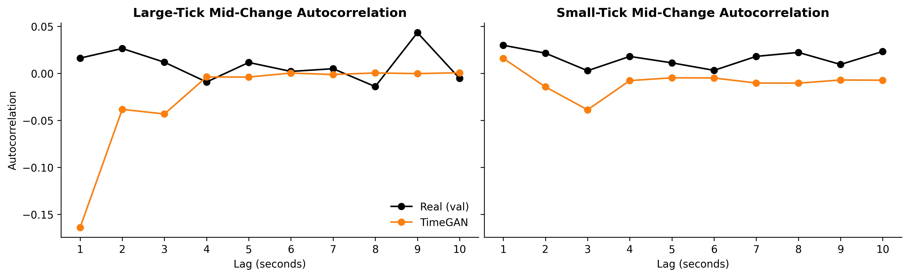
    <br>
    <sub><em>Mid-price change autocorrelation by lag, real vs TimeGAN.</em></sub>
  </p>

  From the autocorrelation charts its clear that this structural failure is specific to large tick stocks with a value at lag-1 being -0.16 compared to 0.02 for the real data. The small-tick stocks on teh other hand show no such dip. The also explains why the ∆VWAP KL for both large-tick stocks failed to pass with an average score of 0.45 compared to small-tick stocks average score being 0.084.
  
- **Discriminator dominating generator:** To understand how the discriminator is dominating the generator and where the model can be improved, we can analyse how the discriminator’s score changes over a window, and how its score changes when swapping out synthetic channels for real ones. The figure below shows the results of this analysis.

  <p align="center">
    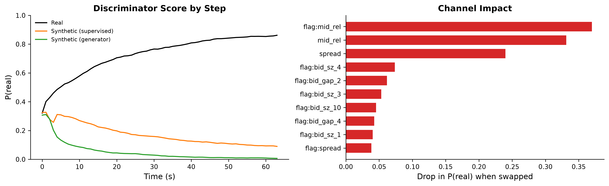
    <br>
    <sub><em>TimeGAN discriminator saliency evaluation by channel.</em></sub>
  </p>

  Here we see the discriminator build confidence over time with real windows rising from about 0.3 to 0.86 while synthetic windows fall towards 0.1 and below. This means the issues in the generator cover the whole window rather then occasional bad single steps. Swapping each channel between real and synthetic windows shows that the discriminator relies most on the mid-price flag, the relative mid-price and the spread, so the main giveaway is how often and how far the mid-price moves, rather than the depth of the book.

## Recommendations

### Viability in Industry

My conclusion on the viability of this model is that it should not be deployed in any research or production pipelines at this stage in development. The primary reason for this is that currently TimeGAN has not been able to sufficiently replicate the real-world market dynamics despite passing areas of the acceptance criteria.

Furthermore, since the TimeGAN architecture generates entire windows the synthetic data is not much better than just using existing historic data despite the costs, as for many HFT (high-frequency trading) algorithms its not just what the market is doing that is important, but also how the market reacts to your algorithms actions. The final restriction preventing real-world deployment is that our limited sample size of a single day means we are missing the outliers and edge cases that are critical to guard against when developing algorithmic trading systems.

### Alternative Architecture

Had development not been constrained to TimeGAN architecture an alternative could have been a maximum-likelihood event model conditioned on the current L10 book and history, where the model emits actual order events (order submissions, cancellations and executions) to a matching engine maintaining the LOB. A GAN-like model could also be used in this system to generate new level 10 quotes when the matching engine runs out of quotes on one side, such as when a level is cancelled or executed.

This approach would be superior as the market behaviour our TimeGAN is attempting to emulate is emergent from this underlying event process. An event based model would also let quantitative researchers test their impact on this synthetic market since placed backtesting orders can be fed to the event model like any other.

## Setup and Usage

### Cloning and Dependencies

After cloning the repository ensure your version of Python is compatible with Python 3.11. Note that PyTorch was installed with CUDA 13.0 index since a plain `pip install` gives the CPU-only build.

```bash
pip install torch==2.14.1 --index-url https://download.pytorch.org/whl/cu130

pip install numpy==2.4.6
pip install pandas==3.1.0
pip install matplotlib==3.11.2 
pip install scipy==1.17.1 
pip install scikit-learn==1.9.1 
pip install scikit-image==0.26.0
```

or otherwise `pip install -r requirements.txt` after installing PyTorch.
      
### Reproducibility

Parameters and controls are set in `config.toml` in the project folder. To start run `train.py` which downloads the dataset (about 580 MB) if not already present, then trains and saves the model. Finally, running `predict.py` evaluates the saved model and saves figures.

```bash
cd recognition/TimeGAN_s48104937
python train.py      # download data (first run only), train, and save model
python predict.py    # evaluate the saved model, and save figures
```

All random number generators are seeded from `config.toml` with each modelling storing the configuration it was trained with so runs are repeatable. Note small differences between runs or GPUs are possible as cuDNN GRU kernels are not fully deterministic.

## Artificial Intelligence Usage Disclosure

In the development of this model and report I made use of two AI tools, the first being Claude (Opus 5.5) and the second being the built-in PyCharm AI autocomplete. The AI tools assisted with the following use case.

- **Diagnosing failures:** When encountering issues with TimeGAN early on Claude helped propose likely causes of the failures and suggested possible solutions. Any suggestions were then trained and compared by myself against the existing model to verify improvements.
- **Synthesizing code:** Claude was used to help with writing up sections of code where appropriate, the main use case of this being working with numpy arrays in the dataset and evaluations, and writing up visualizations functions with consistent styling.
- **Documentation:** Lastly AI was used to assist with creating docstrings for functions and classes, as well as providing feedback and suggestions for the README.md.

Every value provided in this document was produced by code developed in this repository/fork. I, Jakob KB, edited and verified all code, loss functions, modules and metrics in this submission.

## References

[1] J. Yoon, D. Jarrett, and M. van der Schaar, "Time-series generative adversarial networks," in *Advances in Neural Information Processing Systems 32 (NeurIPS 2019)*, 2019, pp. 5509–5519.

[2] LOBSTER, "Data samples." [Online]. Available: https://lobsterdata.com/info/DataSamples.php

[3] M. Arjovsky, S. Chintala, and L. Bottou, "Wasserstein generative adversarial networks," in *Proc. 34th Int. Conf. Machine Learning (ICML)*, 2017, pp. 214–223.
