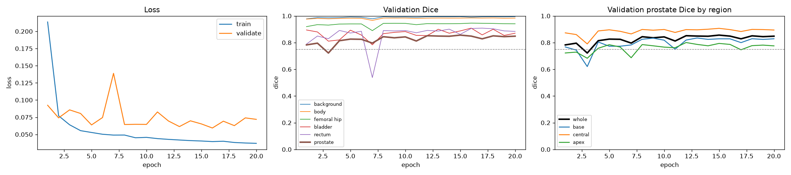
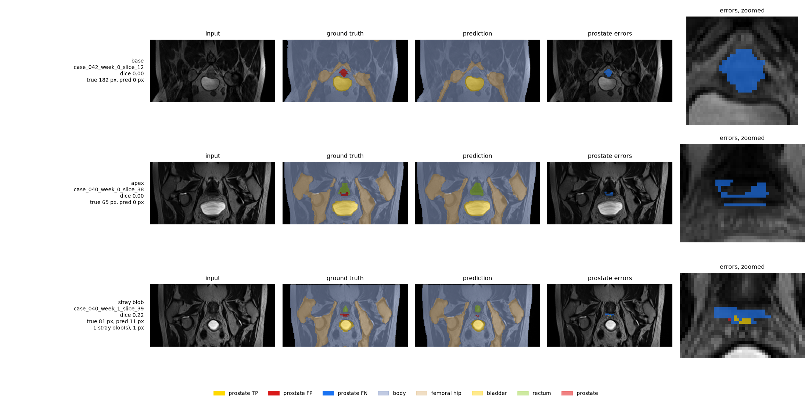
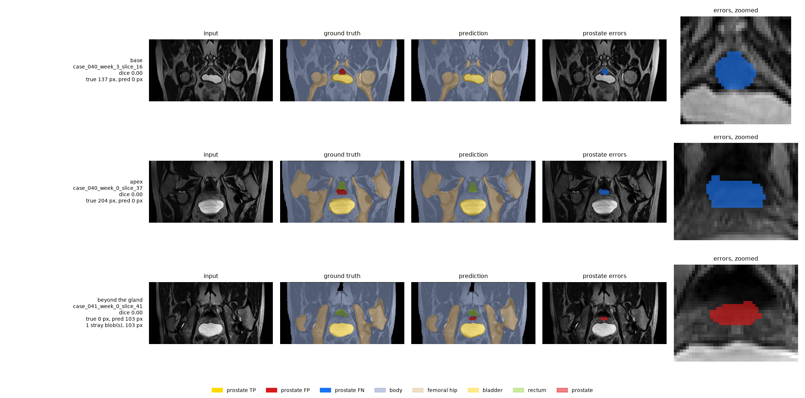
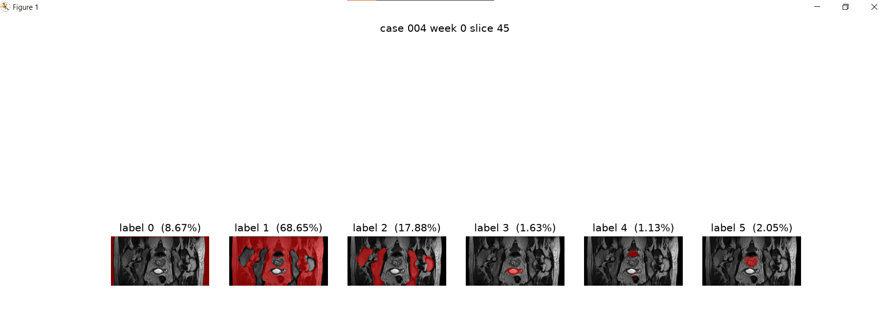

# HipMRI Prostate Segmentation for Radiotherapy Planning using 2D U-Net CNN Architecture

Authour: Samantha Krause

SID: 47423323

## Introduction

### Problem

In prostate radiotherapy planning, imaging specalist must be able to correctly classify and delinate between the prostate, the femoral hip, the bladder, the rectum, and the body and background to plan the path of an external-beam. This a high precision, high context task to delinate target volumes with milimeter level precision. In the case of under-countering the prostate region, tumours have a chance to regrow and reoccur in the patient. In the case of over-countouring, suurounding organs can become irratiated due to the radiation, causing high levels of patient pain and potential radiation toxicity. Both scenarios ultimately lead to reduced patient health outcomes. As such tools that can assist in this planning process are desired.

### 2D U-Net Architecture


*Image: U-Net Architecture courtsey of [Dept. of Computer Science Univerisity of Freiburg](https://lmb.informatik.uni-freiburg.de/people/ronneber/u-net/)*

The U-Net CNN architecture was initally created by Ronneberger for the ISBI challegne fro segmentation of neuronal structures in electron microscopic stacks, a biomedical segmentation problems and thus makes it an ideal solution to the presented problem. The base architecture of a U-Net CNN consists of a symmetry encoder and decoder with skip connections connecting the layers between each. The encoder downsamples an image's information to extract key details about each segment, and the decoder upsamples to regain the resolution it lost with the skip connections inbetween each layer reintroducing lost spatial infomation.

## Solution

A conda environmented was used for this application with the following dependencies and packages:

### Dependencies

The following versions of dependencies are required:

```
Python:      3.12.15
torch:       2.14.1+cu126  (CUDA 12.6)
torchvision: 0.29.1+cu126
nibabel:     5.4.2
numpy:       2.5.2
matplotlib:  3.11.2
```

### Reproducibility

All reported results use seed 11 (`--seed 11`, the default) with `--original-split`, so the test patients are 040–042. The seed fixes the Python, NumPy and PyTorch random generators, the shuffle order and the augmentations, so rerunning with the same seed and settings gives the same batches. cuDNN is not set to deterministic, so repeated GPU runs agree closely but are not bit-identical.

This was primarily made to run on a 6 GB GTX 1660 Ti GPU, with secondary considerations to the A100 GPUs available on UQ's Rangpur. Training was fp32 and AMP was turned off for the duration of training to ensure no NaNs were produced on the card.

### Commands

The following commands were used to run the train.py and predict.py using command line argparse. All runs are save under skip/noskip, weighted sampling procedure, seed, and any additional CLI's used such as original split, CE for CE Dice Loss added and so on and so forth.

`--data-root` is the HipMRI `keras_slices_data` folder and `--cache-dir` is where the ~2 GB slice cache is built on the first run. Commands are written for PowerShell, where a backtick at the end of a line continues the command onto the next line.

```powershell
cd \path\to\PatternAnalysis-2026\recognition\UNet2D_s4742332

# train: no-skip and skip, lightweight depths, no patient weighting, original split
python train.py --no-skip --conv-depths 32 64 128 256 512 --epochs 20 --seed 11 --original-split `
    --data-root \path\to\HipMRI_Study_open\keras_slices_data --cache-dir \path\to\hipmri-cache
python train.py --conv-depths 32 64 128 256 512 --epochs 20 --seed 11 --original-split `
    --data-root \path\to\HipMRI_Study_open\keras_slices_data --cache-dir \path\to\hipmri-cache

# evaluate: validation first, then test once, replace run path with yours
python predict.py runs\noskip_pw-None_seed11_origsplit runs\skip_pw-None_seed11_origsplit --split validate `
    --data-root \path\to\HipMRI_Study_open\keras_slices_data --cache-dir \path\to\hipmri-cache
python predict.py runs\noskip_pw-None_seed11_origsplit runs\skip_pw-None_seed11_origsplit --split test `
    --data-root \path\to\HipMRI_Study_open\keras_slices_data --cache-dir \path\to\hipmri-cache
```

## Investigation

### Data and Preprocessing

The HipMRISlices dataset was presplit into training, testing, and validations with raw and prior hand classified images by a radiology specialist. Reseeding and resplitting the patients is also done to confirm that the effects are not limited to a lucky seeding batch. This split is at the patient-level, with each patient having between 1-8 weeks worth of scans, with 60 slices per scan. Patient-level splitting is required as the anatomy, and thus the differences in segmentation and classification scenarios. is the primary source of variance between images. Leakage between training, validation, and testing of patients slices, weeks, or  doubling of the patients is then considered a worst case scenario as a single patient can be over-fitted or over-represented in the dataset. Validation check points within dataset.py is used then to ensure that this scenario does not occur.

Each image loaded is center cropped to 256x128. This is the standard majority format that the .nii.gz files are in except for one outlier within week 00 of patient 00 which is 256x144. Cropping is required to ensure that the models all have the same input length. Per-slice-z-score normalisation is then applied as MRI intensities have no absolute scale. As a patients anatomy changes over the course of treatment, the raw values week to week also change, and z-scoring removes these offset and scale differences created by time. However, it must be acknowledge that base and apex scan slices contain significantly less prostate class. This means that the approximately zero mean and unit-only  variance that is seen in central slices differ to those in the base or apex scans. It is hypothesised that with --context or 2.5D U-Net that includes neighbour slice normalisation seperately wil be able to overcome the result of z-score normalisation per slice that is required in the preprocessing of this particular dataset.

### Baseline Implementation and Comparison

The baseline comparison for this project, unlike the Ronneberger paper's which used a sliding window CNN as a comparison, was a no skip U-NET architecture. This was employed to investigate in particular the effects provided by the skip connections in regards to precise localisation. This study aims to see whether the information conncection between encoder and decoder actually help in prostate boundary deliniation, in particular at difficult zones such as the apex and the base where the glands are smallest and hardest to segment. As a result, in a problem where spatial localisation is significant to patient health outcomes, this study investigates  how much of the base and apex DICE results rely on skip connections to be more accurately localised.

The comparative model was a basic 2D U-Net architecture.

The setup up was as follows:

| Model         | Params | Depths            | Epochs |
| ------------- | ------ | ----------------- | ------ |
| No-skip U-Net | 6.98M  | 32 64 128 256 512 | 20     |
| Skip U-Net    | 7.77M  | 32 64 128 256 512 | 20     |

Skip connections widen the decoder's input channels, as such the models are not the same size. Lightweight deths were chosen over the default parameters to ensure that it was more suitable to low end ordinary consumer hardware as the tool is aimed at radiology specalists who may not have access to this hardware. One augumentation seed was chosen and the original split was uesd,

### Quantative Benchmarking

The primary benchmarking parameters for these models include:

1. Per-class DICE score to evaluate how well the model is able to identify each class and organ and is the standard overlap measure for segmentation. Background class is in each slice, so high DICE scores for this class is to be expected. This allows for decent quick look evaluation at model performance.
2. Per-location of base central and apex DICE enables the DICE to be disectted to ensure that the domination of large central slices do not hide end failures of the gland. This shows if there is any weak points in the model
3. Per-patient DICE Score for prostate DICE in particular as this organ is the primary target with over or under countouring to. As such mean +- std and min are applied to these scores to understand performance of each contour plan. As such good averages do not hide unusable datasets and scans.
4. Inference ms/slice and peak VRAM were meaured to ensure that the tool can integrate into existing workflows on more commonly available hardware.

### Example Outputs

The following is outputted into the folder during training underneath curves.png and shows the training and validation loss, the validation DICE score and the validation DICE score for the prostate by region over each epoch. history.json contains the historical information that produces these graphic visualisations.



The following table shows the first 10 epoch history for both models on seed 11 for augmentation.

| Model/Epoch | 1     | 2     | 3     | 4     | 5     | 6     | 7     | 8     | 9     | 10    |
| ----------- | ----- | ----- | ----- | ----- | ----- | ----- | ----- | ----- | ----- | ----- |
| No skip     | 0.551 | 0.799 | 0.831 | 0.753 | 0.825 | 0.811 | 0.842 | 0.847 | 0.842 | 0.831 |
| Skip        | 0.783 | 0.796 | 0.722 | 0.814 | 0.826 | 0.825 | 0.796 | 0.844 | 0.836 | 0.843 |

The following table compares the best checkpoint of each model (seed 11, original split) on the validation and test sets.

|                                 | No-skip val                     | Skip val                                  | No-skip test                    | Skip test                                 |
| ------------------------------- | ------------------------------- | ----------------------------------------- | ------------------------------- | ----------------------------------------- |
| Params                          | 6.98M                           | 7.77M                                     | 6.98M                           | 7.77M                                     |
| Best epoch                      | 19                              | 15                                        | 19                              | 15                                        |
| Prostate Dice                   | 0.848                           | **0.856**                           | 0.862                           | **0.871**                           |
| Prostate IoU                    | 0.736                           | 0.748                                     | 0.757                           | 0.772                                     |
| Base / central / apex Dice      | **0.835** / 0.897 / 0.783 | 0.828 / **0.907** / **0.794** | 0.839 / 0.909 / 0.803           | 0.839 / **0.920** / **0.807** |
| Per-case Dice (min)             | 0.839 ± 0.067 (0.665)          | 0.848 ± 0.079 (0.620)                    | 0.857 ± 0.027 (0.814)          | **0.875 ± 0.018 (0.851)**          |
| Precision / recall              | 0.870 / 0.827                   | 0.883 / 0.831                             | 0.878 / 0.846                   | 0.873 / **0.870**                   |
| Slices missed entirely          | 19                              | **16**                              | 23                              | **15**                              |
| Beyond-gland slices             | 12                              | **9**                               | 8                               | **0**                               |
| Stray-blob slices               | **2**                     | 7                                         | **0**                     | 2                                         |
| Bladder Dice                    | 0.855                           | **0.887**                           | 0.961                           | 0.966                                     |
| Inference (batch 16), peak VRAM | **3.0 ms/slice, 0.56 GB** | 3.5 ms/slice, 0.63 GB                     | **3.0 ms/slice, 0.56 GB** | 3.4 ms/slice, 0.63 GB                     |

#### Per-class Dice and IoU (test set)

Per-class Dice and IoU for all six labels on the held-out test set (patients 040–042, 9 scans, 540 slices), best checkpoint of each model, seed 11, original split. Both are computed from the pixel counts pooled over the whole test set.

| Class       | No-skip Dice    | No-skip IoU     | Skip Dice       | Skip IoU        |
| ----------- | --------------- | --------------- | --------------- | --------------- |
| Background  | 0.993           | 0.986           | **0.997** | **0.994** |
| Body        | 0.983           | 0.967           | **0.985** | **0.971** |
| Femoral hip | 0.934           | 0.876           | **0.942** | **0.890** |
| Bladder     | 0.961           | 0.925           | **0.966** | **0.935** |
| Rectum      | **0.845** | **0.731** | 0.826           | 0.704           |
| Prostate    | 0.862           | 0.757           | **0.871** | **0.772** |

The skip U-Net is ahead on five of the six classes, rectum being the exception. The rectum is the hardest class for both models (IoU 0.70–0.73), followed by the prostate. These are the two smallest organs, and they share a thin boundary, which is the clinically important boundary for rectal toxicity.

#### Inference time and memory (test set, GTX 1660 Ti, fp32, batch 16)

| Per 60-slice scan | No-skip           | Skip           |
| ----------------- | ----------------- | -------------- |
| Median            | **0.20 s**  | 0.23 s         |
| Mean ± std       | 0.46 ± 0.37 s    | 0.50 ± 0.40 s |
| Range             | 0.19 – 1.11 s    | 0.22 – 1.15 s |
| Peak VRAM         | **0.56 GB** | 0.63 GB        |

Most scans take about 0.2 s. A few scans in each run took 0.9–1.2 s, which pulls the mean up to roughly twice the median. These slower scans were not investigated further.

Example predict.py output with DICE Class and IOU:

```Shell
python predict.py runs\skip_pw-None_seed11_origsplit runs\noskip_pw-None_seed11_origsplit --split test `
>>     --data-root S:\HipMRI_Study_Open\keras_slices_data --cache-dir S:\hipmri-cache
skip_pw-None_seed11_origsplit: epoch 15, 7.77M params, skip True, depths [32, 64, 128, 256, 512], seed 11, val prostate dice 0.856 (base 0.828 central 0.907 apex 0.794)
Loading dataset with seed 11
train: 11460 images/masks paired OK
validate: 660 images/masks paired OK
test: 540 images/masks paired OK
no leakage

skip_pw-None_seed11_origsplit test: 9 cases, 540 slices
  class          dice    iou
  background    0.997  0.994
  body          0.985  0.971
  femoral hip   0.942  0.890
  bladder       0.966  0.935
  rectum        0.826  0.704
  prostate      0.871  0.772
  prostate base 0.839 central 0.920 apex 0.807
  per-case prostate dice 0.875 +/- 0.018 (min 0.851)
  peak VRAM 0.63 GB, inference 501 +/- 396 ms per case (8.4 ms per slice, batch 16)
  failure summary: 195 slices with prostate, 15 missed entirely (base 13, central 0, apex 2)
    0 slices with prostate predicted beyond the gland (past base 0, past apex 0, median 0 px)
    2 prostate slices with stray blobs, median slice dice base 0.835 central 0.921 apex 0.842
    false positive prostate: 7625 px, 12.7% of predicted prostate (precision 0.873, recall 0.870) | on gland slices base 1022 central 2517 apex 4086 | past base 0 past apex 0
  failure figures: base case_042_week_0_slice_12 (dice 0.00), apex case_040_week_0_slice_38 (dice 0.00), stray blob case_040_week_1_slice_39 (dice 0.22) -> runs\skip_pw-None_seed11_origsplit\failures
  all failures: base 19, central 0, apex 11, stray blob 1, beyond the gland 0 -> test_results.json
noskip_pw-None_seed11_origsplit: epoch 19, 6.98M params, skip False, depths [32, 64, 128, 256, 512], seed 11, val prostate dice 0.848 (base 0.835 central 0.897 apex 0.783)

noskip_pw-None_seed11_origsplit test: 9 cases, 540 slices
  class          dice    iou
  background    0.993  0.986
  body          0.983  0.967
  femoral hip   0.934  0.876
  bladder       0.961  0.925
  rectum        0.845  0.731
  prostate      0.862  0.757
  prostate base 0.839 central 0.909 apex 0.803
  per-case prostate dice 0.857 +/- 0.027 (min 0.814)
  peak VRAM 0.56 GB, inference 460 +/- 369 ms per case (7.7 ms per slice, batch 16)
  failure summary: 195 slices with prostate, 23 missed entirely (base 17, central 0, apex 6)
    8 slices with prostate predicted beyond the gland (past base 0, past apex 8, median 74 px)
    0 prostate slices with stray blobs, median slice dice base 0.845 central 0.910 apex 0.813
    false positive prostate: 7065 px, 12.2% of predicted prostate (precision 0.878, recall 0.846) | on gland slices base 728 central 1941 apex 3948 | past base 0 past apex 448
  failure figures: base case_040_week_3_slice_16 (dice 0.00), apex case_040_week_0_slice_37 (dice 0.00), beyond the gland case_041_week_0_slice_41 (dice 0.00) -> runs\noskip_pw-None_seed11_origsplit\failures
  all failures: base 20, central 0, apex 12, stray blob 0, beyond the gland 8 -> test_results.json

run                             pros dice pros iou   base central   apex     case dice   prec recall  FP px VRAM GB ms/case
skip_pw-None_seed11_origsplit       0.871    0.772  0.839   0.920  0.807  0.875+/-0.018  0.873  0.870   7625    0.63     501
noskip_pw-None_seed11_origsplit     0.862    0.757  0.839   0.909  0.803  0.857+/-0.027  0.878  0.846   7065    0.56     460
```

### In Regards to Baseline vs Comparative Models

The skip connections gave small gains on this task, smaller than expected. As more seeds were not tested, these results may not be fully indicative how the extent to which skip connections assit with spatial localisation of the prostate base, central and apex slices.

### Failure Case Autopsy & Usability Analysis

The following is a summary of the failures that were identified in the test-set failure cases within this study:

1. Stray blobs of identified segmented away from the ground truth mask where the true area of the classified segment lies. This includes identifying prostate on an image without prostate identified in the ground truth mask. The threshold for this was $\leq$ 10 px as the end user requires high precision, any stray blobs pose significant threat to patient outcomes.
2. No prediction of a prostate prediciton when the ground truth mask identified prostate within the image. This is identified through true's pixel mask being larger than 0px and the prediction having 0 pixels. This is also a signifcant concern for missing areas may result in tumour reoccurance.
3. Beyond the gland or over-zealous predictions in which the ground truth did not identify any prostate. This is categorised when any pixel is present with a prostate classification. Over-zealous predictions over state the region and can pose threat to body tissue within that area if radiotherapy is applied.
4. Over prediction of an area split by region and past the apex and base by using a pixel total of prediction - intersection.
5. Failure to predict the base, central, apex slices of the prostate with a DICE score of less than 0.75. This is under-prediction accuracy in an area of the prostate.

#### Test-set failure cases

The five cases below are real slices from the held-out test set (seed 11, original split): three from the skip U-Net and two from the no-skip baseline. `predict.py` chose them as the lowest-Dice slice in each failure category. Each row of a figure shows:

- the input slice
- the ground truth
- the prediction
- the prostate errors on the input: prostate TP yellow, FP red, FN blue
- a zoomed view of those errors

In the ground truth and prediction panels the prostate label is also drawn in red, so the error panel is the one to read.

Skip U-Net, test set:



No-skip U-Net (baseline), test set:



**Case 1: base slice missed between detected slices (skip, `case_042_week_0_slice_12`).** Dice 0.00, 182 px of prostate in the ground truth, 0 px predicted. The gland starts at slice 9 and its true area grows steadily from 8 px to 370 px by slice 15. The skip model's prediction instead flickers on and off: 32 px on slice 11, nothing on slice 12, then 9 px and 3 px on slices 13 and 14. On this slice the base of the prostate sits directly on the dome of the bladder. Without a visible intensity edge between them, the model labels the region bladder or body. Because the 2D model sees each slice on its own, nothing keeps its prediction consistent with the slices either side. The no-skip baseline predicted 120 px here (Dice 0.72), so the skip connections did not help on this slice.

**Case 2: last apex slice missed (skip, `case_040_week_0_slice_38`).** Dice 0.00, 65 px true, 0 px predicted. This is the final slice of the gland (slices 16–38). Towards the apex the prediction shrinks faster than the gland does: 278 px of 327 on slice 35, 145 of 264 on slice 36, 48 of 204 on slice 37, and nothing on slice 38. At 65 px, the prostate here is about 0.2 % of the slice. It is a thin strip beside the rectum, so a cross-entropy model trained mostly on central slices leans towards background. The baseline missed both slice 37 and slice 38 entirely, so on this case the skip connections recovered part of slice 37.

**Case 3: apex under-prediction with a stray pixel (skip, `case_040_week_1_slice_39`).** Dice 0.22, 81 px true, 11 px predicted, of which 10 px overlap and 1 px is a disconnected speck. This is again the last slice of the gland. The cause is the same apex tapering as Case 2, plus argmax noise at the boundary. A single stray pixel is clinically small, but a specialist would still have to find and remove it. On the same slice the baseline predicted 39 px (Dice 0.42), and it then carried on onto slice 40, past the end of the gland.

**Case 4: first four base slices missed (no-skip, `case_040_week_3_slice_16`).** Dice 0.00, 137 px true, 0 px predicted. Slices 13–16 (5, 47, 98 and 137 px) are all missed, and the first prediction is on slice 17 (46 of 172 px). As in Case 1, the base of patient 040's prostate is pressed onto the bladder. Patient 040 accounts for most of the missed slices in the test set: 17 of 23 for the baseline and 11 of 15 for the skip model. The skip model also misses slices 13–15 but finds 46 px on slice 16, one slice earlier than the baseline.

**Case 5: prostate predicted beyond the apex (no-skip, `case_041_week_0_slice_41`).** 0 px true, 103 px predicted, plus 7 px on slice 42. The gland ends at slice 40. On slices 38–40 the baseline already over-contours heavily: 444 px predicted against 188 true, 385 against 97, and 273 against 36. It covers all of the true prostate but is 2–7 times too large, and then it continues past the gland into the tissue between the rectum and the bladder. Without skip connections the decoder only has coarse, low-resolution features to place the boundary from, so it paints a blob where the gland would be expected to continue. This is the over-contouring failure that would irradiate the rectal wall. The skip model over-contours slices 38–40 of this patient by a similar amount (490, 453 and 272 px), but it stops at the end of the gland (0 px on slice 41).

**Summary of the failures.** Every failure above is in the first or last four slices of the gland, where the prostate is small and touches the bladder or rectum. Across the whole test set, all 15 slices the skip model missed entirely are end slices (13 base, 2 apex, 0 central). They are small, from 3 to 182 px with a median of 16 px. The baseline misses more slices (23) and also predicts prostate on 8 slices past the apex, where the skip model predicts none.

### Usability Standpoint

It is recommended that this tool be used as a first draft, with human review of every slice. At a median of 0.23 s per 60-slice scan (mean 0.50 s) and 0.63 GB peak VRAM, it runs well on the consumer GPUs that are more widely available, so it fits into a specialist's workflow with minimal time lost. The central region of the prostate can largely be trusted (Dice 0.920). The base is the weakest region: most missed slices are there, where the gland meets the bladder. The apex has a lower Dice (0.807) but fewer entirely missed slices, and it is where the baseline over-contours past the gland.

*Patients with unusual anatomy should be contoured primarily by hand,* with minimal assistance from this tool. Examples are:

- patient 038, the worst validation case (prostate Dice 0.620 skip, 0.665 no-skip)
- patient 010, which made up much of the test set of the earlier random seed-11 split
- patient 040, whose base accounts for most of the missed test slices

The model tends to struggle with more unusual orientations of anatomy, in particular of the rectum, and tends to be overly cautious when this occurs.

The recommended configuration is the 2D skip U-Net with the listed depth as earlier but to come at the cost of indepth and accuracy to ensure performance on lower end GPUs available to the end users. Additional recommendations to improve the model include upgrading to the improved 2D U-Net or to a 2.5D model to add context on either side of the slice to be predicted to improve apex and base Dice scores through additional context.

## Limitations

The following limitations have been identified:

- significant overlap of the prostate with the bladder in ground truth masks often lead to cautious under countered predictions of prostate
- small test set with only 3 patients with 9 scans in total, with none having full weeks of treatment
- model-size the no-skip model and the skip model had different parameter sizes, so this comparison isn't parameter matched
- normalisation per slice z-scoring alters the intensity scales at the base and apex slices. Per voume normalisation was untried, but has the potential for raising base and apex slice DICE scores.
- 2D slices do not have the same contextual information as 2.5D and 3D which could lead to greater outcomes.

# Conclusion

In summary, this project compared a no skip U-Net as a baseline versus a skip U-Net architecture to segment 2D HipMRI scans into background, body, femoral hip, bladder, rectum, and prostate classes respectively. Both models met the prostate Dice target of $\geq$ 0.75 on unseen test patients (0.871 skip, 0.862 no skip), with every class above 0.82 Dice and inference of 3.4 ms per slice at 0.63 GB peak VRAM on a GTX 1660 Ti. However, the global Dice hides failures at the ends of the gland: central slices reach 0.920 while the base and apex fall to 0.839 and 0.807, and every missed slice lies within the first or last four slices of the gland. Skip connections gave small but consistent gains (15 vs 23 missed slices, 0 vs 8 slices predicted past the gland) for a modest cost, although with one seed and three test patients part of this gap may be noise. The skip U-Net is therefore recommended as a first-draft contouring assistant with every slice reviewed by a specialist, and the next step is to add contextual information by upgrading from 2D to 2.5D, using the previous and next slices, to better predict the base and apex of the prostate.

## Artificial Intelligence Usage Disclosure

The following AI tool was utilized in this projet: Claude Code

The following tasks were where AI was utilized: Cleaning up print statements to ensure good terminal experiences, creating plotting scripts that assist in visualisation, validation of methodology and approach to scaffolding and alteration of existing code to suit project purposes, soundboard prompting to encourage further indepth thinking about the dataset, referencing in the report, assistance with data compliation into Tables for the README.md

AI-suggested code was audited with: Manual Reading, AI generated code was kept seperated from the submission through the chat, Tests and consistent running of the code to ensure that no hallucinations had occured, diff was used to ensure that the AI had only touched what it was prompted to, runtime checks onthe code to ensure that errors were captured early, manual audits of the files and code, visual checks, and rejecting suggestions based on evidence or findings through testing.

## References

The following references were used in writing the report:

[1] School of Electrical Engineering and Computer Science, "COMP3710 Pattern Recognition and Analysis: Report specification," v2.5, The University of Queensland, 2026.

[2] T. T. T. Nguyen, H. Arimura, R. Asamura, T. Hirose, S. Ohga, and J. Fukunaga, "Comparison of volumetric-modulated arc therapy and intensity-modulated radiation therapy prostate cancer plans accounting for cold spots," *Radiological Physics and Technology*, vol. 12, no. 2, pp. 137–148, 2019, doi: [10.1007/s12194-019-00502-0](https://doi.org/10.1007/s12194-019-00502-0).

[3] O. Ronneberger, "U-Net: Convolutional networks for biomedical image segmentation," Department of Computer Science, University of Freiburg. [Online]. Available: [https://lmb.informatik.uni-freiburg.de/people/ronneber/u-net/](https://lmb.informatik.uni-freiburg.de/people/ronneber/u-net/)

[4] O. Ronneberger, P. Fischer, and T. Brox, "U-Net: Convolutional networks for biomedical image segmentation," in *Medical Image Computing and Computer-Assisted Intervention – MICCAI 2015*, Lecture Notes in Computer Science, vol. 9351, Cham: Springer, 2015, pp. 234–241. [Online]. Available: [https://arxiv.org/abs/1505.04597](https://arxiv.org/abs/1505.04597)

[5] A. Chornyi, "2D and 3D U-Net architectures," Codefinity, Nov. 2024. [Online]. Available: [https://codefinity.com/blog/2D-and-3D-U-Net-Architectures](https://codefinity.com/blog/2D-and-3D-U-Net-Architectures)

The following references were used in writing the code:

[6] T. Danka and P. Steinbach, "pytorch-UNet," GitHub repository. [Online]. Available: [https://github.com/cosmic-cortex/pytorch-UNet](https://github.com/cosmic-cortex/pytorch-UNet)

# Required Feasibility

This feasibility assessment is for section 2D U-Net for the HipMRI 2D Slices annotation assistant.

### User Need

The end users are imaging specialists, they require specific, defined and clear boundaries between the prostate and OARs (Organs at Risk) around it. As such, under-contouring or over-contouring poses significant risk to the patients health outcomes after radiotherapy. This is an assistant tool that outlines contours to help inform a specialists decision in pathing the external radiotherapy beam. In summary, this tool needs to be precise, explainable, and be able to be used on varying patients.

### Scope

- Use HipMRI2D Slices provided
- Target DICE $\geq$ 0.75 on prostate label on test set with the 2D U-Net Model
- Apply 2D U-Net

### Acceptance Criterea

- DICE $\geq$ 0.75 on prostate label on test set containing only patients that were not seen in training
- No patient appears in more than once in a training, validating and testing session
- U-NET beats baseline model on prostate DICE under identical conditions
- Report DICE must be seperate for the first, central, and last slice per scan
- Report must be able to label per-class DICE for all 6 labels
- Must be able to be trained on an A100 GPU on Rangpur with an inference of under 50 ms per slice  or on an6GB GTX 1660 Ti at fp32 240 ms per epoch

### Model Choice and Concepts

*Difficulty Band:* Easy. Despite the implementation cap placed upon this band, this was chosen due to perceived difficulty with the content from a personal standpoint.

*Data:* Patient data was provided in keras_slices_datas. This data is formatted by patient case number, week of scan, and the slices that occured within that scan. These slices are formatted as .nii.gz file. There is a pre-provided patient split between training, validation and testing. However, it should be recognised that any patient should be able to be resplit should there be any particular bias towards any particular case which could reduce a model's ability to generalise the dataset. Between the segmented masks and images, they will need to be jointly transformed for data augmentation for model training. Cases with little representation in the data set may be removed or weighted sampling may be applied so that no slice over-contributes.

*Task:* In order to be able to define boundaries between OARs and the prostate, the model must be able to capture both fine and bigger picture details to classify with high spatial precision. This suggests that a model with an encoder-decoder architecture is suited for this task due to it's ability to downsample and reconstruct high resolution images, with accuracy depending on the model chosen.

*Models:*

2D U-Net will be used as the comparative model. U-Net is an CNN encoder-decoder archtecture specific to segementation tasks. U-Net is particularlly popular in medical imaging and has been widely used for similar tools and tasks. First it successively convolves and pools each layer, then upsamples each convolution layer. Skip connections at mirrored stages of convolving and pooling then allow the network to capture both contextual and spatial features. As such this symmetry then allows for efficient training and preservation of spatial information.

Ronneber's paper on 2D U-Net's claim that skips provide precise localisation. In theory, if skip connections carry across fine details from the encoder to the decoder, they increase the amount of knowledge the model has about the boundaries within that image. This is what makes it particularly ideal for tasks where minute differences in inference can mean catastrophic consequeunces for the patient. As such, *a baseline model of a no-skip 2D U-Net (keeping the same symmetric architecture)* allows for further investigation into segmentation behaviour at boundaries. It then can be seen, by comparing the baseline against the compartive model the extent skip connections being able to reduce leakage at OARs and prostate boundary interfaces.

Although the original paper compared a sliding-window CNN with it's U-Net architecture, as it was the prior best performing method, from an investigative standpoint, it is of significant interest as to the extent skip connection's recover spatial details lost in pooling. As this is the central paper's claim. It is interesting to see the impact on this particular dataset.

Both model's will be evaluated on the same patient test split, on prostate DICE overall, on base/apex/centrak slices, and on OAR boundary leakage.

### Preliminary Evidence

*Data Investigation:*

| Split    | Patients | Scans | Slices | Image Pairs |
| -------- | -------- | ----- | ------ | ----------- |
| train    | 31       | 191   | 11,460 | yes         |
| validate | 4        | 11    | 660    | yes         |
| test     | 3        | 9     | 540    | yes         |

| Split        | Shapes                                        | dtype          | Header zooms                               |
| ------------ | --------------------------------------------- | -------------- | ------------------------------------------ |
| seg_train    | (256, 128):11400 slices, (26, 144): 60 slices | uint8:  11460 | (np.float32(1.0), np.float32(1.0)): 11460} |
| seg_validate | (256, 128): 660 slices                       | uint8: 660     | (np.float32(1.0), np.float32(1.0)): 660    |
| seg_test     | (256, 128): 540 slices                       | uint8: 540     | (np.float32(1.0), np.float32(1.0)): 540    |

| Split           | 0                         | 1                   | 2                                           | 3          | 4         | 5         |
| --------------- | ------------------------- | ------------------- | ------------------------------------------- | ---------- | --------- | --------- |
| seg_train       | 17.2706%                  | '67.5106%'          | '12.4949%'                                  | '1.9416%', | '0.3567%' | '0.4256%' |
| seg_validate    | '13.7591%'                | '70.3316%'          | '1.7475%'                                   | '0.5610%   | '0.5610%' | 0.4958%   |
| seg_test        | 16.1678%',                | '68.2893%'          | '12.2517%'                                  | 2.3716%',  | '0.5804%' | 0.3393%'  |
| Assumed Labels: | Background, not body-part | General Body Tissue | Femoral Heads, left and right labelled as 1 | Rectum     | Bladder   | Prostate  |




Patient Cases Inequalities:

train case 004: 8 weeks [0, 1, 2, 3, 4, 5, 6, 7]
train case 005: 5 weeks [0, 1, 2, 3, 4]
train case 006: 2 weeks [0, 1]
train case 007: 1 weeks [0]
train case 008: 1 weeks [0]
train case 009: 1 weeks [0]
train case 010: 8 weeks [0, 1, 2, 3, 4, 5, 6, 7]
train case 011: 8 weeks [0, 1, 2, 3, 4, 5, 6, 7]
train case 012: 8 weeks [0, 1, 2, 3, 4, 5, 6, 7]
train case 013: 8 weeks [0, 1, 2, 3, 4, 5, 6, 7]
train case 014: 8 weeks [0, 1, 2, 3, 4, 5, 6, 7]
train case 015: 8 weeks [0, 1, 2, 3, 4, 5, 6, 7]
train case 016: 8 weeks [0, 1, 2, 3, 4, 5, 6, 7]
train case 017: 8 weeks [0, 1, 2, 3, 4, 5, 6, 7]
train case 018: 8 weeks [0, 1, 2, 3, 4, 5, 6, 7]
train case 019: 8 weeks [0, 1, 2, 3, 4, 5, 6, 7] *Good dataset, week 01 will be cropped
train case 020: 4 weeks [0, 1, 2, 3]
train case 021: 8 weeks [0, 1, 2, 3, 4, 5, 6, 7]
train case 022: 8 weeks [0, 1, 2, 3, 4, 5, 6, 7]
train case 023: 1 weeks [0]
train case 024: 8 weeks [0, 1, 2, 3, 4, 5, 6, 7]
train case 025: 8 weeks [0, 1, 2, 3, 4, 5, 6, 7]
train case 026: 8 weeks [0, 1, 2, 3, 4, 5, 6, 7]
train case 027: 8 weeks [0, 1, 2, 3, 4, 5, 6, 7]
train case 028: 1 weeks [0]
train case 029: 8 weeks [0, 1, 2, 3, 4, 5, 6, 7]
train case 030: 6 weeks [0, 1, 2, 3, 4, 5]
train case 031: 8 weeks [0, 1, 2, 3, 4, 5, 6, 7]
train case 032: 8 weeks [0, 1, 2, 3, 4, 5, 6, 7]
train case 033: 8 weeks [0, 1, 2, 3, 4, 5, 6, 7]
train case 035: 1 weeks [0]
validate case 036: 1 weeks [0]
validate case 037: 1 weeks [0]
validate case 038: 1 weeks [0]
validate case 039: 8 weeks [0, 1, 2, 3, 4, 5, 6, 7]
test case 040: 7 weeks [0, 1, 2, 3, 4, 5, 7]
test case 041: 1 weeks [0]
test case 042: 1 weeks [0]

Notes on the dataset:

- No patient appears in more than one split
- Every scan has exactly 60 slices
- Missing Patient 034 and 001-003 are absent from the test set - assume these are patients whose data was already taken out of the study
- Test set is only 3 patients, if using original patient splitting then report DICE score per patient/scan/(BASE, CENTRAL, APEX)
- 019_week_1 all have 256x144; all others are 256x128
- Labels 0-5 were not originally labelled to their associated segmentation classification. As such reference from [link.springer.com/article/10.1007/s12194-019-00502-0](https://link.springer.com/article/10.1007/s12194-019-00502-0) (image attached) was used for comparisont to correctly identify labels

Other: [github.com/cosmic-cortex/pytorch-UNet/tree/master](https://github.com/cosmic-cortex/pytorch-UNet/tree/master) will be used as a primary reference for model and data augmentation. Their dataset contained PIL images, so this will have to be altered or a wrapper will have to be created along with a no skip connections feature to create baseline

### Risks, Budget and Fallback

Risk include but are not limited to:

*Data Based*

- Missing, corrupted, and non-uniform case data of a patient over the course of the 60 slices per scan. This has been identified as keras_slices_train missing patient 034. Inequal case lengths between patients (1 week vs 8 weeks for 1 patient case for example). Non alignment of folder IDs between the segmented masks and the base images.
- Repeated patient data in sets that lead to defeneralisation of anatomy
- Small tests sets leading to biases towards one patient's slices
- Insufficient scan resoultion leading to inaccurate segmentation at the boundaries
- Base/Apex slices have reduced contrast on cross-sections leading to lower DICE scores and inprecise segmentation at the boundaries

*Time and Hardware Constraints*

- Rangpur A100 GPUs are available for usage for training. However, it should be considered to train for local GTX 1660 Ti in case of unavailablities.
- Final date of project completion: 30/10/2026

*Fallbacks*

- if DICE is below 0.75:
  - training on binaray prostate vs OARs set
  - DICE loss, class weighting, or augmentation of data sets
- If memory runs out:
  - halve batch size or base channel count
- if time allocation runs out prior to completion:
  - increase training time on rangpur
  - reduce epochs
