# VQ-VAE2 for Synthetic HipMRI 2D Slice Generation

## 1. Problem and Motivation
Patient data privacy laws are tightly regulated, therefore public clinical scans are limited, thus making any imaging research challenging. To support medical imaging research advancement, we are proposing the implementation of generative AI, to synthesize and produce synthetic models of certain human body parts, mimicking the natural variation of human body, and thus provide a larger sample for future studies. Generative AI can help us bypass the limitation of real-life samples, as long as it doesn’t violate any of the three important trilemmas in health care synthesis, which are mode collapse or blurry representation, hallucination anatomically structure and memorize patients scan.

## 2. Method

VQ-VAE2 is the chosen model for this synthesis generation problem since the architecture is proven to be capable of learning and reconstructing images with a high fidelity, and thus pairing with a powerful generative prior PixelCNN, we aims to create new slices while avoiding the three failure modes in Section 1.

The model is trained in two stages. Stage 1 trains a VQ-VAE2 to compress each slice into two grids of discrete codes and to rebuild the slice from them. Stage 2 trains two PixelCNN priors that learn which code grids are likely, so that new grids can be sampled and decoded into new slices. A plain autoencoder with the same encoder and decoder serves as the baseline.

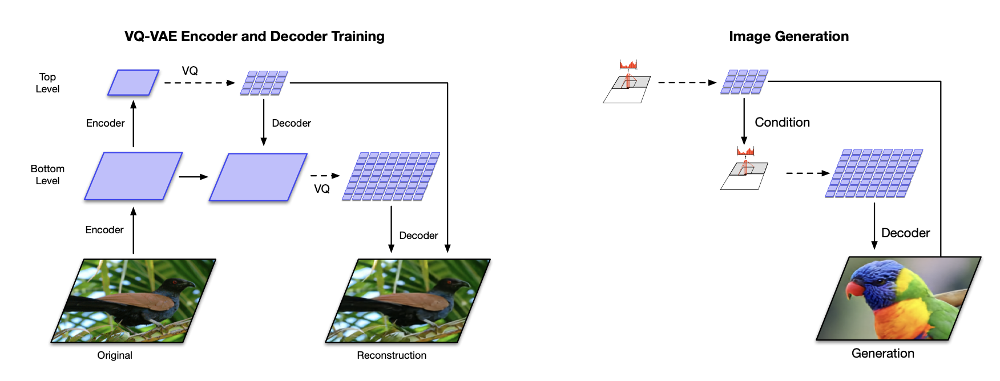
*Figure retrieved from Razavi et al. (2019)*

### 2.1 VQ-VAE2 (hierarchical encoder, codebooks, decoder)

VQ-VAE2 (Razavi et al., 2019) extends VQ-VAE (van den Oord et al., 2017) with a two-level
hierarchy. For a 256×128 slice:

| Stage | Output shape | Role |
|---|---|---|
| Bottom encoder (two stride-2 convs + 2 residual blocks) | 128 × 64 × 32 | local features |
| Top encoder (one stride-2 conv + 2 residual blocks) | 128 × 32 × 16 | global layout |
| Top quantiser (1×1 conv to 64 channels, codebook 512 × 64) | top codes 32 × 16 | |
| Top decoder, concatenated with bottom features, then bottom quantiser | bottom codes 64 × 32 | detail, given the layout |
| Decoder (upsampled top + bottom codes, 2 residual blocks, two transposed convs, sigmoid) | 1 × 256 × 128 | reconstruction |

The residual blocks follow He et al. (2016) as used in VQ-VAE: ReLU, 3×3 conv, ReLU, 1×1 conv, plus a skip connection. The full model has 1.66M parameters.

Each quantiser replaces every encoder vector z_e with its nearest codebook vector e (a nearest-neighbour lookup). Because this lookup has no gradient, the straight-through estimator copies the decoder's gradient directly to the encoder. The loss, per level, follows van den Oord et al. (2017, eq. 3):

$$\mathcal{L} = \lVert x - \hat{x} \rVert^2 + \lVert \mathrm{sg}[z_e] - e \rVert^2 + \beta \lVert z_e - \mathrm{sg}[e] \rVert^2, \quad \beta = 0.25$$

where sg is the stop-gradient. The second term (codebook loss) moves codes towards encoder outputs; the third (commitment loss) keeps encoder outputs close to their codes. The quantiser was adapted from Bao and Gilpin's notebook (after Laskin's implementation), with β moved to the commitment term to match the paper; the two-level wiring was adapted from rosinality's vq-vae-2-pytorch.

Two changes were needed to prevent codebook collapse (see Section 8): codebooks are initialised uniformly in [−1/K, 1/K], and every 100 training steps any code unused in that window is moved onto a randomly chosen encoder output (a "dead-code reset").

### 2.2 PixelCNN Prior (generating new code maps)

VQ-VAE2 alone can only reconstruct. To generate, a prior must produce new code grids. Two autoregressive PixelCNN priors (van den Oord et al., 2016a, 2016b) model each grid one position at a time, in raster order:

- The **top prior** models the 32×16 top grid unconditionally;
- The **bottom prior** models the 64×32 bottom grid conditioned on the top grid, which is
  embedded, upsampled ×2 and added into every layer.

Each prior embeds the code ids, applies a 7×7 masked convolution of type A (a position cannot see itself), then 10 gated residual blocks with 5×5 type-B masked convolutions and the gated activation tanh(a)·σ(b), and finally predicts a distribution over the codes at every position. The final priors are trained on **merged codes**: because the dead-code reset left each 512-code codebook crowded with near-duplicate codes (Section 8.2), each codebook was clustered with k-means into 128 groups and the priors predict group ids; at generation time each group id is decoded through its representative code (the member nearest the group centre), so the VQ-VAE2 itself is unchanged. Each prior's output bias is initialised to the log-frequency of each code, so training starts from the frequency baseline and only has to learn spatial context.

The masks guarantee that each prediction only uses positions above and to the left, which is verified by a causality test (`test_pixelcnn.py`). Priors are trained with cross-entropy. As a simplification, a single masked stack is used instead of the separate vertical and horizontal stacks of the gated PixelCNN, which leaves a known "blind spot" in the receptive field.

To generate a slice: sample top codes from the top prior, sample bottom codes from the bottom prior given the top codes, look both up in the codebooks, and decode. Sampling needs one full forward pass per position (512 for the top grid, 2,048 for the bottom), which makes it slow.

### 2.3 Baseline (plain autoencoder, no codebook)

The baseline uses exactly the same bottom encoder and decoder, with a 1×1 convolution to a continuous 64-channel latent of size 64×32 and a sigmoid output (0.66M parameters). It has no codebook, so it is trained with the reconstruction loss only. Comparing it with VQ-VAE2 isolates what quantisation costs and buys: the baseline can only reconstruct, because its continuous latent has no prior to sample from.

### 2.4 Training

All models were trained on the patient-level training split with Adam and batch size 32 on a MacBook Air M1 GPU (PyTorch `mps`): VQ-VAE2 for 20 epochs and the baseline for 10 (learning rate 3×10⁻⁴); the final top prior for 3 epochs and the bottom prior for 1 epoch on the merged codes (learning rate 3×10⁻⁴). The checkpoint with the lowest validation loss is kept for each model. Earlier prior runs are reported in Section 8 but are invalid because of an `mps` bug (Section 8.3).

## 3. Feasibility Review
**User Need, Scope & Acceptance Criteria**
The audience for our generative AI model would be healthcare researchers and medical-image developers. Products generated by the model can be used to teach students, or even to train larger models for recognition and classification. To effectively reach these stakeholders, the prototype aims to answer whether it can produce genuine representations of human body parts (ie. 2D scans of hips MRI), without the falling into common error of repetitive artifacts, hallucinations or directly replicate original samples. Thus, testable acceptance criteria include showing no memorization from the model, which is critical for protecting patients’ privacy; being able to add variations to generated samples; reconstruction quality have to meet SSIM > 0.6 between test; each training stage fits within a few GPU-hours on Rangpur, and generating a sample takes seconds, not minutes. 

**Model Choice & Course Concepts**
VQ-VAE2 is the chosen model for this problem, corresponding to hard difficulty. In general, it’s a generative neural network model that incorporates 2-level encoder-decoder hierarchy. During training, images are fed are being encoded in the lower-level, for finer details, and once again in the upper-level for the global structure. The final decoder uses the combined quantized tensors from top-level and bottom-level to reconstruction the original images, resulting in a sharper generative artifact, compared to the standard VQ-VAE and VAE. A PixelCNN prior, trained during stage 2 of the training, will then run over the given dataset to generate new images.

**Preliminary Feasibility Evidence**
The given dataset contains 2D Hip MRI scans of 38 unique patients who have been divided into training set (31 patients), validation set (4 patients), and test set (3 patients); splitting into 11,460 / 660 / 540 slices for each set respectively. Therefore, the scans and slices of each patient are also located in the original split that the patient is in, and there’s no leakage between scans of the same patient across each split, which preserve an unbiased training and testing process. 

**Risks, Budget & Fallback**
A considerable risk that I can face is the complex 2-level architecture that requires a considerable amount of time to construct and tuning until the final performance passes all the testable acceptance criteria mentioned above. In addition, the long wait in courses provided GPUs can ever reduce the efficiency of model training. Modest validation and test set size can also raise another issue when we’re checking the actual performance of the model (e.g. testing for memorization and variability). 
To overcome the first two points, VQ-VAE is an adequate fallback option for the original model, since its architecture is similar to VQ-VAE2, but 1-level less. And for the computing power, since it's a moderately undemanding model, I can train it on my local laptop, given that it would take longer time, in exchange for the long queue wait.

## 4. Data
### 4.1 Dataset
We're working with HipMRI Study 2D slices, retrieved from keras_slices_data on Rangpur (the HipMRI Study, citing Liu et al. 2020). Upon brief observation, the files are in NIfTI (.nii.gz) form with data type float32. There are two main data batch in the general folder with two different naming convention:
- case_<patient>_week_<scan>_slice_<n>: these are regular slices of MRI scans and are the files that we'll be working with. We can use them to train, validate and test our model.
- seg_<patient>_week_<scan>_slice_<n>:  these are masked MRI scans, which are derived from the original regular slices. They use colours to highlight the contours and boundaries of each different anatomical components of the scan. We can use these slice to check our recreations images' quality, and to see which anatomical structures appear where.
### 4.2 Split
The given data set has provided split into 3 groups: training/validate/test, which results to 31 / 4 / 3 patients, 11,460 / 660 / 540 slices, 60 slices per scan. To make sure no biases occur and assure adequate training and validating procedure, we have verified patient-level and found that there's zero patient overlap between train, validate and test.
### 4.3 Preprocessing
Our slices inherit the grayscale colour channel, which doesn't have a fixed range for the brightness of the cell, thus we have to perform per-slice min-max normalisation to [0, 1]. Next, after checking the slices shapes, we found that there's one training scan ('case_019_week_1', 60 slices) is 256×144 while all the others are in 256×128. Which would be a problem for our model since they don't accept batches in different sizes.

To resolve the problem, we first tried centre-cropping the slices to 256×128, which means cropping 8 pixels per sides, then checked against the masks. We saw that the removed columns contain labelled anatomy (205,288 labelled pixels across 60 slices; brightest pixel of some slices lies in the strips).

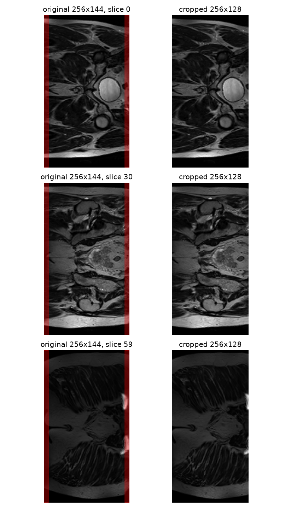

Although on further observation, the removed columns contain only small stripes of bigger components in the slice. However, due to the lack of domain knowledge about anatomy, removing those vertical columns on the sides can violate some unknown constraint. Thus we decided to exclude case_019_week_1 (0.5% of training slices), since we assume that with the abundant resources for training, 60 slices won't affect the gradient to a noticable degree. Patient 019 stays in training via their other scans.

## 5. Dependencies

| Package | Version | Used for |
|---|---|---|
| torch | 2.14.1 | models, training |
| numpy | 2.4.6 | arrays |
| nibabel | 5.4.2 | reading NIfTI slices |
| matplotlib | 3.11.2 | figures |
| scikit-image | 0.26.0 | SSIM |

Get the exact versions with `pip freeze | grep -iE "torch|numpy|nibabel|matplotlib|scikit-image"`.
Install with `pip install torch numpy nibabel matplotlib scikit-image`.

The HipMRI 2D slices (`keras_slices_data`) are only available on the Rangpur cluster and are
not included in this repository; copy them to a local folder and pass its path as `--data-dir`.

## 6. Usage

All commands are run from this folder; `DATA` is the path to `keras_slices_data`.
Long runs on a Mac can be wrapped in `caffeinate -i` to stop the laptop sleeping.

### 6.1 Training

```bash
# 0. Checks (optional): data split and shapes, unit tests
python dataset.py --data-dir "$DATA"
python test_quantizer.py
python test_pixelcnn.py

# 1. Stage 1: VQ-VAE2 and the baseline
python train.py --data-dir "$DATA" --model vqvae2 --epochs 20
python train.py --data-dir "$DATA" --model baseline --epochs 10

# 2. Encode the training set into code grids and cache them (runs/prior/)
python train_prior.py --data-dir "$DATA" --level top --max-steps 1

# 3. Merge near-duplicate codes (512 -> 128 per level) and report the cost
python merge_codes.py --data-dir "$DATA" --k 128

# 4. Stage 2: PixelCNN priors on the merged codes
python train_prior.py --data-dir "$DATA" --out-dir runs/prior_merged --num-codes 128 --level top --epochs 3
python train_prior.py --data-dir "$DATA" --out-dir runs/prior_merged --num-codes 128 --level bottom --epochs 1
```

`train.py` writes `runs/<model>/log.csv`, reconstruction snapshots of 8 fixed validation slices
every 2 epochs, and `best.pt` / `last.pt`. `train_prior.py` writes `<level>_log.csv` and
`<level>_best.pt` in its output folder.

### 6.2 Inference / Sampling

```bash
python predict.py --data-dir "$DATA" --prior-dir runs/prior_merged \
    --merge-file runs/prior_merged/merge.pt --out-dir runs/predict_merged --temperature 0.8
```

`predict.py` (1) reports test-set SSIM for VQ-VAE2 and the baseline, (2) samples new slices
(top prior → bottom prior → decoder), (3) runs the memorisation audit and (4) diversity and
intensity checks. It writes the figures in Section 7 and `metrics.json`. Sampling is slow
(one forward pass per code position); add `--load-samples` to re-run the evaluation on saved
samples.

Exploratory scripts are in `eda/`: `explore_slices.py`, `check_crop.py` and `sanity_prior.py`.

## 7. Results
### 7.1 Example Inputs and Outputs

**Reconstruction.** On the test split (3 unseen patients, 540 slices), VQ-VAE2 reconstructs slices with a mean SSIM of **0.935 ± 0.011** (worst slice 0.906); every test slice meets the SSIM > 0.6 acceptance criterion. Anatomy, organ boundaries and the body outline are preserved; the finest texture (speckle in fat, thin bright lines) is slightly smoothed.

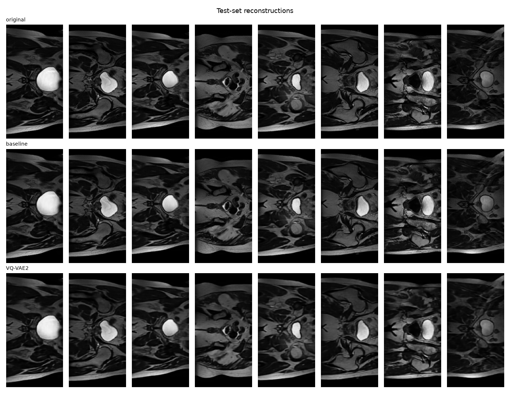

**Generation.** The final samples (8 slices, temperature 0.8) show large-scale structure the first run lacked: background at the top, coherent tissue regions with realistic grey levels, and occasional thin boundary-like lines. However, they are **not** anatomically plausible: no organs, femoral heads or bladder appear, the body outline is incomplete, and there is no left-right symmetry.

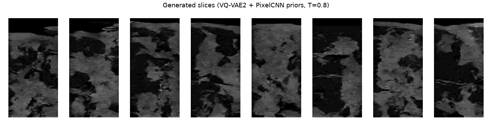

### 7.2 Training Curves

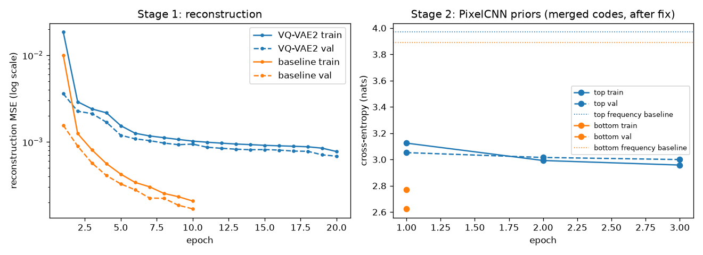

Both stage-1 models converge without overfitting (validation loss stays below the epoch-averaged training loss). VQ-VAE2 improves quickly for five epochs and then slowly, limited by its code bottleneck; the baseline was still improving at epoch 10. Both priors end well below their code-frequency baselines (top 3.00 vs 3.97; bottom 2.62 vs 3.89), showing they learn spatial context, though both were still improving when training stopped.

VQ-VAE2 reconstruction loss fell from 0.0050 after 200 steps to 0.00068 after 20 epochs, with no gap between training and validation loss. The snapshots show the progression on the same fixed validation slices:

| Two-tone collapse (200 steps) | After dead-code reset (200 steps) | Epoch 6 | Epoch 20 |
|---|---|---|---|
| 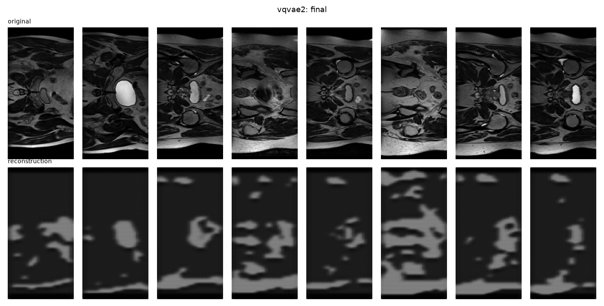 | 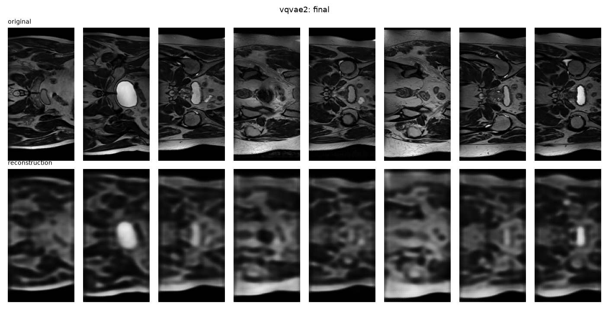 | 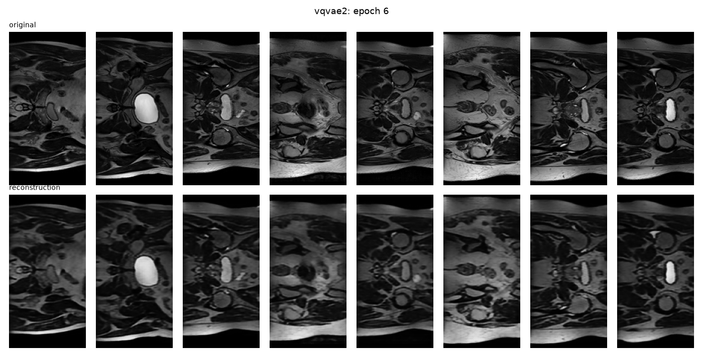 |  |

The final top prior reached a validation cross-entropy of 3.00, about one nat below its frequency baseline of 3.97, and was still improving after 3 epochs; the bottom prior reached 2.62 (frequency baseline 3.89) after 1 epoch.

### 7.3 Baseline vs VQ-VAE2

| | Baseline AE | VQ-VAE2 | VQ-VAE2, merged codes |
|---|---|---|---|
| Parameters | 0.66M | 1.66M | 1.66M |
| Best validation MSE | 0.00017 | 0.00068 | – |
| Test SSIM (mean ± sd) | 0.982 ± 0.003 | 0.935 ± 0.011 | 0.897 (min 0.860) |
| Can generate new slices | no | yes (with priors) | yes (with priors) |

The baseline reconstructs better than VQ-VAE2. This is expected: its latent is a 64×32 grid of continuous 64-number vectors with no bottleneck, while VQ-VAE2 must express every position with
one of 512 codes. Quantisation therefore costs reconstruction fidelity (about 4× higher MSE), but it is what makes generation possible: discrete code grids can be modelled and sampled by a PixelCNN, whereas the baseline's continuous latent has no prior to sample from. Merging codes for the priors costs a further 0.04 SSIM but keeps every slice well above the 0.6 target.

### 7.4 Memorisation Audit (nearest-neighbour analysis)

For every generated slice, the pixel MSE to its nearest training slice is compared with the same distance for real held-out slices (validation and test pooled: 7 patients, 1,200 slices). A generated slice much closer to the training set than real unseen slices would suggest memorisation.

For the final 8 samples, the median distance to the nearest training slice was 0.023, close to the 0.020 of real held-out slices, and no sample was closer to the training set than the 5th percentile of real slices (0.0146), so there is no sign of memorisation. However, the nearest-neighbour pairs show that pixel MSE mostly matches overall brightness rather than anatomy: the nearest training slices are dark, low-contrast slices, and two samples share the same nearest neighbour (#7493). A low distance therefore does not mean a sample is realistic; a feature-based distance (e.g. from a pretrained network) or the segmentation-based check in Section 9 would be more informative. With only 8 samples, this is weak evidence either way.

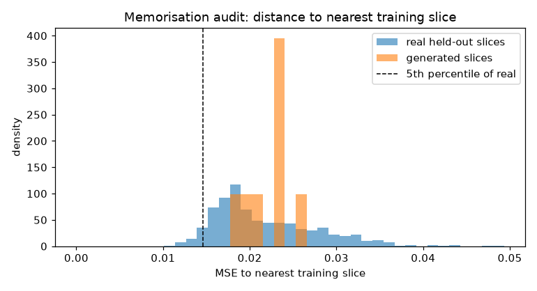
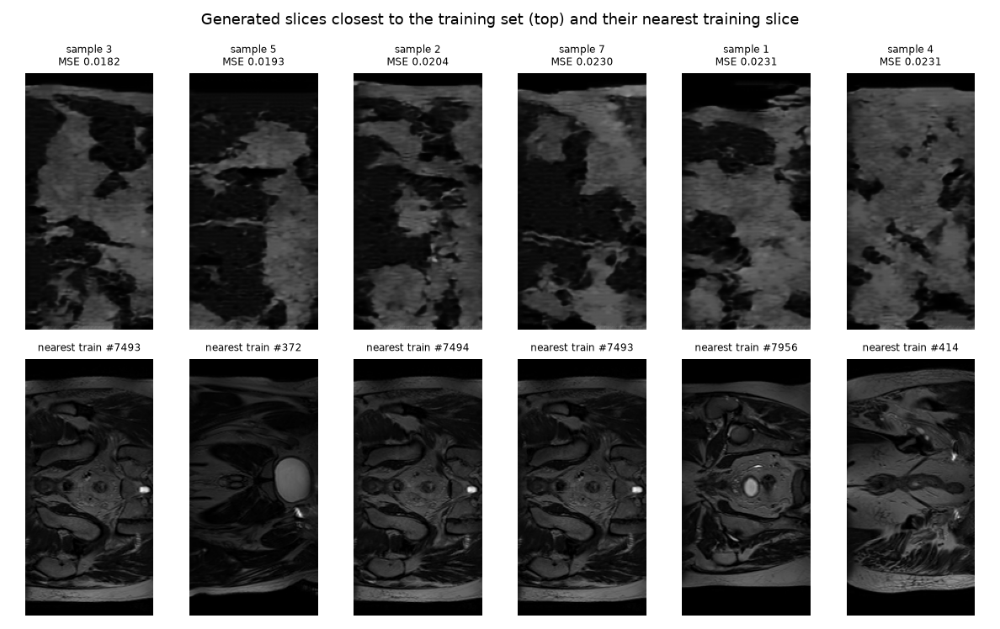

Interpretation caveat: the audit can only flag memorisation when samples are realistic. In the first sampling run, samples were noise, so "0 of 16 samples close to training" was trivially true and does not show the model avoids memorisation. The final samples are realistic in intensity and large-scale structure but not in anatomy, so the audit is only partly meaningful. It would catch a sample that copies a training slice, but a low distance cannot be read as evidence of realism.

The held-out reference is small (7 patients) because the provided validation and test splits are small; this limits how precisely the "normal" distance can be estimated.

### 7.5 Resource Profiling

All on a MacBook Air M1 GPU (`mps`), batch size 32.

| Stage | Parameters | Speed | Total time |
|---|---|---|---|
| VQ-VAE2 training | 1.66M | 0.65 s/step, about 5.2 min/epoch measured | 1 h 45 min (20 epochs) |
| Baseline training | 0.66M | about 3.2 min/epoch (from log, incl. validation) | 32 minutes (10 epochs) |
| Top prior (merged, after fix) | 9.2M | 0.78 s/step, about 5.5 min/epoch | about 17 min (3 epochs) |
| Bottom prior (merged) | 10.1M parameters | 4.81 s/step, about 28.5 min/epoch measured | 36 min (1 epoch) |
| Sampling | – | 131 s per slice (batch of 16) | 17.5 min for 8 slices |

The smoke test predicted 3.8 min per VQ-VAE2 epoch; the measured 5.2 min includes validation and snapshots. The feasibility review's criterion that "generating a sample takes seconds, not minutes" was **not met**: autoregressive sampling needs 2,560 sequential forward passes per slice.

## 8. Failure Autopsies

### 8.1 Codebook collapse: two-tone reconstructions

**What happened.** After a 200-step smoke test, reconstructions were two flat shades of grey.
**Evidence.** Validation slices used **1 of 512** top codes and **2 of 512** bottom codes.
**Cause.** With PyTorch's default initialisation the codebook vectors start much larger than the encoder's outputs, so a few codes win everywhere; unused codes never receive gradients and never recover. Uniform initialisation in [−1/K, 1/K] alone did not help (1 / 3 codes).
**Fix.** A dead-code reset: every 100 steps, codes unused in that window are moved onto random encoder outputs. At the same 200 steps, usage rose to 208 / 165 codes and validation MSE fell from 0.0150 to 0.0050; after full training all 512 codes were used at both levels.


### 8.2 A crowded codebook

**What happened.** The reset fixed collapse but left the codebooks crowded.
**Evidence.** About 30% of codes had a near-twin (nearest other code within 10% of the typical distance between codes), and neighbouring positions shared a code only 4.0% (top) and 12.2% (bottom) of the time, even across uniform background. The encoder's choice between near-identical codes is close to random, which makes the code grids harder to predict.
**Cause.** Repeatedly placing dead codes on random encoder outputs puts them next to codes that are already in use.
**Response.** Merging codes into 128 groups raised neighbour agreement to 10.5% (top) and 26.1% (bottom) at a reconstruction cost of 0.935 → 0.897 SSIM.
**Better fix (not tried).** Reset dead codes only early in training, or use EMA codebook updates (van den Oord et al., 2017, appendix).

### 8.3 Priors that could not learn: a silent `mps` bug

**What happened.** The first priors produced pure texture noise.

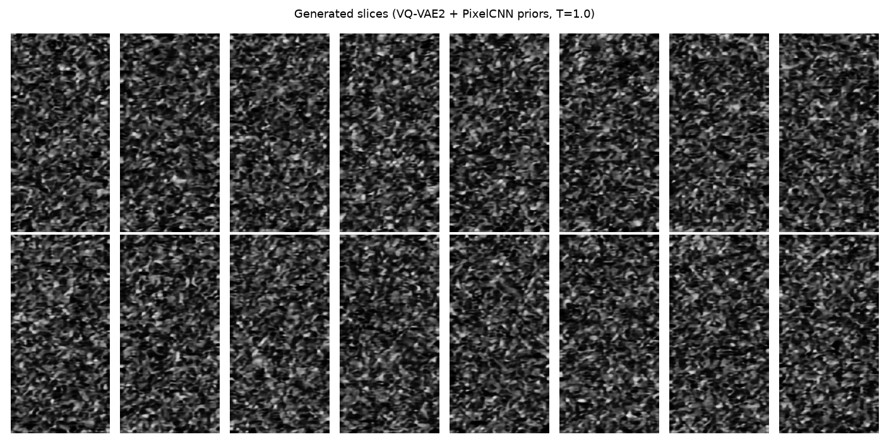

**Evidence.** Every prior's cross-entropy stayed at or above its **code-frequency baseline** (the CE a model reaches by knowing only how often each code appears):

| Prior run | Val CE | Frequency baseline |
|---|---|---|
| Top, 512 codes, 5 epochs | 6.01 | 5.86 |
| Bottom, 512 codes, 8 epochs | 5.92 | 5.78 |
| Top, merged 128 codes, 3 epochs | 4.57 | 3.97 |
| Top, merged, bias at code frequencies (lr 10⁻³ and 3×10⁻⁴) | 3.9726 every epoch | 3.97 |
| **Top, merged, after the fix** | **3.00** | 3.97 |
| **Bottom, merged, after the fix** | 2.62 | 3.89 |

At first this was attributed to the crowded codebook (8.2). A synthetic sanity task (`eda/sanity_prior.py`), where every code is its left neighbour + 1, isolated the real cause: the same prior reached a cross-entropy of 0.39 on the CPU but stayed at 4.85 (a uniform guess) on `mps`, with either form of the loss.
**Cause.** In `PixelCNNPrior.forward`, the permuted embedding output was not contiguous in memory; on `mps` this silently broke learning in the masked convolutions.
**Fix.** Adding `.contiguous()` made `mps` match the CPU (0.39) and the top prior immediately learned spatial context (3.00, about one nat below baseline).
**Lesson.** Compare against the frequency baseline, not the uniform guess, and test a new model on a task with a known answer before trusting it on real data.

### 8.4 Final samples: texture without anatomy, and low diversity

**What happened.** Final samples have realistic grey levels and large coherent regions but no
recognisable anatomy, and they vary less than real slices.


**Evidence.** Mean pairwise MSE between samples is 0.023, about half that between real slices
(0.044); two samples share the same nearest training slice; all show a similar dark top band
and patchwork texture.
**Likely causes.** (1) The priors are under-trained: 3 and 1 epochs, with loss still falling
(Section 7.2). (2) The top prior, which should set the global layout, has the weakest signal:
even after merging, neighbouring top codes agree only 10.5% of the time, so the layout is
hard to learn. (3) The single-stack PixelCNN's blind spot hides some above-right context.
(4) Temperature 0.8 trades diversity for confidence.
**What would fix it.** Longer prior training, a cleaner codebook (Section 8.2), and the full
gated PixelCNN; then re-check diversity at temperature 1.0.

## 9. Recommendation

**Reconstruction: ready.** VQ-VAE2 compresses and rebuilds hip MRI slices with test SSIM 0.935 (every slice above 0.6) on patients it never saw, using a codebook that is fully used.

**Generation: not ready for research use.** After the mps fix, the priors learn spatial context (cross-entropy 1.0–1.3 nats below their frequency baselines) and samples gained large-scale structure, but they show no recognisable anatomy and are less diverse than real slices. No memorisation was detected, but the pixel-space audit is too weak to certify realism.

**Next steps, in order:**
1. Train the priors for many more epochs (their loss was still falling) and compare samples
   against the frequency-baseline and memorisation checks at each stage.
2. Retrain VQ-VAE2 with dead-code resets only in early training (or EMA updates) to get a cleaner
   codebook without merging, avoiding the 0.04 SSIM cost of merging.
3. Use the full gated PixelCNN (separate vertical and horizontal stacks) to remove the blind spot,
   and speed up sampling (for example by recomputing only the rows a position can see).
4. Add an automated anatomical-plausibility check: train a segmentation network on the provided
   masks and test whether generated slices contain organs in plausible positions and sizes.
5. Pool more patients into the held-out reference for the memorisation audit.

## 10. Artificial Intelligence Usage Disclosure
**Tool.** Claude (Anthropic), used as a guide and pair programmer throughout the project.

**Written by me, with Claude's guidance and review:**
- `VectorQuantizer` (`modules.py`): nearest-code lookup, codebook and commitment losses,
  straight-through estimator, `embed_code`. Adapted from Bao's notebook (after Laskin); I moved β
  to the commitment term to match van den Oord et al. (2017, eq. 3) after Claude pointed out the
  difference.
- `VQVAE2` wiring (`modules.py`): adapted from rosinality's `vqvae.py` (Apache-2.0 header) to my
  own encoder, decoder and quantiser classes.
- The training steps and validation passes in `train.py` and `train_prior.py`.

**Generated or scaffolded by Claude, then audited by me:**
- `dataset.py`, `eda/explore_slices.py`, `eda/check_crop.py`, `eda/sanity_prior.py`
- `ResidualBlock`, `Encoder`, `Decoder`, `BaselineAE` and the PixelCNN classes in `modules.py`
- The setup, logging, snapshot and checkpoint code in `train.py` and `train_prior.py`;
  `predict.py`; `merge_codes.py`
- `test_quantizer.py` and `test_pixelcnn.py`
- Debugging: diagnosing codebook collapse and the dead-code reset; the codebook diagnostics;
  finding the `mps` contiguity bug
- Drafting parts of this README (Method and Sections 5–10), which I edited

**How I verified it:**
- **Unit tests:** `test_quantizer.py` (8 checks: shapes, brute-force nearest code,
  straight-through value, loss value, gradients, β placement, `embed_code`, dead-code reset) and
  `test_pixelcnn.py` (mask patterns, causality, non-vacuous influence, conditioning, loss,
  sampling); shape tests in `modules.py`.
- **Data checks:** split counts and zero patient overlap matched my manual audit; the crop check
  against the masks overturned the plan to crop.
- **Smoke tests** before every long run, and code-usage counts to confirm collapse and its fix.
- **A synthetic sanity task** with a known answer, run on CPU and `mps`, which found the bug.
- **Every reported number** comes from my own runs; I compared reconstructions and samples by eye.

## References
Bao, A. (n.d.). Vector Quantized VAE (VQ-VAE). In W. Gilpin, *An Introduction to Algorithms for Physicists* [Course notes, The University of Texas at Austin]. Retrieved 1 November 2026, from
https://www.wgilpin.com/cphy/vq-vae/

He, K., Zhang, X., Ren, S., & Sun, J. (2016). Deep residual learning for image recognition. CVPR 2016. https://arxiv.org/abs/1512.03385

Laskin, M. (n.d.). vqvae [Source code]. GitHub. https://github.com/MishaLaskin/vqvae 

Liu, S., Dowling, J. A., Engstrom, C., Greer, P. B., Crozier, S., & Chandra, S. S. (2020). Manipulating medical image translation with manifold disentanglement. *arXiv preprint* arXiv:2011.13615. https://arxiv.org/abs/2011.13615

Razavi, A., van den Oord, A., & Vinyals, O. (2019). Generating diverse high-fidelity images with VQ-VAE-2. *Advances in Neural Information Processing Systems 32 (NeurIPS 2019)*. https://arxiv.org/abs/1906.00446

rosinality. (n.d.). *vq-vae-2-pytorch* [Source code; vqvae.py]. GitHub. Retrieved 1 November 2026, from https://github.com/rosinality/vq-vae-2-pytorch/blob/master/vqvae.py

van den Oord, A., Kalchbrenner, N., & Kavukcuoglu, K. (2016a). Pixel recurrent neural networks. ICML 2016. https://arxiv.org/abs/1601.06759

van den Oord, A., Kalchbrenner, N., Vinyals, O., Espeholt, L., Graves, A., & Kavukcuoglu, K. (2016b). Conditional image generation with PixelCNN decoders. NeurIPS 2016. https://arxiv.org/abs/1606.05328

van den Oord, A., Vinyals, O., & Kavukcuoglu, K. (2017). Neural discrete representation learning. *Advances in Neural Information Processing Systems 30 (NeurIPS 2017)*. https://arxiv.org/abs/1711.00937

**Acknowledgement.** Data were provided by the HipMRI Study (Liu et al., 2020).