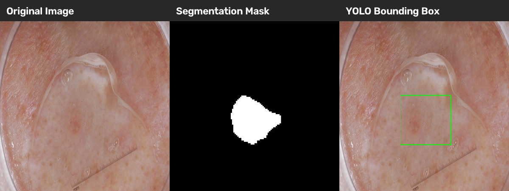
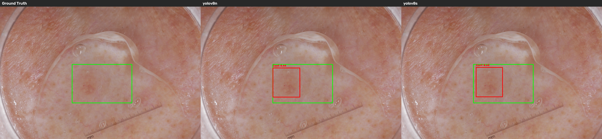
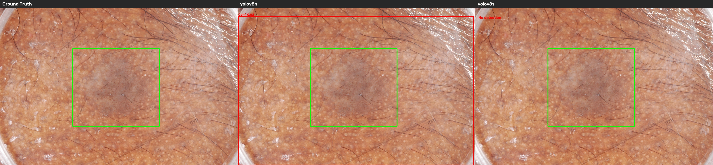
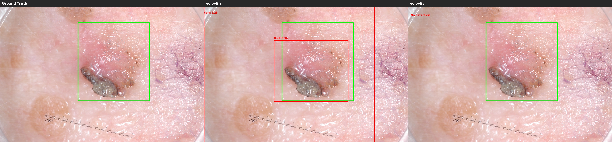
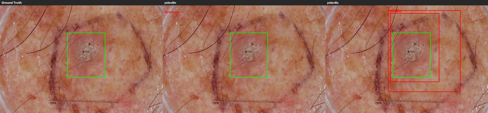
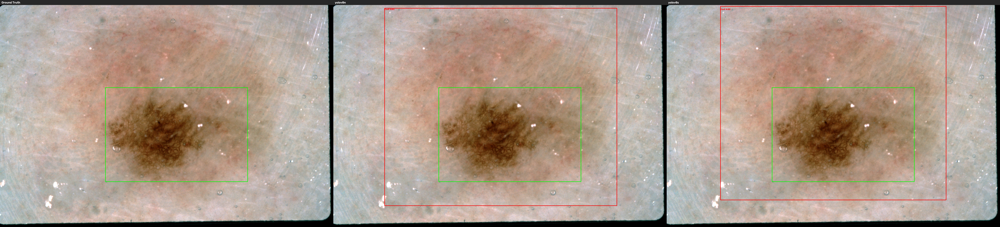

# Skin Lesion Detection Using YOLOv8

**Course**: COMP3710 Pattern Recognition

**Student ID**: 49800683

**Dataset**: ISIC2018

**Models**: YOLOv8n, YOLOv8s

## 1. Project Overview

This project implements skin lesion detection using YOLOv8 object detection models on the ISIC2018 dataset.

The original segmentation masks are converted into bounding-box annotations in the YOLO format. The two pretrained models, `YOLOv8n` and `YOLOv8s`, are fine-tuned and compared in areas of detection accuracy, localization performance, model complexity, and inference speed.

## 2. Dataset

The project uses 2,594 ISIC2018 dermoscopic images and their corresponding lesion segmentation masks. 

Since YOLOv8 requires bounding-box annotations, the original binary segmentation masks are converted into rectangular bounding boxes that enclose the lesion regions. 

### Dataset Example


*Figure 1. Original dermoscopic image, corresponding binary segmentation mask, and YOLO bounding-box annotation.*

### Dataset Preparation

The preprocessing follows this pipeline:
1. Matches each image with its segmentation mask
2. Extracts the minimum bounding rectangle around the non-zero pixels in the mask
3. Converts bounding-box coordinates into normalized YOLO format
4. Splits the dataset into training, validation, and testing subsets
5. Saves the images and annotations in the YOLO dataset structure

A fixed random seed of 42 is used for reproducibility.

### Dataset Split

| Split | Images | Percentage |
|---|---:|---:|
| Training | 2,076 | Approximately 80% |
| Validation | 259 | Approximately 10% |
| Testing | 259 | Approximately 10% |
| Total | 2,594 | 100% |

The dataset contains one detection class:
- `0`: Lesion

### YOLO Annotation Format

Each annotation follows the format: `class_id x_center y_center width height`

All bounding-box coordinates are normalized relative to image dimensions. 

## 3. Models

Two YOLOv8 architectures are compared:

| Model | Parameters (approximately) |
|---|---:|
| YOLOv8n | 3.13 million |
| YOLOv8s | 11.13 million |

YOLOv8n is a lightweight architecture designed for computational efficiency, while YOLOv8s is a larger model with greater representational capacity. 

## 4. Implementation

The implementation is organized into the following Python files:

| File | Description |
|---|---|
| `dataset.py` | Converts segmentation masks into YOLO bounding-box annotations and creates dataset splits |
| `modules.py` | Defines and loads YOLOv8n and YOLOv8s models |
| `train.py` | Fine-tunes the models using the prepared dataset |
| `predict.py` | Evaluates detection accuracy, calculates IoU, analyzes failure cases, generates visualizations, and benchmarks inference speed |
| `utils.py` | Validates dataset annotations and supports bounding-box inspection |

### Training Configuration 

| Parameter | Value |
|---|---|
| Epochs | 50 |
| Image size | 640 × 640 |
| Batch size | 16 |
| Random seed | 42 |
| Optimizer | Ultralytics default |
| Training GPU | NVIDIA L40S |
| Framework | PyTorch and Ultralytics YOLOv8 |

Both models use the same training configuration and data split. The best checkpoint is selected using validation performance. 

## 5. Environment and Dependencies

The project uses Python with the following main libraries:
- `PyTorch`
- `Ultralytics`
- `OpenCV`
- `NumPy`

Install the required packages in a suitable Python environment:

```bash
python -m pip install ultralytics opencv-python numpy
```

A compatible PyTorch installation is also required. GPU training additionally requires an appropriate CUDA-enabled PyTorch environment. 

The experiments were conducted using Ultralytics 8.4.185 and PyTorch 2.14.0+cu130 on an NVIDIA L40S GPU.

## 6. Running the Project

### Dataset Preparation

Download the ISIC2018 dataset and place the original dermoscopic images and their corresponding segmentation masks in the `ISIC2018/` directory at the project root.

Run the preprocessing script from the `PatternAnalysis-2026` root directory:

```bash
python recognition/YOLOv8_s4980068/dataset.py
```

The processed dataset is saved in `ISIC2018_yolo/` with the following structure:

```
ISIC2018_yolo/
├── data.yaml
├── images/
│   ├── train/
│   ├── val/
│   └── test/
└── labels/
    ├── train/
    ├── val/
    └── test/
```

**Note**: The path field in `ISIC2018_yolo/data.yaml` must be updated to match the absolute path of the prepared dataset on the machine used for training or evaluation. 

### Model Training

Both YOLOv8n and YOLOv8s are fine-tuned using pretrained weights and training configuration described in [Training Configuration](#training-configuration) section.

From the `PatternAnalysis-2026` root directory, run:

```bash
python recognition/YOLOv8_s4980068/train.py
```

The training was performed on the UQ Virtual GPU environment. Model checkpoints, training metrics and performance plots are saved in `COMP3710_results/`.

The `best.pt` checkpoint from each model is used for final evaluation on the held-out test set. 

**Note:** GPU training requires a CUDA-enabled PyTorch environment. The dataset and output paths must match the machine's directory structure. 

### Evaluation and Prediction

From the `PatternAnalysis-2026` root directory, run:

```bash
python recognition/YOLOv8_s4980068/predict.py
```

The script supports test-set evaluation, localisation analysis, failure-case visualisation, and inference benchmarking. These tasks can be turned on or off using the flags in the `main` section of the file. 

The output of the script, including evaluation results, IoU measurements, and generated visualisations are saved in `COMP3710_results/`.

## 7. Experimental Results

Both models were evaluated on the same held-out test set of 259 images after 50 epochs of training.

### Test Set Performance

| Metric | YOLOv8n | YOLOv8s |
|---|---:|---:|
| Precision | **96.16%** | 95.74% |
| Recall | **96.91%** | 95.56% |
| mAP@50 | 97.96% | **98.55%** |
| mAP@50:95 | 74.81% | **75.19%** |
| Mean IoU | **86.18%** | 85.33% |

YOLOv8s achieved slightly higher mAP scores, while YOLOv8n performed better in precision, recall, and mean IoU. Mean IoU was calculated using the highest-overlapping prediction per image at a confidence threshold of 0.25. Images without overlapping predictions were assigned an IoU of zero. 

### CPU Inference Benchmark

Inference speed was measured on a MacBook CPU using all 259 test images, processed sequentially with a batch size of 1. 

| Metric | YOLOv8n | YOLOv8s |
|---|---:|---:|
| Total time | 14.95 s | 21.81 s |
| Average latency | 57.71 ms/image | 84.20 ms/image |
| Throughput | **17.33 FPS** | 11.88 FPS |

The benchmark includes image loading, preprocessing, inference and postprocessing. The results are based on a single CPU benchmarking run.

### Confidence-Threshold Analysis

To investigate the trade-off between detection sensitivity and false alarms, both models were evaluated on the 259-image validation set using confidence thresholds of 0.10, 0.25, 0.50, and 0.75. Predictions were matched to ground-truth bounding boxes using an IoU threshold of 0.50.

| Model | Threshold | TP | FP | FN | Precision | Recall |
|---|---:|---:|---:|---:|---:|---:|
| YOLOv8n | 0.10 | 252 | 33 | 7 | 88.42% | 97.30% |
| YOLOv8n | 0.25 | 251 | 16 | 8 | 94.01% | 96.91% |
| YOLOv8n | 0.50 | 247 | 5 | 12 | 98.02% | 95.37% |
| YOLOv8n | 0.75 | 215 | 2 | 44 | 99.08% | 83.01% |
| YOLOv8s | 0.10 | 253 | 31 | 6 | 89.08% | 97.68% |
| YOLOv8s | 0.25 | 249 | 18 | 10 | 93.26% | 96.14% |
| YOLOv8s | 0.50 | 243 | 7 | 16 | 97.20% | 93.82% |
| YOLOv8s | 0.75 | 217 | 1 | 42 | 99.54% | 83.78% |

*TP: correctly matched detections; FP: unmatched or duplicate predictions; FN: missed ground-truth lesions.*

Increasing the confidence threshold generally reduces false-positive detections but also increases missed lesions. For YOLOv8n, raising the threshold from 0.10 to 0.25 reduces false positives from 33 to 16 while increasing false negatives from 7 to 8. In contrast, a threshold of 0.75 reduces false positives to 2 but increases missed lesions to 44.

YOLOv8s achieves slightly higher recall at 0.10, but YOLOv8n performs better at 0.25 and 0.50. These findings suggest that model selection should consider the operating threshold rather than relying solely on aggregate mAP scores.

### Engineering Recommendation

YOLOv8n with a confidence threshold of 0.25 is recommended as the provisional operating configuration for this prototype. It provides high validation recall of 96.91%, while producing fewer false positives than the 0.10 threshold, in addition to model's lower computational cost.

The predictions should be treated as preliminary lesion-localisation suggestions requiring human review. Since the dataset supports only single-class lesion detection, the results cannot establish malignant melanoma sensitivity or predict biopsy burden. Clinical deployment would require additional validation and lesion-type classification.

## 8. Failure-Case Analysis

Five challenging test images were selected based on their low IoU scores to investigate common detection and localisation errors. 

| Failure Case | Observed Issue |
|---|---|
|  | **ISIC_0012159:** Both models underestimate the lesion's bounding-box size. |
|  | **ISIC_0012207:** YOLOv8n predicts an oversized box, while YOLOv8s misses the lesion. |
|  | **ISIC_0013177:** YOLOv8n produces multiple detections, while YOLOv8s misses the lesion. |
|  | **ISIC_0013684:** YOLOv8n misses the lesion, while YOLOv8s produces oversized boxes. |
|  | **ISIC_0015614:** Both models predict boxes larger than the ground truth. |

**Green boxes** represent the ground-truth annotations, while **red boxes** represent the model predictions. All predictions use a confidence threshold of 0.25. 

## 9. Discussion and Limitations

The results reveal that both YOLOv8n and YOLOv8s perform effectively in detecting skin lesions on the ISIC2018 dataset, with only minor differences in detection accuracy. 

Although YOLOv8s achieves slightly higher mAP@50 and mAP@50:95 scores, its larger architecture doesn't provide a bigger improvement over YOLOv8n. Despite the number of parameters being approximately 3.6 times larger, YOLOv8s only improves mAP@50:95 by 0.38 percentage points. This suggests that increasing the model complexity does not necessarily lead to proportionally better detection performance for this task. 

In contrast, YOLOv8n achieves higher precision, recall, and mean best overlap IoU, with approximately 46% higher CPU inference throughput. These results indicate that YOLOv8n offers a more favourable trade-off between detection accuracy and computational efficiency, particularly in environments with limited computational resources. 

The failure case analysis further highlights the distinction between lesion detection and accurate localisation. While both models achieve high mAP@50 scores, from their low mAP@50:95 suggest reduced performance under stricter IoU thresholds. Visual inspection reveals that both models occasionally produce oversized or underestimated bounding boxes, particularly for lesions with unclear boundaries. Some challenging images also result in missed detections, demonstrating that high overall detection accuracy does not guarantee reliable performance on every image.

Several limitations should be considered when interpreting these findings:
- **Bounding-box representation:** The annotations are derived from segmentation masks, limiting the task to rectangular lesion localization rather than pixel-level segmentation.
- **Single-class detection:** The models detect lesions but do not distinguish between different skin conditions.
- **Experimental scope:** The evaluation is based on a single dataset split and one training run per architecture, limiting conclusions about performance consistency and generalizability.
- **Localization evaluation:** Mean IoU is calculated using the highest-overlapping prediction per image, which differs from standard object detection matching procedures.
- **Clinical applicability:** The models have not been clinically validated and are intended for academic experimentation rather than medical diagnosis.

Further experiments across different datasets, random seeds, and evaluation environments would be necessary to determine whether these advantages generalise beyond the current experimental setup. 

## 10. Feasibility Review

**Project Title:** Skin Lesion Detection Using YOLOv8: Evaluating Detection Accuracy and Computational Efficiency

**Selected Models:** YOLOv8n (Baseline) and YOLOv8s (Proposed Model) – Normal Difficulty

**Dataset:** ISIC2018 Dermoscopic Images

**Framework:** Python, PyTorch, Ultralytics YOLO

### 10.1 User Needs, Scope and Acceptance Criteria

This project aims to develop a YOLOv8-based prototype for detecting and localising skin lesions in dermoscopic images. The main objective is to investigate whether a larger detection model provides sufficient improvements in accuracy and localisation to justify its additional computational cost, while considering the trade-off between detection sensitivity and false positives.

**Acceptance criteria:**
- Achieve a target mean localisation IoU ≥ 0.80 and report mAP@50, mAP@50:95, precision and recall.
- Compare YOLOv8n and YOLOv8s using identical dataset splits and training configurations.
- Evaluate confidence thresholds to investigate detection sensitivity and false-positive trade-offs.
- Analyse 3–5 representative failure cases and measure inference throughput (FPS).

### 10.2 Model Choice and Course Concepts

YOLOv8 is a one-stage object detector suited to bounding-box localisation. Two pretrained variants will be fine-tuned on the same image splits and settings: YOLOv8n as a lightweight baseline and YOLOv8s as the higher-capacity proposed model.

Binary segmentation masks will be converted to normalised box coordinates. The project applies convolutional neural networks, transfer learning, supervised detection, validation-based model selection and precision-recall analysis.

Patient-level separation will be attempted if reliable patient identifiers are available; otherwise, that limitation will be documented.

### 10.3 Preliminary Feasibility Evidence

Initial inspection of the ISIC2018 dataset on Rangpur identified approximately 2,595 candidate training images with corresponding segmentation masks and roughly 1,001 original test images.

The consistent image-mask naming convention supports automated conversion into YOLO bounding-box annotations. Next, image-mask matching, annotation validity and available patient metadata will be verified before creating reproducible training, validation and test splits.

A small GPU experiment will assess whether both pretrained models can be fine-tuned within the available computing and storage resources.

### 10.4 Risks, Budget and Fallback

Key risks include incorrect bounding-box conversion, inconsistent annotations, potential data leakage, inaccurate localisation of lesions with unclear boundaries and limited GPU resources.

The project is planned over approximately two weeks, with GPU acceleration used for model fine-tuning and CPU execution available for inference benchmarking.

If YOLOv8s requires excessive computational resources or provides only marginal accuracy improvements, YOLOv8n will remain the preferred lightweight alternative.

**Expected outcome:** A reproducible skin lesion detection prototype with quantitative baseline comparison, confidence-threshold analysis, representative failure-case investigation and an evidence-based recommendation balancing detection accuracy with computational efficiency.


## 11. Artificial Intelligence Usage Disclosure

ChatGPT (OpenAI) was used as a supporting tool during the development of this project.

AI assistance was used for:
- Understanding YOLOv8 concepts, evaluation metrics, and implementation approaches.
- Debugging Python code and resolving environment-related issues.
- Guidance on dataset preprocessing, model evaluation, and result visualisation.
- Improving the clarity, structure, and formatting of the README documentation.

All AI-assisted suggestions were reviewed and checked against the project requirements. The implementation was tested by running preprocessing, training, and evaluation scripts, inspecting generated outputs, and comparing experimental results.

The final implementation, experimental analysis, and submitted work were reviewed and verified by the author.

## 12. Conclusion

This project implemented and evaluated YOLOv8n and YOLOv8s for skin lesion detection using the ISIC2018 dataset. 

Both models showed strong detection performance, with YOLOv8n demonstrating a more favourable balance between accuracy and computational efficiency. The results highlight the importance of evaluating localisation accuracy and inference speed with standard detection metrics when comparing object detection models. 