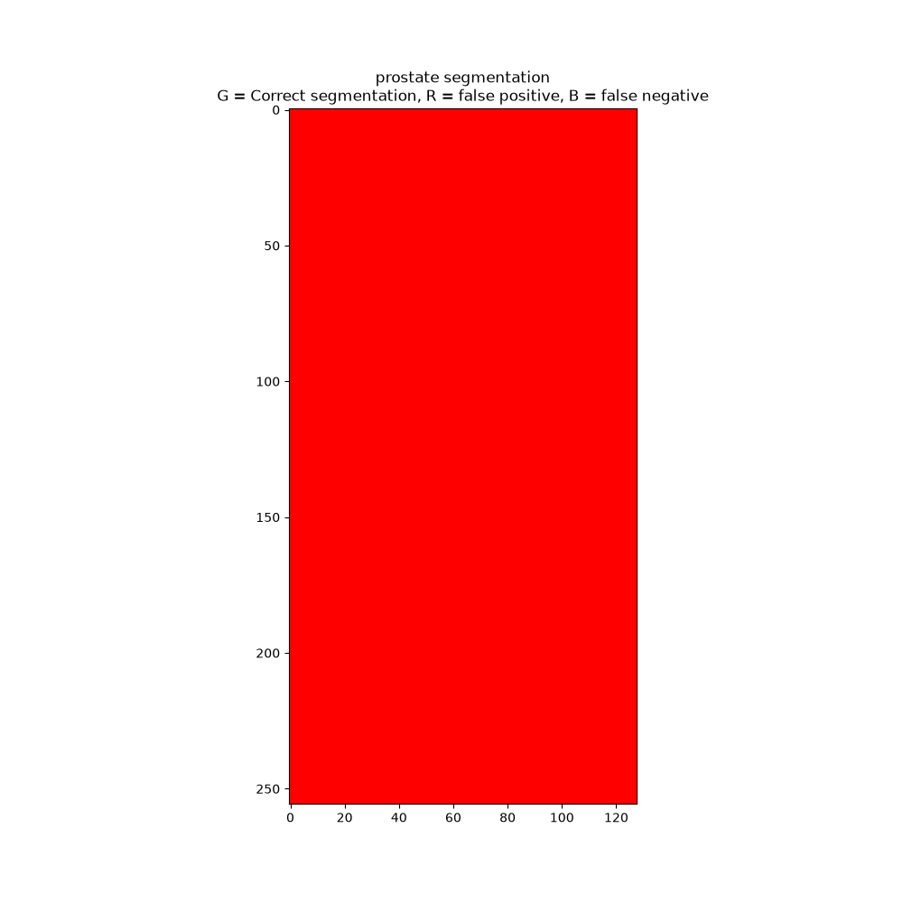
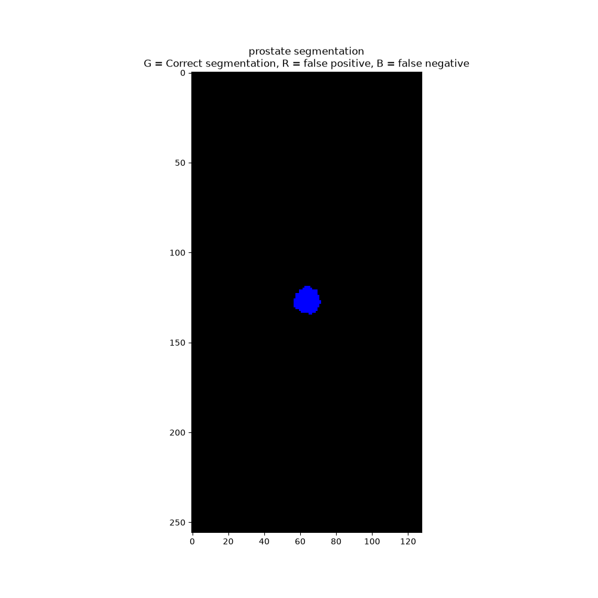
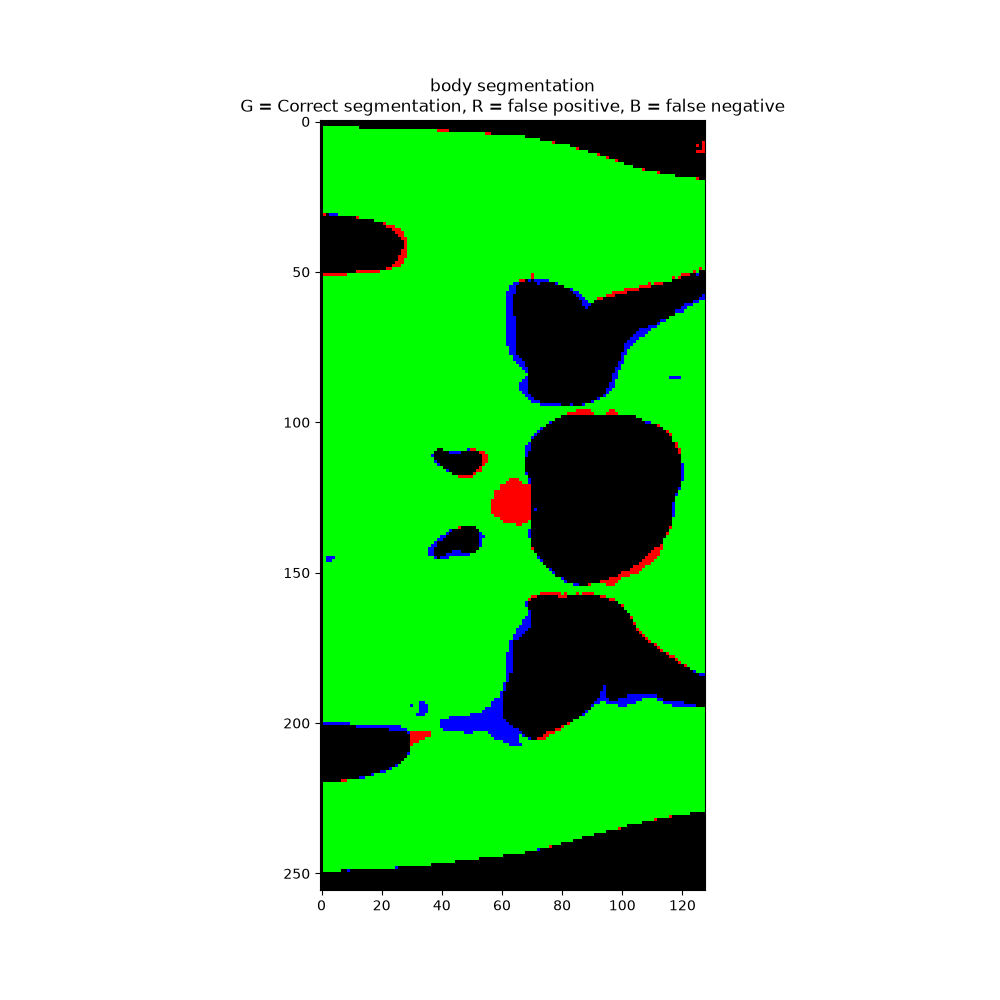
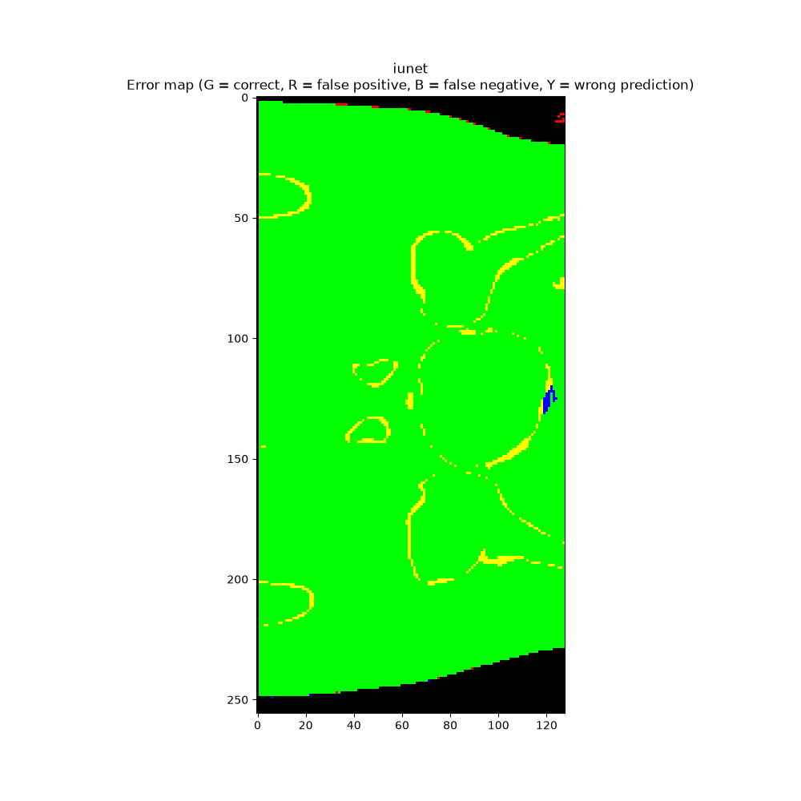
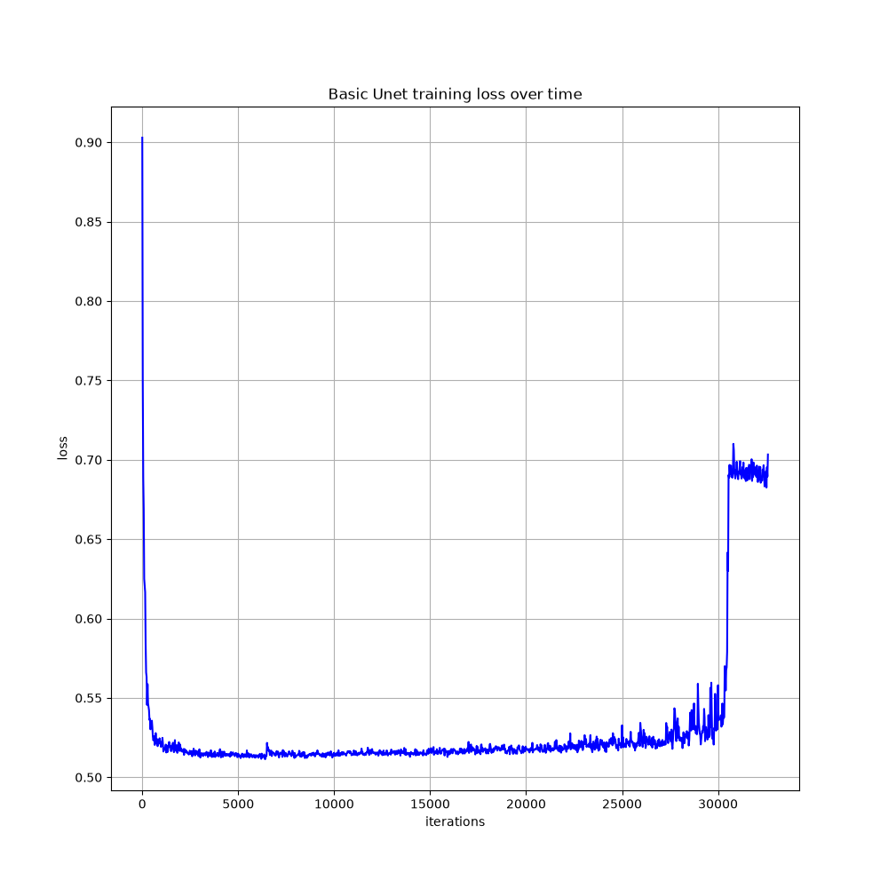
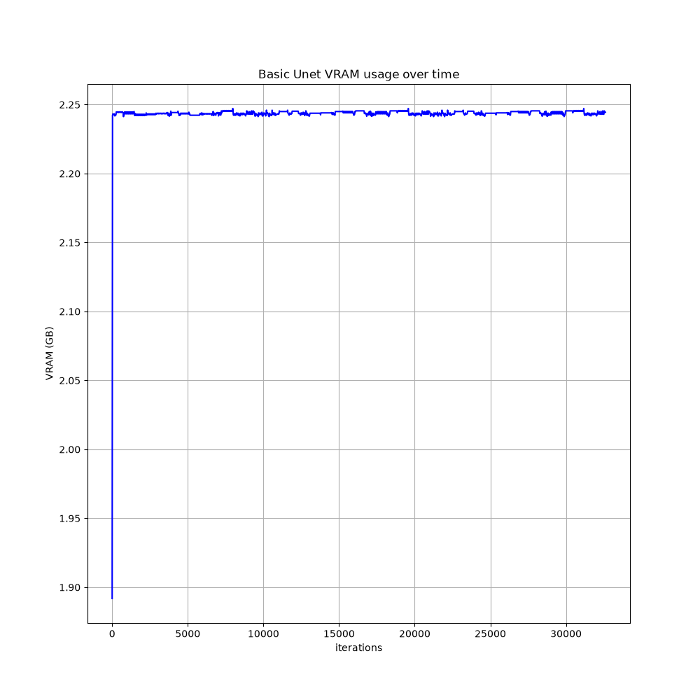
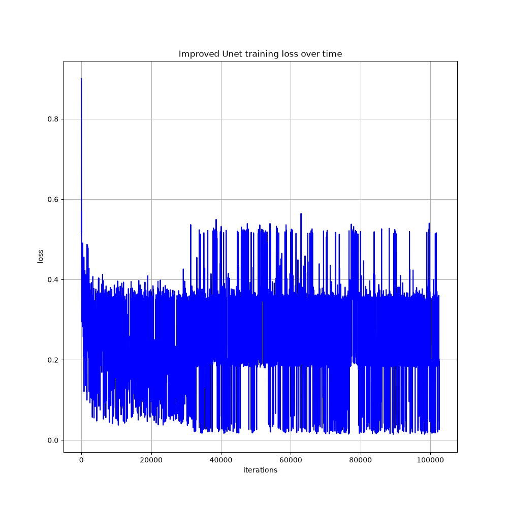
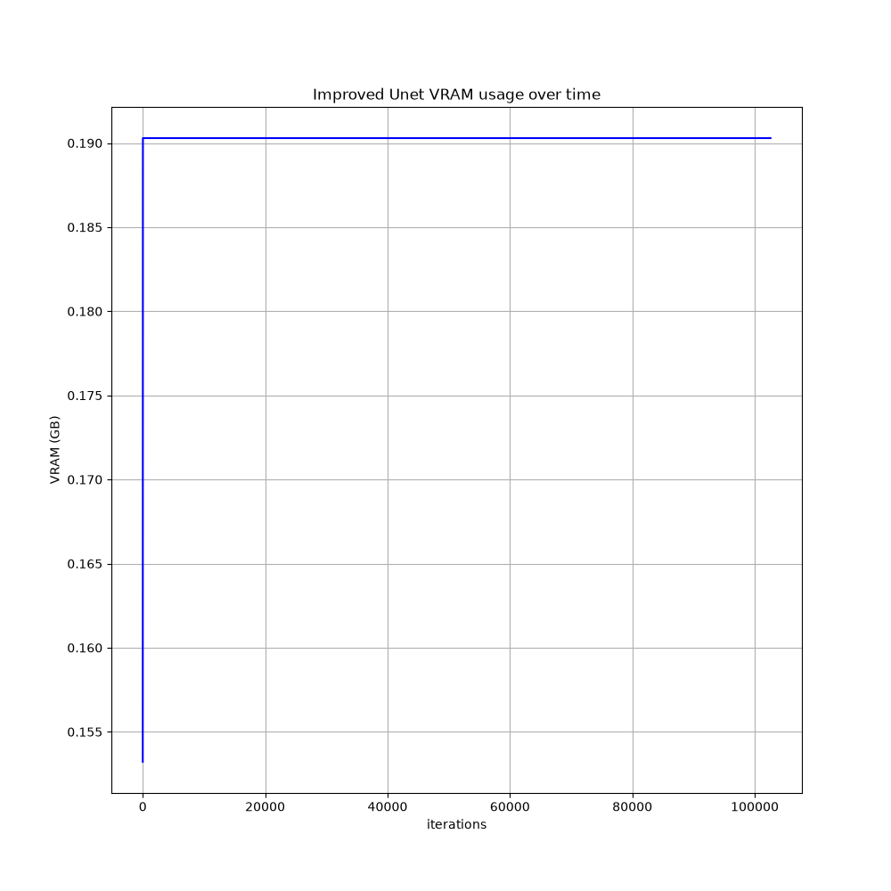

### s4920197 - Andrey Greyze

# Segmentation of Prostate Tumors with U net architechture 
Segmenting an MRI scan into regions where different organs and body parts lie is a very important task in radiotherapy. Radiotherapy is used to target and eliminate regions where tumors lie. The algorithm to be implemented in this project is a convolutional nueral network that employs the U net architechture to process 2D slices of prostate MRI scans. The model aims to segment the scan into six regions: background, body, bones, bladder, prostate and rectum. The U net architechture captures the context of the image with repeated 3x3 convolutions and max pooling, which reduces its dimensions and extracts global and local patterns. after each pair of convolutions, the resulting feature map is saved for later to preserve its features. These images are called skip connections and they preserve features from the earlier stages of learning, so that they are not forgotten during gradient descent. When the image is spatially reduced down to its lowest level, the image is scaled back up to its original dimensions using transposed convolutions or upsampling. It is then concatonated with the skip connection feature map that corresponds to its size. This preserves high resolution features learned in the early stages of the network. For this project, a more modern, improved U net architechture was compared to a more basic U net implementation in order to understand how differently the two models perform and which model can be used for this task in a clinic, if any. 

## Feasability review
### 1. User Need Scope & Acceptance: 
This model will help radiotherapists to plan their radiotherapy by outlining the exact, precise segments of the prostate where there are plans for radiotherapy. The model will mark segments to irradiate a given scan. The model is intended to be used in real time for determining target regions to be hit with radiation, so it needs a high level of precision, the ability to generalise over any patient and fast computing times. The model is expected to be ran on MRI machines, which are not very computationally powerful, meaning that the model needs to be mindful of VRAM and its use of other computational resources. A 2D model that ignores the context of the full scan, which is 3D uses less resources, but it uses more memory resources. One aim of building this model, which is 2D, is to explore the differences between 2D and 3D image segmentation models. How the performance of the models change with respect to their resource usage, computation times, etc. A very important metric for MRI imaging is regoin boundaries, since administering radiation has to be very precise in order to not damage healthy tissue with radiation.

### 2. Model Choice and Course Concepts: 
I am choosing to implement the improved 2 U net as my baseline comparison model (medium difficult). This model will use the HipMRI2D dataset, composed of 38 patients` weekly Hip MRI scans. The images contain 6 unique, non overlapping regions that must be classified by the model. The choice of model to do this will be a basic U net. This architechture is the golden standard for segmentation tasks, because of its ability to preserve and learn high resolution features and take in spatial context of images, i.e. it cares about the pixels surrounding other pixels, which is something MLPs for example, dont care about. The dataset with be split approximately 90%, 5% and 5% for the train, test and validation sets. Since the dataset contains lots of data, we can afford to have a small validation and testing set. By splitting most of the data to the training set we avoid overfitting and extract more features. A patient level data split needs to be enforced, meaning there is no patient whose scans appear in two different sets. This is done to prevent data leakage, since the model will train to recognize patterns in specific patients instead of training to recognize real patterns in general, not patient specific scans.

### 3. Preliminary Feasibility Evidence: 
The data has 6 unique regions, there are about 38 patients in the data that need to be split. Each patient has 60 images taken per scan, over 19 weeks. This allows a lower epoch number for training, since there is so much data per epoch. Not all scans have all 6 regions and none of the regions overlap with each other. Each scan is a 256 x 128 image. These dimensions are powers of two, so they will be space efficient. A smoke test can be conducted to make sure the data can be dimensionally compressed to the level that my model will try and compress it to. The proposed model will be a U net with a max depth of 5, which would compress data down to 16 x 8 image at the final bottleneck stage. The smoke test experiment runs and trains and tests the model under a simple 1 epoch and 2 image training loop. This ensures that the main training loop can run without crashing for thousands of iterations, which will be required during the real instensive model training. 

### 4. Risks, Budget & Fallback: 
The key risks of the model are overfitting, which would cause the model to be highly inacurate with unseen data, making it dangerous to use in the real world. If the model does not generalise then it cannot be safe to use and shouldn`t be relied on. One point to note is the class imbalance of the dataset. The most important label in the dataset is the prostate label. This label is around 2% of the total volume of the scan. This means that a specialised loss function must be used to account for this factor. Since otherwise, the model will just label everything as non-tumor and it will be 98% correct. This is not a correct way of assessing model performance, so a dice loss function must be used to balance out the loss function from the class imbalance. A 2D model also risks not being able to take in full spatial context that a 3D model is able to. If good results are not achievable with a 2D model, then a 3D model may be the only choice, even if it is more computationally intensive. Another major risk is over/under contouring. If the regions that are planned to be hit with radiotherapy are not marked accurately, then there is a major risk of irradiating the surrounding organs if the segmentation is overly liberal, or tumor reoccurance if the segmentation is too conservative.

## Dependencies
- Torch (2.14.1): this is a standard library for any deep learning task
- nibabel (5.4.2): since the dataset is comprised of Nifti files, nibabel is used to load them onto the disk 
- numpy (2.4.6): used to encode the nifti files into a format that is supported by the model, i.e. a 3D tensor of shape [1, 256, 128], later inputted to the model as [batch_size, 1, 256, 128]
- matplotlib (3.11.2): This module is used for plotting performance metrics such as loss over time, heat maps of the trained model, etc. 

## Usage
First, the data all comes from the HipMRI 2D dataset, which is structured by 6 folders, A test, train and validate folder for the ground truth masks and the image slices. There are 38 patients in total in the dataset, THe patients are split into three disjoint sets already and no explicit data splitting has to be done to the dataset in order to prevent data leakage. The folders contain 60 2D slices for each patient, which are 128x256 nifti images and combine to form one 3D MRI scan. There are scans from different weeks per patient too, making around 11000 training images, 400 validation images and 660 testing images. The images that are 144x256 are filtered out in order to have a uniform dataset. The images are made up of six classes: background, body, bone, bladder, rectum and prostate

To train the model on this dataset **train.py dataset_folder** must be called. This command will train a Basic Unet model and an Improved Unet model on the previously mentioned dataset and then it will save it to a unet/ and iunet/ folder, along with recorded training losses over time, VRAM use over time and total training time. A plot of the VRAM and loss over time will be saved to the visual/ folder as a png image, for both models. running **predict.py unet_path improved_unet_path data_path** will generate images that overlay the models predictions with the ground truth mask, saving the images to the visuals/ folder, just like **train.py**. It will also test the models independantly, displaying each models per class mean dice similarity coefficients, per class mean IoU scores and inference times

## Results
### Benchmarks
The mean per-class dice scores and IoU (Intersection over Union) are displayed in the tables below
<table>
  <tr>
    <td>Model/Dice Score</td>
    <td>Background</td>
    <td>Body</td>
    <td>Bone</td>
    <td>Bladder</td>
    <td>Rectum</td>
    <td>Prostate</td>
  </tr>
  <tr>
    <td>Basic</td>
    <td>0</td>
    <td>0</td>
    <td>0</td>
    <td>3.3e-5</td>
    <td>0</td>
    <td>6.7e-3</td>
  </tr>
  <tr>
    <td>Improved</td>
    <td>0.9935</td>
    <td>0.9767</td>
    <td>0.9239</td>
    <td>0.9595</td>
    <td>0</td>
    <td>0</td>
  </tr>
</table>

<table>
  <tr>
    <td>Model/IoU</td>
    <td>Background</td>
    <td>Body</td>
    <td>Bone</td>
    <td>Bladder</td>
    <td>Rectum</td>
    <td>Prostate</td>
  </tr>
  <tr>
    <td>Basic</td>
    <td>0</td>
    <td>0</td>
    <td>0</td>
    <td>1.6e-5</td>
    <td>0</td>
    <td>3.3e-3</td>
  </tr>
  <tr>
    <td>Improved</td>
    <td>0.9871</td>
    <td>0.9545</td>
    <td>0.8585</td>
    <td>0.9222</td>
    <td>0</td>
    <td>0</td>
  </tr>
</table>

The basic model is an absolute failure. Under analysis, it seems that the model has a critical training flaw which teaches it to mark every pixel as prostate or bladder. It does not pay attention to any other class other than the bladder and prostate. This can be seen above, with mean Iou and dice scores for all other classes being equal to 0 under the basic Unet model. Under the analysis of the failure cases seen below, the only regions in red are the prostate, everything else is blue or black, indicating that the model segments everything as the prostate. 

The Improved Unet performs better, but is still too flawed to be used in a clinical setting. The Improved Unet works well at outlining the body, background, bladder and bones, achieving dice scores above 0.9 for each class. However, the improved Unet does not know how to segment the prostate and rectum at all. The dice scores for the rectum and prostate are zero. This is likely due to the huge class imbalance of the prostate and rectum. One reason for this failure could be an improper dice loss function. The dice loss function may need to be modified to reward the model more negatively when it misses regions of the extremely imbalanced classes. Coincidentally, as seen in the failure cases, the model outlines the rectum and prostate fairly well, but chooses to class it as body instead of prostate or rectum for whatever reason.

In general, A pattern with the improved Unet is that it mislabels regions rather than over/undercontouring

This indicates that the model could be grouping two classes together, e.g. body and prostate, for whatever reason. Possibly due to the extreme class imbalance

The performance of each network under a low end CPU, which is computationally weaker than the target hardware, was: 0.03s for improved Unet and 0.13 for basic Unet. The inference times are higher for the basic unet due to its higher parameter count and number of starting filters (64, compared to 16). The parameter count of the basic Unet is 10x the improved Unets` because of this. The basic Unet has 31030918 parameters, while the improved Unet has 3184418, one order or magnitude less. This causes the improved Unet to be more compact and faster than the basic unet

The higher parameter counts and starting filters resulted in longer training time for the basic Unet, which was trained for 1:18 minutes whereas the improved Unet trained for 0:52 minutes. The training curves and VRAM usage for both models are displayed below.

It can be seen that the training for the improved unet was very unstable, most likely caused by a high learning rate or other hyperparameters. The hyperparameters used by the original implementation of the improved Unet were copied for this one, not taking into account any challenges brought upon the different dataset. The training loss spiked between 0.5 and 0.05, which does not indicate convergance, unlike the basic unet which converged to 0.5. The basic Unet was trained seperately under 12 hyperparameter sets. The best performing set was saved for future use, or if a better set was not found then the best set would be saved after four tries. The final set of hyperparameters used is shown below:

<table>
  <tr>
    <td>learning rate</td>
    <td>gamma</td>
    <td>weight decay</td>
    <td>unet depth</td>
    <td>number of initial filters</td>
    <td>batch size</td>
    <td>epochs</td>
  </tr>
  <tr>
    <td>0.0005</td>
    <td>0.970</td>
    <td>1e-5</td>
    <td>5</td>
    <td>64</td>
    <td>128</td>
    <td>60</td>
  </tr>
</table>

A search through a larger set of hyperparameters may be needed to determine wether hyperparameters are to blame for the models poor performance. 64 filters and 128 batch size may be causing the poor performance. receiving one update to gradients every 128 images is unlikely to lead to receiving good gradient updates, since there is too much feedback at once to learn from. As a result, the resulting output of the model after softmax was almost a uniform distribution, meaning the model isnt really sure of anything and didnt receive meaningful gradient updates during training

The verdict is that the improved unet model may be good enough for clinical use after the issue of pairing unrelated classes together is solved. Dice scores for all correctly working classes is above 0.9, and the number of false positives i.e. over countouring seen in the failure cases is minimal. It is not clear what the dice scores for regions like the prostate would be if the issue was to be solved, but the fact that the model is able to segment the other regions accurately, fast and while using below 2GB of VRAM is a positive sign. 

The basic Unet however, is not fit for clinical use. It does not segment any regions at all and there is a critical flaw that stops it from learning any patterns from the data, even though it uses the same loss function as the improved unet.

## Artificial Intelligence Usage Disclosure
I used Google Gemini as an enchanced search function, to further explain documentation and concepts such as hyperparameter tuning, U net architechture and other concepts. No Gemini generated code was used in my scripts, nor Gemini generated answers in my README
