# Segmentation of Prostate Tumors with U net architechture 
Segmenting an MRI scan into regions where tumors, orgrans and bones lie is a very important task. Radiotherapy can be used to target and eliminate regions where tumors lie. The algorithm implemented in this project is a convolutional nueral network that employs the U net architechture to process 2D slices of prostate MRI images, and segments the regions of the image which are a tumor, bones, background, body outline, bladder and rectum. An output from the model is an image with regions with 6 distinct classes representing the 6 total classes found in the images. The U net architechture works by capturing the context of the image with repeated 3x3 convolutions and max pooling, which reduces its dimensions. after each pair of convolutions, the resulting feature map is saved for later. These images are called skip connections and they preserve features from the earlier stages of learning, so that they are not forgotten. When the image is spatially reduced down to its lowest level, the image is scaled back up to its original dimensions using transposed convolutions. It is concatonated with the skip connection feature map that corresponds to its size, which preserves high resolution features learned in the early stages of the network. For this project, a more modern, improved U net architechture was compared to a more basic U net implementation in order to understand how differently the two models perform, 

## Feasability review
### 1. User Need Scope & Acceptance: 
This model will help radiotherapists to plan their radiotherapy by outlining the exact, precise segments of the prostate where there is a tumor, that will need to be irradiated. The model will mark segments to irradiate a given scan. The model is intended to be used in real time for determining target regions to be hit with radiation, so it needs a high level of precision, the ability to generalise over any patient and fast computing times. The model is expected to be ran on MRI machines, which are not very computationally powerful, meaning that the model needs to be mindful of VRAM and its use of other computational resources. A 2D model that ignores the context of the full scan, which is 3D uses less resources, but it uses more memory resources. One aim of building this model, which is 2D, is to explore the differences between 2D and 3D image segmentation models. How the performance of the models change with respect to their resource usage, computation times, etc. A very important metric for MRI imaging is regoin boundaries, since administering radiation has to be very precise in order to not damage healthy tissue with radiation.

### 2. Model Choice and Course Concepts: 
I am choosing to implement the improved 2 U net as my baseline comparison model (medium difficult). This model will use the HipMRI2D dataset, composed of 38 patients` weekly Hip MRI scans. The images contain 6 unique, non overlapping regions that must be classified by the model. The choice of model to do this will be a basic U net. This architechture is the golden standard for segmentation tasks, because of its ability to preserve and learn high resolution features and take in spatial context of images, i.e. it cares about the pixels surrounding other pixels, which is something MLPs for example, dont care about. The dataset with be split approximately 90%, 5% and 5% for the train, test and validation sets. Since the dataset contains lots of data, we can afford to have a small validation and testing set. By splitting most of the data to the training set we avoid overfitting and extract more features. A patient level data split needs to be enforced, meaning there is no patient whose scans appear in two different sets. This is done to prevent data leakage, since the model will train to recognize patterns in specific patients instead of training to recognize real patterns in general, not patient specific scans.

### 3. Preliminary Feasibility Evidence: 
The data has 6 unique regions, there are about 38 patients in the data that need to be split. Each patient has 60 images taken per scan, over 19 weeks. This allows a lower epoch number for training, since there is so much data per epoch. Not all scans have all 6 regions and none of the regions overlap with each other. Each scan is a 256 x 128 image. These dimensions are powers of two, so they will be space efficient. A smoke test can be conducted to make sure the data can be dimensionally compressed to the level that my model will try and compress it to. The proposed model will be a U net with a max depth of 5, which would compress data down to 16 x 8 image at the final bottleneck stage. The smoke test experiment runs and trains and tests the model under a simple 1 epoch and 2 image training loop. This ensures that the main training loop can run without crashing for thousands of iterations, which will be required during the real instensive model training. 

### 4. Risks, Budget & Fallback: 
The key risks of the model are overfitting, which would cause the model to be highly inacurate with unseen data, making it dangerous to use in the real world. If the model does not generalise then it cannot be safe to use and shouldn`t be relied on. One point to note is the class imbalance of the dataset. The most important label in the dataset is the prostate tumor label. This label is around 2% of the total volume of the scan. This means that a specialised loss function must be used to account for this factor. Since otherwise, the model will just label everything as non-tumor and it will be 98% correct. This is not a correct way of assessing model performance, so a dice loss function must be used to balance out the loss function from the class imbalance. A 2D model also risks not being able to take in full spatial context that a 3D model is able to. If good results are not achievable with a 2D model, then a 3D model may be the only choice, even if it is more computationally intensive.

## Dependencies
- Torch: this is a standard library for any deep learning task
- nibabel: since the dataset is comprised of Nifti files, nibabel is used to load them onto the disk 
- numpy: used to encode the nifti files into a format that is supported by the model, i.e. a 3D tensor of shape [1, 256, 128], later inputted to the model as [batch_size, 1, 256, 128]
- matplotlib: This module is used for plotting performance metrics such as loss over time, heat maps of the trained model, etc. 

## Results
### Benchmarks
The model achieved a mean IoU of 0.504. a dice coefficient of 0.257 on the prostate label. The model was able to achieve fast computational speeds, taking 0.09 seconds to output an image on average. Take note that since A viable GPU was not available for the model to use (lower than expected computational resources), the inference time will likely be even faster. The simple unet has a parameter count of 7696518

These results are objectively worse than the benchmark model, meaning that a simplified Unet is likely not good enough for this task under the current model architechture. The benchmark model achieved slightly better IoU of 0.53 and an inference time of 0.03. The model has fewer parameters than the simple unet, scoring at 2397670 parameters, around 4x less than the simple unet. This is due to the simple unet having a very large amount of filters, starting out with 64. The standout feature of the benchmark model is its` 0.69 dice coefficient for the prostate label, which is much higher than the baseline model. This is a promising result and can be improved with better model training, data augmentation via clipping, rotation, etc. which wasnt able to be done due to time constraints. The simple Unet is actually better than the baseline model at segmenting classes 5 and 6, achieving a dice score of 0.59 and 0.63. Whereas the model achieved 0.32 and 0.28. These classes are especially important, since they represent the bladder and rectum, both very sensitive areas around which no error can be afforded. 

I believe that even though the improved Unet shows promising results, it is not safe enough for a clinic. The IoU score of 0.53 implies a high inaccuracy and that the model has failed to generalise well. Perhaps more spatial context needs to be given to the model, so that it can achieve a higher score. The model should be retrained and tested with random data augmentation in order to 
train it to see patterns better, otherwise it is too unsafe. Below are some error maps, which show in grey background, in white, where the model and truth mask overlap. In red are false positives and in blue are false negatives

<table>
  <tr>
    <td>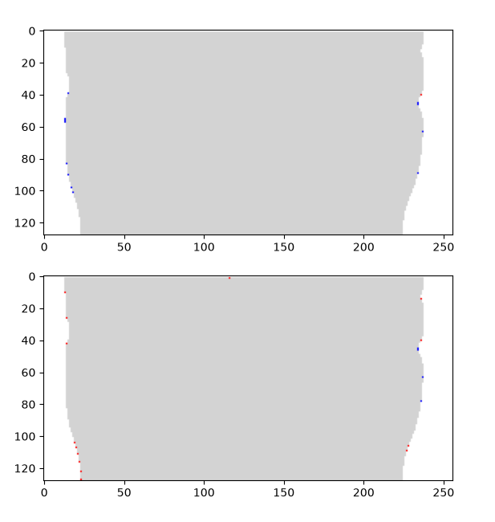</td>
    <td>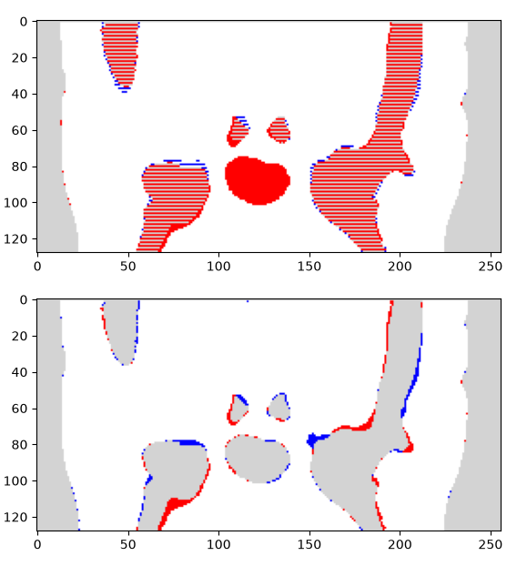</td>
    <td>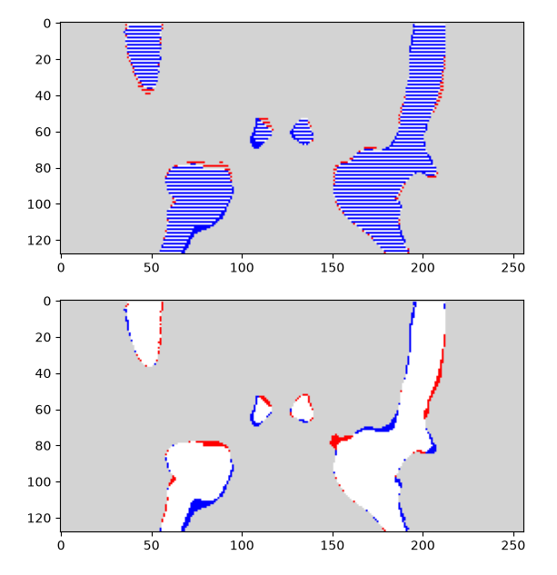</td>
    <td>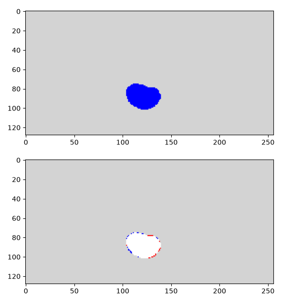</td>    
  </tr>
</table>
Figure 1: error map of a scan
It is clear that there architechtural flaws in the simple unet, because it has overlayed its results for the prostate tumor with the bones class. Otherwise, its segmentation of tumor, marked down as bone is ok.
<table>
  <tr>
    <td>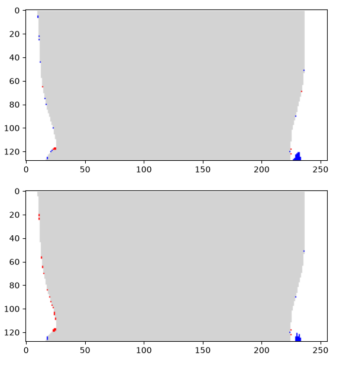</td>    
    <td>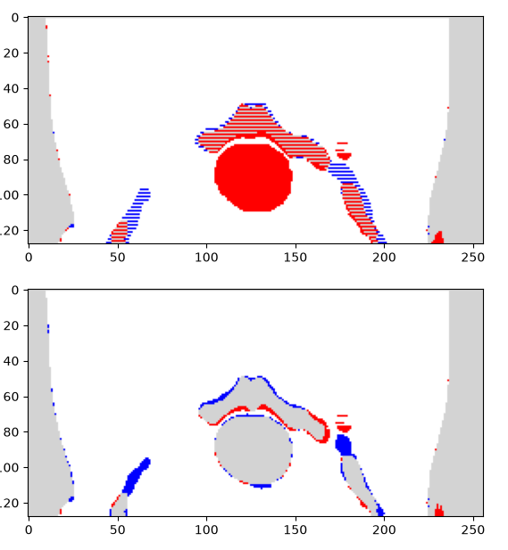</td>
    <td>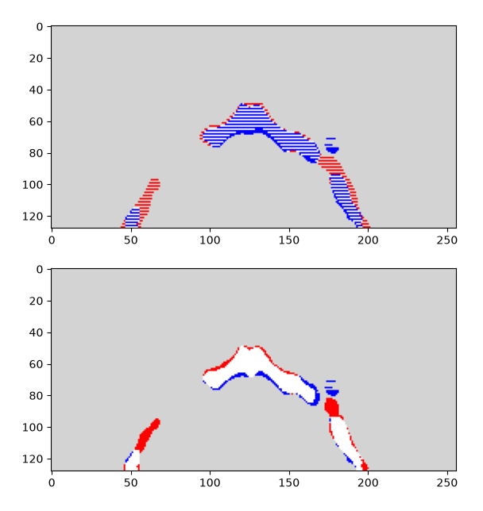</td>
    <td>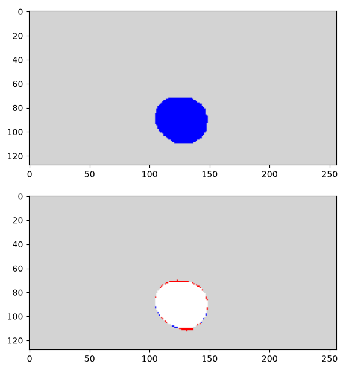</td>
  </tr>
</table>
It can be seen that the two models are quite accurate in predicting body outline and background
<table>
  <tr>
    <td>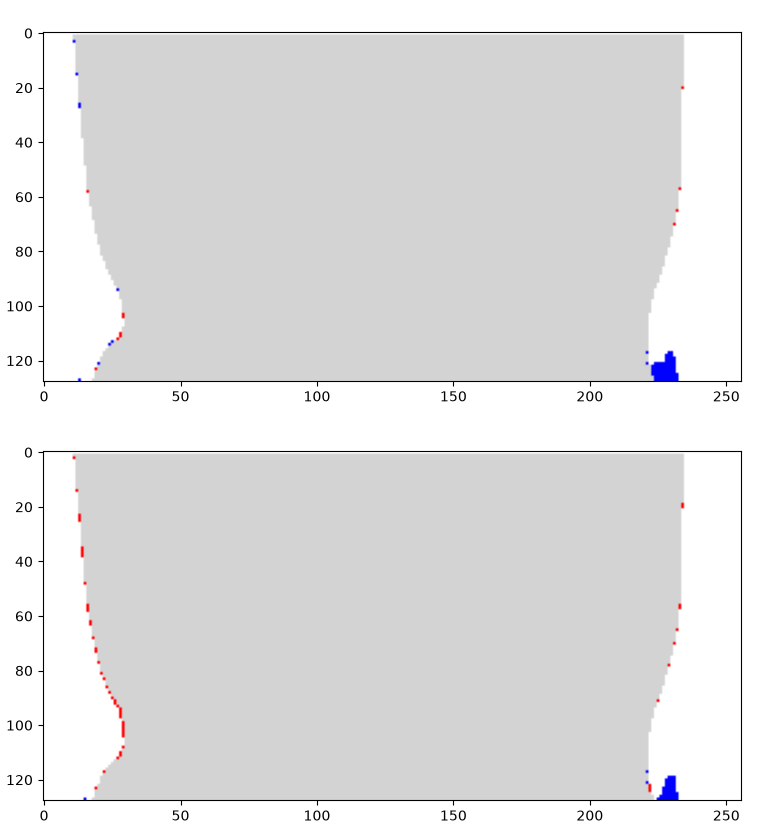</td>
    <td>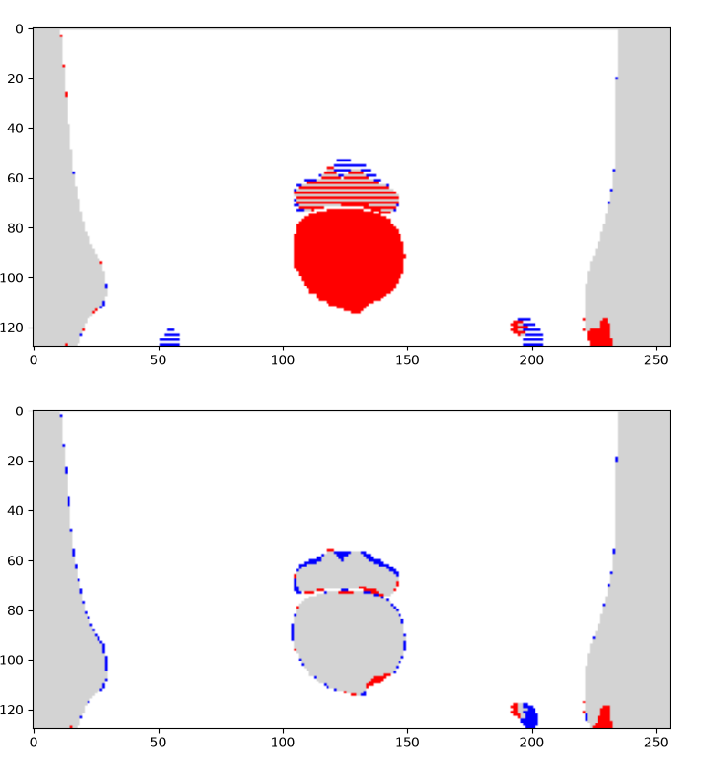</td>
    <td>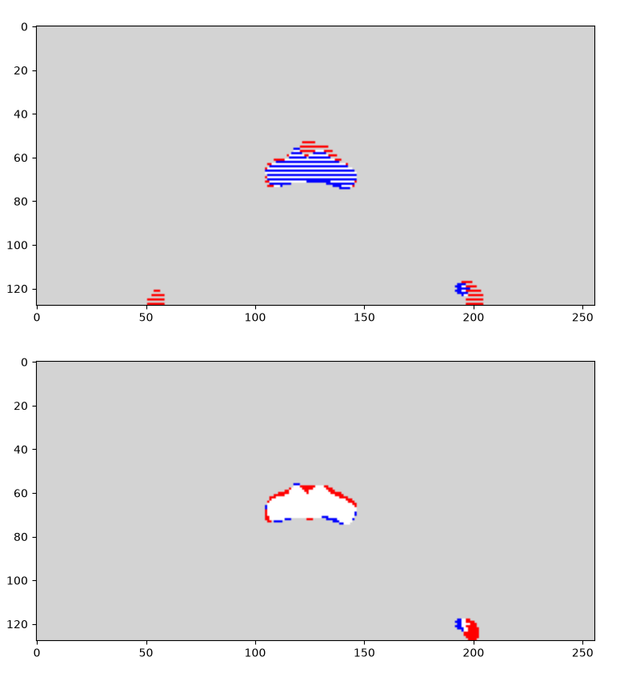</td>
    <td></td>    
  </tr>
</table>

## Artificial Intelligence Usage Disclosure
I used Google Gemini as an enchanced search function, to further explain documentation and concepts such as hyperparameter tuning, U net architechture and other concepts. No Gemini generated code was used in my scripts, nor Gemini generated answers in my README

average inference time: 0.09196116791831123
dice scores prer class: 
[tensor(0.9965), tensor(0.9266), tensor(0.6097), tensor(0.2574), tensor(0.5926), tensor(0.6389)]
average IoU score: 0.5040650367736816
average inference time: 0.030183675554063587
dice scores prer class: 
[tensor(0.9950), tensor(0.9811), tensor(0.9057), tensor(0.6963), tensor(0.3256), tensor(0.2832)]
average IoU score: 0.5358808636665344