# TimeGAN for AMZN Limit Order Book Simulation

Edward Tennyson, s46482079 COMP3710, Section 2.7 (Hard).

The feasibility review and usage instructions are contained in Appendix 1 and 2 respectively.

## Abstract
The purpose of this report is to investigate whether the TimeGAN model can generate realistic Amazon limit orderbooks (LOB). Chronologically, the performance of a simple stochastic autoregressive (AR) foundation will be quantified against temporal supervision. As the report progresses, the addition of validity measures such as ordering penalties and conditional extensions will be added to the baseline to assess the quality of the results. Ultimately, the penalties can improve orderbook validity but can distort other factors like distribution of bid-ask spreads. A structured decoder can remove orderbook violations and conditioning on starting volumes can raise final depth SSIM, as this improved from 0.179 to 0.283. Further, temporal dependence remains insufficient, and no combination of settings were able to meet the target quality criteria. The evidence provided in this report contributes to further research and experimenting; however, is not adequate to support full strategy backtesting.

## 1 Introduction
The proprietary generation of synthetic market data can significantly improve desk efficiency if access to historical data is limited. A concrete simulation must capture dynamics and patterns in both liquidity and pricing, whilst maintaining valid LOB structuring and spreads. It is therefore important to ensure that bid-ask prices do not cross and that bid and ask for LOBs are monotonically decreasing and increasing respectively. 

The proposed research question: can TimeGAN improve simulation reliability over a simple autoregressive baseline without voiding the foundations of a LOB.

TimeGAN extends the traditional adversarial network model with supervised temporal learning. The corresponding paper by Yoon, Scharrett, and van der Schaar evaluates the distributional resemblance and predictive capacity between simulated and real market data, whereas our research question focuses on quantification metrics like Kullback-Leibler Divergence (KL) and the Structural Similarity Index (SSIM). We apply the given course criteria supplied by the LOBSTER Amazon dataset and investigate failures through analysis of structural validity, similarity, and stochastic variation.

## 2 Data and preprocessing
The dataset covers the 21st of June 2012 and contains 269748 AMZN snapshots with 10 bid and 10 ask levels with price and quantity for each, supplying 20 prices and 20 volumes for 40 features. We transform prices into per-level log returns and volume is scaled according to the function:

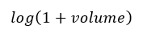

Afterwards, all 40 features undergo min-max scaling on a per-feature basis according to:

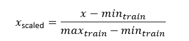

This is because log returns are small and volumes can be much larger, so no scaling can result in volume errors dominating the reconstruction loss. By mapping training values from 0 to 1, we can assist optimization by reducing differences and matching the sigmoid output range of the TimeGAN.

Feature scaling is computed on the training data only and we do not clip held-out values. This is done to prevent information leakages as using later data to scale would mean future information can influence data preprocessing. Not clipping can preserve extreme values and distribution shifts. A chronological 70/15/15% split uses the following session times respectively: training time 09:30-14:03, validation 14:03-15:01:30, and test time 15:01:30-16:00. Each window update contains 32 market messages with a stride of 32, which leaves 1080 eligible windows for validation, with the final partition being excluded from evaluation metrics, but measured on its own in section 7.

We split the data chronologically prior to constructing windows within each partition. Each step is an orderbook update so temporal updates are interpreted on the event times.

## 3 Models and experimental design
As mentioned, the baseline comparison is a stochastic vector AR (VAR) model with a ridge coefficient set to 0.01 and a lag order of 2. These parameters were chosen due to having the lowest mean invalid-book rate. Initial feature lags are sampled from training windows, and the future shocks are from fitted residuals. The VAR(2) receives the same initial price anchor as the primary TimeGAN comparison. This is done without observing starting volumes or future validation observations. 

The TimeGAN model combines adversarial generation networks with the supervised learning extension of temporal relationships (Yoon, Jarrett and van der Schaar, 2019). Its embedder converts real sequences into a learnt latent representation, while original features are reconstructed from the recovery network. The generator produces synthetic latent sequences from random noise and then the discriminator learns to distinguish these from the real encoded sequences. Then, a supervisor learns to predict the laten statues which encourages the generated sequences to preserve temporal relationships. The combination of reconstruction, temporal supervision and adversarial training can output realistic sequences.

For the PyTorch TimeGAN, 5 networks are used for the recurrent implementation, including the embedder, recovery, generator, supervisor and discriminator (Yoon, Jarrett and van der Schaar, 2019). Each warmup for the reconstruction, supervisor and joint adversarial training contain 5000 updates, and the main experiments use 3 GRU layers per network (apart from the two-layer supervisor), with hidden widths of 24, 128 batch-size, and 0.001 learning rate. 

Extended modelling also includes gentle and moderate ordering penalties to the reconstruction and generator losses. Once the decoder returns the prices, gaps below $0.01 across the bid-ask spread and adjacent levels are penalised. The penalty increases linearly depending on the shortfall. Weights of 0.001 and 0.01 respectively are used for gentle and moderate comparisons, and works according to the following equation:

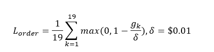

This extension encourages valid ordering without brute-forcing order book validity. Later, the ladder decoder uses positive gaps to build the prices which ensures that the bid/ask level ordering remains structurally valid. Additionally, we use a separate experiment removing the supervisor pretraining and joint temporal-loss terms to reduce the training budget.
For the generation process, 40-dimensional uniform noise is passed through each of the generator, supervisor and recovery networks, and the discriminator evaluates latent sequences. The joint objectives combine each of the adversarial, reconstruction and supervision losses, comparing batch means and standard deviations. Each joint cycle has 2 generator and supervisor updates as well as 2 embedder and recovery updates before each discriminator opportunity and is only applied if loss exceeds 0.15 (Yoon, Jarrett and van der Schaar, 2019).

The baseline TimeGAN, which will be referred to as the ‘reference’ TimeGAN, along with the gentle, moderate, and no-supervision TimeGAN models will be compared with each using 3 training seeds. Reconstruction and decoder performance are also analysed later in controlled experiments with a single training seed. We retain 29 completed generator-fits for comparison with 4 reconstruction-only runs, and some incomplete training runs for transparency. We compare these amongst different research goals regarding ordering penalties, temporal supervision, decoder design, and volume conditioning.

This research environment runs Python 3.12.14, Pytorch 2.8.0+cu128, SciPy 1.16.3 and Matplotlib 3.10.7. The native RTX 4060 with 8GB VRAM was used for the initial training results; however, CPU (Core i7-13650HX with 14 cores and 20 logical processors) and GPU execution with training benchmarks were compared with the CPU being selected for TimeGAN experiments due to better performance for the recurrent cell. The Python script predict.py can be used to generate synthetic order-book sequences with the chosen models.

## 4 Evaluation protocol
Invalid snapshots are defined by:
	Non-finite values
	Non-positive prices
	Crossed bid-ask spreads
	Incorrectly ordered levels
	Negative volumes

Distributions for the spreads and mid-price returns use the histogram bins generated from the training data with out-of-range values moved into its closest bin. KL divergence measures the distributional mismatch. The autocorrelation error compares absolute returns at event lags 1-10 to assess short-term volatility dependence. Due to temporal limitations, long-term volatility clustering could not be accurately evaluated. 

The depth SSIM will use 10x32 bid and ask using training-derive global log-volume scaling and a 7x7 window with a fixed data range (Wang et al., 2004). The scores are averaged over the windows, with course project brief targets being KL ≤ 0.1 and SSIM > 0.6, alongside orderbook validity requirements; however, future orderbook sequences can be realistic without resembling the observed validation future, so the required diagnostics are measured with spread and return distributions to analyse statistical similarity, and random inputs will be used to assess diversity (Wang et al., 2004).

We use generation seeds 42, 43, and 44 and measure sampling variation across seeds to evaluate checkpoints from the trained models. A volume-conditioning test is used to assess whether providing initial orderbook volumes improves generated-sequence quality. Therefore, initialised volume models are compared against a model with no starting volume (set to zero). To determine improvements, the volume-conditioned version must increase SSIM by at least 0.05, fail to increase the invalid-book results, avoid worsening spread/return KL, and limit autocorrelation error to 5% increases. Finally, to assess output diversity, starting conditions remain fixed with randomised inputs, requiring the resulting price/volume standard deviations to reach at minimum 10% of the reference model.

Finally, noise ratios (scaled between 0 and 1) compare how generated future sequences differ for both prices and volumes. We quantify variability using 128 generated sequences with matching context. We average ratios across the selected generation seeds for each case. These results will allow us to assess whether a model ignores or is impacted by its random input.

## 5 Main validation results
The reference TimeGAN model manages to improve orderbook validity and overall bid-ask spread logic when compared to the baseline VAR(2) model; however, it performs worse on return KL, autocorrelation error, and SSIM. The gentle ordering penalty managed to reduce orderbook invalidity rates by approximately 33 percentage points, while the spread KL rose from 0.0745 to 0.2662. Further, removing temporal supervision worsened the mean orderbook invalidity and autocorrelation error. Overall, it is conclusive to retain supervision; however, the strong variation across different training seeds limits the strength of the outcome.

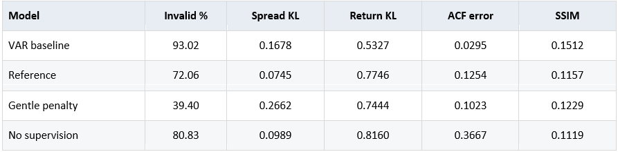

Table 1: Validation-selected results. Here, the TimeGAN averages three fits and three generation seeds per fit and the VAR uses one fitted model.

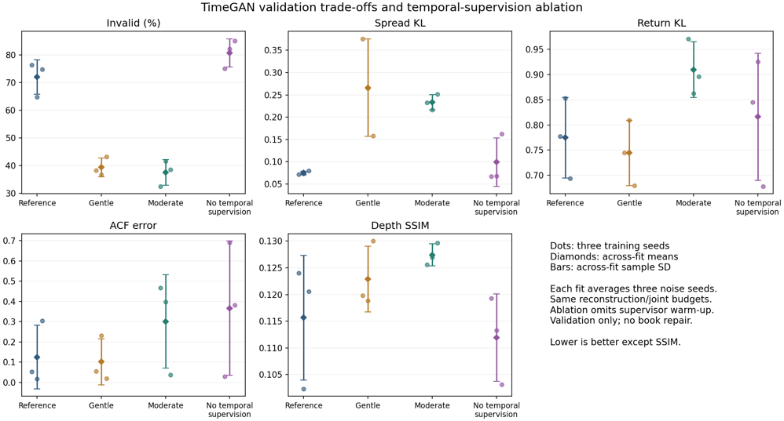 

Figure 1: Penalty comparisons: Here, the dots represent training seeds and the diamonds and bars show their mean and sample SD. Each fit averages three generation seeds.

All quality targets are not met by any of the historical settings. Based on a low average error, the VAR model’s low autocorrelation does not fully demonstrate realistic volatility clustering as the shuffled real returns score 0.0301 which is close to VAR’s 0.0295. Total training budgets differ slightly as the comparison covers 1-10 event lags, and the no-supervision model omits any supervisor warm-ups.

The final volume-conditioning research experiment achieves a final SSIM of 0.2829 which is analysed further in Section 7. Both models use 19 measured price-gap context features and historical models use the starting prices to reconstruct price paths, while the matched only receives a starting volume. The SSIM improvement is measured against its own matched zero-volume models. The difference in architecture, training budgets and seeds prevent all experiments from being pure repetitions.

## 6 Failure cases and diagnostic studies
The 3 historical gentle penalty cases each show different sources of failure in depth similarity metrics. Windows 1, 540 and 1080 show orderbook invalidity figures of 84.375%, 59.375% and 0% respectively with SSIM results of -0.1025, 0.1641, and 0.1964 respectively. All the 620 inter-update volume entries change depending on the generation case, versus 49, 92, and 65 real changes. The 3rd case has valid orderbooks but poor depth similarity. The below Figure 2 shows the mismatches in depth.

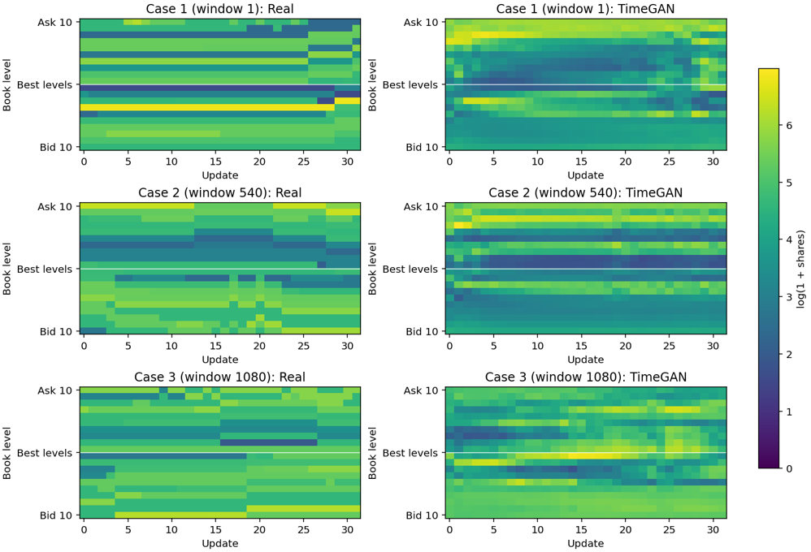

Figure 2: Validation case results with training seed 2026 and generation seed 42. The colours expose sparse real changes and continuously varying generated volumes.

Therefore, better reconstructions did not guarantee better results in generation. While the partially weighted reconstruction reduced mean-squared error for price and volume by 38.84% and 85.25% respectively, the corresponding GAN resulted in lower orderbook validity and worsened bid-ask spreads. A ladder decoder was used to impose ordered pricing with positive gaps; showing a final SSIM of 0.0992, and with a lower learning rate it achieved 0.1229; with both ladders failing the improvement screens. These are distinct additional results to the original implementation.

The diagnostic evidence here shows that compared to real orderbook updates, our generated sequences change volume results for almost every value. Therefore, future improvements should model when volume remains constant, how much it changes, and relationships between alternating price levels. Section 7 investigates the final volume-conditioned model using the same 3 validation windows.

## 7 Completed starting volume experiment
The last pair tests access to 20 given starting volumes, alongside the known 19 price-gap context features. Both of the following models use a hidden width of 48, with learning rates of 0.0003, 230393 parameters, a ladder decoder, and 4000 updates per stage. Volume-input positions are set to zero for the control, so that the initial weights and sampled noise streams match, with each model uses one training seed and 3 generation seeds. 

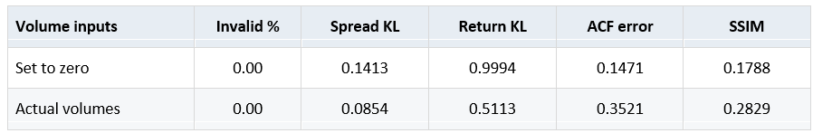

Table 2: Update 4000 (Final paired validation results). Each row averages the three training seeds.

The starting volumes improved the final SSIM with an absolute gain of 0.1041 from 0.1788 to 0.2829. The spread KL and return KL dropped from 0.1413 to 0.0854 and 0.9994 to 0.5113 respectively, with both models measuring zero invalid orderbooks (primarily due to their shared ordering decoder); however, autocorrelation errors rose from 0.1471 to 0.3521, and the noise ratio in case 1 was just below 0.1 at 0.098854. The overall improvement screen therefore fails to pass, and while the spread KL and book validity targets are met, the return KL and SSIM targets are not. Therefore, we fail to establish confidently realistic market dynamics.

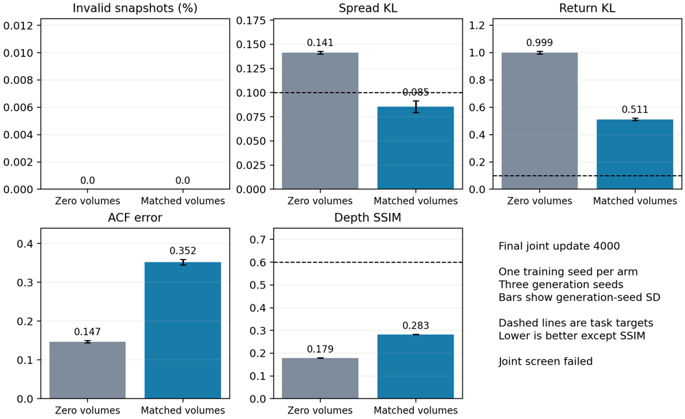 

Figure 3: Final comparison. The error bars show generation-seed SD for one training seed per arm.

### Final depth examples and volume dynamics
The below Figure 4 quantifies the same 3 validation windows for the real books against both final models using generation seed 42. The matched-volume SSIM for windows 1, 540, and 1080 manage to reach 0.4041, 0.4130 and 0.2818 respectively. All 3 retain orderbook validity but are still below the SSIM target of 0.6. Having starting volumes improves the depth profile relative to the control with volume inputs set to zero. The generated sequences still change volume too continuously to conclude realism.
 
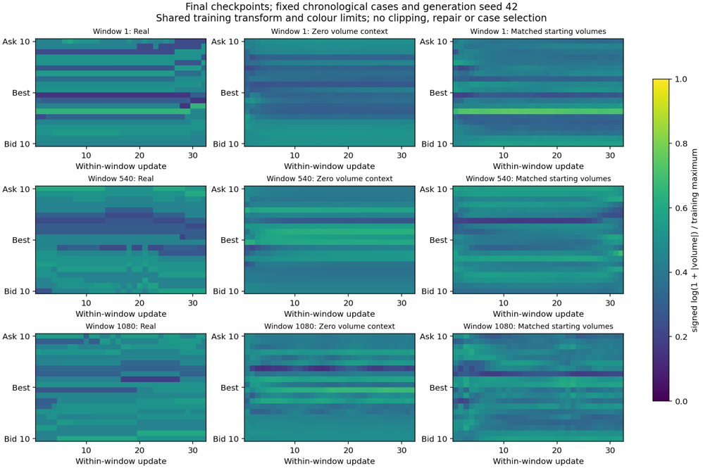

Figure 4: Results at update 4000 with training seed 2026 and generation seed 42.

Compared with the real model’s validation sequence, the final matched model’s volume still changes almost every update, compared with real validation sequences of ~11.44%. While the change count includes miniscule volume changes, the mean absolute log-volume change remains around 2.1 times the real value. When known starting volumes are used, the model achieves a SSIM of 0.4431. Subsequently, averaging transformed depth maps across validation windows (for each side and generation seed separately, we achieve a SSIM score of 0.9177. This, however, describes the average depth pattern and should not replace the primary per-window score of 0.2829 as conclusive evidence.

Both validation-selected checkpoints are used as secondary results and occur at the 3000th update. At update 4000, the model’s SSIM declines from 0.3140 to 0.2829, while the generator (minibatch) loss declines from 9.1103 to 8.2715. Evidently, lower training loss did not result in improvements in SSIM, but does not show overfitting. 

Between the fitted models, the different generation seeds used quantified minimal relative differences. All 3 seeds showed improvements in SSIM and distributional similarity, with worsened autocorrelation errors. Standard deviation results varied around 0.3% of the mean for the volume-conditioned and zero-volume models. These findings were therefore consistent across the sampled outputs.

### Final Partition Evaluation
A final held-out evaluation tested the models on an additional 1838 windows between 15:01:30-16:00, with no additional training or tuning. The SSIM improved from 0.1550 to 0.2716 for the zero-volume control and volume-conditioned models respectively; however, this was still slightly lower than the validation score of 0.2829. Further, spread KL increased from 0.0854 to 0.1128, above the 0.1 target. Return KL stayed high at 0.5178 with autocorrelation error worsening to 0.2739. Overall, the results show the benefit of including starting information; however, fail to establish reliable results for a realistic simulation. 

Ultimately, the limitation in the data may reflect the differences in performance across the validation and final partitions. These differences can reflect liquidity, volatility, and order dynamics changing throughout the trading day; however, only one day of data limits the ability to establish this reliably.

## 8 Feasibility and limitations
After earlier efficiency testing in the preprocessing phase, the native i7-13650HX CPU was used over the RTX 4060 for execution. Table 3 below displays the recorded fit and generation times for all 1080 windows. The no-supervision mean-time is slightly faster due to the omittance of the supervisor warmup. The final conditioned model parts take around 109 minutes due to the large absolute size compared with the other models. The results support reproducibility with the saved settings, including the source hashes, training states and checkpoints.

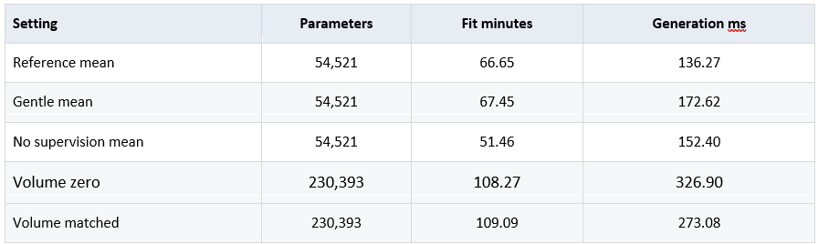

Table 3: Recorded CPU resources averaging over three training seeds with final volume rows use one training seed each.

Early synthetic batch tests of the reference GRU resulted in 4.632 and 6.950 second updates on the CPU and GPU threads respectively, with two underlying warmups and 5 timed updates, hence why the CPU was selected for training. Table 4 below also displays an efficiency comparison between the CPU and GPU.

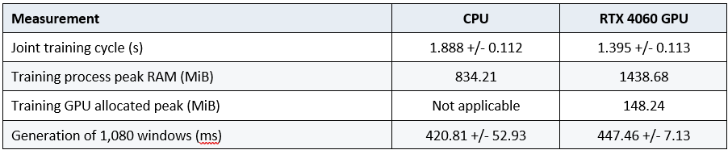

Table 4: Resource profiling for CPU and GPU comparison. Displays mean sample standard deviation among timings and memory usage.

Evidently, GPU joint-training cycles took ~26.1% less time compared to the CPU for the larger final model, with similar generation latency results. The comparisons differ slightly as the earlier benchmarks use different models and CPU thread counts, and data preprocessing is excluded. 

Overall, the use of a single stock, trading day, and training seed for the final comparison limits generalisation. Other limitations include unscored test partitions (being the final hour ~15% of trading) and the short event-time windows limiting volatility clustering analysis to a short-term horizon. Additional days of AMZN data would limit the intra-day temporal trading impact as volume tends to cluster around the opening and closing of the market, helping quantify generalisation across days.

## 9 Conclusion
Ultimately, the historical results favour retaining temporal supervision within the tested settings, while the final matched pair-models with start-volume information improve the SSIM scores. Unfortunately, no model was able to fully meet all criteria jointly. The final model was able to achieve a SSIM score of 0.2829 with no orderbook violations; however, the return fidelity, temporal dependence and output diversity are not sufficient to allow for reliable execution-strategy backtesting. In direct response to the proposed research question, the results back only a partial improvement over the baseline VAR model in terms of simulation reliability. While the reference TimeGAN was able to improve orderbook validity, its performance was worse than the VAR(2) in terms of return similarities, autocorrelation and SSIM results. While the ladder decoder managed to achieve 100% valid orderbooks, it was not enough to establish realistic market dynamics. 

As the current results support further experimentation and research, primary next steps for improvement include modelling sparse volume transitions and temporal dependence, as well as assessing independent training seeds and additional training days.

## Artificial Intelligence Usage Disclosure
OpenAI’s ChatGPT was used in assistance with writing code for the python scripts and Jupyter notebooks. This assisted in the implementation and diagnostics of the research question and helped with recovering saved experiments for the purpose of analysis. It also assisted in debugging and regression tests for checkpoint audits and replays. The implementation was checked using automated tests with checkpoint audits and replay comparisons, with results being crosschecked with the efficiency of ChatGPT.

## References
Yoon, J., Jarrett, D. and van der Schaar, M. (2019). Time-series Generative Adversarial Networks. NeurIPS 32.

LOBSTER. Sample files: AMZN Level 10, 21 June 2012.

Yoon, J. TimeGAN reference implementation, revision 8f6181c.

Wang, Z. et al. (2004). Image Quality Assessment: From Error Visibility to Structural Similarity. IEEE TIP, 13, 600–612.

COMP3710 Project Brief 2026, draft v2.

## Appendix 1: Feasibility review

### 1. User need, scope and acceptance criteria
Quant Researchers that specialise in market microstructure research often find themselves needing to model realistic market data to test trading algorithms. Under controlled conditions, it is extremely useful to have accurate simulations at hand that can do this. The purpose of this project is to investigate whether a TimeGAN model can reproduced Amazon Level-10 orderbook behaviour more accurately than a simple autoregressive basline while maintaing valid market conditions.

The prototype will use the given LOBSTER sample from 21 June 2012 with 32 market updates, meaing that one training example will contain 32 consecutive recorded market events (i.e. a new order, trade, cancellation etc.) Genereated price changes will be reconstructed using supplied beginning prices with results limited by trading day.

The proposed effectiveness criteria include:

1. KL divergence ≤ 0.1 of spreads and price mid-point returns when comparing real and generated distributions.
2. Heatmap depth structural similarity SSIM > 0.6.
3. No observed structural violations in outputs, including: crossed orderbooks, invalid price levels, negative quantities.
4. Improvement in volatility clustering compared to the baseline, which will be measured by a lower error (against the real autocorrelation return with lags 1-10).
5. Peak GPU memory uses ≤ 7 GiB on this computer's RTX 4060 (which has 8GB VRAM). Training time and generation throughput will be recorded to measure efficiency benchmarks.

### 2. Model choice and course concepts
TimeGAN is the selected model according the task sheet. It combines a 'learned embedding with supervised temporal learning and adversarial training' (Yoon, Jarrett, van der Scharr, 2019). The model will be used to investigate the quantified temporal patterns in orderbook data can re-produce structurally valid orderbooks according the pre-defined market conditions. Relevant course concepts include recurrent networks, generative adversarial learning, and representation learning.

An implementation in PyTorch will be compared with a simple first-order vector autoregressive (AR) model/generator per sampled residuals in the data. Data splits will be the same for each model, following 70/15/15% split between training, validation, and testing. To simplify the data mathematically, which is done commonly across quantitative research desks, we will take the logarithm of prices to calculate log returns with scaling fit to the training data.

### 3. Preliminary feasibility evidence
The initial audit verified 269748 aligned message and order-book rows, with 40 orderbook features (10 orderbook levels per bid/ask side). No missing price levels were found as well as no invalid spreads (non-positive) or incorrectly ordered price ladders or invalid quantities. Preprocessing produced 5507, 1081, and 1839 training, validation, and test sequences respectfully. This is resulting of the 70/15/15% day-split. The first 70% of the day is used for training, next 15% for validation, and final 15% for testing. Each complete sequence contains 32 steps by 40 features.

The next initial check was the RTX 4060, which successfully was able to process a batch containing 64 sequences of market data. These results demonstrate working and audited data and GPU compatability.

### 4. Risks, budget and fallback
The main risks with the model include unstable adversarial training, repetitive outputs, structural violations (of orderbook constraints), and unrealistic computing times. Also, the dataset covers 1 trading day of Amazon, limiting conclusions about extending the analysis to other stocks and market conditions that the data wasn't able to capture.

Initial experimenting will be done using the RTX 4060, which will be capped to a memory budget of 7 out of the 8 GiB VRAM available. Next steps will include running small TimeGANS to measure training stability, memory usage, and throughput. If memory requirements are excessive, batch size and hidden-layer width will need to be reduced, and computing on rangpur will be considered if local requirements are not enough.

Finally, for fallback, if the generated sequences are unrealistic, the baselines AR comparison and structural diagnostics will be utilised to identify the limitations of the TimeGAN and assist in making a final recommendation for backtesting in quantitative research.

### References
https://proceedings.neurips.cc/paper_files/paper/2019/file/c9efe5f26cd17ba6216bbe2a7d26d490-Paper.pdf

## Appendix 2: Usage Instructions

## Reproducibility and usage
I used Python 3.12.14, PyTorch 2.8.0+cu128, NumPy 2.2.6, SciPy 1.16.3 and Matplotlib 3.10.7 for this project. Commands can be run from recognition/timegan_spagheddy7 in a Python environment. Ensure the following dependencies are installed:

python -m pip install torch==2.8.0 --index-url https://download.pytorch.org/whl/cu128

python -m pip install -r requirements-notebook.txt

## Viewing results
To view results, open ar_results.ipynb and timegan_results.ipynb to view the currently saved tables and figures with no retraining and runs needed. Further numerical and graphical results along with settings are stored under reports/ar and reports/timegan.

## Optional example generation
Synthetic sequences can be generated using the following code (as long as the locally saved final checkpoint is available):

python predict.py --model timegan `

    --checkpoint outputs/timegan/experiments/volume_recovery_matched_s2026/joint_last.pt `

    --num-sequences 64 --seed 42 --device cpu --threads 1

This saves all of the generated arrays, summaries and previews under outputs/timegan, demonstrating the generating from training contexts. Some raw data and model checkpoints are not included in the git so some inferences require locally available weights, which are saved and viewable in the notebook.

## Verification
Automated verification checks can be run with:

python -m unittest discover -s . -p "test_*.py" -v

The seeds, configurations and source hashes support the reproducibility of results, with validation using generation seeds 42, 43 and 44. 

## Artificial Intelligence Usage Disclosure
OpenAI’s ChatGPT was used in assistance with writing code for the python scripts and Jupyter notebooks. This assisted in the implementation and diagnostics of the research question and helped with recovering saved experiments for the purpose of analysis. It also assisted in debugging and regression tests for checkpoint audits and replays. The implementation was checked using automated tests with checkpoint audits and replay comparisons, with results being crosschecked with the efficiency of ChatGPT.
